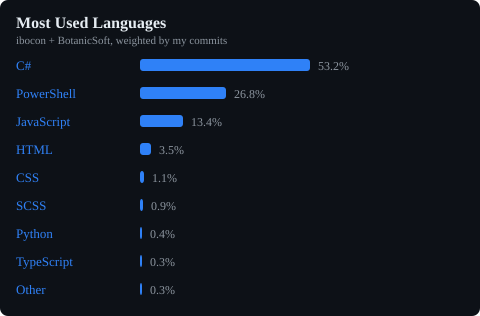

<!-- 1. Header Banner -->

  

<!-- 2. Typing Intro -->

  

 

## 👨‍💻 엔지니어 소개 (About Me)

| 구분 | 주요 내용 및 엔지니어링 지향점 |
| :---: | :--- |
| **🏢 제품 엔지니어링** | 스마트 프린터 디바이스 연동 클라이언트와 클라우드 백엔드 개발 |
| **🧱 아키텍처 철학** | **Clean Architecture**, **CQRS**, **도메인 주도 설계(DDD)** 기반으로 변경에 유연하고 테스트 가능한 시스템 구축 |
| **⚡ 실적 및 생산성** | 최근 1년간 **10,000+ Contributions** 달성 — 매일 지속적인 코드 개선과 TDD 기반 검증 사이클 유지 |
| **✍️ 지식 공유** | 기술적 시행착오와 시스템 아키텍처 설계 고민을 [엔지니어링 노트](https://blog.botanicsoft.com)에 기록하고 공유 |

---

## 🛠 기술 스택 (Tech Stack)

### 언어 (Languages)

### 백엔드 (Backend)

### 데이터 및 메시징 (Data & Messaging)

### 클라이언트 및 디자인 시스템 (Client & Design System)

### 인프라 및 GitOps (Infrastructure & GitOps)

### 클러스터 플랫폼 (Cluster Platform)

### 테스트 (Testing)

### 관측성 (Observability)

### 개발자 경험 및 AI 활용 (DevEx & AI-assisted)

---

## 🚀 주요 엔지니어링 프로젝트 (Key Projects)

| 프로젝트 | 세부 기술서 | 시스템 역할 및 성격 | 핵심 아키텍처 및 기술적 기여 |
| :--- | :---: | :--- | :--- |
| **Monolith** | [상세 기술서](./resume/project-monolith.md) | 사내 서비스·클라이언트 통합 .NET 모노레포 | 하위 시스템 5종 통합, YARP 게이트웨이·마이크로서비스 분리 |
| **Peony** | [상세 기술서](./resume/project-personal-peony.md) | 이벤트 기반 백엔드 및 도메인 모델 고도화 | CQRS 구조 적용, RabbitMQ 비동기 메시징, 도메인 행위 집중화 |
| **Argon** | [상세 기술서](./resume/project-argon.md) | On-Premise K8s 이중 사이트 GitOps | 4대 플랫폼 평면, Rook-Ceph, Keycloak DR, Flux GitOps |
| **nemonic Desktop** | [상세 기술서](./resume/project-nemonic-desktop.md) | Windows 스마트 메모 프린터 클라이언트 | 8년 라이프사이클 관리, GDI 누수 진단 및 .NET 9 현대화 |
| **Lithium** | [상세 기술서](./resume/project-lithium.md) | FINECUBE 컬러 라벨 모바일 앱 | BLE 동기화 경합 해소, targetSdk 34 마이그레이션 |

> 📄 **전체 이력서 원본 (SoT)**: [김예건 마스터 이력서 (resume-yegun-kim.md)](./resume/resume-yegun-kim.md)  
> 🗂️ **41개 저장소별 기술 보고서**: [41개 레포지토리 종합 색인 (resume/README.md)](./resume/README.md)  
> 🌐 **공식 Notion 배포 뷰어**: [Notion 이력서 웹 링크](https://app.notion.com/p/3dd475218675811299b0e3d6b2baa43d)

---

## 📝 최근 엔지니어링 노트 (Recent Notes)
<!-- BLOG-POST-LIST:START -->
- [Peony를 모노레포에서 서비스별 저장소로 나눈 이유](https://blog.botanicsoft.com/peony-monorepo-split-fifteen-services/)
- [Postfix 오픈 릴레이를 막는 4가지 경계](https://blog.botanicsoft.com/kubernetes-alertmanager-postfix-open-relay/)
- [Rich Domain Model로 불변식을 지키는 설계 원칙](https://blog.botanicsoft.com/clean-architecture-rich-domain/)
- [Microsoft .NET 레퍼런스 저장소 한눈에 보기](https://blog.botanicsoft.com/dotnet-reference-projects/)
- [Blazor 개발 환경을 구성하는 방법: Webpack과 TypeScript](https://blog.botanicsoft.com/blazor-webassembly-webpack-typescript-sass-setup/)
<!-- BLOG-POST-LIST:END -->

---

## 📊 깃허브 활동 및 잔디 통계 (Activity & Grass)

  

  <picture>
    <source media="(prefers-color-scheme: dark)" srcset="https://raw.githubusercontent.com/ibocon/ibocon/output/github-contribution-grid-snake-dark.svg">
    <source media="(prefers-color-scheme: light)" srcset="https://raw.githubusercontent.com/ibocon/ibocon/output/github-contribution-grid-snake.svg">
    
  </picture>

---

## 📫 연락처 및 채널 (Contact & Links)

