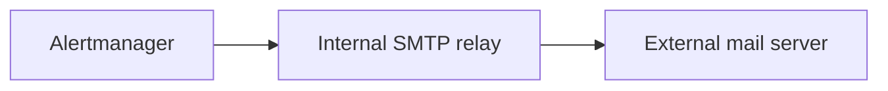
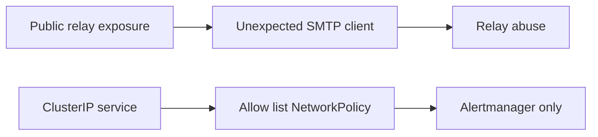

알림은 운영팀이 문제를 가장 먼저 알아차리게 하는 장치다. 하지만 알림을 전달하는 SMTP relay의 신뢰 경계가 흐려지면, 그 relay는 외부의 대량 발송 경로가 될 수 있다. 이 글은 온프레미스 Kubernetes 환경에서 발생한 오픈 릴레이 악용 사례를 익명화해, 차단 순서와 재발 방지 원칙을 정리한다.

## 알림 메일은 왜 갑자기 스팸 발송 경로가 되었나

처음 보이는 신호는 알림 패턴과 맞지 않는 대량의 전달 시도, 수신 측 거부, 그리고 평소와 다른 발송량이었다. 애플리케이션의 경보 내용과 무관한 수신자가 빠르게 늘어나는 경우, 단순한 알림 폭주가 아니라 SMTP relay 자체의 접근 경계를 우선 의심해야 한다.

문제의 핵심은 Postfix 자체가 아니라 노출과 신뢰 설정의 조합이었다. 외부에서 도달 가능한 submission endpoint가 있었고, relay 허용 범위는 내부 통신에 쓰이는 넓은 주소 대역을 신뢰했다. 그 둘이 만나면 외부 요청이 내부에서 온 것처럼 보일 여지가 생긴다.

## 의도한 경로와 실제로 열린 경로

정상적인 구조에서는 Alertmanager만 내부 SMTP relay에 연결하고, relay가 외부 메일 서버로 전달한다. SMTP relay는 모든 클라이언트의 발송 대행자가 아니라, 지정된 내부 워크로드의 제한된 의존성이다.

하지만 Service가 외부에 노출되면 이 전제가 깨진다. 인터넷의 임의 클라이언트가 submission endpoint에 도달할 수 있고, relay 정책이 실제 원격 클라이언트 대신 변환된 내부 출발지 주소를 보게 될 수 있다. 이때 허용 목록은 의도와 달리 외부 요청까지 신뢰하게 된다.

## 신뢰 CIDR과 source NAT가 만든 오해

클러스터 내부 통신을 쉽게 만들기 위해 넓은 사설 대역을 허용하는 설정은 흔하다. 그러나 LoadBalancer나 NodePort를 거쳐 들어온 연결은 source NAT 때문에 원래 접속자의 주소 대신 노드 또는 클러스터 경계의 주소로 보일 수 있다. SMTP relay가 그 주소만 보고 허용 여부를 판단하면, “내부 대역만 허용한다”는 정책은 더 이상 실제 클라이언트를 구분하지 못한다.

따라서 SMTP의 신뢰 경계는 네트워크 주소 하나에만 기대면 안 된다. 외부 노출 여부, Service 유형, Postfix relay restriction, 그리고 workload 단위 접근 제어를 함께 검토해야 한다.

## 사건 중에는 무엇을 먼저 차단해야 하나

사고 대응의 첫 목표는 원인을 완전히 설명하는 것이 아니라 추가 발송을 멈추는 것이다. 이 사례에서는 다음 순서가 효과적이었다.

1. 외부에서 도달 가능한 Service를 내부 전용으로 바꾼다.
2. NetworkPolicy로 Alertmanager만 relay에 연결할 수 있도록 허용 목록을 만든다.
3. 이미 쌓인 비정상 메시지는 격리·정리하고, 정상 알림 경로가 남았는지 확인한다.
4. 선언형 설정에 같은 변경을 반영해 다음 동기화에서 노출이 되돌아오지 않게 한다.

여기서 메일 큐 정리는 별도의 운영 절차다. 실수로 정상 알림을 손실시키지 않도록, 큐를 변경하기 전에 서비스 영향과 복구 경로를 확인해야 한다. 공개된 글에 특정 운영 명령을 그대로 싣는 것보다, 조직의 승인된 런북을 따라 격리와 정리를 수행하는 편이 안전하다.

## 컨테이너 로그만으로 충분하지 않은 이유

컨테이너 로그는 빠른 대응에 유용하지만 회전 주기가 짧으면 사건의 시작점을 보여 주지 못한다. 현재 남은 가장 이른 로그 행은 “그 이후에 악용이 계속되었다”는 하한일 뿐, 최초 발생 시각의 증거가 아니다.

장기 보존되는 중앙 로그 저장소는 이 공백을 줄인다. relay가 남기는 연결·거부·전달 패턴을 검색해 보존 범위 안의 가장 이른 지표를 찾고, 그보다 앞선 구간의 관측 한계를 함께 기록해야 한다. 이렇게 하면 사실과 추정을 분리한 사고 타임라인을 만들 수 있다.

## 재발 방지 체크리스트

- SMTP relay가 외부에 노출되는 Service 유형이나 ingress 경로를 갖고 있지 않은가?
- relay 허용 규칙이 실제 연결 주체를 구별할 수 있는가? source NAT의 영향을 검토했는가?
- Alertmanager 같은 필요한 워크로드만 NetworkPolicy로 relay에 연결할 수 있는가?
- Postfix의 relay restriction이 네트워크 정책과 독립적으로 외부 중계를 거부하는가?
- 컨테이너 로그보다 긴 보존 기간의 중앙 로그와 발송량 이상 탐지가 있는가?
- 서명 키와 관련 DNS 레코드를 사고 대응 및 정기 교체 절차에서 관리하는가?

## 마무리

오픈 릴레이는 한 가지 잘못된 설정보다 여러 경계가 동시에 느슨해질 때 발생한다. 외부 노출을 줄이고, SMTP 정책을 좁히고, 워크로드 단위 네트워크 제어와 장기 관측을 겹치면 한 계층의 실수가 곧바로 대량 발송으로 이어지는 것을 막을 수 있다. 알림 시스템도 외부로 메시지를 보내는 보안 경계라는 사실을 설계와 점검에 반영해야 한다.
