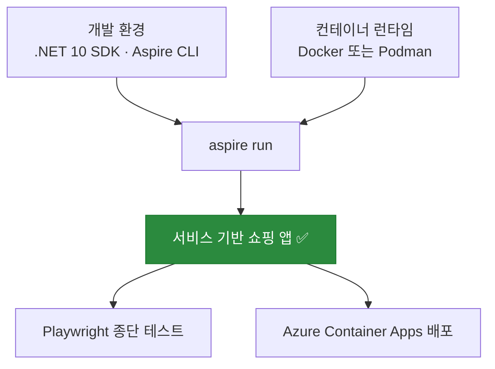
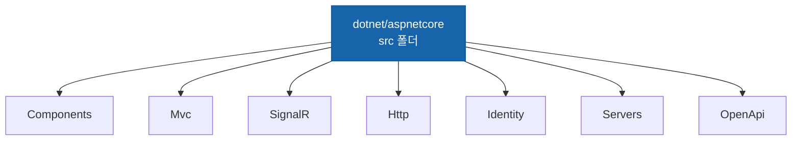
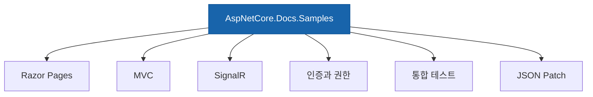
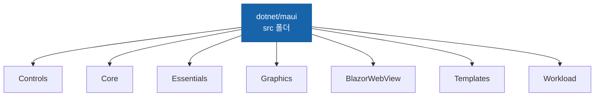
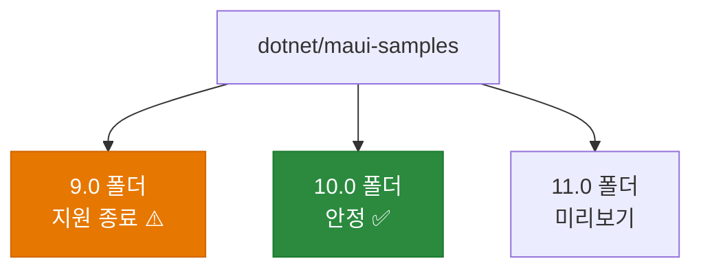
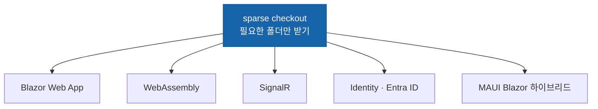
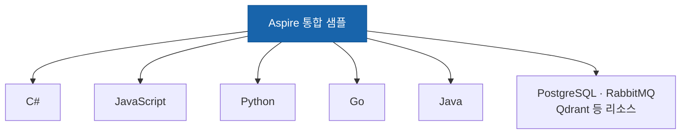
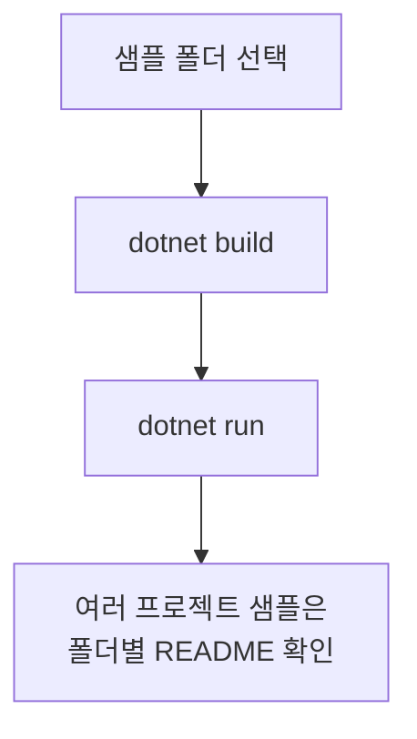

## dotnet/eShop

[dotnet/eShop](https://github.com/dotnet/eShop)은 Aspire로 구성한 서비스 기반 전자상거래 앱이다. Docker 또는 Podman 위에서 돌고, Playwright 종단 테스트와 Azure Container Apps 배포까지 갖췄다. .NET 10 기준이며 .NET 8 버전은 `release/8.0` 브랜치에 있다. 유지 중이고 MIT 라이선스다.

실행하려면 `global.json`에 맞는 .NET 10 SDK, Aspire CLI, 컨테이너 런타임이 필요하고 저장소 루트에서 `aspire run`을 실행한다.

## dotnet/aspnetcore

[dotnet/aspnetcore](https://github.com/dotnet/aspnetcore)는 ASP.NET Core 프레임워크 자체의 소스 저장소다. 샘플 앱이 아니라 구현을 직접 읽는 곳이라, 문서에서 본 기능이 내부에서 어떻게 동작하는지 확인할 때 쓴다. `src` 아래에 Components, Mvc, SignalR, Http, Identity, Servers, OpenApi 같은 영역이 나뉘어 있고 `AspNetCore.slnx`와 `restore.cmd`, `restore.sh`가 루트에 있다. 소스에서 빌드하는 방법은 `docs/BuildFromSource.md`가 안내한다. 공식 문서는 learn.microsoft.com/aspnet/core에 있다. 유지 중이며 MIT다.

샘플은 [dotnet/AspNetCore.Docs.Samples](https://github.com/dotnet/AspNetCore.Docs.Samples)에 있다. ASP.NET Core 문서의 Razor Pages, MVC, SignalR, 인증과 권한, 통합 테스트, JSON Patch 샘플 모음이다. 실행 방법은 페이지에 적혀 있지 않고 개발 컨테이너 폴더가 있다. 코드는 MIT, 문서는 CC-BY-4.0이다.

## dotnet/maui

[dotnet/maui](https://github.com/dotnet/maui)는 C#과 XAML로 Android, iOS, iPadOS, macOS, Windows 앱을 만드는 .NET MAUI 프레임워크의 소스 저장소다. 샘플은 별도 저장소인 `dotnet/maui-samples`로 안내하고, 이 저장소는 컨트롤과 핵심 구현을 읽는 곳이다. `src` 아래에 Controls, Core, Essentials, Graphics, BlazorWebView, Templates, Workload가 나뉘어 있다.

새 앱은 `dotnet new maui -n NewApp`으로 만들고, 템플릿이 없으면 `dotnet workload install maui`를 먼저 실행한다. 소스에서 빌드하려면 `.github/DEVELOPMENT.md`의 안내대로 `dotnet tool restore`를 실행한 뒤 `dotnet build ./Microsoft.Maui.BuildTasks.slnf`로 빌드 작업을 먼저 빌드해야 솔루션을 열 수 있다. 유지 중이며 MIT다.

샘플은 [dotnet/maui-samples](https://github.com/dotnet/maui-samples)에 있다. 버전 폴더로 나뉘며 9.0은 지원이 끝났다고 표시되고 10.0이 안정, 11.0이 미리보기다. C#, XAML과 Microsoft.Extensions.AI를 쓰고 Android, iOS, macOS, Windows를 대상으로 한다. 메인 페이지에는 빌드 명령이 없고 버전 관리는 `10.0/PACKAGE-VERSIONS.md`를 안내한다. MIT다.

## dotnet/blazor-samples

[dotnet/blazor-samples](https://github.com/dotnet/blazor-samples)는 Blazor 공식 문서에 딸린 샘플 모음이다. 저장소가 커서 필요한 폴더만 받는 sparse checkout 명령을 안내한다. 코드는 MIT, 문서는 CC-BY-4.0이다.

## microsoft/aspire-samples

[microsoft/aspire-samples](https://github.com/microsoft/aspire-samples)는 여러 언어로 만든 서비스를 Aspire로 엮는 통합 샘플 모음이다. React, Vue, Angular, FastAPI, Express, PostgreSQL, RabbitMQ, Qdrant 같은 기술이 샘플별로 나온다. 샘플마다 실행 방법이 따로 있고 개발 컨테이너 설정이 제공된다. 유지 중이며 MIT다.

## dotnet/samples

[dotnet/samples](https://github.com/dotnet/samples)는 .NET 문서가 참조하는 코드 샘플 모음이다. 샘플 폴더에서 `dotnet build`, `dotnet run`으로 실행한다. 이슈는 닫혀 있어서 `dotnet/docs`에 올린다. 아래는 Peony, Garden, Orchid와 연관이 깊은 순서로 고른 샘플이다.

| 순서 | 샘플 폴더 | 보여 주는 것 | 연관 프로젝트 | MS Learn |
| --- | --- | --- | --- | --- |
| 1 | `core/workers` | `BackgroundService`와 `IHostedService`로 만드는 백그라운드 서비스. 큐 처리, 스코프 서비스, 타이머, Windows 서비스, 종료 신호 처리 | Peony 서비스, Orchid 동기화 엔진 | [Worker Services](https://learn.microsoft.com/dotnet/core/extensions/workers) |
| 2 | `core/logging` | 콘솔 포맷터 기본형·JSON·systemd, 컴파일 시점 로그 생성기, 워커의 로깅 옵션 | Peony, Garden.Cluster 로그 수집 | [Logging](https://learn.microsoft.com/dotnet/core/extensions/logging), [로그 생성기](https://learn.microsoft.com/dotnet/core/extensions/logger-message-generator) |
| 3 | `core/diagnostics/DiagnosticScenarios` | 교착, CPU 폭증, 메모리 누수, 메모리 급증을 일부러 일으키는 Web API. 진단 도구 연습용 | Garden.Cluster 운영 진단, Peony | [.NET 진단 튜토리얼](https://learn.microsoft.com/dotnet/core/diagnostics/) |
| 4 | `csharp/unit-testing-best-practices` | 단위 테스트 모범 사례 예제 | Garden.Harness 테스트 규약 | [단위 테스트 모범 사례](https://learn.microsoft.com/dotnet/core/testing/unit-testing-best-practices) |
| 5 | `async/async-and-await` | async/await 예제 | Orchid, Peony | [비동기 프로그래밍](https://learn.microsoft.com/dotnet/csharp/asynchronous-programming/) |

