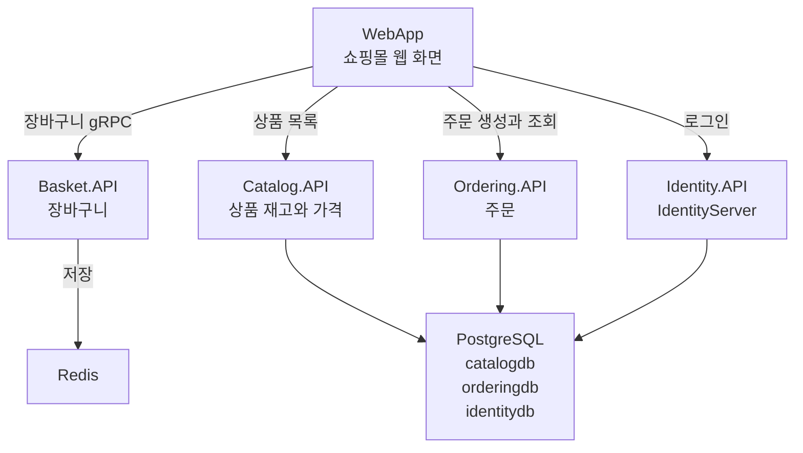
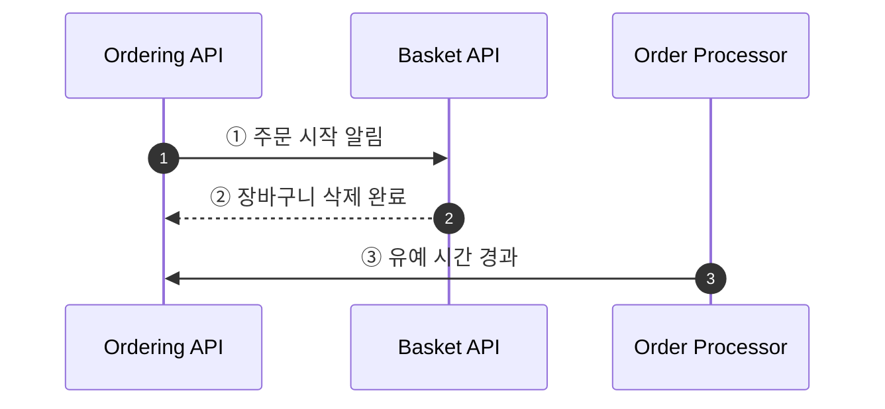
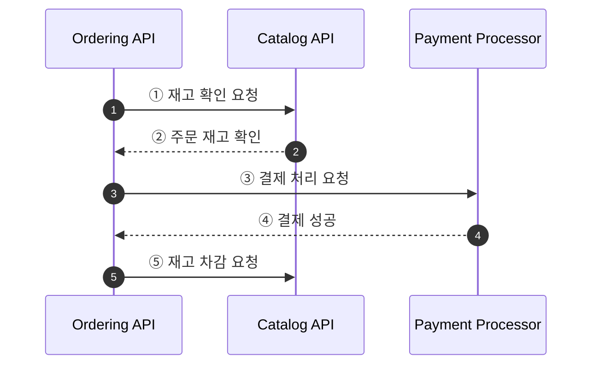
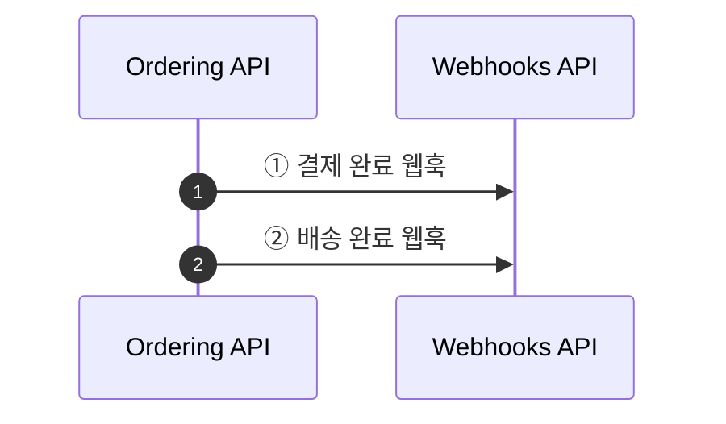
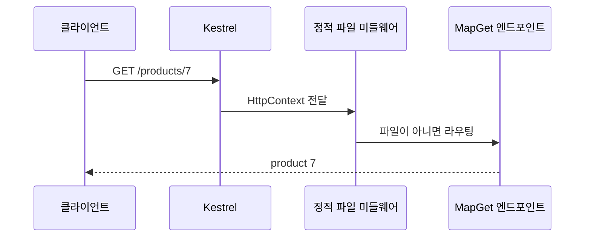
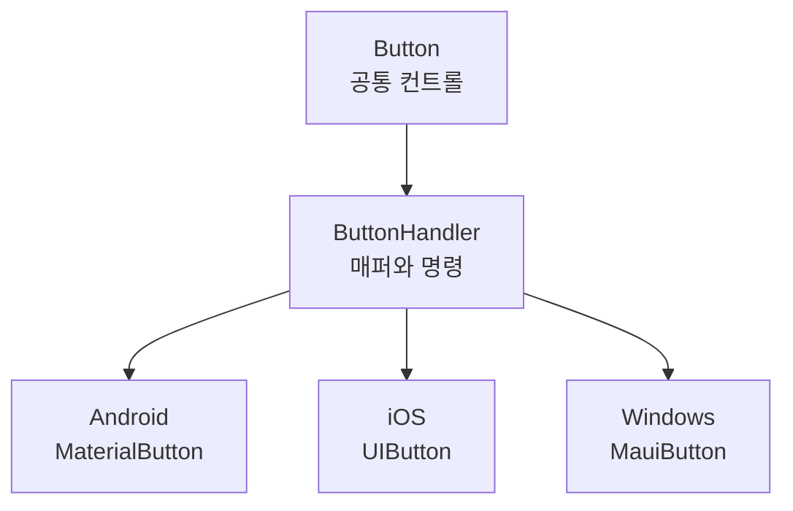
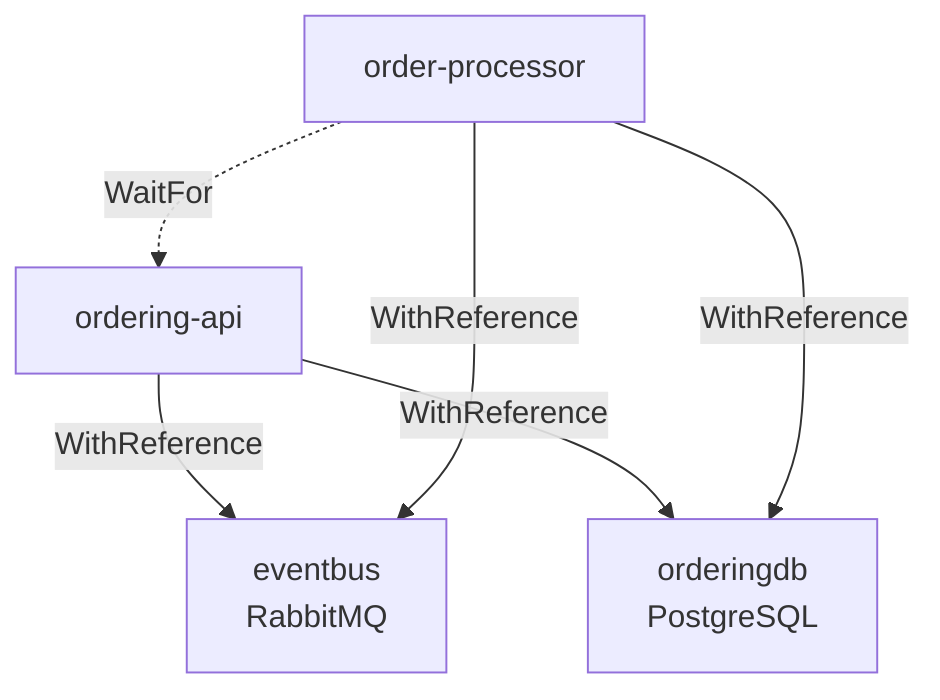
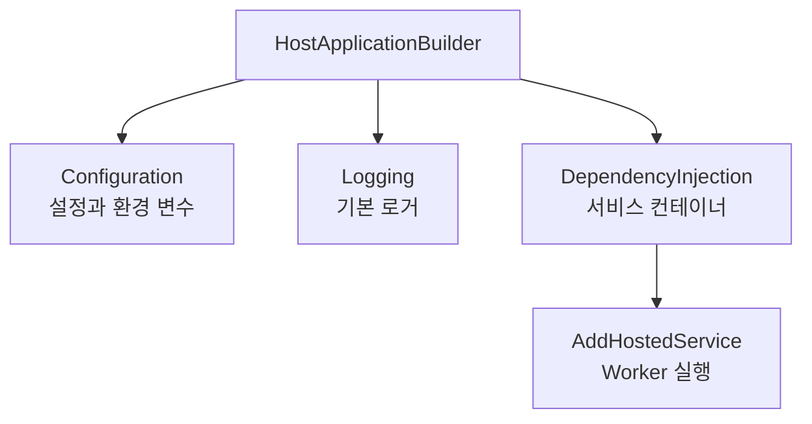

## 핵심 요약

완성된 서비스 조합은 `dotnet/eShop`에서, 프레임워크 내부 동작은 ASP.NET Core·MAUI·runtime에서 찾으면 된다. 각 저장소의 차트는 폴더 이름이 아니라 실제 코드 한 조각이 연결하는 리소스와 실행 경로를 보여 준다. 샘플 저장소는 같은 기능을 작은 프로젝트에서 확인할 때 쓴다.

## 알아야 할 최소 개념

## dotnet/eShop

[dotnet/eShop](https://github.com/dotnet/eShop)의 README는 이 저장소를 다음과 같이 소개한다.

> Aspire[^aspire]를 사용한 서비스 기반 아키텍처로 전자상거래 웹사이트를 구현한 .NET 레퍼런스 애플리케이션.

`src/eShop.AppHost/AppHost.cs`가 서비스와 저장소를 선언한다. `WebApp`은 장바구니, 상품, 주문, 로그인 API를 호출하며 장바구니는 Redis를 쓰고 나머지는 PostgreSQL 데이터베이스를 쓴다.



서비스는 RabbitMQ `eventbus`로 이벤트를 주고받는다. 먼저 주문을 접수한 뒤 장바구니를 비우고, 유예 시간이 끝났다는 신호를 주문 서비스에 전달한다.



다음 단계는 재고와 결제다. 주문 서비스는 재고가 확인된 뒤에만 결제 처리를 요청한다.



마지막으로 주문 상태가 결제 완료와 배송 완료로 바뀔 때 웹훅을 발행한다. 수신 서비스는 이 이벤트를 고객 알림에 사용한다.



재고가 없거나 결제가 실패하면 `Ordering.API`가 각각 재고 부족과 주문 취소 명령을 실행한다. `PaymentProcessor`는 HTTP 엔드포인트와 데이터베이스가 없는 워커다.

모바일 요청은 AppHost의 YARP[^yarp] `mobile-bff`가 카탈로그, 주문, 인증 API로 라우팅한다. 기능 테스트는 Aspire 호스트와 Docker를 쓰고 브라우저 테스트는 Playwright를 쓴다.

## 동작 원리

## dotnet/aspnetcore

[dotnet/aspnetcore](https://github.com/dotnet/aspnetcore)의 저장소 소개는 다음과 같다.

> ASP.NET Core는 Windows, Mac, Linux에서 최신 클라우드 기반 웹 애플리케이션을 만드는 크로스 플랫폼 .NET 프레임워크다.

프레임워크 자체의 소스 저장소다. 샘플 앱이 아니라 구현을 직접 읽는 곳이라, 문서에서 본 기능이 내부에서 어떻게 동작하는지 확인할 때 쓴다. 최소 앱 하나가 요청을 처리하는 경로는 다음처럼 적을 수 있다.

```csharp
var app = WebApplication.CreateBuilder(args).Build();
app.UseStaticFiles();
app.MapGet("/products/{id}", (int id) => $"product {id}");
app.Run();
```

`src/Servers/Kestrel`이 연결을 받고 `src/Http`이 `HttpContext`와 라우팅을 맡는다. `src/Middleware`의 정적 파일 미들웨어가 파일 요청이 아닌 경로를 넘기면 `src/Http/Routing`이 일치한 엔드포인트로 보낸다.



MVC, Blazor, SignalR은 이 엔드포인트 자리에 각자의 처리 모델을 연결한다. 인증은 `src/Security`가, 사용자 관리는 `src/Identity`가, OpenAPI 문서 생성은 `src/OpenApi`가 맡는다. 소스에서 빌드하는 방법은 `docs/BuildFromSource.md`가 안내한다.

샘플은 [dotnet/blazor-samples](https://github.com/dotnet/blazor-samples)와 [dotnet/AspNetCore.Docs.Samples](https://github.com/dotnet/AspNetCore.Docs.Samples)에 나뉜다. 전자는 Blazor를, 후자는 MVC, SignalR, 인증과 통합 테스트를 다룬다.

## dotnet/maui

[dotnet/maui](https://github.com/dotnet/maui)의 README는 이 저장소를 다음과 같이 소개한다.

> .NET Multi-platform App UI(.NET MAUI)는 C#과 XAML로 모바일과 데스크톱 앱을 만드는 크로스 플랫폼 프레임워크다.

Android, iOS, iPadOS, macOS, Windows를 대상으로 하는 프레임워크의 소스 저장소다. 컨트롤은 `src/Controls`에, 핸들러와 플랫폼 코드는 `src/Core/src/Handlers`에 있다. `Button` 하나가 플랫폼마다 무엇이 되는지는 `src/Core/src/Handlers/Button`에서 확인할 수 있다.



`ButtonHandler.Android.cs`, `ButtonHandler.iOS.cs`, `ButtonHandler.Windows.cs`가 같은 핸들러를 플랫폼별 네이티브 버튼에 연결한다. `PropertyMapper`와 `CommandMapper`는 `ButtonHandler.cs`에 있다. `Essentials`, `Graphics`, `BlazorWebView`는 별도 모듈이다.

새 앱은 `dotnet new maui -n NewApp`으로 만들고, 템플릿이 없으면 `dotnet workload install maui`를 먼저 실행한다. [dotnet/maui-samples](https://github.com/dotnet/maui-samples)는 버전별 C#·XAML 예제를 제공한다.

## microsoft/aspire

[microsoft/aspire](https://github.com/microsoft/aspire)의 README는 이 저장소를 다음과 같이 소개한다.

> Aspire는 분산 애플리케이션을 만들고 실행하고 배포하는, 여러 언어를 지원하는 코드 우선 툴체인이다.

Aspire CLI, AppHost SDK, 대시보드, 서비스 디스커버리, 프로젝트 템플릿, 통합 패키지, VS Code 확장이 이 저장소에 있다. README의 예제는 `DistributedApplication.CreateBuilder`로 AppHost를 만들고 `AddRedis`, `AddNodeApp`, `AddViteApp`으로 서비스와 리소스를 선언한 뒤 `WithReference`와 `WaitFor`로 연결한다. 아래는 `dotnet/eShop`의 `AppHost.cs`에서 필요한 선언만 옮긴 사례다.

```csharp
var redis = builder.AddRedis("redis");
var rabbitMq = builder.AddRabbitMQ("eventbus");
var postgres = builder.AddPostgres("postgres");
var orderDb = postgres.AddDatabase("orderingdb");

var orderingApi = builder.AddDotnetProject("ordering-api", "../Ordering.API")
    .WithReference(rabbitMq).WaitFor(rabbitMq)
    .WithReference(orderDb).WaitFor(orderDb);

builder.AddDotnetProject("order-processor", "../OrderProcessor")
    .WithReference(rabbitMq).WaitFor(rabbitMq)
    .WithReference(orderDb)
    .WaitFor(orderingApi);
```

실선은 연결 정보를 받는 `WithReference`이고, 점선은 준비될 때까지 기다리는 `WaitFor`다. `ordering-api`에는 EF 마이그레이션이 있으므로 `order-processor`가 이를 기다린다.



[microsoft/aspire-samples](https://github.com/microsoft/aspire-samples)는 프런트엔드, API, 컨테이너, 데이터베이스를 연결하는 언어별 예제를 제공한다.

## dotnet/runtime

[dotnet/runtime](https://github.com/dotnet/runtime)의 README는 이 저장소를 다음과 같이 소개한다.

> 이 저장소에는 지원하는 모든 플랫폼용 .NET 런타임, 라이브러리, 공유 호스트(`dotnet`) 설치 관리자를 빌드하는 코드와 .NET 런타임과 라이브러리의 소스가 들어 있다.

`src`에는 `coreclr`, `mono`, `libraries` 등이 있다. 워커 서비스, 로깅, 의존성 주입, 설정은 `src/libraries`의 `Microsoft.Extensions.*` 라이브러리에 있다.

```csharp
var builder = Host.CreateApplicationBuilder(args);
builder.Services.AddHostedService<Worker>();
builder.Build().Run();
```

`HostApplicationBuilder`는 설정 파일과 환경 변수, 기본 로거, 서비스 컨테이너를 준비한다. 이어서 `AddHostedService`가 `Worker`를 컨테이너에 넣고 호스트가 실행한다.



`coreclr`과 `mono`는 실행 엔진이고, 위 코드는 `libraries` 쪽 호스팅 API를 쓴다. 빌드는 `docs/workflow/README.md`를 따른다.

## 적용할 때 확인할 점

샘플은 [dotnet/samples](https://github.com/dotnet/samples)에 있다. 아래는 Peony, Garden, Orchid와 연관이 깊은 순서로 고른 샘플이다.

| 샘플 폴더 | 확인할 주제 | 연관 프로젝트 |
| --- | --- | --- |
| `core/workers` | 백그라운드 서비스 | Peony, Orchid |
| `core/logging` | 로그 구성 | Peony, Garden.Cluster |
| `core/diagnostics/DiagnosticScenarios` | 진단 시나리오 | Garden.Cluster, Peony |
| `csharp/unit-testing-best-practices` | 단위 테스트 | Garden.Harness |
| `async/async-and-await` | 비동기 처리 | Orchid, Peony |

## 마무리

서비스 구성을 따라가려면 eShop의 AppHost에서 시작하고, 요청·UI·호스팅 API의 내부 연결은 각 프레임워크 저장소의 실제 구현에서 확인한다. 코드를 새로 쓰기 전에는 대응하는 샘플을 실행해 기대한 연결과 다르면 원 저장소의 구현으로 돌아가면 된다.

[^aspire]: 분산 앱의 서비스와 의존 리소스를 코드로 묶어 로컬에서 함께 실행하게 해 주는 .NET 스택이다.
[^yarp]: Microsoft가 만든 .NET 리버스 프록시 라이브러리다.
