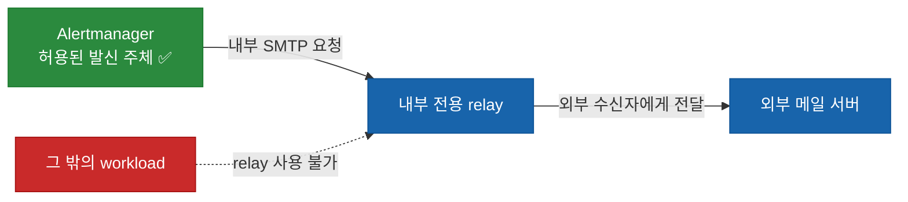
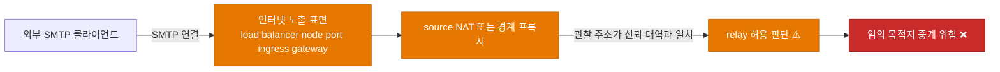

## 핵심 요약: 어떤 위험을 막고 무엇을 확인하나

알림용 메일 전달 중계 서버 SMTP relay가 외부의 대량 발송 경로가 되면, 알림 누락뿐 아니라 발신 평판 저하와 수신 측 거부가 함께 일어날 수 있다. 이 글은 외부 노출, 실제 연결 주체 판별, Postfix relay 정책, workload 접근 제어를 어떤 순서로 확인할지 일반화한 사고 사례다.

독자는 읽은 뒤 자신의 relay가 인터넷에서 도달 가능한지와 누가 연결할 수 있어야 하는지를 구분해 점검할 수 있다. 실제 Postfix 설정값, 메일 큐 조작 명령, 내부 로그와 식별자는 다루지 않는다.

## 영향: 알림 relay가 대량 발송 경로가 되면 무엇이 달라지나

이 사례에서 먼저 보인 신호는 알림 패턴과 맞지 않는 대량 전달 시도, 수신 측 거부, 그리고 평소와 다른 발송량이었다. 애플리케이션 경보 내용과 무관한 수신자가 빠르게 늘어나면 단순한 알림 폭주가 아니라 SMTP relay의 접근 경계를 먼저 확인해야 한다.

영향은 전송량 증가에 그치지 않는다. 정상 알림이 지연되거나 거부될 수 있고, relay를 사용하는 조직의 발신 평판도 영향을 받을 수 있다. 점검할 때는 어느 알림이 실제로 손실됐는지와 현재도 외부 요청이 relay에 도달하는지를 별도로 확인한다.

## 즉시 차단: 정상 알림을 보존하며 추가 발송을 멈추는 순서

사고 대응의 첫 목표는 원인을 완전히 설명하는 것이 아니라 추가 발송을 멈추면서 정상 알림 경로를 보존하는 것이다. 이 사례에서는 다음 순서가 효과적이었다.

1. Kubernetes에서 네트워크 진입점을 제공하는 Service를 외부에서 도달할 수 없도록 내부 전용으로 바꾼다.
2. Pod 간 통신 허용 규칙 NetworkPolicy로 필요한 Alertmanager workload만 relay에 연결할 수 있게 한다.
3. 비정상 메시지는 조직의 승인된 런북에 따라 격리·정리하고, 정상 알림 경로가 남았는지 확인한다.
4. 선언형 설정에 같은 변경을 반영해 다음 동기화에서 노출이 되돌아오지 않게 한다.

메일 큐 정리는 별도의 운영 절차다. 정상 알림을 잃지 않도록 큐를 변경하기 전 서비스 영향과 복구 경로를 확인해야 한다. 공개 글에는 특정 삭제 명령을 싣는 대신, 승인된 런북으로 격리와 정리를 수행해야 한다는 판단 기준만 남긴다.

## 원인: 외부 노출과 신뢰 경계가 겹친 방식

### 최소 용어

Alertmanager는 경보를 받아 여러 알림 채널로 전달하는 구성 요소다. SMTP relay는 메일을 대신 전달하는 중계 서버다. source NAT는 경계를 지나는 연결에서 원래 접속자 주소가 노드나 다른 경계 구성 요소의 주소로 바뀌어 보일 수 있는 처리다.

Kubernetes Service는 Pod 집합을 네트워크에서 사용할 수 있게 만드는 추상화이며, 어떤 접근 경로를 만들지는 Service와 주변 네트워크 구성이 함께 결정한다. [Kubernetes Service 문서](https://kubernetes.io/docs/concepts/services-networking/service/)는 Service가 Pod 집합을 네트워크에 노출하는 방식을 설명한다.

### 의도한 경로와 실제로 열린 경로

정상적인 구조에서는 Alertmanager만 내부 SMTP relay에 연결하고, relay가 외부 메일 서버로 전달한다. relay는 모든 클라이언트의 발송 대행자가 아니라 지정된 내부 workload의 제한된 의존성이다.

그림 1은 허용된 발신 주체와 relay의 역할을 구분한다. 외부 메일 서버로의 송신은 정상 경로이며, relay에 SMTP 요청을 보낼 수 있는 주체는 Alertmanager 하나여야 한다.

이 그림의 확인점은 두 가지다. Alertmanager 외 workload의 연결 근거가 문서화되어 있는지, relay가 인터넷에서 SMTP 요청을 받는 진입점이 없는지 확인한다.

문제의 핵심은 Postfix 자체가 아니라 노출과 신뢰 설정의 조합이었다. 외부에서 도달 가능한 submission endpoint가 있고 relay 허용 범위가 내부 통신에 쓰이는 넓은 주소 대역을 신뢰하면, 외부 요청이 내부에서 온 것처럼 보일 여지가 생긴다.

그림 2는 하나의 Service 유형이 아니라 여러 조건이 겹칠 때만 성립하는 위험 경로를 보여 준다.

따라서 점검은 왼쪽에서 오른쪽 순서로 한다. 인터넷 노출 표면이 있는지, 경계에서 원래 접속자 주소가 바뀌는지, relay 허용 규칙이 그 관찰 주소를 신뢰하는지, 그 조합이 임의 목적지로의 중계를 허용하는지를 각각 확인한다.

### source NAT가 주소 기반 허용을 흐리는 조건

클러스터 내부 통신을 쉽게 만들기 위해 넓은 사설 대역을 허용하는 설정은 흔하다. 그러나 외부 연결이 경계를 지날 때 source NAT가 적용되면 relay가 원래 접속자 대신 노드나 클러스터 경계의 주소를 볼 수 있다. 이 조건에서는 "내부 대역만 허용한다"는 주소 규칙이 실제 클라이언트를 충분히 구분하지 못할 수 있다.

따라서 SMTP 신뢰 경계는 네트워크 주소 하나에만 기대면 안 된다. 외부 노출 여부, Service 접근 경로, Postfix relay restriction, workload 단위 접근 제어를 함께 검토해야 한다. [Postfix relay access control 문서](https://www.postfix.org/SMTPD_ACCESS_README.html)는 trusted network와 인증된 client, 허용된 relay destination을 구분하는 기본 relay 정책을 설명한다.

## 재발 방지: 네 가지 경계를 함께 점검하는 방법

한 계층의 설정이 느슨해져도 곧바로 대량 발송으로 이어지지 않게 네 가지 경계를 겹친다.

| 경계 | 확인 대상 | 막으려는 실패 | 적용하지 못할 때의 대체 감시 |
| --- | --- | --- | --- |
| 외부 노출 | Service, load balancer, node port, ingress와 gateway 경로 | 인터넷에서 relay에 직접 도달 | 외부 포트 노출 변경과 연결 급증을 경보로 감시 |
| workload 연결 | Alertmanager와 relay의 label 기반 NetworkPolicy | 불필요한 내부 workload의 relay 사용 | 허용된 client 목록과 connection log를 정기 비교 |
| relay 정책 | Postfix relay restriction과 허용 범위 | 네트워크 정책 실패 시 임의 목적지 중계 | 거부와 허용 비율, 수신 도메인 분포를 감시 |
| 장기 관측 | 중앙 로그 보존과 발송량 이상 탐지 | 짧은 컨테이너 로그만으로 사건 범위를 오판 | 보존 범위의 가장 이른 관찰값과 관측 한계를 함께 기록 |

[Kubernetes NetworkPolicy 문서](https://kubernetes.io/docs/concepts/services-networking/network-policies/)는 Pod에 적용되는 트래픽 허용 규칙과 이를 지원하는 네트워크 플러그인이 필요하다는 조건을 설명한다. 따라서 NetworkPolicy를 방어층으로 쓸 때는 선언만 확인하지 말고, 사용 중인 플러그인이 이를 실제로 시행하는지도 검증해야 한다.

컨테이너 로그는 빠른 대응에 유용하지만 회전 주기가 짧으면 사건의 시작점을 보여 주지 못한다. 현재 남은 가장 이른 로그 행은 "그 이후에 악용이 계속되었다"는 하한일 뿐, 최초 발생 시각의 증거는 아니다. 중앙 로그 저장소는 이 공백을 줄이지만, 보존 범위 앞의 시간은 관측하지 못했다는 한계를 함께 기록해야 한다.

다음 체크리스트로 같은 경계를 정기 점검할 수 있다.

- SMTP relay가 외부에 노출되는 Service 유형이나 ingress 경로를 갖고 있지 않은가?
- relay 허용 규칙이 실제 연결 주체를 구별할 수 있는가? source NAT의 영향을 검토했는가?
- Alertmanager처럼 필요한 workload만 NetworkPolicy로 relay에 연결할 수 있는가?
- Postfix relay restriction이 네트워크 정책과 독립적으로 외부 중계를 거부하는가?
- 컨테이너 로그보다 긴 보존 기간의 중앙 로그와 발송량 이상 탐지가 있는가?
- 서명 키와 관련 DNS 레코드를 사고 대응 및 정기 교체 절차에서 관리하는가?

## 마무리: 다음 점검에서 확인할 한 가지

오픈 릴레이는 한 가지 잘못된 설정보다 여러 경계가 동시에 느슨해질 때 발생한다. 외부 노출을 줄이고, SMTP 정책을 좁히고, workload 단위 네트워크 제어와 장기 관측을 겹치면 한 계층의 실수가 곧바로 대량 발송으로 이어지는 일을 줄일 수 있다.

다음 점검에서는 relay가 외부에서 도달 가능한지부터 확인하고, 그 다음에 실제 연결 주체와 Postfix 정책이 같은 신뢰 경계를 표현하는지 비교한다. 알림 시스템도 외부로 메시지를 보내는 보안 경계라는 사실을 설계와 운영 점검에 반영해야 한다.
