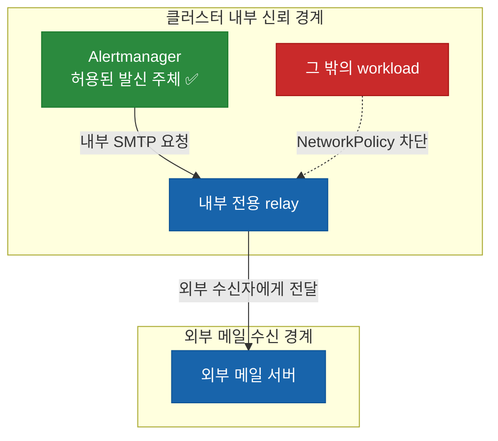
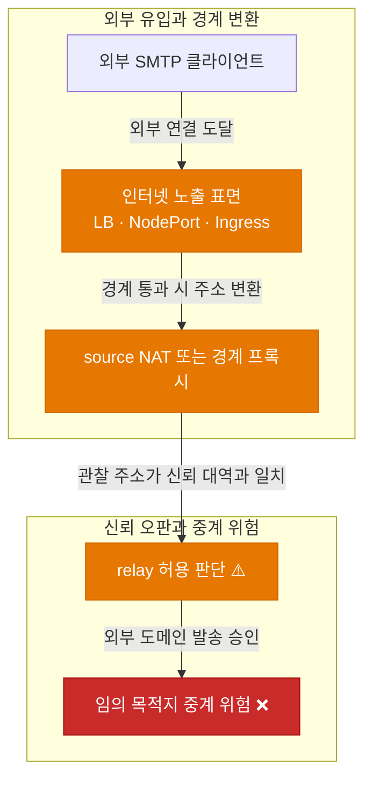

## 핵심 요약

관리자 메일함에 DMARC 집계 보고서[^dmarc]가 한꺼번에 쌓였고, 외부 메일 서버들은 우리 발신 IP를 스팸 발신자로 거부하고 있었다. 처음에는 해킹당했다고 생각했지만, 원인은 침입이 아니라 알림용 메일 서버(SMTP relay)가 외부에 열려 스팸 발송에 이용당한 것이었다. 이 글은 그때 막은 순서와, 다시 열리지 않게 겹친 네 가지 경계를 기록한다.

## 영향

10월 27일, 관리자 메일함에 DMARC 집계 보고서가 한꺼번에 도착했다. 알림 메일은 이런 보고서를 만들지 않는다. 열어 보니 보고서마다 같은 발신 IP가 찍혀 있었고, 외부 메일 서버들이 그 IP를 스팸 발신자 블랙리스트(RBL)에 올려 거부하기 시작한 상태였다. 아래는 수신 서버 한 곳의 보고서에서 필요한 줄만 옮긴 것이다.

```xml
<date_range><begin>1792972804</begin><end>1793059883</end></date_range>
<source_ip>203.0.113.10</source_ip>
<count>1</count>
<policy_evaluated><disposition>none</disposition><dkim>pass</dkim><spf>pass</spf></policy_evaluated>
```

처음에는 해킹당했다고 생각했다. 그런데 Postfix 로그에는 침입 흔적이 아니라, 무작위 외부 수신자와 임의의 우리 도메인 발신자 주소로 가는 메일 제출이 고속으로 반복되고 있었다. relay는 이를 받아 DKIM 서명[^dkim]까지 붙였다. relay Service가 LoadBalancer와 NodePort로 외부에 열려 있다는 것을 확인하고서야 침입이 아니라 오픈 릴레이 악용으로 판단을 바꿨다. 같은 보고서의 인증 결과도 이 판단과 맞았다.

```xml
<policy_published><domain>botanicsoft.com</domain><p>none</p></policy_published>
<dkim><domain>botanicsoft.com</domain><selector>mail</selector><result>pass</result></dkim>
<spf><domain>botanicsoft.com</domain><result>pass</result></spf>
```

SPF와 DKIM이 모두 우리 도메인으로 통과했으므로 외부에서 도메인을 사칭한 메일이 아니라 우리 서버가 서명해 내보낸 메일이다. 정책이 `p=none`, 즉 관찰만 하는 설정이어서 DMARC로는 걸러지지 않았다.

막힌 곳은 시작 시점이었다. 컨테이너 로그에는 그날 오전 기록뿐이었고, 중앙 로그 저장소(Loki)에서 처음 확인한 그날 새벽 3시대를 시작으로 적었다. 다음 날 보존 구간 전체를 다시 집계하니 틀린 판정이었다. 외부에서 성공한 첫 릴레이는 10월 20일, 대량 발송 시작은 10월 25일이었다. 첫 성공 뒤 일주일 동안 알아채지 못한 것이다.

피해는 전송량 증가에 그치지 않았다. 차단 직전 메일 큐에는 스팸 1만 4천여 건이 쌓여 있었다. 발신 IP가 여러 RBL에 올라 정상 알림 메일까지 거부당했고, 목록이 풀릴 때까지 경보는 Alertmanager[^am] 화면에서 직접 확인해야 했다. 스팸에 우리 서명이 붙어 서명 키 교체도 계획해야 했다. 11월 13일 구글의 보고서에는 정책이 `reject`로, 서명 selector가 `mail2610`으로 바뀐 것이 보인다.

```xml
<policy_published><domain>botanicsoft.com</domain><p>reject</p></policy_published>
<dkim><domain>botanicsoft.com</domain><selector>mail2610</selector><result>pass</result></dkim>
```

점검할 때는 어느 알림이 실제로 손실됐는지와 현재도 외부 요청이 relay에 도달하는지를 별도로 확인한다.

## 즉시 차단

첫 목표는 원인 설명이 아니라 추가 발송을 멈추면서 정상 알림 경로를 보존하는 것이었다. 그날 실제로 한 순서는 다음과 같다.

| 조치 | 그날의 결과 |
| --- | --- |
| 1. Kubernetes Service[^service]를 내부 전용으로 바꿔 외부 경로를 닫는다 | 외부 노출은 사라졌지만, 공인 주소로 접속하던 Alertmanager의 알림 메일이 전부 실패 |
| 2. NetworkPolicy[^netpol]로 Alertmanager만 relay에 연결하게 한다 | Flannel이 NetworkPolicy를 시행하지 않아 접근을 막지 못함 |
| 3. 비정상 메시지를 승인된 런북에 따라 격리·정리하고 정상 알림 경로를 확인한다 | 큐가 비어 있는 것을 재확인 |
| 4. 같은 변경을 선언형 설정에 반영한다 | GitOps에 게시 |

1번과 2번의 틈은 다음 날 재조사에서 알았다. 그래서 relay 허용 범위를 로컬로 줄이고 SMTP 인증을 켰으며, Alertmanager는 클러스터 내부 주소에 TLS와 인증으로 접속하게 바꿨다. 무인증 요청, TLS 없는 인증, 틀린 비밀번호는 모두 거부되고 인증된 client만 통과하는 것을 임시 Pod로 확인했다. 큐 정리는 별도의 운영 절차라 다루지 않는다.

## 원인

### 의도한 경로와 실제로 열린 경로

정상 구조에서는 Alertmanager만 내부 relay에 연결하고, relay가 외부 메일 서버로 전달한다. 그림 1에서 relay에 요청을 보낼 수 있는 주체는 Alertmanager 하나여야 한다.



확인점은 두 가지다. Alertmanager 외 workload의 연결 근거가 문서화되어 있는지, relay가 인터넷에서 SMTP 요청을 받는 진입점이 없는지 확인한다.

문제의 핵심은 Postfix 자체가 아니라 노출과 신뢰 설정의 조합이었다. 외부에서 닿는 submission endpoint가 있고 relay 허용 범위가 내부 통신용 넓은 주소 대역을 신뢰하면, 외부 요청이 내부에서 온 것처럼 보인다. 그림 2는 여러 조건이 겹칠 때만 성립하는 이 경로다.



따라서 점검은 위에서 아래 순서로 한다. 인터넷 노출 표면이 있는지, 경계에서 원래 접속자 주소가 바뀌는지, relay 허용 규칙이 그 관찰 주소를 신뢰하는지, 그 조합이 임의 목적지로의 중계를 허용하는지를 각각 확인한다.

### source NAT가 주소 기반 허용을 흐리는 조건

넓은 사설 대역을 허용하는 설정은 흔하다. 그러나 외부 연결이 경계를 지날 때 source NAT[^nat]가 적용되면 relay는 원래 접속자 대신 노드나 경계의 주소를 본다. 그러면 "내부 대역만 허용한다"는 규칙이 실제 클라이언트를 구분하지 못한다. 그래서 신뢰 경계는 주소 하나에 기대지 말고 노출 여부, Service 접근 경로, workload 단위 접근 제어를 함께 봐야 한다. [Postfix relay access control 문서](https://www.postfix.org/SMTPD_ACCESS_README.html)는 trusted network, 인증된 client, 허용된 relay destination을 구분하는 기본 정책을 설명한다.

## 재발 방지

한 계층이 느슨해져도 곧바로 대량 발송으로 이어지지 않게 네 가지 경계를 겹친다.

| 경계 | 확인 대상 | 막으려는 실패 |
| --- | --- | --- |
| 외부 노출 | Service, load balancer, node port, ingress 경로 | 인터넷에서 relay에 직접 도달 |
| workload 연결 | Alertmanager와 relay의 NetworkPolicy | 불필요한 내부 workload의 relay 사용 |
| relay 정책 | Postfix relay restriction | 네트워크 정책 실패 시 임의 목적지 중계 |
| 장기 관측 | 중앙 로그 보존과 발송량 이상 탐지 | 짧은 로그만으로 사건 범위를 오판 |

[Kubernetes NetworkPolicy 문서](https://kubernetes.io/docs/concepts/services-networking/network-policies/)는 NetworkPolicy를 시행하는 네트워크 플러그인이 필요하다고 설명한다. Flannel처럼 시행하지 않는 환경에서는 선언만으로 방어층이 되지 않으므로 시행 여부를 검증해야 한다.

로그도 같은 한계가 있었다. 컨테이너 로그는 시작점을 보여 주지 못했고, 이 글을 쓰려고 다시 조회했을 때는 Loki 보존 기간이 지나 10월 로그 원문이 남아 있지 않았다. 그래서 외부 수신 서버가 보낸 DMARC 보고서를 근거로 삼았다. 보존 범위 앞의 시간은 관측하지 못했다는 한계를 함께 기록해야 한다.

- relay가 외부에 노출되는 Service나 ingress 경로를 갖고 있지 않은가?
- relay 허용 규칙이 실제 연결 주체를 구별하는가? (source NAT 포함)
- 필요한 workload만 NetworkPolicy로 relay에 연결되고, 플러그인이 이를 시행하는가?
- Postfix relay restriction이 네트워크 정책과 독립적으로 외부 중계를 거부하는가?
- 컨테이너 로그보다 길게 보존되는 중앙 로그와 발송량 이상 탐지가 있는가?
- 악용 기간에 relay를 통과한 메일의 서명 키와 DNS 레코드를 교체해야 하는지 확인했는가?

## 마무리

오픈 릴레이는 한 가지 잘못된 설정보다 여러 경계가 동시에 느슨해질 때 발생한다. 외부 노출을 줄이고, SMTP 정책을 좁히고, workload 단위 네트워크 제어와 장기 관측을 겹치면 한 계층의 실수가 곧바로 대량 발송으로 이어지는 일을 줄일 수 있다.

다음 점검에서는 relay가 외부에서 도달 가능한지부터 보고, 그다음에 실제 연결 주체와 Postfix 정책이 같은 신뢰 경계를 말하는지 비교한다. 알림 시스템도 외부로 메시지를 보내는 경계라는 점을 기억해 둔다.

[^dmarc]: 우리 도메인 이름으로 온 메일을 받은 서버들이 처리 결과를 요약해 보내 주는 자동 메일이다.
[^dkim]: 메일이 우리 도메인에서 나갔다는 것을 증명하는 전자 서명이다.
[^am]: 경보를 받아 메일 같은 알림 채널로 전달하는 구성 요소다.
[^service]: Pod 집합을 네트워크에서 쓸 수 있게 만드는 Kubernetes 구성 요소다.
[^netpol]: Pod 사이에서 어떤 통신을 허용할지 정하는 Kubernetes 규칙이다.
[^nat]: 경계를 지나는 연결의 원래 접속자 주소를 노드나 경계 장비의 주소로 바꾸는 처리다.
