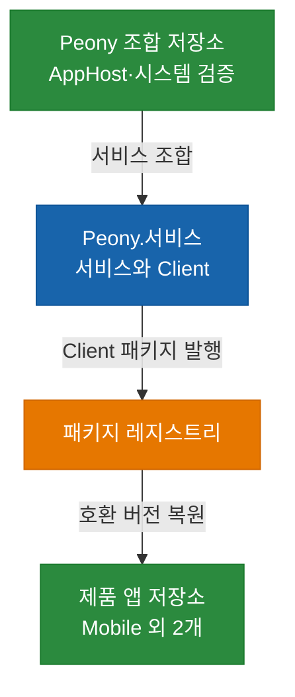

## 핵심 요약: 모노레포는 무엇을 주었고 무엇 때문에 나눴나

Peony는 서비스 13개, 제품 앱 3개(Mobile, Management, Frontdoor), 로컬 통합 실행용 AppHost를 한 저장소(모노레포)에 두고 있었다. 이를 서비스별 저장소로 나눴다.

처음 한 저장소를 택한 이유는 서비스 경계가 아직 정해지지 않았고, 소규모라 저장소마다 운영 설정을 두는 부담을 피하고 싶었고, 통합 실행과 검증을 단순하게 하고 싶어서였다. 나눈 근거는 세 가지다. 작업 범위가 서비스 하나로 닫히지 않았고, 서비스 변경과 소비자의 경계가 흐려졌고, 서비스가 자기 계약과 릴리스의 책임을 지지 못했다. 이 글은 두 쪽의 근거, 검토한 대안, 감수한 비용을 정리한다. 코드 변경은 다음 글에서 다룬다.

## 문제: 한 저장소를 택한 이유와 한계가 된 것

한 저장소를 택한 이유는 세 가지였다.

1. **서비스 경계가 정해지지 않았다**: 서비스를 나누고 합치는 일이 잦은 시기라, 경계를 옮길 때 한 솔루션 안에서 옮기는 편이 쌌다.
2. **소규모 운영 부담을 피하려 했다**: 저장소, CI, 배포 설정을 서비스마다 두면 관리할 곳이 늘어난다.
3. **통합 실행과 검증을 단순하게 하려 했다**: AppHost(로컬에서 서비스를 한꺼번에 띄우는 프로젝트)가 서비스 프로젝트를 직접 참조해, 저장소 하나로 통합 실행이 됐다.

그 구조가 시간이 지나며 한계가 됐다.

1. **작업 범위**: 서비스, 제품 앱, AppHost가 한 저장소에 있어 Codex Worktree(AI 작업용 작업 사본)가 작업 범위를 넘는 파일까지 체크아웃한다.
2. **변경과 소비자의 경계**: 서비스별 Client와 공용 Contract(타입 465개)가 한 저장소에 있어 서비스 변경과 소비자 작업의 경계가 흐려진다.
3. **릴리스 책임**: 서비스의 공개 계약과 Client 패키지는 그 서비스의 배포·버전 책임이어야 한다. 내 해석으로는 모노레포에서 이 책임이 저장소 전체에 걸려 있었다.

## 선택지: 무엇을 어떻게 나눌 것인가

대안은 두 질문으로 나눠 비교했다.

| 질문 | 검토한 대안 |
| --- | --- |
| 서비스와 계약을 어떻게 나누나 | 모든 Client를 공용 Contract 저장소에 모으기 / Git submodule로 소스 연결 / 서비스와 Client를 함께 분리 |
| 통합 실행은 어디서 하나 | AppHost를 서비스마다 복제 / 별도 Integration 저장소 / 기존 Peony를 조합 저장소로 축소 |

모든 Client를 공용 저장소에 모으는 안은 계약을 서비스 소유로 점진 분해한다는 목표와 방향이 반대다. Git submodule은 저장소 간 의존 수단으로 쓰지 않기로 했다.

## 결정: 서비스가 Client까지 소유하고, Peony는 조합만 맡는다

결정은 둘이다. 각 `Peony.{Service}`가 서비스(`src`)와 Client(`Client/src`)를 함께 소유하고 Client 패키지를 발행한다. 기존 Peony는 AppHost와 시스템 검증을 맡는 조합 저장소로 줄이고, 별도 Integration 저장소는 만들지 않는다. 아래 그림은 이 구조에서 의존이 흐르는 방향이다.



그림의 확인점은 서비스끼리 소스나 Git submodule로 이어지지 않고, 레지스트리를 거치는 패키지만 오간다는 것이다. 이관 순서도 이 방향을 따랐다. 의존이 없는 FeatureFlag, Counterparty, Product, User를 먼저 옮기고, 이들을 소비하는 앱 저장소를 뒤에, 조합 저장소를 마지막에 옮겼다. 이관 뒤 각 저장소에서 테스트가 통과했다. 예를 들어 Ledger는 815건, Management는 983건이다.

## 트레이드오프: 감수한 비용과 실제로 나온 비용

미리 알고 감수한 비용은 패키지 버전 관리와 호환성 검증이다. 호환성 검증이 실패하면 소비자 업데이트를 막고 이전 호환 패키지를 유지하기로 했다.

- **사실**: 이관 직후 계약은 여전히 하나의 `Peony.Contract` 0.1.0 패키지에 서비스 대부분의 계약을 담았고, 9개 Client가 직접 의존했다. 한 서비스의 계약 변경이 패키지 전체 재발행과 9개 Client 버전 조율을 낳는 구조였다.
- **사실**: Ledger 이전 중 두 Client가 같은 타입을 각자 가져 컴파일 오류(CS0433, 같은 타입이 두 어셈블리에 있을 때 나는 오류)가 났다.
- **해석**: 저장소를 나눈 것만으로는 계약 소유권이 풀리지 않았다. 계약을 서비스 소유로 분해하는 작업이 이관의 일부로 당겨졌다.

```diff
 <!-- Directory.Packages.props (Product) -->
+    <PackageVersion Include="Peony.Contract" Version="0.1.0" />
```

이 한 줄이 비용이 눈에 보이는 지점이다. 소스로 공유하던 계약이 버전 있는 패키지가 됐고, 버전을 올리는 일이 소비자마다 따로 생겼다. 그다음 계약을 서비스 쪽으로 옮겨 해소한 과정은 다음 글에서 다룬다.

## 마무리: 나누기 전에 확인할 세 가지

저장소를 나눌지 판단하는 기준으로 이 사례에서 남는 것은 세 가지다. 작업 범위가 서비스 하나로 닫히는지, 변경을 소유한 쪽과 소비하는 쪽의 경계가 코드 위치와 같은지, 릴리스 단위가 서비스 경계와 일치하는지다. 이 셋이 어긋날 때 모노레포의 이점(경계 변경 비용, 운영의 단순함, 통합 실행)을 패키지 버전 관리라는 비용과 바꿀 수 있다. 내 해석으로는 서비스 경계가 굳은 뒤에 앞의 이점이 줄고 한계가 커졌다. 다음 글에서는 계약 타입이 소스에서 패키지로, 다시 서비스 소유의 소스로 돌아온 과정을 diff로 따라간다.
