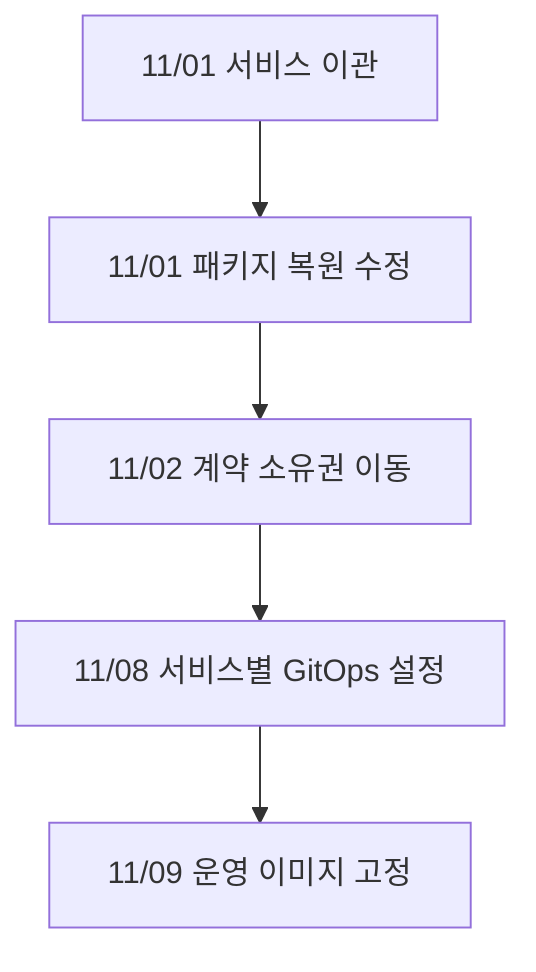

## 핵심 요약: 하루 만에 옮긴 것과 옮기지 못한 것은 무엇인가

2026년 11월 1일, Peony 모노레포(여러 서비스를 한 저장소에 두는 구조)의 서비스 15개를 각각 독립 저장소로 옮겼다. 첫 이관 커밋은 11시 52분, 마지막 서비스는 18시 36분이다. 이 글은 커밋 기록을 근거로 이관 순서, 같은 날 막힌 지점, 이틀째에 남은 문제를 적는다.

이 글은 시리즈의 첫 글이다. 계약 타입 소유권을 바꾼 과정과 사내 NuGet 피드 문제는 각각 다음 글에서 따로 다룬다. 이관을 결정한 이유는 커밋에 남아 있지 않아 쓰지 않는다.

## 문제: 서비스만 옮기면 빌드가 끝나는가

모노레포에서는 서비스끼리 소스 경로로 서로를 참조한다. 저장소를 나누면 이 참조가 모두 끊어진다. 11월 1일 오후의 커밋에서 끊어진 곳이 순서대로 보인다.

아래 그림은 이관 첫날부터 운영 반영까지 이어진 다섯 단계다.

- 14시 03분: Product와 User에서 테스트 프로젝트용 분석기 완화 설정을 분리 저장소 구조에 맞게 좁혔다.
- 16시 01분: Ledger에서 소스 경로를 읽던 계약 테스트를 분리된 레이아웃에 맞게 고쳤다.
- 16시 34분~16시 47분: Product, User, Ledger에서 클라이언트 패키지를 사내 피드에서 복원하도록 바꿨다.
- 22시 00분: 네 저장소에서 피드 주소를 secret 대신 코드에 고정했다.

서비스 소스는 한 번에 옮겼지만, 서비스끼리 빌드를 공유하던 부분은 이관 뒤에 하나씩 고쳐야 했다.

## 선택지: 공유하던 계약 소스를 어디에 둘 것인가

서비스가 서로 호출할 때 쓰는 요청·응답 타입(계약)이 가장 큰 문제였다. 기록에는 세 가지 방식이 차례로 나온다.

1. **계약 소스를 서비스 클라이언트 쪽으로 구부려 넣기**: 11월 1일 FeatureFlag에서 클라이언트가 혼자 복원되도록 계약을 클라이언트에 옮겼다.
2. **공용 Peony.Contract 패키지를 소비하기**: 같은 날 FeatureFlag와 Counterparty가 이 방식으로 되돌렸고, Product와 User도 이 패키지를 쓰도록 바꿨다.
3. **서비스 클라이언트가 자기 계약 타입을 소유하기**: 11월 2일에 시작했다.

## 결정: 이틀째에 계약을 서비스로 돌려보냈다

11월 2일 00시 06분에 공용 계약 소스를 Peony.Contract 독립 저장소로 복원했다. 그 뒤 7개 커밋으로 계약 폴더를 하나씩 소유 서비스의 클라이언트로 옮겼다. 마지막 커밋은 11월 3일 00시 45분 Retailer다.

한 번에 정해진 것은 아니다. Product와 User에서는 11월 2일 "계약 타입을 클라이언트가 소유"하는 커밋이 들어갔다가 곧 되돌려졌고, 같은 날 오후에 공용 패키지 없이 클라이언트만으로 복원되는 방식이 다시 들어갔다. 같은 날 자정 직후에는 Product에서 공용 패키지와 충돌한 직렬화 옵션 사본 파일(21줄)도 지웠다.

11월 2일 오전 8시 50분에는 Ledger, Product, User, Importer가 배포 설정을 각자 소유하고 조합 저장소로 동기화하는 CI를 넣었다. 오후 6시대에는 동기화 대상을 Peony.Aspire로 바꿨다.

## 트레이드오프: 무엇을 얻고 무엇을 떠안았나

기록으로 확인되는 사실과 그에 대한 내 해석을 나눠 적는다.

- **사실**: 11월 8일부터 서비스마다 staging, production용 GitOps 설정(Git에 적은 배포 상태를 클러스터가 따라가는 방식)이 각 저장소에 생겼고, 11월 9일에는 운영 이미지가 서비스별로 고정됐다.
- **해석**: 배포 단위가 저장소 단위가 되어 서비스별로 배포 시점을 따로 정할 수 있게 됐다.
- **사실**: 계약 패키지 버전을 올리는 커밋(예: 0.1.1)과 계약 의존성 핀을 갱신하는 커밋이 서비스마다 따로 생겼다.
- **해석**: 모노레포에서는 한 커밋이던 계약 변경이, 이제 패키지 발행과 소비자 갱신이라는 두 단계가 됐다.

관측 한계도 있다. 이 글은 커밋 제목과 시각만 근거로 하고 있어서, 어떤 선택지를 놓고 얼마나 오래 고민했는지는 알 수 없다.

## 마무리: 이관 전에 확인할 한 가지

서비스 소스를 옮기는 데는 하루가 걸렸지만, 서비스 사이에 숨어 있던 소스 경로 참조를 정리하는 데는 이틀 이상 걸렸다. 저장소를 나누기 전에 서비스끼리 공유하는 타입과 빌드 설정이 어디에 있는지 목록부터 만들어 보길 권한다. 다음 글에서는 이 목록의 첫 항목인 계약 타입 소유권을 다룬다.
