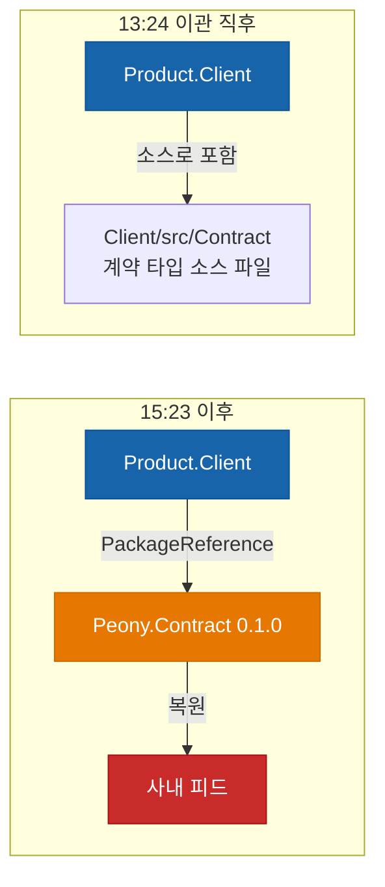
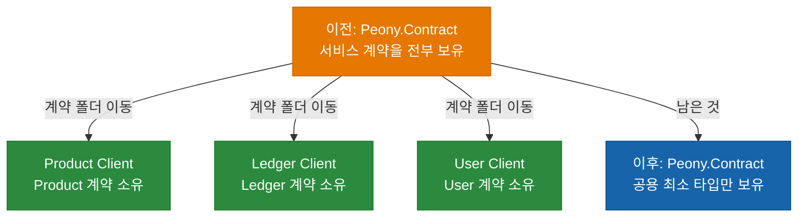

## 핵심 요약: 하루 만에 옮긴 것과 옮기지 못한 것은 무엇인가

2026년 11월 1일, Peony 모노레포(여러 서비스를 한 저장소에 두는 구조)의 서비스 15개를 각각 독립 저장소로 옮겼다. 첫 이관 커밋은 11시 52분, 마지막 서비스는 18시 36분이다. 이 글은 Product 서비스의 커밋 diff를 따라, 서비스끼리 공유하던 계약 타입(서비스가 서로 호출할 때 쓰는 요청·응답 모델)이 어떻게 바뀌었는지 적는다.

이 글은 시리즈의 첫 글이다. 사내 NuGet 피드 문제는 다음 글에서 따로 다룬다. 이관을 결정한 이유는 커밋에 남아 있지 않아 쓰지 않는다.

## 문제: 서비스만 옮기면 빌드가 끝나는가

이관 직후(13시 24분) Product.Client는 계약 타입을 자기 `Client/src/Contract` 아래에 소스 파일로 갖고 있었다. 15시 23분 커밋은 이 파일들을 지우고 공용 패키지 `Peony.Contract`를 참조하게 바꿨다. 이 커밋은 77개 파일에서 1,355줄을 지우고 7줄을 더했다.

```diff
 <!-- Client/src/Peony.Product.Client.csproj -->
     <PackageReference Include="Garden.Share" />
+    <PackageReference Include="Peony.Contract" />

 <!-- Directory.Packages.props -->
+    <PackageVersion Include="Peony.Contract" Version="0.1.0" />
```

이 변경에서 확인할 것은 두 가지다. 계약 타입이 소스 파일에서 버전이 붙은 패키지로 바뀌었다는 점, 그리고 이제 패키지를 어디선가 복원(restore, 의존 패키지를 내려받는 단계)해야 한다는 점이다. 같은 날 오후의 후속 커밋들이 이 복원 경로를 세웠다.

- 16시 34분: Product의 `NuGet.config`에서 임시 로컬 패키지 소스를 걷어내고 `Peony.*` 패키지를 사내 피드에서 받도록 매핑을 옮겼다.
- 22시 00분: 네 저장소에서 피드 주소를 secret 대신 코드에 고정했다.

```diff
 <!-- NuGet.config (핵심 줄만 발췌) -->
-    <add key="local" value="artifacts/packages" />
   <packageSource key="hanul">
     <package pattern="Garden.*" />
+    <package pattern="Peony.*" />   <!-- 이전에는 local 소스 아래에 있었다 -->
```

복원 경로가 틀리면 계약 패키지를 받지 못해 Client부터 빌드되지 않는다. 아래 그림이 이 변화를 보여 준다.



## 선택지: 공유하던 계약을 어디에 둘 것인가

기록에는 세 가지 방식이 나온다.

1. **계약을 서비스 클라이언트 안에 두기**: 11월 1일 13시 12분 FeatureFlag에서 `Peony.Contract` 참조를 지우고 계약을 클라이언트에 넣었다.
2. **공용 Peony.Contract 패키지를 소비하기**: 같은 날 FeatureFlag와 Counterparty가 이 방식으로 되돌렸고, Product와 User도 이 방식을 택했다.
3. **서비스 클라이언트가 자기 계약 타입을 소유하기**: 11월 2일에 다시 시도했다.

## 결정: 이틀째에 계약을 서비스로 돌려보냈다

Product는 11월 2일 11시 20분에 계약 타입을 공용 패키지에서 클라이언트로 옮겼다. 커밋 메시지에는 공용 패키지 0.1.3이 발행되기 전까지 클라이언트 테스트가 실패한다고 적혀 있다. 12시 39분에 이 커밋을 되돌렸고(revert), 16시 32분에 다시 같은 방향으로 확정했다.

```diff
 <!-- Client/src/Peony.Product.Client.csproj -->
     <PackageReference Include="Garden.Share" />
-    <PackageReference Include="Peony.Contract" />
     <PackageReference Include="Peony.Counterparty.Client" />
```

이 커밋은 75개 파일에서 1,237줄을 더해 계약 타입을 Client로 되돌려 놓았다. 커밋 메시지는 이유를 이렇게 적는다. Product 계약이 한 어셈블리(패키지가 담는 단위)에서만 풀리도록 하고, Contract에서 Client를 거쳐 다시 Contract로 돌아오는 순환 의존(NU1108)을 막는다. 확인할 신호는 `Peony.Contract` 참조가 사라진 것이다. 이 방식에서는 Client 패키지 하나만 받으면 계약이 같이 온다.

같은 날 자정 직후에는 Product에서 공용 패키지와 충돌한 직렬화 옵션 사본 파일(21줄)도 지웠다. Peony.Contract 쪽에서는 이후 7개 커밋으로 계약 폴더를 소유 서비스의 클라이언트로 옮겼고, 마지막 커밋은 11월 3일 00시 45분 Retailer다.



나머지 서비스(Autofill, Billing, Provisioning, WeatherForecast, Retailer, FeatureFlag)도 같은 방식으로 옮겼다.

## 트레이드오프: 무엇을 얻고 무엇을 떠안았나

기록으로 확인되는 사실과 그에 대한 내 해석을 나눠 적는다.

- **사실**: Product의 Client 패키지는 계약 타입을 직접 갖고, 공용 커널과 Notifier가 소유한 연동 타입도 사본으로 흡수했다. 버전은 0.1.3으로 올랐다.
- **해석**: 소비자는 패키지 하나만 받으면 되지만, 같은 타입의 사본이 여러 저장소에 생겼다. 공용 타입이 바뀌면 사본을 각각 갱신해야 한다.
- **사실**: 11월 8일부터 서비스마다 staging, production용 GitOps 설정이 각 저장소에 생겼고, 11월 9일에는 운영 이미지가 서비스별로 고정됐다.
- **해석**: 배포 단위가 저장소 단위가 되어 서비스별로 배포 시점을 따로 정할 수 있게 됐다.

관측 한계도 있다. 커밋 메시지와 diff만 근거라서, 선택지를 놓고 얼마나 고민했는지와 11시 20분 커밋을 되돌린 이유는 알 수 없다.

## 마무리: 이관 전에 확인할 한 가지

서비스 소스를 옮기는 데는 하루가 걸렸지만, 계약 타입이 소스에서 패키지로, 다시 소스로 돌아오는 데는 이틀이 걸렸다. 저장소를 나누기 전에 서비스끼리 공유하는 타입이 어느 저장소에 속하는지, 그 타입을 받는 경로가 어디인지부터 목록으로 만들어 보길 권한다. 다음 글에서는 이 글에서 짧게 지나간 사내 NuGet 피드 복원 문제를 다룬다.
