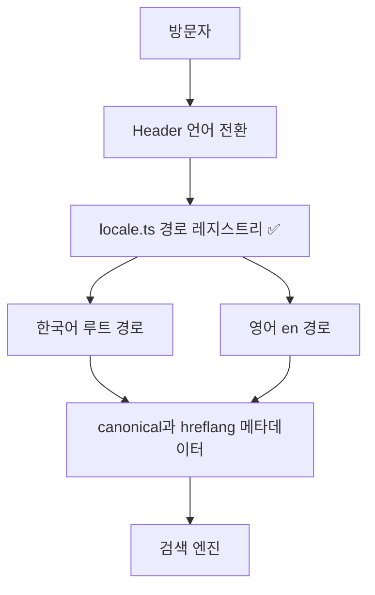
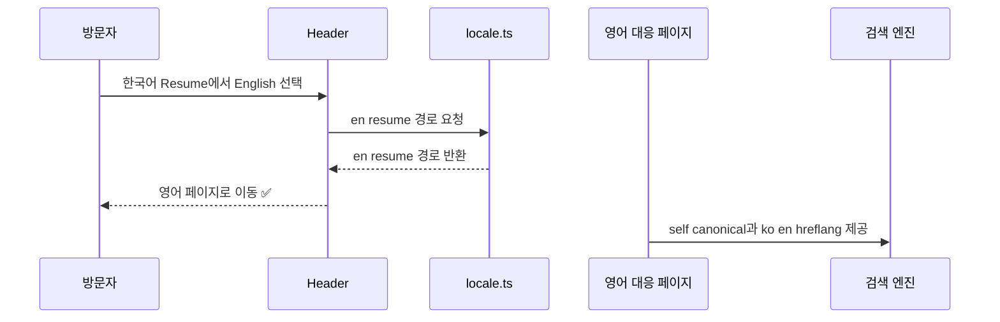

# 블로그 로캘 라우팅 설계

| 상태 | 최종 수정 | 관련 계획 | 구현 상태 |
| --- | --- | --- | --- |
| 승인 | 2026-10-30 | [블로그 이력서 및 탐색](../../lib/Garden.Harness/plans/ibocon/history/2610/W5/261030/261030_feat_blog-resume-navigation.md) | `site/src/lib/locale.ts`와 각 정적 페이지에 구현됨 |

## 문서 목적

`blog.botanicsoft.com`의 한국어 기본 콘텐츠와 영어 번역 콘텐츠가 공유하는 URL 규칙, 언어 전환 책임, 검색 엔진 메타데이터 경계를 정의한다. 이 문서는 페이지 본문의 번역 품질이나 자동 언어 감지를 정의하지 않는다.

## 설계 상태

목표 설계는 한국어를 사이트 기본 언어로 두고 루트 경로에서 제공하며, 영어로 번역된 정적 신뢰 페이지에만 `/en/` 접두사를 두는 것이다. 영어 콘텐츠를 기본 경로로 승격하거나 모든 URL에 국가 코드를 부여하지 않는다.

현재 구현은 `site/src/lib/locale.ts`가 `home`·`about`·`resume`·`editorial`의 두 로캘 경로를 단일 소스로 제공하고, 각 쌍 페이지가 canonical 및 상호 `hreflang`을 출력한다. 이 설계의 도입과 검증은 [블로그 이력서 및 탐색 계획](../../lib/Garden.Harness/plans/ibocon/history/2610/W5/261030/261030_feat_blog-resume-navigation.md)에서 완료되었다.

## 설계 목표

1. 한국어 기본 페이지는 짧고 안정적인 루트 URL을 유지한다.
2. 영어 번역 페이지는 `/en/` 아래에만 발행하여 기본 콘텐츠와 URL 공간을 충돌시키지 않는다.
3. 페이지 단위 언어 전환은 동일한 정보 구조의 대응 페이지로 이동한다.
4. 검색 엔진에는 각 언어 페이지의 self-canonical과 상호 `hreflang` 및 한국어 `x-default`를 제공한다.
5. 번역이 없는 게시물은 영어 대응 URL과 `hreflang`을 주장하지 않는다.

## 시스템 경계

| 경계 | 책임 | 신뢰 수준 |
| --- | --- | --- |
| 방문자 브라우저 | 현재 페이지의 언어 전환 링크를 따라 이동 | 외부 |
| Astro 정적 사이트 | 로캘별 HTML과 메타데이터를 생성 | 신뢰 |
| `locale.ts` 경로 레지스트리 | 로캘과 페이지 키를 URL로 변환 | 신뢰 |
| 검색 엔진 | canonical 및 `hreflang`을 해석해 색인 후보를 선택 | 외부 |

## 구성요소

| 구성요소 | 책임 |
| --- | --- |
| `site/src/lib/locale.ts` | `ko`와 `en`의 페이지별 상대 및 절대 URL을 제공한다. |
| `Header.astro` | 현재 페이지 키를 유지한 채 반대 로캘의 대응 경로를 링크한다. |
| 정적 페이지 | 자기 자신을 canonical로 선언하고 번역본과 `x-default`를 선언한다. |
| 콘텐츠 게시물 경로 | 기본 한국어 게시물만 발행하며 번역이 없으면 영어 대체 관계를 만들지 않는다. |

## 주요 흐름

## 설계 결정

### ADR-001: 한국어 기본 경로와 영어 접두사

- 문제·맥락: 한국어가 주 언어인 개인 기술 블로그는 짧은 기본 URL을 유지하면서도 신뢰 페이지의 영어 번역을 명확하게 구분해야 한다.
- 고려한 대안: 모든 로캘에 `/ko-kr/`와 `/en-us/`를 붙이는 Microsoft Learn식 대칭 구조, 루트 경로를 자동 언어 감지로 리디렉션하는 방식, 한국어 루트와 영어 `/en/` 접두사 방식.
- 결정: 한국어 페이지는 `/`, `/about/`, `/resume/`, `/editorial-policy/`에 두고 해당 영어 번역은 `/en/`, `/en/about/`, `/en/resume/`, `/en/editorial-policy/`에 둔다.
- 트레이드오프: URL이 로캘별로 대칭은 아니며 향후 다른 지역별 영어 변형이 필요해지면 경로 체계를 재검토해야 한다. 대신 현재 기본 독자와 사이트 규모에는 URL이 짧고 링크가 읽기 쉽다.
- 상태: 승인

### ADR-002: 명시적 전환 우선과 검색 메타데이터

- 문제·맥락: 브라우저 언어 설정만으로 페이지를 강제 전환하면 사용자가 공유한 URL과 의도한 로캘이 달라질 수 있고, 번역 관계를 검색 엔진에 명확하게 전달하기 어렵다.
- 고려한 대안: `Accept-Language` 기반 강제 리디렉션, 언어 전환 링크만 제공, 언어 전환 링크와 canonical 및 `hreflang`을 함께 제공.
- 결정: URL 자체가 언어를 결정하며 Header의 명시적 전환 링크를 제공한다. 대응 번역이 있는 페이지는 self-canonical과 상호 `hreflang`을 제공하고 `x-default`는 한국어 기본 URL을 가리킨다.
- 트레이드오프: 최초 방문자의 브라우저 언어에 맞춰 자동 이동하지 않는다. 대신 방문자가 선택한 URL을 안정적으로 유지하고 공유 및 색인 관계를 예측 가능하게 만든다.
- 상태: 승인

## 오류 처리

| 실패 | 처리 |
| --- | --- |
| 페이지 키에 대응 로캘 경로가 없음 | 새 페이지를 발행하기 전에 `localePaths`에 두 로캘 경로를 함께 추가한다. |
| 번역 페이지가 준비되지 않음 | 영어 경로와 `hreflang`을 발행하지 않고 기본 한국어 페이지로만 제공한다. |
| 잘못된 언어 URL 요청 | 정적 호스트의 일반 404 응답을 제공하며 다른 언어 경로로 자동 리디렉션하지 않는다. |
| 도메인 변경 | `absoluteLocaleUrl`의 기준 URL과 canonical 및 `hreflang` 결과를 함께 갱신한다. |

## 관련 문서

- [블로그 이력서 및 탐색 계획](../../lib/Garden.Harness/plans/ibocon/history/2610/W5/261030/261030_feat_blog-resume-navigation.md)
- [MDN Accept-Language 헤더](https://developer.mozilla.org/en-US/docs/Web/HTTP/Reference/Headers/Accept-Language)
- [MDN rel alternate와 hreflang](https://developer.mozilla.org/en-US/docs/Web/HTML/Reference/Attributes/rel)
- [Microsoft Learn .NET 영어 경로](https://learn.microsoft.com/en-us/dotnet/)
- [Microsoft Learn .NET 한국어 경로](https://learn.microsoft.com/ko-kr/dotnet/)
