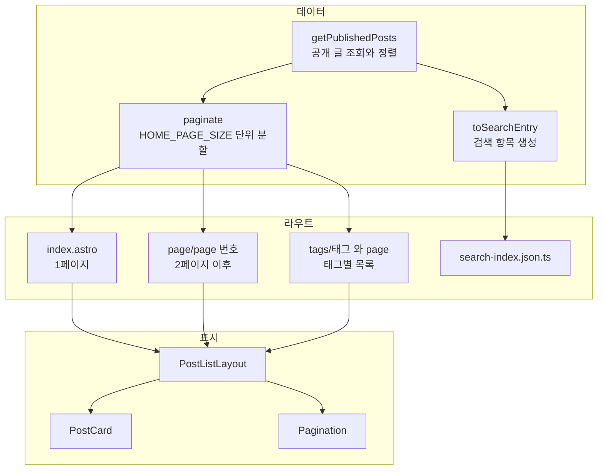
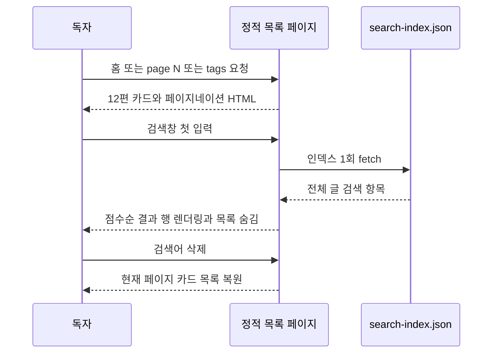

# 블로그 글 목록 설계

| 상태 | 최종 수정 | 관련 계획 | 구현 상태 |
| --- | --- | --- | --- |
| 초안 | 2026-11-16 | [블로그 홈 정적 페이지네이션과 검색 인덱스 분리](../../lib/Garden.Harness/plans/ibocon/ibocon/planning/261116_feat_paginate-blog-home-and-split-search-index.md) | `site/src/lib/blog-posts.ts`, `blog-pagination.ts`, `blog-search-index.ts`와 `site/src/components/PostListLayout.astro`, `site/src/pages/`의 목록 라우트에 구현됨 |

## 문서 목적

`blog.botanicsoft.com`의 글 목록(홈, 페이지 이동, 태그 모음)과 검색이 글 수 증가에도 일정한 HTML 크기와 일관된 표시를 유지하는 구조를 정의한다. 이 문서는 글 상세 페이지, 커버 이미지의 비율·여백 규칙(표시 품질 컨벤션), RSS를 정의하지 않는다.

## 설계 상태

목표 설계는 목록을 빌드 시점에 12편 단위 정적 페이지로 나누고, 모든 목록 페이지가 같은 커버 카드 표시를 쓰며, 검색은 별도 인덱스 파일로 분리하는 것이다. 글 링크는 JS 없이도 정적 HTML에서 도달할 수 있어야 한다.

현재 구현은 이 목표를 따른다. `getPublishedPosts()`가 공개 글을 한 곳에서 조회하고, `paginate()`가 분할을 계산하며, `PostListLayout`이 홈·`/page/N/`·`/tags/태그/`·`/tags/태그/page/N/`를 같은 골격으로 그린다. 검색 결과 목록만 썸네일 없는 행이며 이는 의도된 예외다. 구현 진행과 검증은 [계획서](../../lib/Garden.Harness/plans/ibocon/ibocon/planning/261116_feat_paginate-blog-home-and-split-search-index.md)가 소유한다.

## 설계 목표

1. 목록 한 페이지의 HTML 크기와 DOM 노드 수는 전체 글 수와 무관하게 페이지당 글 수로 상한이 정해진다.
2. 모든 글은 JS 없이 페이지네이션 링크 또는 태그 링크로 도달할 수 있다.
3. 홈, 2페이지 이후, 태그 페이지는 같은 카드 표시를 쓴다.
4. 검색은 전체 글을 대상으로 하되, 초기 로딩에 인덱스를 포함하지 않는다.
5. 검색 순위 규칙(제목, 태그, 설명 순)은 목록 분할과 무관하게 한 곳에서만 정의한다.
6. 글 슬러그와 목록 라우트의 URL 공간이 충돌하지 않는다.

## 시스템 경계

| 경계 | 책임 | 신뢰 수준 |
| --- | --- | --- |
| 방문자 브라우저 | 목록 페이지 요청, 검색어 입력, 인덱스 지연 fetch, 검색 결과 렌더링 | 외부 |
| Astro 정적 빌드 | 공개 글 조회, 분할, 목록 HTML과 `search-index.json` 생성 | 신뢰 |
| 콘텐츠 컬렉션 | 글 front matter와 본문 제공. 초안은 개발 모드에서만 포함 | 신뢰 |
| Cloudflare 정적 자산 | 생성된 HTML과 JSON을 변경 없이 제공 | 신뢰 |

## 구성요소

| 구성요소 | 책임 |
| --- | --- |
| `getPublishedPosts` | 초안 제외(개발 모드는 포함)와 최신순 정렬의 유일한 소유자 |
| `paginate`, `pagePath` | 페이지 슬라이스, 이전·다음 링크, 경로 규칙(`/`, `/page/N/`, `/tags/태그/page/N/`). 순수 함수 |
| `HOME_PAGE_SIZE` | 페이지당 글 수 12. 값 변경 지점은 이 상수 하나 |
| `toSearchEntry` | 제목·설명·태그·링크·날짜만 담은 검색 항목. 본문은 포함하지 않음 |
| `PostListLayout` | head, 제목, 검색 UI, 태그 링크 목록, 카드 목록, 페이지네이션, 광고 슬롯, 검색 스크립트의 공통 골격과 `rel=prev/next`·canonical |
| `PostCard` | 커버, 태그, 날짜, 읽기 시간, 제목, 설명을 가진 목록 카드. 커버 표시 면 정책의 대상 |
| `Pagination` | 페이지 번호 링크와 `aria-current`. 한 페이지뿐이면 렌더링하지 않음 |
| `search-index.json.ts` | 빌드 시 검색 항목 전체를 JSON 한 파일로 출력 |
| `blog-filter.ts` | 검색 점수와 순서 비교. 목록 분할과 독립 |
| `blog-slug.ts` | 예약 슬러그에 `page`, `tags`, `search-index.json` 포함 |

## 주요 흐름

검색 중에는 카드 목록과 페이지네이션을 숨기고 결과 영역을 보인다. 검색어를 지우면 현재 페이지 목록으로 돌아간다. 결과는 DOM 노드에 `textContent`로만 채워 글 제목·설명이 마크업으로 해석되지 않게 한다.

## 설계 결정

### 목록을 정적 페이지네이션으로 나눈다

- 문제·맥락: 홈이 글 105편을 한 HTML에 모두 렌더링해 HTML 크기와 DOM 노드와 스크롤 길이가 글 수에 비례해 늘었다. 이미지는 이미 지연 로딩이라 병목은 DOM이다.
- 고려한 대안: 무한 스크롤, "더 보기" JS, 가상 스크롤, 정적 페이지네이션.
- 결정: 빌드 시 12편 단위 정적 페이지(`/page/N/`)로 나눈다. 무한 스크롤·더 보기·가상 스크롤은 채택하지 않는다.
- 트레이드오프: 페이지 이동이 필요하다. 대신 하단 광고 슬롯과 푸터에 도달할 수 있고 뒤로 가기가 위치를 보존하며, 글 링크가 정적 HTML에 남아 크롤러가 따라갈 수 있다. 가상 스크롤은 105편 규모에 과하고 검색이 여전히 전체 DOM에 의존한다.
- 상태: 승인

### 검색을 자체 인덱스 JSON과 기존 점수 규칙으로 구현한다

- 문제·맥락: 기존 검색은 DOM 카드를 `hidden`으로 토글해서, 목록을 나누면 다른 페이지 글을 찾을 수 없다.
- 고려한 대안: Pagefind 도입, 빌드 시 `search-index.json` 한 파일과 기존 `blog-filter.ts` 재사용.
- 결정: `search-index.json`을 첫 입력 때 한 번 가져와 기존 점수 규칙(제목 3, 태그 2, 설명 1)으로 거른다.
- 트레이드오프: 본문 전문 검색은 제공하지 않는다. 인덱스는 105편에 약 49KB라 글이 늘면 선형으로 커지므로, 본문 검색이 필요하거나 인덱스가 수백 KB에 이르면 Pagefind 같은 조각 인덱스로 재결정한다. Pagefind는 새 의존성이며 한국어 부분 문자열 일치가 기존보다 약해질 수 있다.
- 상태: 승인

### 태그 필터를 정적 태그 페이지로 바꾼다

- 문제·맥락: 태그 칩이 JS로 카드를 숨기는 방식이라 목록 분할과 양립하지 못한다.
- 고려한 대안: 칩 유지(현재 페이지 카드만 필터), 태그별 정적 페이지.
- 결정: 칩을 `/tags/태그/` 링크로 바꾸고 태그 페이지도 같은 방식으로 분할한다. 글이 없는 태그는 페이지를 만들지 않는다.
- 트레이드오프: 태그 이동이 페이지 전환이 된다. 대신 태그가 SEO 진입 페이지가 되고 JS 없이 동작한다. 태그 값은 소문자 영문·하이픈 열거형이라 URL 인코딩 문제가 없다.
- 상태: 승인

### 목록 라우트 이름을 예약 슬러그로 보호한다

- 문제·맥락: 글은 `/글슬러그/`로 발행되므로 `page`, `tags`, `search-index.json` 슬러그의 글이 생기면 목록 라우트와 충돌한다.
- 고려한 대안: 목록 라우트를 별도 접두사 아래로 이동, 예약 슬러그로 글 이름을 금지.
- 결정: 세 이름을 `RESERVED_SLUGS`에 추가해 글 슬러그 검사가 거부하게 한다.
- 트레이드오프: 해당 이름의 글을 만들 수 없다. 홈 URL을 단순하게 유지한다.
- 상태: 승인

### 모든 목록 페이지를 커버 카드로 통일한다

- 문제·맥락: 구현 중 홈 1페이지만 커버 카드이고 2페이지 이후와 태그 페이지가 썸네일 없는 행이었다. 같은 글이 페이지에 따라 다르게 보여 일관성이 깨졌다.
- 고려한 대안: 1페이지만 카드·이후 행(밀도 우선), 모든 목록 카드.
- 결정: 홈, `/page/N/`, 태그 페이지 모두 `PostCard`를 쓴다. 페이지당 12편으로 DOM이 이미 제한되므로 행으로 줄이는 이득이 작다.
- 트레이드오프: 페이지 높이가 행 방식보다 길다. 검색 결과 목록은 인덱스에 커버가 없어 행을 유지한다.
- 상태: 승인

### 2페이지 이후를 컴팩트 행으로 줄이는 설계를 철회한다

- 문제·맥락: 초기 계획은 DOM·스크롤 감소를 위해 2페이지 이후와 태그 페이지를 썸네일 없는 컴팩트 행(`PostRow`)으로 표시하도록 했다.
- 고려한 대안: 컴팩트 행 유지, 카드 통일.
- 결정: 이 설계를 철회하고 [모든 목록 페이지를 커버 카드로 통일한다](#모든-목록-페이지를-커버-카드로-통일한다)로 대체한다. `PostRow` 컴포넌트는 삭제했다.
- 트레이드오프: 계획서의 카드 경량화 단계와 구현이 달라졌다. 계획서의 해당 서술은 이 결정이 정본이다.
- 상태: 대체됨

## 오류 처리

| 실패 | 처리 |
| --- | --- |
| 검색 인덱스 fetch 실패 또는 비정상 응답 | 상태 영역에 안내 문구를 보이고 카드 목록은 그대로 둔다. 페이지네이션과 태그 링크로 계속 탐색할 수 있다 |
| JS 비활성 | 검색 UI는 동작하지 않지만 모든 글은 페이지네이션과 태그 링크로 도달할 수 있다 |
| 검색어에 일치하는 글 없음 | 결과 영역을 비우고 "일치하는 게시물이 없습니다."를 보인다 |
| 입력이 빠르게 바뀌어 이전 요청의 결과가 늦게 도착 | 최신 검색어와 다르면 렌더링하지 않는다 |
| 글이 없는 태그 | 태그 페이지를 만들지 않는다 |
| 글이 12편 이하 | 페이지네이션을 렌더링하지 않는다 |

## 관련 문서

- [블로그 홈 정적 페이지네이션과 검색 인덱스 분리 계획](../../lib/Garden.Harness/plans/ibocon/ibocon/planning/261116_feat_paginate-blog-home-and-split-search-index.md)
- [블로그 로캘 라우팅 설계](blog-locale-routing.md)
- [블로그 표시 품질 컨벤션](../convention/blog-presentation.md)
