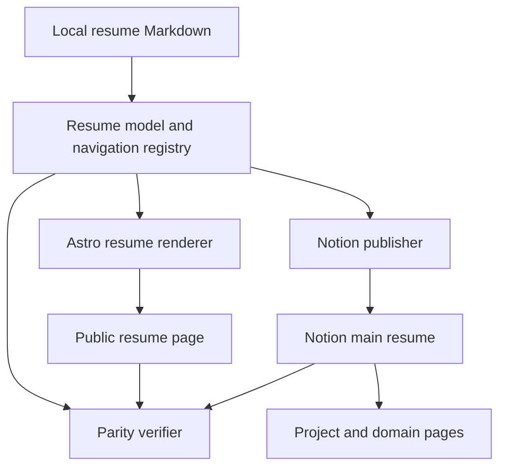
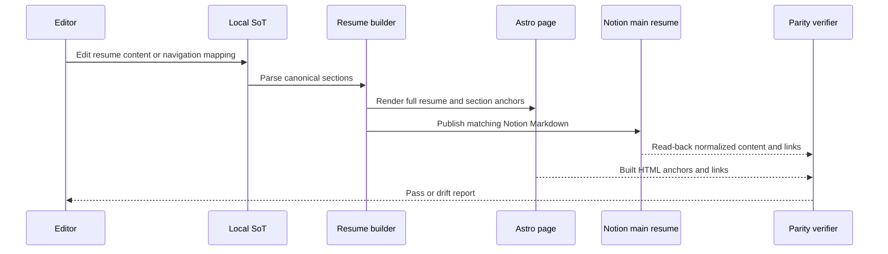

# 이력서 콘텐츠 동기화 및 탐색 설계

| 상태 | 최종 수정 | 관련 계획 | 구현 상태 |
| --- | --- | --- | --- |
| 초안 | 2026-10-30 | [이력서-Notion 동기화 및 탐색 개선](../../lib/Garden.Harness/plans/ibocon/planning/261030_feat_resume-notion-sync.md) | 계획됨 |

## 문서 목적

로컬 이력서 원문, 공개 웹 이력서, Notion 이력서 사이의 콘텐츠 드리프트를 막고, 독자가 웹 페이지의 섹션과 Notion의 상세 포트폴리오를 안정적으로 오갈 수 있는 목표 구조를 정의한다. 이 문서는 공개 이력서의 정보 구조와 동기화 계약만 다루며, Notion의 기존 도메인 허브·상세 기술서의 분류를 변경하지 않는다.

## 설계 상태

목표 설계는 `resume/resume-yegun-kim.md`에서 추출한 구조화된 이력서 모델을 웹과 Notion에 각각 렌더하고, 배포 후 정규화한 섹션·링크 계약을 비교하는 것이다. 현재 웹 `site/src/pages/resume.astro`는 요약 콘텐츠만 직접 보유하고, Notion에는 10대 도메인 허브와 확장된 기술 스택이 있어 로컬 원문 및 웹과 드리프트가 존재한다. 구현은 [관련 계획](../../lib/Garden.Harness/plans/ibocon/planning/261030_feat_resume-notion-sync.md)에서 진행한다.

## 설계 목표

1. 로컬 Git의 이력서 원문을 편집 가능한 유일한 콘텐츠 원본으로 유지한다.
2. 웹과 Notion은 원문의 같은 섹션·문안·탐색 대상을 사용하며, 임의의 별도 복사본을 소유하지 않는다.
3. 웹에서는 프로필, 대표 역량, 경력, 주요 프로젝트, 전체 도메인 지도, 기술 스택, 학력으로 즉시 이동할 수 있다.
4. 주요 프로젝트와 10대 도메인은 현재의 안정적인 Notion 페이지 URL로 이동한다.
5. Notion 본문 헤딩의 가변 블록 ID를 공개 탐색 계약으로 사용하지 않는다.
6. 동기화 뒤에는 사람의 육안 비교가 아니라 자동화된 콘텐츠·링크 계약으로 드리프트를 판정한다.

## 시스템 경계

| 경계 | 책임 | 신뢰 수준 |
| --- | --- | --- |
| Local SoT | 이력서 문안, 섹션 순서, Notion 상세 대상의 원본 보관 | 신뢰 |
| Resume model 및 navigation registry | 원문 섹션 ID, 표시명, 웹 앵커, Notion 페이지 URL의 대응 | 신뢰 |
| Astro resume page | 원문 모델을 공개 웹에서 렌더하고 내부·외부 탐색 제공 | 신뢰 |
| Notion main resume | 원문을 공유 가능한 형식으로 표시하고 상세 페이지로 연결 | 동기화 대상 |
| Notion portfolio pages | 프로젝트·도메인 상세 근거를 제공 | 외부 참조 대상 |
| Parity verifier | 웹 산출물 및 Notion read-back을 원문 계약과 비교 | 검증 경계 |

## 구성요소

| 구성요소 | 책임 |
| --- | --- |
| Local resume Markdown | 공개 가능한 사실·문안·섹션 순서를 소유한다. |
| Resume model and navigation registry | 웹 앵커와 Notion 대상 URL을 선언적으로 연결한다. |
| Astro resume renderer | 모델 전체를 렌더하고 상단 목차와 상세 링크를 제공한다. |
| Notion publisher | 원문을 Notion Markdown으로 변환·반영하고 read-back 대상을 반환한다. |
| Parity verifier | 필수 섹션, 정규화 문안, 프로젝트·도메인 URL, 렌더된 웹 앵커를 비교한다. |

## 주요 흐름

## 설계 결정

### D1. 로컬 Markdown을 유일한 콘텐츠 원본으로 유지한다

- 문제·맥락: 현재 웹 요약본과 Notion 본문이 독립적으로 편집되어 기술 스택과 섹션 범위가 달라졌다.
- 고려한 대안: Notion을 원본으로 삼아 웹에서 조회한다; 웹·Notion을 수동으로 병행 편집한다.
- 결정: Git에서 추적되는 `resume/resume-yegun-kim.md`와 연관 레지스트리를 유일한 변경 진입점으로 둔다.
- 트레이드오프: Notion에서 즉시 편집하는 편의성은 줄지만, 변경 이력과 검증 가능한 배포 경로를 얻는다.
- 상태: 제안

### D2. 페이지 간 탐색은 안정적인 Notion 페이지 URL만 사용한다

- 문제·맥락: Notion 메인 페이지의 헤딩 블록 링크는 전체 본문 교체나 블록 재생성 뒤 변경될 수 있다.
- 고려한 대안: 모든 헤딩에 복사한 블록 URL을 저장한다; Notion 페이지 루트와 하위 상세 페이지를 구분한다.
- 결정: 웹 내부 섹션 이동은 HTML 앵커를 사용하고, Notion 이동은 메인 이력서 페이지 또는 프로젝트·도메인별 고정 페이지 URL로 제한한다.
- 트레이드오프: Notion 본문의 특정 헤딩까지 한 번에 스크롤하는 링크는 제공하지 않는다.
- 상태: 제안

### D3. 동기화 완료는 원격 read-back으로만 판정한다

- 문제·맥락: publish 호출 성공만으로 Notion의 실제 본문·테이블·링크 보존을 보장할 수 없다.
- 고려한 대안: publish 응답만 기록한다; 수동 육안 점검만 한다.
- 결정: publish 뒤 Notion fetch 결과와 빌드된 웹 HTML을 원문 계약에 대조한다.
- 트레이드오프: Notion API 가용성이 없으면 동기화는 완료가 아닌 `BLOCKED`로 남는다.
- 상태: 제안

## 오류 처리

| 실패 | 처리 |
| --- | --- |
| 필수 섹션 또는 웹 앵커 누락 | 빌드·검증을 실패시키고 누락된 section ID를 보고한다. |
| 레지스트리의 Notion URL 누락 또는 중복 | publish 전에 실패시키고 매핑을 보완한다. |
| Notion publish 실패 | 원격 상태를 성공으로 표시하지 않고 Local SoT를 보존한다. |
| Notion read-back 문안·링크 불일치 | drift report를 생성하고 재배포 또는 원문 정정을 요구한다. |
| 외부 상세 페이지 접근 불가 | URL과 접근 오류를 보고하되 Local SoT를 변경하지 않는다. |

## 관련 문서

- [로컬 이력서 원문](../../resume/resume-yegun-kim.md)
- [이력서 탐색 목차](../../resume/resume-document-index.md)
- [Notion 이력서 구조 규약](../portfolio/strategy/convention-notion-resume-structure.md)
- [이력서-Notion 동기화 및 탐색 개선 계획](../../lib/Garden.Harness/plans/ibocon/planning/261030_feat_resume-notion-sync.md)
