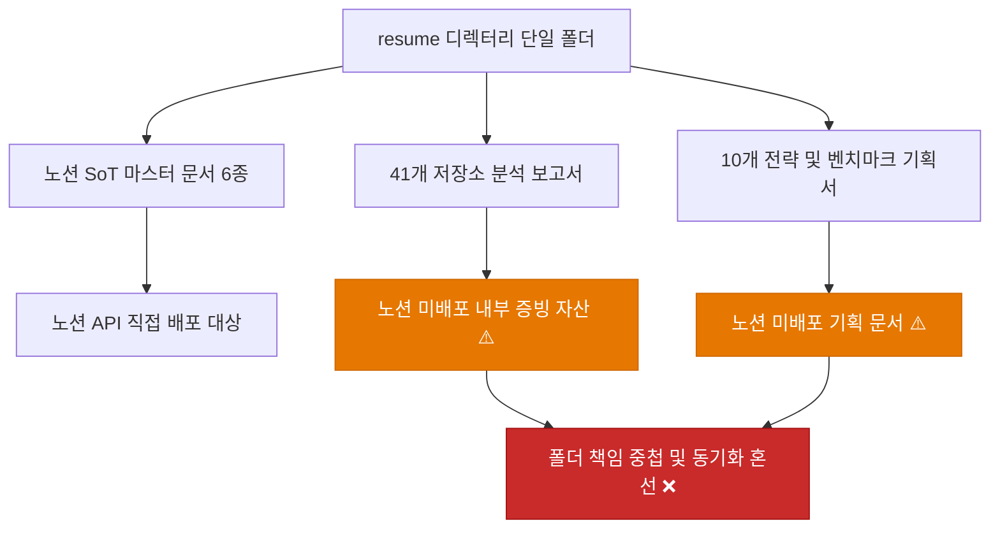
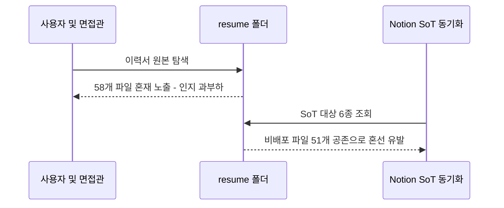
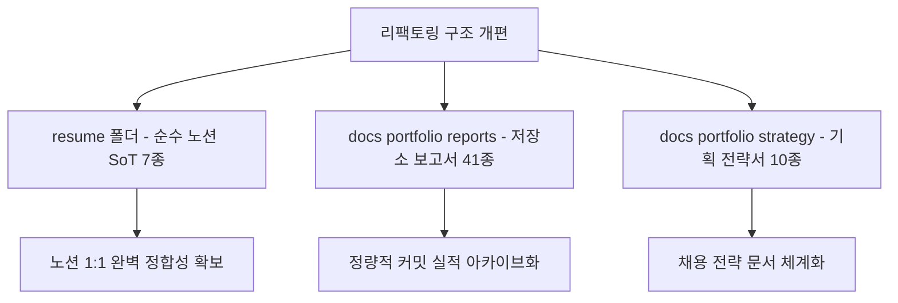
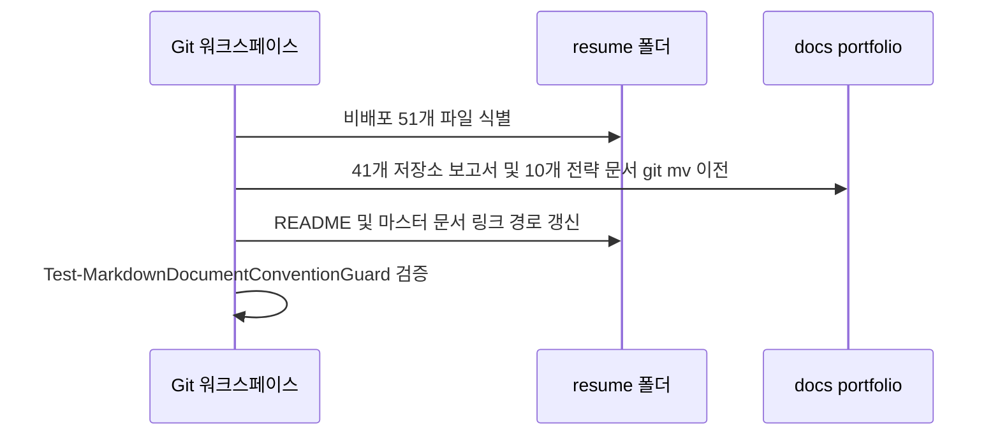
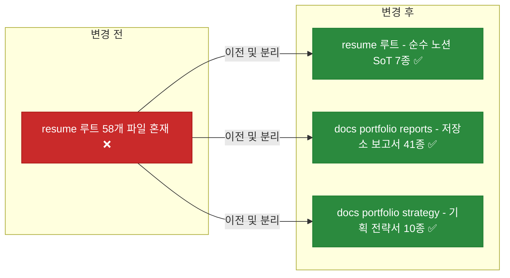
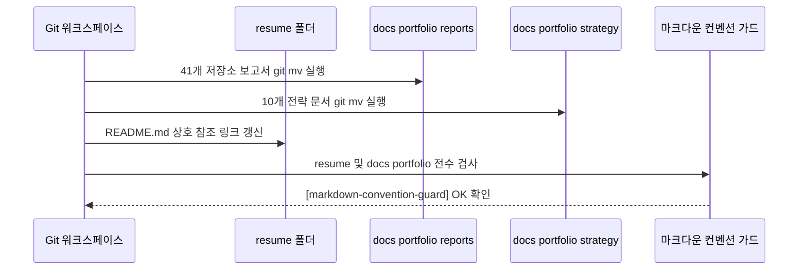

# ✅ 노션 비배포 포트폴리오 문서 및 저장소 보고서 분리 이전 계획

## 계획 관계

> **관계 스키마**: `1`
> **계획 ID**: `ibocon:261014_refac_relocate-non-notion-portfolio-docs`
> **출처 판정**: `최초`
> **출처 판정 근거**: resume/ 디렉터리를 순수 노션 SoT 마스터 6종 및 README로 정예화하고, 노션에 직접 배포되지 않는 41개 저장소 기술 보고서와 10개 전략 및 기획 문서를 docs/portfolio/ 하위로 분리 이전하기 위한 계획

| 관계 | 대상 계획 ID | 조건 | 근거·인수 범위 |
| --- | --- | --- | --- |

<!-- plan-relations-summary:start -->
> 자동 생성 관계 요약. 원본은 위 관계 표입니다.

| 구분 | 계획·조건 |
| --- | --- |
| 최초 계획 | [✅ 노션 비배포 포트폴리오 문서 및 저장소 보고서 분리 이전 계획](<261014_refac_relocate-non-notion-portfolio-docs.md>) `ibocon:261014_refac_relocate-non-notion-portfolio-docs` |
| 직접 출처 | 없음 |
| 직접 후속 | [✅ 노션 이력서 9대 단일 책임 도메인(SRP) 원자적 분할 리팩토링](<261014_refac_split-notion-domains-srp.md>) `ibocon:261014_refac_split-notion-domains-srp`<br/>[✅ 이력서 및 포트폴리오 과장·미사여구 제거 및 담백한 서술 리팩토링](<261014_refac_tone-down-resume-expressions.md>) `ibocon:261014_refac_tone-down-resume-expressions` |
| 계보 경로 | [✅ 노션 비배포 포트폴리오 문서 및 저장소 보고서 분리 이전 계획](<261014_refac_relocate-non-notion-portfolio-docs.md>) `ibocon:261014_refac_relocate-non-notion-portfolio-docs` |
| 착수 조건 | 가능 |
<!-- plan-relations-summary:end -->


## 결정이 필요한 사항

1. **비배포 문서의 이전 대상 디렉터리 구조** — `docs/portfolio/reports/` 및 `docs/portfolio/strategy/`로 분리 (권장)
- 권장안: 41개 Git 저장소 기술 이력 보고서는 `docs/portfolio/reports/`에 배치하고, 10개 포트폴리오 전략 및 벤치마킹 문서는 `docs/portfolio/strategy/`에 배치한다.
- 근거: 기술 증빙 자료(과거 커밋 실적)와 향후 프로필 브랜딩 전략 문서를 성격별로 명확히 분리하여 문서 탐색성을 극대화한다.
- 대안: `docs/history/` 하위로 일괄 이전. 이는 하네스 및 엔지니어링 계획서 history와 섞여 포트폴리오 자산으로서의 독립성이 훼손된다.

2. **`resume/` 디렉터리 잔류 기준** — Notion API 배포 대상(SoT) 6종 + 거버넌스 색인 1종으로 정예화 (권장)
- 권장안: `resume/`에는 `notion-sot-map.json`에 정의된 6대 마스터 문서(`resume-yegun-kim.md`, `project-monolith.md`, `project-argon.md`, `project-nemonic-desktop.md`, `project-lithium.md`, `project-personal-peony.md`)와 디렉터리 색인 `README.md`만 유지한다.
- 근거: `resume/` 폴더가 순수하게 노션 웹 배포 뷰어와 1:1로 대응하는 로컬 원천(SoT)으로서의 단일 책임을 갖게 된다.
- 대안: 41개 저장소 보고서를 `resume/reports/` 하위 폴더로 이동. 여전히 `resume/` 폴더 내에 비배포 산출물이 공존하여 Notion 동기화 범위가 모호해진다.

3. **이전 후 상호 참조 링크 보존** — `resume/README.md` 및 전략 문서 내 상대 링크 갱신 (권장)
- 권장안: `resume/README.md`에서 보고서 링크를 `./repo-*.md`에서 `../docs/portfolio/reports/repo-*.md`로 갱신하고, 전략 문서 링크 역시 상대 경로로 정확히 재연결한다.
- 근거: 로컬 뷰어나 깃허브 웹 인터페이스에서 깨진 링크(Dead link) 없이 전체 문서를 유기적으로 탐색할 수 있다.

## 배경

### 현재 문제점

- `resume/` 디렉터리는 원래 노션(Notion)에 1:1로 웹 배포되는 **로컬 마스터 마크다운 원본(Single Source of Truth, SoT)**을 격리 보관하기 위한 폴더이다.
- 그러나 9년간의 41개 저장소 커밋 실적 분석 보고서(41종)와 채용 담당자 대응 및 프로필 브랜딩을 위한 전략 기획서(10종)가 동일한 `resume/` 루트에 뒤섞여 있다.
- 이로 인해 Notion 동기화 도구(`notion-sot-map.json`) 관리 범위와 실제 폴더 파일 목록 간 괴리가 발생하고, 순수 노션 이력서 관리의 명확성이 저하된다.

### 원인 분석





### 리팩토링 방향

1. **`resume/` 디렉터리 정예화**: 노션에 배포되는 6대 마스터 문서와 총괄 색인 `README.md`만 유지 (총 7개 파일).
2. **`docs/portfolio/reports/` 신설**: 41개 저장소 분석 보고서를 이관 (41개 파일).
3. **`docs/portfolio/strategy/` 신설**: 10개 전략/기획 문서를 이관 (10개 파일).
4. **상호 참조 링크 동기화**: `resume/README.md` 및 이전 파일들의 상대 경로를 전수 보정.





## 이전 대상 전체 파일 목록 (AS-IS vs TO-BE)

| 구분 / 분류 | 현재 위치 (AS-IS) | 노션 배포 | 변경 위치 (TO-BE) | 이전 목적 및 처리 방식 |
| :--- | :--- | :---: | :--- | :--- |
| **마스터 이력서** | `resume/resume-yegun-kim.md` | **O** | `resume/resume-yegun-kim.md` | **[유지]** 노션 메인 이력서 1:1 동기화 원본 |
| **프로젝트 상세 1** | `resume/project-monolith.md` | **O** | `resume/project-monolith.md` | **[유지]** 노션 Monolith 상세 기술서 1:1 동기화 원본 |
| **프로젝트 상세 2** | `resume/project-argon.md` | **O** | `resume/project-argon.md` | **[유지]** 노션 Argon 상세 기술서 1:1 동기화 원본 |
| **프로젝트 상세 3** | `resume/project-nemonic-desktop.md` | **O** | `resume/project-nemonic-desktop.md` | **[유지]** 노션 nemonic Desktop 상세 기술서 1:1 동기화 원본 |
| **프로젝트 상세 4** | `resume/project-lithium.md` | **O** | `resume/project-lithium.md` | **[유지]** 노션 Lithium 상세 기술서 1:1 동기화 원본 |
| **프로젝트 상세 5** | `resume/project-personal-peony.md` | **O** | `resume/project-personal-peony.md` | **[유지]** 노션 Peony 상세 기술서 1:1 동기화 원본 |
| **거버넌스 색인** | `resume/README.md` | **O** | `resume/README.md` | **[유지]** 노션 SoT 마스터 관리 총괄 색인 |
| **전략/기획 01** | `resume/github-profile-plan.md` | **X** | `docs/portfolio/strategy/github-profile-plan.md` | **[이전]** GitHub 프로필 README 및 잔디 뷰어 배포 전략 |
| **전략/기획 02** | `resume/notion-resume-advancement-strategy-plan.md` | **X** | `docs/portfolio/strategy/notion-resume-advancement-strategy-plan.md` | **[이전]** 노션 이력서 10대 레퍼런스 분석 기반 고도화 계획 |
| **전략/기획 03** | `resume/notion-resume-references.md` | **X** | `docs/portfolio/strategy/notion-resume-references.md` | **[이전]** 10대 타사 개발자 노션 이력서 벤치마킹 분석 DB |
| **전략/기획 04** | `resume/notion-tech-career-plan.md` | **X** | `docs/portfolio/strategy/notion-tech-career-plan.md` | **[이전]** 41개 저장소 실적을 5대 프로젝트로 묶는 총괄 체계화 계획 |
| **전략/기획 05** | `resume/plan-domestic-recruiter-optimization.md` | **X** | `docs/portfolio/strategy/plan-domestic-recruiter-optimization.md` | **[이전]** 국내 채용 담당자 관점의 프로필 최적화 전략 |
| **전략/기획 06** | `resume/plan-strategy-01-private-repo-showcase.md` | **X** | `docs/portfolio/strategy/plan-strategy-01-private-repo-showcase.md` | **[이전]** 비공개 실무 저장소의 프로필 쇼케이스화 전략 |
| **전략/기획 07** | `resume/plan-strategy-02-public-architecture-template.md` | **X** | `docs/portfolio/strategy/plan-strategy-02-public-architecture-template.md` | **[이전]** 공개 .NET 아키텍처 템플릿 리포지토리 구축 전략 |
| **전략/기획 08** | `resume/plan-strategy-03-opensource-contribution-and-troubleshooting-repo.md` | **X** | `docs/portfolio/strategy/plan-strategy-03-opensource-contribution-and-troubleshooting-repo.md` | **[이전]** 오픈소스 기여 및 트러블슈팅 큐레이션 전략 |
| **전략/기획 09** | `resume/plan-strategy-04-pinned-gist-architecture.md` | **X** | `docs/portfolio/strategy/plan-strategy-04-pinned-gist-architecture.md` | **[이전]** Pinned Gist 및 동적 스니펫 설계 역량 시각화 전략 |
| **전략/기획 10** | `resume/plan-strategy-05-notion-domain-hierarchy-architecture.md` | **X** | `docs/portfolio/strategy/plan-strategy-05-notion-domain-hierarchy-architecture.md` | **[이전]** 노션 이력서 도메인별 폴더 트리 모델 아키텍처 설계서 |
| **저장소 보고서 01** | `resume/repo-01-nemonic-basic-windows.md` | **X** | `docs/portfolio/reports/repo-01-nemonic-basic-windows.md` | **[이전]** NemonicBasicWindows 저장소 커밋 기여 보고서 |
| **저장소 보고서 02** | `resume/repo-02-nemonic-basic-android.md` | **X** | `docs/portfolio/reports/repo-02-nemonic-basic-android.md` | **[이전]** NemonicBasicAndroid 저장소 커밋 기여 보고서 |
| **저장소 보고서 03** | `resume/repo-03-nemonic-android-intern.md` | **X** | `docs/portfolio/reports/repo-03-nemonic-android-intern.md` | **[이전]** NemonicAndroidIntern 저장소 커밋 기여 보고서 |
| **저장소 보고서 04** | `resume/repo-04-nemonic-basic-ios.md` | **X** | `docs/portfolio/reports/repo-04-nemonic-basic-ios.md` | **[이전]** NemonicBasiciOS 저장소 커밋 기여 보고서 |
| **저장소 보고서 05** | `resume/repo-05-nemonic-plugin-android.md` | **X** | `docs/portfolio/reports/repo-05-nemonic-plugin-android.md` | **[이전]** NemonicPluginAndroid 저장소 커밋 기여 보고서 |
| **저장소 보고서 06** | `resume/repo-06-nemonic-label-windows.md` | **X** | `docs/portfolio/reports/repo-06-nemonic-label-windows.md` | **[이전]** NemonicLabelWindows 저장소 커밋 기여 보고서 |
| **저장소 보고서 07** | `resume/repo-07-lithium.md` | **X** | `docs/portfolio/reports/repo-07-lithium.md` | **[이전]** Lithium 저장소 커밋 기여 보고서 |
| **저장소 보고서 08** | `resume/repo-08-mangoslab-drawing.md` | **X** | `docs/portfolio/reports/repo-08-mangoslab-drawing.md` | **[이전]** Mangoslab.Drawing 저장소 커밋 기여 보고서 |
| **저장소 보고서 09** | `resume/repo-09-sulfur.md` | **X** | `docs/portfolio/reports/repo-09-sulfur.md` | **[이전]** Sulfur 저장소 커밋 기여 보고서 |
| **저장소 보고서 10** | `resume/repo-10-firmware.md` | **X** | `docs/portfolio/reports/repo-10-firmware.md` | **[이전]** Firmware 저장소 커밋 기여 보고서 |
| **저장소 보고서 11** | `resume/repo-11-mangoslab-infrastructure.md` | **X** | `docs/portfolio/reports/repo-11-mangoslab-infrastructure.md` | **[이전]** Mangoslab.Infrastructure 커밋 기여 보고서 |
| **저장소 보고서 12** | `resume/repo-12-memo-view.md` | **X** | `docs/portfolio/reports/repo-12-memo-view.md` | **[이전]** MemoView 저장소 커밋 기여 보고서 |
| **저장소 보고서 13** | `resume/repo-13-mangoslab-usb.md` | **X** | `docs/portfolio/reports/repo-13-mangoslab-usb.md` | **[이전]** Mangoslab.Usb 저장소 커밋 기여 보고서 |
| **저장소 보고서 14** | `resume/repo-14-mangoslab-nemonic.md` | **X** | `docs/portfolio/reports/repo-14-mangoslab-nemonic.md` | **[이전]** Mangoslab.Nemonic 저장소 커밋 기여 보고서 |
| **저장소 보고서 15** | `resume/repo-15-mangoslab-bluetooth.md` | **X** | `docs/portfolio/reports/repo-15-mangoslab-bluetooth.md` | **[이전]** Mangoslab.Bluetooth 저장소 커밋 기여 보고서 |
| **저장소 보고서 16** | `resume/repo-16-mangoslab-iac.md` | **X** | `docs/portfolio/reports/repo-16-mangoslab-iac.md` | **[이전]** Mangoslab.IaC 저장소 커밋 기여 보고서 |
| **저장소 보고서 17** | `resume/repo-17-oxygen-nemonic-pro-settings-app.md` | **X** | `docs/portfolio/reports/repo-17-oxygen-nemonic-pro-settings-app.md` | **[이전]** Oxygen.Nemonic.Pro.SettingsApp 기여 보고서 |
| **저장소 보고서 18** | `resume/repo-18-oxygen-teams.md` | **X** | `docs/portfolio/reports/repo-18-oxygen-teams.md` | **[이전]** Oxygen.Teams 저장소 커밋 기여 보고서 |
| **저장소 보고서 19** | `resume/repo-19-oxygen-jira.md` | **X** | `docs/portfolio/reports/repo-19-oxygen-jira.md` | **[이전]** Oxygen.Jira 저장소 이슈 기여 보고서 |
| **저장소 보고서 20** | `resume/repo-20-oxygen-hub.md` | **X** | `docs/portfolio/reports/repo-20-oxygen-hub.md` | **[이전]** Oxygen.Hub 저장소 커밋 기여 보고서 |
| **저장소 보고서 21** | `resume/repo-21-oxygen-slack.md` | **X** | `docs/portfolio/reports/repo-21-oxygen-slack.md` | **[이전]** Oxygen.Slack 저장소 커밋 기여 보고서 |
| **저장소 보고서 22** | `resume/repo-22-oxygen-amplitude.md` | **X** | `docs/portfolio/reports/repo-22-oxygen-amplitude.md` | **[이전]** Oxygen.Amplitude 저장소 커밋 기여 보고서 |
| **저장소 보고서 23** | `resume/repo-23-mangoslab-pipeline.md` | **X** | `docs/portfolio/reports/repo-23-mangoslab-pipeline.md` | **[이전]** Mangoslab.Pipeline 저장소 커밋 기여 보고서 |
| **저장소 보고서 24** | `resume/repo-24-history.md` | **X** | `docs/portfolio/reports/repo-24-history.md` | **[이전]** History 저장소 커밋 기여 보고서 |
| **저장소 보고서 25** | `resume/repo-25-nemonic-ampv.md` | **X** | `docs/portfolio/reports/repo-25-nemonic-ampv.md` | **[이전]** Nemonic.Ampv 저장소 커밋 기여 보고서 |
| **저장소 보고서 26** | `resume/repo-26-zinc-nemonic-ai.md` | **X** | `docs/portfolio/reports/repo-26-zinc-nemonic-ai.md` | **[이전]** Zinc.NemonicAi 저장소 커밋 기여 보고서 |
| **저장소 보고서 27** | `resume/repo-27-kc5.md` | **X** | `docs/portfolio/reports/repo-27-kc5.md` | **[이전]** kc5 저장소 커밋 기여 보고서 |
| **저장소 보고서 28** | `resume/repo-28-zinc-nemonic-study.md` | **X** | `docs/portfolio/reports/repo-28-zinc-nemonic-study.md` | **[이전]** Zinc.NemonicStudy 저장소 커밋 기여 보고서 |
| **저장소 보고서 29** | `resume/repo-29-kc6.md` | **X** | `docs/portfolio/reports/repo-29-kc6.md` | **[이전]** kc6 저장소 커밋 기여 보고서 |
| **저장소 보고서 30** | `resume/repo-30-mangoslab.md` | **X** | `docs/portfolio/reports/repo-30-mangoslab.md` | **[이전]** Mangoslab 저장소 커밋 기여 보고서 |
| **저장소 보고서 31** | `resume/repo-31-oxygen-web.md` | **X** | `docs/portfolio/reports/repo-31-oxygen-web.md` | **[이전]** Oxygen.Web 저장소 커밋 기여 보고서 |
| **저장소 보고서 32** | `resume/repo-32-zinc-zapier.md` | **X** | `docs/portfolio/reports/repo-32-zinc-zapier.md` | **[이전]** Zinc.Zapier 저장소 커밋 기여 보고서 |
| **저장소 보고서 33** | `resume/repo-33-monolith.md` | **X** | `docs/portfolio/reports/repo-33-monolith.md` | **[이전]** Monolith 저장소 커밋 기여 보고서 |
| **저장소 보고서 34** | `resume/repo-34-radium.md` | **X** | `docs/portfolio/reports/repo-34-radium.md` | **[이전]** Radium 저장소 커밋 기여 보고서 |
| **저장소 보고서 35** | `resume/repo-35-mip-301-centerm-fw-test.md` | **X** | `docs/portfolio/reports/repo-35-mip-301-centerm-fw-test.md` | **[이전]** MIP-301-Centerm-FW-Test 커밋 기여 보고서 |
| **저장소 보고서 36** | `resume/repo-36-zinc-nemonic-study-service-summary.md` | **X** | `docs/portfolio/reports/repo-36-zinc-nemonic-study-service-summary.md` | **[이전]** NemonicStudy.Service.Summary 기여 보고서 |
| **저장소 보고서 37** | `resume/repo-37-firmware-test-utility.md` | **X** | `docs/portfolio/reports/repo-37-firmware-test-utility.md` | **[이전]** Firmware.TestUtility 저장소 기여 보고서 |
| **저장소 보고서 38** | `resume/repo-38-argon.md` | **X** | `docs/portfolio/reports/repo-38-argon.md` | **[이전]** argon 저장소 커밋 기여 보고서 |
| **저장소 보고서 39** | `resume/repo-39-zinc-nemonic-study-bff-api.md` | **X** | `docs/portfolio/reports/repo-39-zinc-nemonic-study-bff-api.md` | **[이전]** NemonicStudy.Bff.Api 저장소 기여 보고서 |
| **저장소 보고서 40** | `resume/repo-40-zinc-nemonic-study-service-ocr.md` | **X** | `docs/portfolio/reports/repo-40-zinc-nemonic-study-service-ocr.md` | **[이전]** NemonicStudy.Service.Ocr 저장소 기여 보고서 |
| **저장소 보고서 41** | `resume/repo-41-nemonic-sdk-image-flutter.md` | **X** | `docs/portfolio/reports/repo-41-nemonic-sdk-image-flutter.md` | **[이전]** Nemonic.Sdk.Image.Flutter 저장소 기여 보고서 |

## 변경 범위



| 레이어 | 파일 | 변경 내용 |
| --- | --- | --- |
| 저장소 보고서 | `resume/repo-01-nemonic-basic-windows.md` | 41개 저장소 기술 보고서를 `docs/portfolio/reports/`로 git mv 이전 |
| 기획 전략서 | `resume/plan-strategy-01-private-repo-showcase.md` | 10개 포트폴리오 전략 문서를 `docs/portfolio/strategy/`로 git mv 이전 |
| 거버넌스 색인 | `resume/README.md` | 이전된 보고서 및 전략 문서의 상대 링크 경로 동기화 |

## 단계별 수정 계획

### ✅ 1단계. 목적지 디렉터리 신설 및 41개 저장소 보고서 이전

**파일**: `resume/repo-01-nemonic-basic-windows.md`

AS-IS:

```powershell
# ❌ resume/ 폴더에 비배포 저장소 보고서가 직접 잔류
resume/repo-01-nemonic-basic-windows.md
```

TO-BE:

```powershell
# ✅ docs/portfolio/reports/ 디렉터리로 git mv 이전
docs/portfolio/reports/repo-01-nemonic-basic-windows.md
```

### ✅ 2단계. 10개 전략 및 기획 문서 이전

**파일**: `resume/plan-strategy-01-private-repo-showcase.md`

AS-IS:

```powershell
# ❌ resume/ 폴더에 내부 기획 전략서가 직접 잔류
resume/plan-strategy-01-private-repo-showcase.md
```

TO-BE:

```powershell
# ✅ docs/portfolio/strategy/ 디렉터리로 git mv 이전
docs/portfolio/strategy/plan-strategy-01-private-repo-showcase.md
```

### ✅ 3단계. resume/README.md 링크 동기화

**파일**: `resume/README.md`

AS-IS:

```markdown
<!-- ❌ resume/ 내부 파일 링크가 현재 디렉터리(./)를 참조 -->
| 01 | NemonicBasicWindows | ... | [01_보고서](./repo-01-nemonic-basic-windows.md) |
| 전략 01 | 비공개 실무 리포지토리 쇼케이스 | ... | [전략서](./plan-strategy-01-private-repo-showcase.md) |
```

TO-BE:

```markdown
<!-- ✅ 이전된 목적지 상대 경로로 1:1 동기화 -->
| 01 | NemonicBasicWindows | ... | [01_보고서](../docs/portfolio/reports/repo-01-nemonic-basic-windows.md) |
| 전략 01 | 비공개 실무 리포지토리 쇼케이스 | ... | [전략서](../docs/portfolio/strategy/plan-strategy-01-private-repo-showcase.md) |
```

## 주요 흐름



## 테스트 계획

> 위치: `lib/Garden.Harness/src/markdown/guards/`
> 도구: Test-MarkdownDocumentConventionGuard.ps1, Test-PlanningGuard.ps1

### ✅ 테스트 요약

| 검증 스크립트 | 검증 대상 | 목표 |
| --- | --- | :---: |
| `Test-MarkdownDocumentConventionGuard.ps1` | `resume/` (7개 파일) | 위반 0건 통과 |
| `Test-MarkdownDocumentConventionGuard.ps1` | `docs/portfolio/` (52개 파일) | 위반 0건 통과 |
| `Test-PlanningGuard.ps1` | 계획서 자체 정적 서식 | 위반 0건 통과 |

### 테스트 결과

| 범위 | 실행 명령 | 총 테스트 | 통과 | 실패 | 결과 |
| --- | --- | ---: | ---: | ---: | :---: |
| resume 정예화 검증 | `pwsh -NoProfile -File lib/Garden.Harness/src/markdown/guards/Test-MarkdownDocumentConventionGuard.ps1 -Path resume` | 7 | 7 | 0 | ✅ |
| 이전 문서 검증 | `pwsh -NoProfile -File lib/Garden.Harness/src/markdown/guards/Test-MarkdownDocumentConventionGuard.ps1 -Path docs/portfolio` | 52 | 52 | 0 | ✅ |
| 계획서 서식 검증 | `pwsh -NoProfile -File lib/Garden.Harness/src/plan/guards/format/Test-PlanFormatGuard.ps1 -PlanPath docs/planning/261014_refac_relocate-non-notion-portfolio-docs.md` | 1 | 1 | 0 | ✅ |

**실행 일시**: 2026-10-14 17:35 +09:00

## 후속 검증

| 항목 | 확인 내용 | 상태 |
| --- | --- | --- |
| Notion SoT 맵 무결성 | `lib/Garden.Harness/src/notion/tools/notion-sot-map.json` 경로가 `resume/` 잔류 6종과 일치하는지 확인 | 확인 |
| 외부 링크 무결성 | 루트 `README.md`의 프로젝트 링크가 여전히 `resume/` 내 6종을 가리키는지 확인 | 확인 |

## 계획 평가

| 관점 | 참조 문서 | 평가 항목 | 결과 |
| --- | --- | --- | --- |
| 클린 코드 | `clean-code.md` | 단일 책임 원칙(SRP)에 따라 Notion SoT 폴더와 내부 기획/실적 폴더를 명확히 분리 | ✅ |
| 아키텍처 | `clean-architecture.md` | 배포 인터페이스(Notion SoT)와 내부 아카이브(docs/portfolio)의 경계 확립 | ✅ |
| 디자인 패턴 | `design-pattern.md` | 기존 하네스 거버넌스 및 상대 경로 링크 규칙의 일관된 재사용 | ✅ |
| 엔터프라이즈 패턴 | `enterprise-application-architecture.md` | Single Source of Truth(SoT) 무결성 보존 및 파편화 방지 | ✅ |
| 리팩토링 | `refactoring.md` | git mv를 통한 변경 이력(History) 연속성 보존 및 단계별 안전한 이전 | ✅ |
| 테스트 품질 | `testing/docs/guide/x-unit-test-patterns.md` | Test-MarkdownDocumentConventionGuard를 통한 자동화된 정적 검증 보장 | ✅ |
| .NET 도메인·컨벤션 | `dotnet/docs/guide·convention` | 마크다운 및 디렉터리 거버넌스 작업으로 C# 도메인 코드 직접 변경 없음 | 해당 없음 |

**특이사항:**

- `resume/` 내의 41개 저장소 기술 보고서는 향후 추가적인 스타트업/기업 지원 시 STAR 기술서의 근거 데이터베이스로 언제든 참조될 수 있으므로 영구 삭제하지 않고 `docs/portfolio/reports/`로 안전하게 보존한다.

## 작업 순서

1. `docs/portfolio/reports/` 및 `docs/portfolio/strategy/` 디렉터리를 생성한다.
2. `resume/repo-*.md` 41개 파일을 `docs/portfolio/reports/`로 `git mv` 실행한다.
3. `resume/plan-*.md`, `resume/github-profile-plan.md`, `resume/notion-*.md` 10개 파일을 `docs/portfolio/strategy/`로 `git mv` 실행한다.
4. `resume/README.md` 내의 파일 링크를 신규 상대 경로로 일괄 치환한다.
5. `Test-MarkdownDocumentConventionGuard.ps1`로 `resume/` 및 `docs/portfolio/` 디렉터리를 전수 검증한다.
6. 본 계획서의 테스트 결과 및 체크리스트를 완료 상태로 갱신한다.
