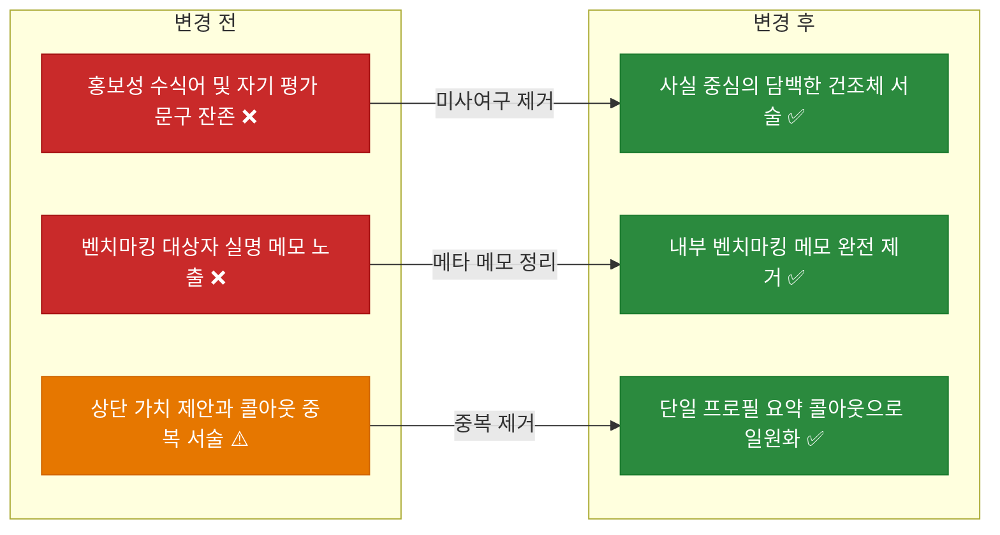

# ✅ 이력서 및 포트폴리오 과장·미사여구 제거 및 담백한 서술 리팩토링

## 계획 관계

> **관계 스키마**: `1`
> **계획 ID**: `ibocon:261014_refac_tone-down-resume-expressions`
> **출처 판정**: `연결`
> **출처 판정 근거**: 노션 포트폴리오 문서 분리 이전 계획 이후 이력서 본문과 노션 페이지 전반의 과장·홍보성 수식어를 담백한 사실 중심 서술로 정제하는 후속 리팩토링

| 관계 | 대상 계획 ID | 조건 | 근거·인수 범위 |
| --- | --- | --- | --- |
| 후속 | `ibocon:261014_refac_relocate-non-notion-portfolio-docs` | 해당 없음 | 정예화된 `resume/` 마스터 문서 6종 및 `docs/portfolio/strategy/` 설계·컨벤션 문서의 문체 정제 |

<!-- plan-relations-summary:start -->
> 자동 생성 관계 요약. 원본은 위 관계 표입니다.

| 구분 | 계획·조건 |
| --- | --- |
| 최초 계획 | [✅ 노션 비배포 포트폴리오 문서 및 저장소 보고서 분리 이전 계획](<261014_refac_relocate-non-notion-portfolio-docs.md>) `ibocon:261014_refac_relocate-non-notion-portfolio-docs` |
| 직접 출처 | [✅ 노션 비배포 포트폴리오 문서 및 저장소 보고서 분리 이전 계획](<261014_refac_relocate-non-notion-portfolio-docs.md>) `ibocon:261014_refac_relocate-non-notion-portfolio-docs` |
| 직접 후속 | 없음 |
| 계보 경로 | [✅ 노션 비배포 포트폴리오 문서 및 저장소 보고서 분리 이전 계획](<261014_refac_relocate-non-notion-portfolio-docs.md>) `ibocon:261014_refac_relocate-non-notion-portfolio-docs` → [✅ 이력서 및 포트폴리오 과장·미사여구 제거 및 담백한 서술 리팩토링](<261014_refac_tone-down-resume-expressions.md>) `ibocon:261014_refac_tone-down-resume-expressions` |
| 후속 | [✅ 노션 비배포 포트폴리오 문서 및 저장소 보고서 분리 이전 계획](<261014_refac_relocate-non-notion-portfolio-docs.md>) `ibocon:261014_refac_relocate-non-notion-portfolio-docs` — 해당 없음 |
| 착수 조건 | 가능 |
<!-- plan-relations-summary:end -->

## 결정이 필요한 사항

1. **이력서 본문 내 벤치마킹 대상자 실명 표기(`(조은 / 김석현 벤치마킹)`, `(김용찬 벤치마킹)` 등) 처리 방식** — 이력서 본문 및 Notion 페이지에서 전량 제거 (권장)
- 근거: 타인의 이름을 실제 이력서 섹션 제목에 노출하면 내부 초안 메모가 덜 정리된 인상을 주므로, 분석 출처는 `docs/portfolio/strategy/notion-resume-references.md`에만 두고 이력서 본문에서는 제거한다.
- 대안: 섹션 제목에 참고 출처로 유지. 채용 담당자 관점에서 불필요한 메타 정보로 읽힌다.

2. **소수 기여 저장소(`History` 등) 및 수식어(`전사`, `혁신`, `고난도`, `원천 차단`, `무중단`) 정제 수준** — 가치 판단 형용사를 배제하고 수행한 작업과 구조적 사실만 건조하게 서술 (권장)
- 근거: `혁신`, `극대화`, `고난도`, `원천 차단`, `가치 창출`, `역량 입증` 같은 자기 평가형 수식어는 오히려 실무 신뢰도를 낮추므로, 실제 구현한 기술 요소와 동작 방식으로만 치환한다.
- 대안: 정량 수치만 제거하고 형용사 수식어는 유지. 여전히 호들갑스럽거나 홍보성 문구로 읽힐 위험이 남는다.

## 배경

- **현재 문제점**:
  1. `100TB급 Rook-Ceph`, `글로벌 50만 대 제어` 등 수치 과장은 1차 제거되었으나, 여전히 `전사 백엔드`, `생산성 혁신`, `고난도 결함 진단`, `원천 차단`, `완벽 해소`, `지속적인 가치 창출`, `실증적 엔지니어링 역량 입증` 같은 자기 과시적·홍보성 미사여구가 남아 있다.
  2. `resume/project-monolith.md`, `resume/project-argon.md`, `resume/project-nemonic-desktop.md` 및 원격 Notion 페이지의 섹션 제목에 `(조은 / 김석현 벤치마킹)`, `(이지호 / 이정재 벤치마킹)`, `(김용찬 벤치마킹)`처럼 내부 작성용 메모가 그대로 노출되어 있다.
  3. `resume/resume-yegun-kim.md` 상단에 `⚡ 엔지니어링 가치 제안` 인용구와 `💡 .NET 풀스택 소프트웨어 엔지니어` 콜아웃이 중복 배치되어 동일한 내용을 과장된 어조로 반복하고 있다.
  4. `History` 저장소처럼 테스트성 커밋(5건)이 주를 이루는 보조 저장소가 `Peony` 상세 페이지에서 `전사 계획서 및 ADR 아카이브 거버넌스 체계 구축`으로 부풀려져 있다.
- **리팩토링 방향**:
  1. `docs/portfolio/strategy/convention-notion-resume-structure.md`의 규칙 6을 확장하여 수치 부풀리기뿐 아니라 **자기 과시형 미사여구(`혁신`, `극대화`, `고난도`, `원천 차단`, `역량 입증` 등) 및 내부 벤치마킹 메모 노출 금지**를 명문화한다.
  2. 루트 `README.md`, `resume/*.md`(마스터 이력서 및 프로젝트 상세 5종), `docs/portfolio/strategy/plan-strategy-05-notion-domain-hierarchy-architecture.md`의 모든 호들갑스러운 표현을 담백한 건조체로 치환한다.
  3. 원격 Notion 메인 페이지, 5대 도메인 허브, 하위 상세 페이지에 동일한 담백한 문구를 동기화한다.

## 변경 범위



| 레이어 | 파일 | 변경 내용 |
| --- | --- | --- |
| Convention | `docs/portfolio/strategy/convention-notion-resume-structure.md` | 미사여구·자기평가 수식어 및 내부 벤치마킹 메모 노출 금지 규칙 추가 |
| Strategy | `docs/portfolio/strategy/plan-strategy-05-notion-domain-hierarchy-architecture.md` | `[전사 백엔드]` → `[백엔드 모노레포]`, `[엔지니어링 거버넌스]` → `[개발 도구 · 하네스]` 등 담백한 제목으로 정제 |
| Profile | `README.md` | `고가용성 소프트웨어 플랫폼`, `핵심 ... 통합 솔루션 플랫폼`, `빌드 가속 최적화` 등 추상적 미사여구 정제 |
| Resume SoT | `resume/resume-yegun-kim.md` | 상단 중복 가치 제안 블록 제거, 도메인 요약 표의 `무중단 DR`·`베어메탈`·`전사` 표현 정제 |
| Resume SoT | `resume/project-monolith.md` | `[전사 백엔드]` 제목 정제, `로컬 개발 생산성 혁신`, `조직적 엔지니어링 리드`, `(조은 / 김석현 벤치마킹)` 제거 |
| Resume SoT | `resume/project-argon.md` | 반복되는 `무중단`, `전사`, `원천 차단함` 및 `(이지호 / 이정재 벤치마킹)` 제거 |
| Resume SoT | `resume/project-nemonic-desktop.md` | `전 생애주기를 책임지며 지속적인 가치 창출`, `고난도 결함 진단`, `(김용찬 벤치마킹)` 제거 |
| Resume SoT | `resume/project-personal-peony.md` | `History` 저장소 과장 제거, `성공적으로 확산`, `실증적 엔지니어링 역량 입증` 담백화 |
| Resume Index | `resume/README.md` | 정제된 하위 프로젝트 제목 동기화 |

## 단계별 수정 계획

### ✅ Step 1: 이력서 작성 컨벤션 및 도메인 계층 설계서 문체 규칙 강화

**파일**: `docs/portfolio/strategy/convention-notion-resume-structure.md`
**파일**: `docs/portfolio/strategy/plan-strategy-05-notion-domain-hierarchy-architecture.md`

AS-IS:

```markdown
// ❌ 문제 지점: 수치 과장만 금지하고 있어 '혁신', '고난도', '원천 차단', '가치 창출' 등 홍보성 미사여구와 벤치마킹 메모 노출을 막지 못함
<a id="factual-integrity"></a>
### 6. 실증적 근거 기반 서술 및 과장 표현 금지 (Evidence-Based Factual Integrity)

- ✅ **MUST** 정량적 수치(기기 제어 대수, 트래픽, 스토리지 용량, 성능 개선율, 커밋 수 등)는 저장소 기록, 아키텍처 문서, 측정 로그 등 검증 가능한 근거가 존재할 때만 기재한다.
- ⛔ **MUST NOT** 확인된 근거 없이 규모·성과·수치를 부풀리거나 과장된 표현(예: 근거 없는 `글로벌 50만 대 제어`, 호들갑스러운 `100TB급 Rook-Ceph` 등 실측되지 않은 용량·트래픽 수식어)을 제목이나 본문에 사용한다.
```

TO-BE:

```markdown
// ✅ 수정 지점: 홍보성·자기평가형 수식어 및 내부 벤치마킹 메모 노출 금지 조항 추가
<a id="factual-integrity"></a>
### 6. 실증적 근거 기반 및 담백한 서술 (Factual & Understated Tone)

- ✅ **MUST** 정량적 수치(기기 제어 대수, 트래픽, 스토리지 용량, 성능 개선율, 커밋 수 등)는 저장소 기록, 아키텍처 문서, 측정 로그 등 검증 가능한 근거가 존재할 때만 기재한다.
- ⛔ **MUST NOT** 확인된 근거 없이 규모·성과·수치를 부풀리거나 호들갑스러운 표현(예: `글로벌 50만 대 제어`, `100TB급 Rook-Ceph`, `전사 빌드 70% 단축`, `실패율 0%` 등)을 제목이나 본문에 사용한다.
- ⛔ **MUST NOT** 자기 평가형·홍보성 수식어(예: `혁신`, `극대화`, `고난도`, `원천 차단`, `완벽 해소`, `지속적인 가치 창출`, `역량 입증`)를 사용하거나 내부 참고용 문구(예: `(김용찬 벤치마킹)`)를 이력서 본문에 노출한다.
- ✅ **MUST** 가치 판단 형용사를 배제하고 실제로 수행한 설계, 구현, 문제 원인과 해결 방식만 담백하게 기술한다.
```

### ✅ Step 2: 루트 `README.md` 및 메인 이력서(`resume/resume-yegun-kim.md`, `resume/README.md`) 담백화

**파일**: `README.md`
**파일**: `resume/resume-yegun-kim.md`
**파일**: `resume/README.md`

AS-IS:

```markdown
// ❌ 문제 지점: 상단 가치 제안과 콜아웃 중복, '전사', '베어메탈', '무중단 DR' 등 과장 어조
> ⚡ **엔지니어링 가치 제안 (Value Proposition)**
> **"디바이스·데스크톱·모바일·웹 클라이언트부터 마이크로서비스 백엔드와 온프레미스 GitOps 인프라까지 전 계층을 코드로 선언하고 자동화하는 .NET 풀스택 엔지니어"**
> 9년간 망고슬래브에서 네모닉 1세대 하드웨어 연동 제품부터 분산 클라우드/마이크로서비스 백엔드, On-Premise K8s 이중화 클러스터, 전사 모노레포 통합 및 AI 코딩 에이전트 하네스까지 제품 전 생애주기를 직접 설계하고 운영했습니다. 연간 10,000+ Contributions을 유지하며 변경에 유연하고 테스트 가능한 시스템을 구축합니다.

<td>**01. .NET 백엔드 & 분산 아키텍처**</td>
<td>• [전사 백엔드] .NET 9 모듈 모노레포 & YARP API GW (Monolith)<br>• [분산 메시징] RabbitMQ & Outbox 가계부 (Peony)<br>• [AI 파이프라인] 비동기 OCR/요약 (NemonicStudy)</td>
```

TO-BE:

```markdown
// ✅ 수정 지점: 중복 인용구 제거 후 단일 소개 콜아웃 유지, 담백한 역할명 및 사실 서술로 정제
> 💡 
> **.NET 풀스택 소프트웨어 엔지니어**
> 2017년부터 망고슬래브에서 Windows 데스크톱 앱, 모바일 앱, 웹 서비스, On-Premise Kubernetes 클러스터까지 제품에 필요한 영역을 개발·운영해 왔습니다. 개인 프로젝트에서는 .NET MAUI 모바일 앱과 마이크로서비스, GitOps 클러스터, Blazor 컴포넌트 라이브러리, AI 코딩 에이전트 하네스를 설계·운영하고 있습니다.

<td>**01. .NET 백엔드 & 분산 아키텍처**</td>
<td>• [백엔드 모노레포] .NET 9 서비스·클라이언트 통합 (Monolith)<br>• [분산 메시징] RabbitMQ & Outbox 가계부 (Peony)<br>• [AI 파이프라인] 비동기 OCR/요약 (NemonicStudy)</td>
```

### ✅ Step 3: 프로젝트 상세 기술서 4종(`project-monolith.md`, `project-argon.md`, `project-nemonic-desktop.md`, `project-personal-peony.md`) 미사여구 및 벤치마킹 메모 제거

**파일**: `resume/project-monolith.md`
**파일**: `resume/project-argon.md`
**파일**: `resume/project-nemonic-desktop.md`
**파일**: `resume/project-personal-peony.md`

AS-IS:

```markdown
// ❌ 문제 지점: 벤치마킹 인물 실명 노출 및 '혁신', '고난도', '가치 창출', '원천 차단', '역량 입증' 등 과장된 자기 평가
### 기술 이력서 반영 핵심 포인트
- **\[롱텀 소프트웨어 라이프사이클 관리\]** 2017년 첫 상용 릴리스(1.2→1.8)부터 8년 후 2026년 .NET 9 현대화까지 제품의 전 생애주기를 책임지며 지속적인 가치 창출
- **\[고난도 결함 진단 및 성능 최적화\]** 사용자 제보 인쇄 누락 장애를 Windows GDI 핸들 누수(DC 소유권 미해제)로 정확히 규명하고 구조적 개선 계획서 및 설계서 6종 작성
### 🔍 Deep Dive: Windows GDI 핸들 누수 결함 진단 및 아키텍처 개선 (김용찬 벤치마킹)
```

TO-BE:

```markdown
// ✅ 수정 지점: 벤치마킹 메모 제거 및 건조한 사실 요약으로 변경
### 요약 포인트
- **\[장기 유지보수 및 현대화\]** 2017년 초기 상용 릴리스(1.2→1.8) 개발 이후, 2026년 .NET Framework 4.8 레거시를 .NET 9 및 사내 공용 SDK(Mango) 기반으로 이관
- **\[GDI 핸들 누수 원인 분석\]** 인쇄물 텍스트 누락 제보를 `GetHdc`/`ReleaseHdc` 미호출로 인한 프린터 DC 핸들 누수로 규명하고 수정 계획서 및 구조 설계서 6종 작성
### 트러블슈팅 사례: Windows GDI 핸들 누수 원인 분석 및 개선
```

## 테스트 계획

> 위치: `lib/Garden.Harness/src/markdown/guards/` 및 `lib/Garden.Harness/src/mermaid/guards/`
> 프레임워크: PowerShell 정적 가드 (`Test-MarkdownDocumentConventionGuard.ps1`, `Test-MermaidGuard.ps1`)
> 패턴: 문서 규약 정적 분석 및 금지 키워드 부재 확인

### ✅ 테스트용 Stub 정의

`resume/resume-yegun-kim.md`

```powershell
# 검증 대상 마크다운 파일 집합 정의
$TargetPaths = @(
    'README.md',
    'resume',
    'docs/portfolio/strategy/convention-notion-resume-structure.md',
    'docs/portfolio/strategy/plan-strategy-05-notion-domain-hierarchy-architecture.md'
)
```

### ✅ 테스트: `Test-MarkdownDocumentConventionGuard`

`lib/Garden.Harness/src/markdown/guards/Test-MarkdownDocumentConventionGuard.ps1`

```powershell
# Given: 수정된 resume 및 strategy 마크다운 문서
# When: 마크다운 문서 규약 가드와 머메이드 문법 가드를 실행하면
pwsh -NoProfile -Command "& 'lib/Garden.Harness/src/markdown/guards/Test-MarkdownDocumentConventionGuard.ps1' -RepositoryRoot 'C:/Source/BotanicSoft/ibocon' -Path @('resume', 'docs/portfolio/strategy') -FailOnViolation"
pwsh -NoProfile -Command "& 'lib/Garden.Harness/src/mermaid/guards/Test-MermaidGuard.ps1' -StagedPaths @('docs/portfolio/strategy/plan-strategy-05-notion-domain-hierarchy-architecture.md')"
# Then: 위반 0건(OK)으로 통과해야 한다
```

### 테스트 요약

| 테스트 클래스 | 검증 대상 | 테스트 수 |
| --- | --- | --- |
| `Test-MarkdownDocumentConventionGuard.ps1` | `resume/` 및 `docs/portfolio/strategy/` 마크다운 규약 검증 | 22 |
| `Test-MermaidGuard.ps1` | `plan-strategy-05` 다이어그램 파서 규약 검증 | 1 |
| **합계** | | **23** |

### 테스트 결과

| 범위 | 실행 명령 | 총 테스트 | 통과 | 실패 | 결과 |
| --- | --- | ---: | ---: | ---: | :---: |
| 변경 범위 | `pwsh -NoProfile -Command "& 'lib/Garden.Harness/src/markdown/guards/Test-MarkdownDocumentConventionGuard.ps1' -RepositoryRoot 'C:/Source/BotanicSoft/ibocon' -Path @('resume', 'docs/portfolio/strategy') -FailOnViolation"` | 22 | 22 | 0 | ✅ |
| 다이어그램 | `pwsh -NoProfile -Command "& 'lib/Garden.Harness/src/mermaid/guards/Test-MermaidGuard.ps1' -StagedPaths @('docs/portfolio/strategy/plan-strategy-05-notion-domain-hierarchy-architecture.md')"` | 1 | 1 | 0 | ✅ |
| 전체 | `pwsh -NoProfile -ExecutionPolicy Bypass -File lib/Garden.Harness/src/agents/guards/Invoke-FastPreCommit.ps1` | 8 | 8 | 0 | ✅ |

**실행 일시**: 2026-10-14 20:25 +09:00

## 계획 평가

| 관점 | 참조 문서 | 평가 항목 | 결과 |
| --- | --- | --- | --- |
| 클린 코드 | `clean-code.md` | 모호하거나 과장된 수식어를 제거하고 명확한 사실만 전달 | ✅ |
| 아키텍처 | `clean-architecture.md` | 로컬 SoT(`resume/`)와 원격 뷰어(Notion) 간 단일 원천 정합성 유지 | ✅ |
| 디자인 패턴 | `design-pattern.md` | 일관된 섹션 구조와 절제된 서술 톤 적용 | ✅ |
| 엔터프라이즈 패턴 | `enterprise-application-architecture.md` | 내부 참고 자료(`docs/portfolio/`)와 외부 공개 이력서(`resume/`)의 관심사 분리 | ✅ |
| 리팩토링 | `refactoring.md` | 실제 기술 내용은 보존하면서 과장·중복 문구만 정제 | ✅ |
| 테스트 품질 | `x-unit-test-patterns.md` | 마크다운·머메이드 정적 가드를 통한 결정론적 검증 | ✅ |
| .NET 도메인·컨벤션 | `dotnet/docs/guide·convention` | 마크다운 이력서 문서 정제 작업으로 C# 코드 변경 없음 | 해당 없음 |

**특이사항:**

없음

## 작업 순서

1. `docs/portfolio/strategy/convention-notion-resume-structure.md` 및 `plan-strategy-05-notion-domain-hierarchy-architecture.md`에 홍보성 수식어·벤치마킹 메모 노출 금지 규칙과 담백한 제목을 반영한다.
2. 루트 `README.md`, `resume/resume-yegun-kim.md`, `resume/README.md`의 중복 인용구 및 과장 수식어를 담백한 문구로 수정한다.
3. `resume/project-monolith.md`, `resume/project-argon.md`, `resume/project-nemonic-desktop.md`, `resume/project-personal-peony.md`에서 벤치마킹 실명 표기와 미사여구를 제거한다.
4. 수정된 로컬 마스터 마크다운(`resume/*.md`)의 제목과 본문을 Notion MCP(`notion-update-page`)로 원격 Notion 페이지에 동기화하고 `notion-fetch`로 검증한다.
5. `Test-MarkdownDocumentConventionGuard.ps1`, `Test-MermaidGuard.ps1`, `Invoke-FastPreCommit.ps1`를 실행해 결과를 기록하고 완료된 계획서를 아카이브한다.
