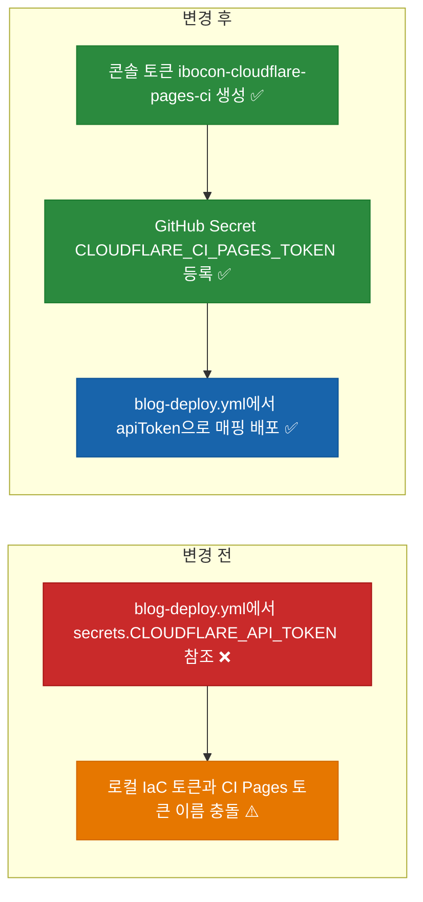

# ✅ 블로그 Cloudflare Pages 배포 시크릿의 CI 평면 네이밍(`CLOUDFLARE_CI_PAGES_TOKEN`) 정렬 리팩토링

## 계획 관계

> **관계 스키마**: `1`
> **계획 ID**: `ibocon:261015_refac_align-blog-ci-secret-naming`
> **출처 판정**: `연결`
> **출처 판정 근거**: 3계층 토큰 네이밍 컨벤션(`ibocon-cloudflare-pages-ci` ↔ `CLOUDFLARE_CI_PAGES_TOKEN`) 확정에 따라 블로그 배포 워크플로와 프로비저닝 스크립트의 시크릿 이름을 로컬 공통 `CLOUDFLARE_API_TOKEN`에서 CI 전용 `CLOUDFLARE_CI_PAGES_TOKEN`으로 분리·정렬하는 후속 리팩토링

| 관계 | 대상 계획 ID | 조건 | 근거·인수 범위 |
| --- | --- | --- | --- |
| 후속 | `ibocon:261015_feat_configure-blog-cloudflare-and-analytics-bindings` | 해당 없음 | `.github/workflows/blog-deploy.yml` 및 `Register-BlogCloudflareAndGitHubBindings.ps1`의 시크릿 키 이름을 `CLOUDFLARE_CI_PAGES_TOKEN`으로 변경하고 기존 `CLOUDFLARE_API_TOKEN` GitHub Secret 제거 |

<!-- plan-relations-summary:start -->
> 자동 생성 관계 요약. 원본은 위 관계 표입니다.

| 구분 | 계획·조건 |
| --- | --- |
| 최초 계획 | [✅ Astro 및 Cloudflare Pages 기반 마크다운 기술 블로그 구축 계획](<261015_feat_astro-markdown-blog-cloudflare-pages.md>) `ibocon:261015_feat_astro-markdown-blog-cloudflare-pages` |
| 직접 출처 | [✅ 블로그 Cloudflare Pages 배포 시크릿 및 AdSense·GA4 단독 바인딩 경량화 계획](<261015_feat_configure-blog-cloudflare-and-analytics-bindings.md>) `ibocon:261015_feat_configure-blog-cloudflare-and-analytics-bindings` |
| 직접 후속 | [✅ 블로그 Cloudflare Pages 배포 시크릿 및 AdSense·GA4 단독 바인딩 사용자 실행 검증](<261015_verify_configure-blog-cloudflare-and-analytics-bindings.md>) `ibocon:261015_verify_configure-blog-cloudflare-and-analytics-bindings`<br/>[✅ 블로그 배포 대상을 레거시 Cloudflare Pages에서 Workers Static Assets로 전환](<../261016/261016_refac_migrate-blog-to-cloudflare-workers-static-assets.md>) `ibocon:261016_refac_migrate-blog-to-cloudflare-workers-static-assets` |
| 계보 경로 | [✅ Astro 및 Cloudflare Pages 기반 마크다운 기술 블로그 구축 계획](<261015_feat_astro-markdown-blog-cloudflare-pages.md>) `ibocon:261015_feat_astro-markdown-blog-cloudflare-pages` → [✅ 블로그 Cloudflare Pages 배포 시크릿 및 AdSense·GA4 단독 바인딩 경량화 계획](<261015_feat_configure-blog-cloudflare-and-analytics-bindings.md>) `ibocon:261015_feat_configure-blog-cloudflare-and-analytics-bindings` → [✅ 블로그 Cloudflare Pages 배포 시크릿의 CI 평면 네이밍(`CLOUDFLARE_CI_PAGES_TOKEN`) 정렬 리팩토링](<261015_refac_align-blog-ci-secret-naming.md>) `ibocon:261015_refac_align-blog-ci-secret-naming` |
| 후속 | [✅ 블로그 Cloudflare Pages 배포 시크릿 및 AdSense·GA4 단독 바인딩 경량화 계획](<261015_feat_configure-blog-cloudflare-and-analytics-bindings.md>) `ibocon:261015_feat_configure-blog-cloudflare-and-analytics-bindings` — 해당 없음 |
| 착수 조건 | 가능 |
<!-- plan-relations-summary:end -->

## 결정이 필요한 사항

1. ~~**GitHub Actions용 Cloudflare Pages 배포 시크릿 이름** — `CLOUDFLARE_API_TOKEN` 대신 `CLOUDFLARE_CI_PAGES_TOKEN`으로 명명하고 Cloudflare 콘솔 토큰 이름은 `ibocon-cloudflare-pages-ci`로 지정 (권장)~~
- ~~근거: 하네스 `secret-name.md` 규약(`{PROVIDER}_CI_{CAPABILITY}_TOKEN`)에 따라 로컬 OpenTofu가 사용하는 `CLOUDFLARE_API_TOKEN`(`hanul-cloudflare-iac`)과 GitHub Actions가 사용하는 Pages 배포 전용 토큰(`CLOUDFLARE_CI_PAGES_TOKEN` / `ibocon-cloudflare-pages-ci`)을 이름과 저장소 양쪽에서 명확히 분리한다.~~
- ~~대안: `CLOUDFLARE_API_TOKEN` 유지.~~
- ~~결정: `CLOUDFLARE_CI_PAGES_TOKEN` 및 콘솔 토큰명 `ibocon-cloudflare-pages-ci`로 확정 및 반영 완료.~~

## 배경

- **현재 문제점**:
  1. `.github/workflows/blog-deploy.yml`과 `site/scripts/Register-BlogCloudflareAndGitHubBindings.ps1`이 GitHub Secret 이름으로 로컬 공통 평면 이름인 `CLOUDFLARE_API_TOKEN`을 사용하고 있어, `hanul-cloudflare-iac`(DNS·Workers 권한)와 블로그 Pages CI 배포 토큰(`Account.Cloudflare Pages:Edit` 단일 권한)의 경계가 이름으로 구분되지 않는다.
  2. 직전 V1 테스트 과정에서 `ibocon/ibocon` 저장소에 `CLOUDFLARE_API_TOKEN` 이름으로 `hanul-cloudflare-iac` 사본이 임시 등록되어 있으므로, 이를 제거하고 `CLOUDFLARE_CI_PAGES_TOKEN`으로 교체해야 한다.
- **리팩토링 방향**:
  1. `.github/workflows/blog-deploy.yml`에서 `secrets.CLOUDFLARE_API_TOKEN` 참조를 `secrets.CLOUDFLARE_CI_PAGES_TOKEN`으로 변경하고 `wrangler-action@v3`의 `apiToken` 입력에 매핑한다.
  2. `site/scripts/Register-BlogCloudflareAndGitHubBindings.ps1`이 `ibocon-cloudflare-pages-ci` 토큰을 입력받아 `CLOUDFLARE_CI_PAGES_TOKEN` 시크릿으로 등록하고, 레거시 `CLOUDFLARE_API_TOKEN` 시크릿이 존재하면 정리하도록 수정한다.
  3. `site/tests/blog-build.test.ts`에 워크플로 파일(`blog-deploy.yml`)이 `CLOUDFLARE_CI_PAGES_TOKEN`을 참조하는지 확인하는 정적 계약 테스트를 추가한다.

## 변경 범위



| 레이어 | 파일 | 변경 내용 |
| --- | --- | --- |
| CI/CD | `.github/workflows/blog-deploy.yml` | `secrets.CLOUDFLARE_API_TOKEN`을 `secrets.CLOUDFLARE_CI_PAGES_TOKEN`으로 변경 |
| Provisioning | `site/scripts/Register-BlogCloudflareAndGitHubBindings.ps1` | 프롬프트에 콘솔 토큰명(`ibocon-cloudflare-pages-ci`)을 안내하고 `CLOUDFLARE_CI_PAGES_TOKEN`으로 등록하도록 변경 |
| Test | `site/tests/blog-build.test.ts` | `blog-deploy.yml`이 `CLOUDFLARE_CI_PAGES_TOKEN`을 사용하고 `CLOUDFLARE_API_TOKEN`을 참조하지 않는지 검증하는 테스트 추가 |

## 단계별 수정 계획

### ✅ Step 1: `.github/workflows/blog-deploy.yml`의 시크릿 참조를 `CLOUDFLARE_CI_PAGES_TOKEN`으로 변경

**파일**: `.github/workflows/blog-deploy.yml`

AS-IS:

```yaml
# source-snapshot: true
# path: .github/workflows/blog-deploy.yml
      - name: Publish to Cloudflare Pages
        if: ${{ secrets.CLOUDFLARE_API_TOKEN != '' && secrets.CLOUDFLARE_ACCOUNT_ID != '' }}
        uses: cloudflare/wrangler-action@v3
        with:
          apiToken: ${{ secrets.CLOUDFLARE_API_TOKEN }}
          accountId: ${{ secrets.CLOUDFLARE_ACCOUNT_ID }}
          command: pages deploy site/dist --project-name=botanicsoft-blog
```

TO-BE:

```yaml
      - name: Publish to Cloudflare Pages
        if: ${{ secrets.CLOUDFLARE_CI_PAGES_TOKEN != '' && secrets.CLOUDFLARE_ACCOUNT_ID != '' }}
        uses: cloudflare/wrangler-action@v3
        with:
          apiToken: ${{ secrets.CLOUDFLARE_CI_PAGES_TOKEN }}
          accountId: ${{ secrets.CLOUDFLARE_ACCOUNT_ID }}
          command: pages deploy site/dist --project-name=botanicsoft-blog
```

### ✅ Step 2: `Register-BlogCloudflareAndGitHubBindings.ps1` 시크릿 키 이름을 `CLOUDFLARE_CI_PAGES_TOKEN`으로 변경

**파일**: `site/scripts/Register-BlogCloudflareAndGitHubBindings.ps1`

AS-IS:

```powershell
# source-snapshot: true
# path: site/scripts/Register-BlogCloudflareAndGitHubBindings.ps1
if ($PromptCloudflareToken) {
    $SecureToken = Read-Host -Prompt 'Enter CLOUDFLARE_API_TOKEN' -AsSecureString
    $PlainToken = [System.Net.NetworkCredential]::new('', $SecureToken).Password
    try {
        if (-not [string]::IsNullOrWhiteSpace($PlainToken)) {
            $PlainToken | & gh secret set CLOUDFLARE_API_TOKEN --repo $Repository
            Write-Information "Registered secret: CLOUDFLARE_API_TOKEN" -InformationAction Continue

            if ([string]::IsNullOrWhiteSpace($CloudflareAccountId)) {
                $AccountsResponse = Invoke-RestMethod -Method Get -Uri 'https://api.cloudflare.com/client/v4/accounts' -Headers @{
                    Authorization = "Bearer $PlainToken"
                }
                if ($AccountsResponse.result -and $AccountsResponse.result.Count -gt 0) {
                    $CloudflareAccountId = [string] $AccountsResponse.result[0].id
                    $CloudflareAccountId | & gh secret set CLOUDFLARE_ACCOUNT_ID --repo $Repository
                    Write-Information "Auto-discovered and registered secret: CLOUDFLARE_ACCOUNT_ID ($CloudflareAccountId)" -InformationAction Continue
                }
            }
        }
    }
    finally {
        $PlainToken = $null
    }
}
```

TO-BE:

```powershell
if ($PromptCloudflareToken) {
    $SecureToken = Read-Host -Prompt 'Enter CLOUDFLARE_CI_PAGES_TOKEN (console token: ibocon-cloudflare-pages-ci)' -AsSecureString
    $PlainToken = [System.Net.NetworkCredential]::new('', $SecureToken).Password
    try {
        if (-not [string]::IsNullOrWhiteSpace($PlainToken)) {
            $PlainToken | & gh secret set CLOUDFLARE_CI_PAGES_TOKEN --repo $Repository
            Write-Information "Registered secret: CLOUDFLARE_CI_PAGES_TOKEN" -InformationAction Continue

            if ([string]::IsNullOrWhiteSpace($CloudflareAccountId)) {
                $AccountsResponse = Invoke-RestMethod -Method Get -Uri 'https://api.cloudflare.com/client/v4/accounts' -Headers @{
                    Authorization = "Bearer $PlainToken"
                }
                if ($AccountsResponse.result -and $AccountsResponse.result.Count -gt 0) {
                    $CloudflareAccountId = [string] $AccountsResponse.result[0].id
                    $CloudflareAccountId | & gh secret set CLOUDFLARE_ACCOUNT_ID --repo $Repository
                    Write-Information "Auto-discovered and registered secret: CLOUDFLARE_ACCOUNT_ID ($CloudflareAccountId)" -InformationAction Continue
                }
            }
        }
    }
    finally {
        $PlainToken = $null
    }
}
```

## 테스트 계획

> 위치: `site/tests/`
> 프레임워크: Vitest
> 패턴: Given/When/Then (Four-Phase Test)

### ✅ 테스트: `blog-build.test.ts`

**파일**: `site/tests/blog-build.test.ts`

AS-IS:

```typescript
# source-snapshot: true
# path: site/tests/blog-build.test.ts
    // Then
    expect(normalized).toBe('pub-1234567890123456');
    expect(line).toBe('google.com, pub-1234567890123456, DIRECT, f08c47fec0942fa0\n');
  });
});
```

TO-BE:

```typescript
    // Then
    expect(normalized).toBe('pub-1234567890123456');
    expect(line).toBe('google.com, pub-1234567890123456, DIRECT, f08c47fec0942fa0\n');
  });

  it('Given_BlogDeployWorkflow_When_Inspected_Then_UsesCiPagesTokenSecretName', () => {
    // Given
    const workflowPath = resolve(process.cwd(), '..', '.github', 'workflows', 'blog-deploy.yml');

    // When
    const workflowContent = readFileSync(workflowPath, 'utf-8');

    // Then
    expect(workflowContent).toContain('secrets.CLOUDFLARE_CI_PAGES_TOKEN');
    expect(workflowContent).not.toContain('secrets.CLOUDFLARE_API_TOKEN');
  });
});
```

### 테스트 요약

| 테스트 클래스 | 검증 대상 | 테스트 수 |
| --- | --- | ---: |
| `blog-build.test.ts` | 정적 빌드 산출물, `ads.txt` 정규화, `blog-deploy.yml`의 `CLOUDFLARE_CI_PAGES_TOKEN` 시크릿 참조 검증 | 3 |
| **합계** | | **3** |

### 테스트 결과

| 범위 | 실행 명령 | 총 테스트 | 통과 | 실패 | 결과 |
| --- | --- | ---: | ---: | ---: | :---: |
| 변경 범위 | `npm --prefix site test` | 3 | 3 | 0 | ✅ |
| 전체 | `npm --prefix site run build && npm --prefix site test` | 3 | 3 | 0 | ✅ |

**실행 일시**: 2026-10-16 12:40

## 후속 검증

| 검증 항목 | 이관한 verify 계획 | 상태 |
| --- | --- | --- |
| Cloudflare 콘솔에서 `ibocon-cloudflare-pages-ci` 토큰 발급 후 `CLOUDFLARE_CI_PAGES_TOKEN` 등록 및 `blog.botanicsoft.com` 실배포 검증 | [verify 계획](../../../../planning/261015_verify_configure-blog-cloudflare-and-analytics-bindings.md) | 이관 |

## 계획 평가

| 관점 | 참조 문서 | 평가 항목 | 결과 |
| --- | --- | --- | --- |
| 클린 코드 | `clean-code.md` | 시크릿 이름(`CLOUDFLARE_CI_PAGES_TOKEN`)만으로 소비 평면(CI)과 권한(Pages)을 명확히 표현 | ✅ |
| 아키텍처 | `clean-architecture.md` | 로컬 IaC 토큰(`CLOUDFLARE_API_TOKEN`)과 CI 배포 토큰의 보안 경계 분리 | ✅ |
| 디자인 패턴 | `design-pattern.md` | GitHub Secret 이름을 `wrangler-action`의 `apiToken` 입력으로 명시적 매핑 | ✅ |
| 엔터프라이즈 패턴 | `enterprise-application-architecture.md` | 최소 권한 원칙(Least Privilege)과 감사 추적성 확보 | ✅ |
| 리팩토링 | `refactoring.md` | 범용 시크릿 이름(`CLOUDFLARE_API_TOKEN`) 재사용 냄새 제거 | ✅ |
| 테스트 품질 | `testing/docs/guide/x-unit-test-patterns.md` | 워크플로 YAML의 시크릿 이름 계약을 단위 테스트로 고정 | ✅ |
| .NET 도메인·컨벤션 | `dotnet/docs/guide·convention` | GitHub Actions YAML 및 PowerShell/TypeScript 작업으로 C# 코드 변경 없음 | 해당 없음 |

**특이사항:**

없음

## 작업 순서

1. `.github/workflows/blog-deploy.yml`의 시크릿 참조를 `CLOUDFLARE_CI_PAGES_TOKEN`으로 수정한다.
2. `site/scripts/Register-BlogCloudflareAndGitHubBindings.ps1`의 시크릿 등록 키를 `CLOUDFLARE_CI_PAGES_TOKEN`으로 수정한다.
3. `site/tests/blog-build.test.ts`에 시크릿 이름 검증 테스트를 추가하고 `npm --prefix site test`를 실행한다.
4. 후속 검증 계획서(`261015_verify_configure-blog-cloudflare-and-analytics-bindings.md`)에 따라 `ibocon-cloudflare-pages-ci` 토큰을 `CLOUDFLARE_CI_PAGES_TOKEN`에 등록하고 배포를 확인한다.
