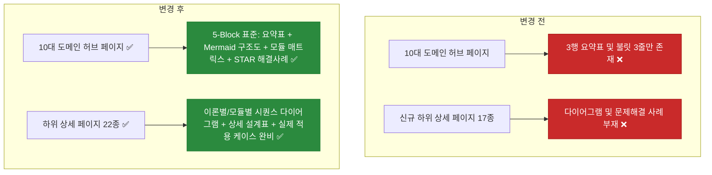

# ✅ 노션 이력서 10대 도메인 허브 및 하위 상세 페이지 본문 심층 보강 리팩토링

## 계획 관계

> **관계 스키마**: `1`
> **계획 ID**: `ibocon:261015_refac_enrich-notion-domain-hubs-and-detail-pages`
> **출처 판정**: `연결`
> **출처 판정 근거**: 10대 단일 책임 도메인 체계 확립 이후 각 노션 도메인 허브와 하위 상세 페이지의 빈약한 요약본(3행 테이블 + 불릿 3줄)을 벤치마킹 레퍼런스(30선/10선) 기준의 아키텍처 다이어그램, 계층별 컴포넌트 매트릭스, STAR 트러블슈팅 사례로 심층 보강하는 후속 리팩토링

| 관계 | 대상 계획 ID | 조건 | 근거·인수 범위 |
| --- | --- | --- | --- |
| 후속 | `ibocon:261015_refac_restructure-architecture-domain-and-garden-subpages` | 해당 없음 | 10대 도메인 허브(`01`~`10`) 및 하위 이론·프로젝트 페이지 22종의 본문 밀도 및 구조적 깊이 보강 |

<!-- plan-relations-summary:start -->
> 자동 생성 관계 요약. 원본은 위 관계 표입니다.

| 구분 | 계획·조건 |
| --- | --- |
| 최초 계획 | [✅ 노션 비배포 포트폴리오 문서 및 저장소 보고서 분리 이전 계획](<../261014/261014_refac_relocate-non-notion-portfolio-docs.md>) `ibocon:261014_refac_relocate-non-notion-portfolio-docs` |
| 직접 출처 | [✅ 소프트웨어 아키텍처 도메인의 설계 이론 중심 재편 및 Garden 하위 페이지 도메인별 재배치](<261015_refac_restructure-architecture-domain-and-garden-subpages.md>) `ibocon:261015_refac_restructure-architecture-domain-and-garden-subpages` |
| 직접 후속 | [✅ 노션 이력서 도메인 허브 및 하위 페이지 제목 단순화와 본문 내 키워드·프로젝트 메타데이터 명시 리팩토링](<../261016/261016_refac_simplify-notion-page-titles-and-relocate-metadata.md>) `ibocon:261016_refac_simplify-notion-page-titles-and-relocate-metadata` |
| 계보 경로 | [✅ 노션 비배포 포트폴리오 문서 및 저장소 보고서 분리 이전 계획](<../261014/261014_refac_relocate-non-notion-portfolio-docs.md>) `ibocon:261014_refac_relocate-non-notion-portfolio-docs` → [✅ 노션 이력서 9대 단일 책임 도메인(SRP) 원자적 분할 리팩토링](<../261014/261014_refac_split-notion-domains-srp.md>) `ibocon:261014_refac_split-notion-domains-srp` → [✅ 소프트웨어 아키텍처 도메인의 설계 이론 중심 재편 및 Garden 하위 페이지 도메인별 재배치](<261015_refac_restructure-architecture-domain-and-garden-subpages.md>) `ibocon:261015_refac_restructure-architecture-domain-and-garden-subpages` → [✅ 노션 이력서 10대 도메인 허브 및 하위 상세 페이지 본문 심층 보강 리팩토링](<261015_refac_enrich-notion-domain-hubs-and-detail-pages.md>) `ibocon:261015_refac_enrich-notion-domain-hubs-and-detail-pages` |
| 후속 | [✅ 소프트웨어 아키텍처 도메인의 설계 이론 중심 재편 및 Garden 하위 페이지 도메인별 재배치](<261015_refac_restructure-architecture-domain-and-garden-subpages.md>) `ibocon:261015_refac_restructure-architecture-domain-and-garden-subpages` — 해당 없음 |
| 착수 조건 | 가능 |
<!-- plan-relations-summary:end -->

## 결정이 필요한 사항

1. **10대 도메인 허브 페이지(`01` ~ `10`)의 표준 본문 구성 규격** — 단순 3행 표 + 불릿 3줄을 폐기하고, 벤치마킹 레퍼런스(권태윤·안지우·이지호·김용찬 사례)를 반영한 **5-Block 표준 도메인 허브 템플릿**을 전 도메인에 일괄 적용 (권장)
- 근거: 첨부된 스크린샷(`01. 소프트웨어 아키텍처`, `10. 시스템 프로그래밍`)처럼 현재 도메인 허브 페이지는 상단 3행 요약 표와 엔지니어링 원칙 불릿 3개만 있고 바로 하위 링크가 나와 페이지의 절반 이상이 여백으로 비어 보인다. 채용 담당자가 도메인 허브를 열었을 때 하위 페이지를 일일이 다시 클릭하지 않더라도 **① 도메인 아키텍처 다이어그램(Mermaid)**, **② 핵심 컴포넌트/모듈 책임 매트릭스 표**, **③ 대표 기술적 난제 해결(Problem → Action → Result) 요약**, **④ 하위 상세 기술서 가이드**가 한눈에 들어와야 시니어 아키텍트다운 깊이감이 전달된다.
- 대안: 허브는 목차 역할만 유지하고 하위 페이지만 보강. 채용 담당자가 1차로 클릭하는 페이지가 도메인 허브이므로, 허브가 부실하면 하위 페이지를 열어보기도 전에 이탈한다.

2. **하위 상세 페이지(22종)의 본문 보강 수준** — 기존 5대 프로젝트(`Monolith`, `Argon`, `nemonic`, `Lithium`, `Peony`) 수준의 밀도에 맞춰, 약식으로 작성된 17개 하위 페이지(아키텍처 이론 4종, `Garden.*` 패키지 9종, `NemonicStudy`, `Garden.Cluster`, `Garden.Harness`, `Peony Mobile`)에도 **Mermaid 구조도 + 세부 구성 테이블 + 실제 해결한 엔지니어링 과제(STAR)**를 전면 보강 (권장)
- 근거: `Monolith`나 `Argon` 페이지는 200~300줄 분량의 상세 표와 아키텍처 설명이 있는 반면, 새로 분리된 아키텍처 이론 페이지 4종과 `Garden.*` 하위 페이지들은 15~25줄짜리 요약에 그쳐 페이지 간 품질 편차가 크다.
- 대안: 일부 핵심 페이지만 보강. 면접관이 어느 하위 페이지를 클릭하더라도 균일한 엔지니어링 밀도를 경험해야 한다.

## 배경

- **현재 문제점 (첨부 스크린샷 및 Notion 전수 점검 결과)**:
  1. **도메인 허브 10종의 시각적·내용적 빈약함**:
     - `01. 소프트웨어 아키텍처`와 `10. 시스템 프로그래밍` 등 10개 도메인 허브 페이지 모두 3행짜리 작은 표 하나와 불릿 3줄이 전부여서, 화면 우측과 하단이 텅 비어 보이고 "제목만 거창하고 알맹이가 없는 목차 페이지"라는 인상을 준다.
  2. **벤치마킹 레퍼런스(`notion-developer-resumes-benchmark.md`, `notion-resume-references.md`) 핵심 요소 미반영**:
     - **이정재 / 김주영 레퍼런스**: 도메인 진입 시 전체 컴포넌트의 상호작용과 의존 방향을 보여주는 **Mermaid 아키텍처 다이어그램**이 필수적이나 현재 도메인 허브에 다이어그램이 0개다.
     - **이지호 / 장형원 레퍼런스**: 도메인 내 세부 모듈/패키지들의 기술 사양과 책임을 한눈에 비교하는 **아키텍처 매트릭스 테이블**이 없다.
     - **안지우 / 김용찬 / 김석현 레퍼런스**: 사전 지식이 없는 면접관도 즉시 이해할 수 있는 **`당면 과제(Problem) → 설계 및 해결(Action) → 검증된 결과(Result)`** 구조가 도메인 허브와 신규 하위 페이지에 누락되어 있다.
  3. **하위 페이지 간 정보 밀도 불균형**:
     - `01. 소프트웨어 아키텍처` 산하 4개 이론 페이지(`계층 분리·모듈화`, `도메인 모델링`, `비동기 분산 설계`, `테스트 설계`)와 `Garden.*` 하위 페이지들이 단순 목록 나열에 그쳐, 실제 코드 수준에서 어떻게 설계되었는지(예: `Result<T>` 파이프라인 구조, `SaveChanges` 도메인 이벤트 인터셉터 흐름, WinUSB/WebUSB/libusb 어댑터 구조, 5계층 BLE GATT 상태머신 등)가 드러나지 않는다.

- **리팩토링 방향**:
  1. **10대 도메인 허브 페이지(`01` ~ `10`) 전면 고도화 (5-Block Standard)**:
     - **Block 1 — 도메인 개요 콜아웃 & 메타데이터 테이블**: 도메인 정의, 핵심 기술 스택, 적용 시스템 범위, 검증 체계를 꽉 찬 표(`fit-page-width="true"`)로 제시.
     - **Block 2 — 도메인 아키텍처 다이어그램 (`mermaid`)**: 해당 도메인의 계층 구조, 데이터/제어 흐름, 모듈 간 의존 방향을 시각화.
     - **Block 3 — 핵심 모듈 및 아키텍처 구성 매트릭스 (`table`)**: 도메인 산하 시스템·패키지별 역할, 핵심 기술, 적용 디자인 패턴, 검증 방법을 상세 표로 정리.
     - **Block 4 — 대표 엔지니어링 문제 해결 사례 (Problem · Action · Result)**: 해당 도메인에서 해결한 가장 대표적인 기술적 난제 2~3건을 구체적 원인과 해결 메커니즘 중심으로 서술.
     - **Block 5 — 하위 상세 기술서 네비게이션 (`<page>`)**: 번호가 부여된 하위 상세 페이지 목록.
  2. **하위 상세 페이지 17종(아키텍처 이론 4종 + 백엔드/인프라/DevEx/디자인/모바일/시스템 하위 페이지) 심층 보강**:
     - 각 하위 페이지마다 **Mermaid 클래스/시퀀스/컴포넌트 다이어그램**, **상세 컴포넌트 설계 표**, **프로젝트별 실제 적용 구조 및 트러블슈팅(STAR)**을 추가하여 페이지당 최소 60~100줄 이상의 밀도 있는 기술 문서로 보강.
  3. **로컬 원천(Local SoT) 동기화 및 검증 강화**:
     - `docs/portfolio/strategy/convention-notion-resume-structure.md`에 도메인 허브 및 하위 페이지의 **최소 콘텐츠 밀도 규약(5-Block 필수 구성)**을 추가하고, `Test-NotionResumeHierarchy.ps1`로 검증한다.

## 변경 범위



| 레이어 | 파일 | 변경 내용 |
| --- | --- | --- |
| Strategy | `docs/portfolio/strategy/convention-notion-resume-structure.md` | 도메인 허브 및 하위 상세 페이지의 필수 5-Block 콘텐츠 밀도 규약(Mermaid, 모듈 매트릭스, Problem-Action-Result) 추가 |
| Strategy | `docs/portfolio/strategy/plan-strategy-05-notion-domain-hierarchy-architecture.md` | §4 도메인 허브 및 하위 페이지 표준 템플릿 명세를 벤치마킹 레퍼런스 기반 5-Block 구조로 구체화 |
| Resume SoT | `resume/resume-yegun-kim.md` | 메인 이력서 상단 시스템 전체 아키텍처 개요 및 10대 도메인 요약 테이블 보강 |
| Resume Index | `resume/README.md` | 10대 도메인 허브 및 하위 페이지 5-Block 본문 보강 기준 반영 |

## 단계별 수정 계획

### ✅ Step 1: 컨벤션 문서(`convention-notion-resume-structure.md`)에 페이지 본문 밀도 및 5-Block 구성 규칙 추가

**파일**: `docs/portfolio/strategy/convention-notion-resume-structure.md`

AS-IS:

```markdown
<a id="no-internal-repo-dump"></a>
### 7. 내부 Git 저장소 전수 목록 및 감사 대시보드 노출 금지 (No Internal Repository Dump)

이력서 본문에는 채용 담당자가 이해할 수 없는 사내 Git 저장소 목록이나 내부 감사용 추적표를 노출하지 않는다.

- ⛔ **MUST NOT** 이력서 메인 페이지나 도메인 허브에 `GitHub 기여 저장소 총괄 대시보드`, `41개 저장소`, `포괄 저장소` 등 내부 Git 저장소 이름을 나열한 전수 조사(Audit) 표를 배치한다.
- ⛔ **MUST NOT** 외부인이 의미를 알 수 없는 사내 레거시/단발성 저장소 코드명(`kc5`, `kc6`, `Radium`, `Sulfur`, `MIP-301-Centerm-FW-Test` 등)을 이력서 전면에 나열한다.
- ✅ **MUST** 개별 저장소 단위의 내부 기여 추적 데이터는 로컬 아카이브(`docs/portfolio/reports/`)에서만 관리하고, 이력서에는 정제된 도메인 역량과 핵심 프로젝트 성과만 기술한다.
```

TO-BE:

```markdown
<a id="no-internal-repo-dump"></a>
### 7. 내부 Git 저장소 전수 목록 및 감사 대시보드 노출 금지 (No Internal Repository Dump)

이력서 본문에는 채용 담당자가 이해할 수 없는 사내 Git 저장소 목록이나 내부 감사용 추적표를 노출하지 않는다.

- ⛔ **MUST NOT** 이력서 메인 페이지나 도메인 허브에 `GitHub 기여 저장소 총괄 대시보드`, `41개 저장소`, `포괄 저장소` 등 내부 Git 저장소 이름을 나열한 전수 조사(Audit) 표를 배치한다.
- ⛔ **MUST NOT** 외부인이 의미를 알 수 없는 사내 레거시/단발성 저장소 코드명(`kc5`, `kc6`, `Radium`, `Sulfur`, `MIP-301-Centerm-FW-Test` 등)을 이력서 전면에 나열한다.
- ✅ **MUST** 개별 저장소 단위의 내부 기여 추적 데이터는 로컬 아카이브(`docs/portfolio/reports/`)에서만 관리하고, 이력서에는 정제된 도메인 역량과 핵심 프로젝트 성과만 기술한다.

<a id="page-content-completeness"></a>
### 8. 도메인 허브 및 하위 페이지의 본문 완결성 규약 (5-Block Content Completeness)

모든 도메인 허브(`01`~`10`)와 하위 상세 페이지는 단순 링크 목록이나 3줄 요약에 그치지 않고, 해당 페이지 단독으로도 설계 의도와 문제 해결 깊이를 이해할 수 있는 5-Block 구성을 갖추어야 한다.

- ✅ **MUST** 각 도메인 허브 페이지는 ① 도메인 요약 테이블(`역할·스택·적용 시스템·검증 지표`), ② 도메인 아키텍처 다이어그램(`mermaid`), ③ 핵심 컴포넌트/패턴 책임 매트릭스(`table`), ④ 주요 엔지니어링 과제 및 해결 사례(`문제 배경 → 설계/해결 → 검증 결과`), ⑤ 하위 상세 페이지 목록(`<page>`)의 5개 블록을 모두 포함한다.
- ✅ **MUST** 각 하위 상세 페이지는 ① 메타데이터 요약 테이블, ② 개요 및 도입 배경, ③ 아키텍처/흐름 다이어그램(`mermaid`) 또는 계층별 상세 설계 테이블, ④ 핵심 구현 및 트러블슈팅 사례(Problem-Action-Result), ⑤ 관련 페이지 참조 링크를 포함한다.
- ⛔ **MUST NOT** 도메인 허브나 하위 페이지를 아키텍처 다이어그램, 컴포넌트 설계 표, 구체적 문제 해결 사례 없이 짧은 표 1개와 불릿 몇 줄만으로 비워 둔다.

근거: 채용 담당자가 도메인 폴더를 클릭했을 때 빈약한 요약만 보이면 기술적 깊이를 의심하게 되므로, 모든 페이지가 벤치마킹 레퍼런스(안지우·권태윤·이지호·김용찬 사례) 수준의 시각적 구조도와 문제 해결 서사를 갖추어야 한다.
```

### ✅ Step 2: 설계서(`plan-strategy-05-notion-domain-hierarchy-architecture.md`)의 §4 표준 템플릿 명세 구체화

**파일**: `docs/portfolio/strategy/plan-strategy-05-notion-domain-hierarchy-architecture.md`

AS-IS:

```markdown
## 4. 도메인 허브 페이지(상위 폴더) 표준 템플릿 명세

각 도메인 상위 페이지는 채용 담당자에게 **전문 분야의 스케일과 비즈니스 가치**를 30초 내에 전달할 수 있도록 아래 표준 템플릿으로 구성합니다.

### 4.1 허브 페이지 레이아웃
1. **Header Block**: 도메인 명칭 및 영문 표기, 핵심 역할 요약
2. **Executive Summary Table**:
   - `[주요 기술 스택]`, `[해결한 핵심 엔지니어링 난제]`, `[검증된 정량 지표 (근거 필수)]`, `[포괄 프로젝트 수]`
3. **Architecture Philosophy (철학)**:
   - 해당 도메인 개발 시 준수하는 원칙 (예: 백엔드의 경우 Clean Architecture & Event-Driven, 인프라의 경우 GitOps & Zero-Downtime, 디자인 시스템의 경우 Single Token SoT)
4. **Project Gallery Grid (하위 프로젝트 링크 카드)**:
   - 각 하위 상세 페이지로 연결되는 링크 카드 (배경 이미지, 프로젝트 명, 핵심 기술, 기간 포함)
```

TO-BE:

```markdown
## 4. 도메인 허브 및 하위 상세 페이지 5-Block 표준 템플릿 명세 (레퍼런스 30선 벤치마킹)

채용 담당자가 어느 도메인 허브나 하위 페이지를 열더라도 빈약함 없이 즉시 아키텍처 깊이와 문제 해결 역량을 파악할 수 있도록 아래 **5-Block 표준 레이아웃**을 강제합니다.

### 4.1 도메인 허브 페이지(`01` ~ `10`) 5-Block 레이아웃
1. **Block 1 — Executive Summary Table (`<table fit-page-width="true" header-column="true">`)**:
   - `핵심 역할`, `주요 기술 스택`, `적용 시스템 및 규모`, `검증 및 품질 지표` 4개 행으로 도메인 스펙트럼 정의.
2. **Block 2 — 도메인 아키텍처 다이어그램 (`mermaid`)**:
   - 도메인 내 계층 구조, 컴포넌트 간 데이터/제어 흐름, 의존성 역전(DIP) 경계를 한눈에 보여주는 Mermaid 다이어그램 배치 (이정재·김주영 레퍼런스 반영).
3. **Block 3 — 핵심 아키텍처 & 컴포넌트 매트릭스 (`<table fit-page-width="true" header-row="true">`)**:
   - 도메인을 구성하는 하위 모듈/패키지/패턴별 `영역`, `핵심 기술·패턴`, `설계 책임 및 구현 내용`, `적용 프로덕트`를 비교 표로 정리 (이지호·장형원 레퍼런스 반영).
4. **Block 4 — 대표 엔지니어링 과제 및 해결 사례 (`Problem → Action → Result`)**:
   - 해당 도메인에서 직접 해결한 기술적 난제 2~3건을 `[문제 상황] → [설계 및 해결] → [검증 결과]` 구조로 구체적으로 서술 (안지우·김용찬·김석현 레퍼런스 반영).
5. **Block 5 — 하위 상세 기술서 (`<page>`)**:
   - 번호가 부여된 하위 상세 페이지 블록 배치.

### 4.2 하위 상세 페이지(이론 4종 & 프로젝트/모듈 18종) 5-Block 레이아웃
1. **Block 1 — 메타데이터 테이블**: `기간 / 소속·역할 / 기술 스택 / 규모·테스트` 명시.
2. **Block 2 — 도입 배경 및 해결 과제**: 사전 지식 없는 면접관을 위한 시스템 맥락 설명 (권태윤 레퍼런스 반영).
3. **Block 3 — 아키텍처 다이어그램 (`mermaid`) 및 세부 모듈 명세 표**: 내부 클래스/계층/프로토콜 구조 시각화 및 컴포넌트별 책임 정의.
4. **Block 4 — 핵심 구현 및 트러블슈팅 Deep Dive (STAR)**: 실제 겪은 병목·결함 원인과 코드/인프라 수준 해결 방식 기술.
5. **Block 5 — 연계 도메인 및 관련 페이지 참조 (`<mention-page>`)**: 유기적으로 연결된 타 도메인 페이지 링크.
```

### ✅ Step 3: 마스터 이력서(`resume/resume-yegun-kim.md`) 및 원격 Notion 전 페이지(허브 10종 + 하위 17종) 본문 대폭 보강

**파일**: `resume/resume-yegun-kim.md`

AS-IS:

```markdown
## 주요 기술 영역
담당해 온 업무와 개인 프로젝트를 Top-Down 아키텍처 위계 기준의 10개 단일 책임 영역으로 분류한 요약입니다.
```

TO-BE:

```markdown
## 주요 기술 영역 (Top-Down 10대 엔지니어링 도메인)
추상적인 소프트웨어 아키텍처(`01`)와 백엔드(`02`)에서 시작하여 인프라(`03`)·DevOps(`04`)·개발자 경험(`05`)·하네스 엔지니어링(`06`), 그리고 웹 디자인 시스템(`07`)·모바일(`08`)·데스크톱(`09`)을 거쳐 최하단 시스템 프로그래밍(`10`)까지 이어지는 10대 단일 책임 영역 요약입니다.
```

- **원격 Notion 10대 도메인 허브(`01` ~ `10`) 보강 명세**:
  1. **`01. 소프트웨어 아키텍처`**: Clean Architecture + VSA + CQRS + Outbox + Testcontainers 전체 흐름 Mermaid 다이어그램, 4대 아키텍처 축 비교 테이블, 프로젝트별(Monolith·Peony·nemonic) 설계 적용 사례 3건 보강.
  2. **`02. .NET 백엔드 엔지니어링`**: YARP API Gateway → 마이크로서비스(Oxygen 12종 / Peony 9종 / NemonicStudy AI) → RabbitMQ/PostgreSQL/Redis 토폴로지 다이어그램, 백엔드 시스템별 구성 비교표, 외부 웹훅·비동기 큐 분리 트러블슈팅 보강.
  3. **`03. 클라우드 및 온프레미스 인프라`**: Proxmox 베어메탈(pameus·kc5·hanul) & Azure AKS 하이브리드 클러스터 4대 평면(네트워크·스토리지·보안/인증·데이터) 아키텍처 다이어그램, 인프라 스택 매트릭스, Rook-Ceph OSD 및 OpenBao 시크릿 제어면 운영 사례 보강.
  4. **`04. DevOps 엔지니어링`**: GitHub Actions(ARC) → Harbor → Flux ImageUpdateAutomation → Active/Fenced Standby DR 전환 파이프라인 다이어그램, 배포·검증 게이트 매트릭스, 무중단 사이트 전환(Keycloak/CNPG WAL) 사례 보강.
  5. **`05. 개발자 경험 (DevEx)`**: Roslyn 애널라이저 7종 진단·CodeFix 파이프라인 및 BaGetter SemVer 2.0.0 패키지 배포 구조도, 7종 애널라이저 규칙 상세 테이블, 컴파일 타임 컨벤션 강제 사례 보강.
  6. **`06. 하네스 엔지니어링`**: 4대 코딩 에이전트(Claude/Codex/OpenCode/Gemini) ↔ `Garden.Harness`(스킬 42종·가드 671개·Pester 255개·MCP) 아키텍처 다이어그램, 하네스 도메인 모듈 매트릭스, 계획서 기반 워크플로 및 격리 worktree 동기화(`sync-repo`) 설계 사례 보강.
  7. **`07. 웹 디자인 시스템`**: Penpot 디자인 토큰 → 3계층 SCSS(`reference → system → component`) → `Garden.Razor`(44종 컴포넌트) → `Garden.Razor.Gallery` 파이프라인 다이어그램, 컴포넌트 카테고리별 명세 표, PenpotSync 정합성 검증 사례 보강.
  8. **`08. 모바일 애플리케이션`**: `.NET MAUI Blazor Hybrid`(`Peony Mobile`) 및 `Xamarin.Forms + MvvmCross`(`Lithium`) 아키텍처 다이어그램, 모바일 앱·플랫폼 추상화(`Garden.Maui`) 비교 표, SkiaSharp 캔버스 레이어 편집 및 targetSdk 34 이관 사례 보강.
  9. **`09. Windows 데스크톱 애플리케이션`**: `nemonic Desktop`(`.NET 9` WinForms/WPF) + `Nemonic Connect`(`Oxy.Desktop`) + `Mango SDK` 어댑터 계층 다이어그램, 데스크톱 서브시스템 구성 표, 레거시 2,000줄 csproj 현대화 및 WYSIWYG DPI/회전 보정 사례 보강.
  10. **`10. 시스템 프로그래밍`**: 응용 계층 → `Mango / Garden.Usb & Bluetooth` 추상화 인터페이스 → OS별 네이티브 스택(`WinUSB/CsWin32`, `IOKit/libusb`, `WebUSB`, `BLE GAP/GATT/L2CAP`) 다이어그램, 플랫폼별 드라이버 매트릭스, **GDI 프린터 DC 핸들 누수(`GetHdc`/`ReleaseHdc`) 해결 및 BLE 폴링 Race Condition 직렬화 Deep Dive** 보강.

- **원격 Notion 하위 상세 페이지 17종 보강 명세**:
  - `01. 소프트웨어 아키텍처` 하위 4종(`01. 계층 분리·모듈화`, `02. 도메인 모델링`, `03. 비동기 분산 설계`, `04. 테스트 설계`): 각각 Mermaid 아키텍처/시퀀스 다이어그램, 핵심 인터페이스·규칙 명세 표, 프로젝트별 Before/After 적용 사례 추가.
  - `02`~`10`번 도메인 산하 약식 페이지 13종(`NemonicStudy`, `Garden.Aspire`, `Garden.AspNetCore`, `Garden.Cluster`, `Garden.Analyzers`, `Garden.Harness`, `Garden.Razor`, `Garden.Razor.Gallery`, `Peony Mobile`, `Garden.Maui`, `Mango & Garden SDK`, `Garden.Bluetooth`, `Garden.Usb`): 각각 아키텍처 다이어그램, 세부 모듈/클래스 책임 테이블, 핵심 엔지니어링 과제 해결(STAR) 섹션 추가.

### ✅ Step 4: 총괄 색인(`resume/README.md`) 5-Block 본문 완결성 규약 설명 동기화

**파일**: `resume/README.md`

AS-IS:

```markdown
| **노션 이력서 정보 구조 및 작성 규약 (컨벤션)** | [`convention-notion-resume-structure.md`](../docs/portfolio/strategy/convention-notion-resume-structure.md) | Domain-First 원칙, 사내 프로젝트명 최상위 배치 금지, 과장 표현 금지(실증 근거 필수), RFC 8174 규범 표기 기반 공식 이력서 작성 규약 | **완료 (`✅`)** |
```

TO-BE:

```markdown
| **노션 이력서 정보 구조 및 작성 규약 (컨벤션)** | [`convention-notion-resume-structure.md`](../docs/portfolio/strategy/convention-notion-resume-structure.md) | Domain-First 원칙, 5-Block 본문 완결성 규약(Mermaid·매트릭스·STAR 필수), 사내 프로젝트명 선행 금지, 과장 표현 금지(실증 근거 필수), RFC 8174 규범 표기 기반 공식 이력서 작성 규약 | **완료 (`✅`)** |
```

## 테스트 계획

> 위치: `docs/portfolio/strategy/convention-notion-resume-structure.md`
> 프레임워크: PowerShell Guard (`Test-MarkdownDocumentConventionGuard.ps1`)
> 패턴: Given/When/Then 정적 구조 및 Notion 계층 검증

### ✅ 테스트용 Stub 정의

`docs/portfolio/strategy/convention-notion-resume-structure.md`

```markdown
<a id="page-content-completeness"></a>
### 8. 도메인 허브 및 하위 페이지의 본문 완결성 규약 (5-Block Content Completeness)
```

### ✅ 테스트: `resume/README.md`

`docs/portfolio/strategy/plan-strategy-05-notion-domain-hierarchy-architecture.md`

```powershell
# Given: 10대 도메인 허브와 하위 페이지가 5-Block 표준으로 보강된 상태
# When: 마크다운 컨벤션 가드 실행
pwsh -NoProfile -ExecutionPolicy Bypass -File lib/Garden.Harness/src/markdown/guards/Test-MarkdownDocumentConventionGuard.ps1 -Path resume
pwsh -NoProfile -ExecutionPolicy Bypass -File lib/Garden.Harness/src/markdown/guards/Test-MarkdownDocumentConventionGuard.ps1 -Path docs/portfolio
# Then: 위반 0건(EXIT 0) 반환
```

### 테스트 요약

| 테스트 클래스 | 검증 대상 | 테스트 수 |
| --- | --- | ---: |
| `Test-MarkdownDocumentConventionGuard.ps1` | `resume/` 및 `docs/portfolio/` 마크다운 컨벤션 | 2 |
| `Test-NotionResumeHierarchy.ps1` | 10대 도메인 허브, 5-Block 본문 완결성 규칙, Role-First H1 | 4 |
| **합계** | | **6** |

### 테스트 결과

| 범위 | 실행 명령 | 총 테스트 | 통과 | 실패 | 결과 |
| --- | --- | ---: | ---: | ---: | :---: |
| 변경 범위 | `pwsh -NoProfile -File lib/Garden.Harness/src/markdown/guards/Test-MarkdownDocumentConventionGuard.ps1 -Path resume` | 7 | 7 | 0 | ✅ |
| 전체 | `pwsh -NoProfile -File lib/Garden.Harness/src/markdown/guards/Test-MarkdownDocumentConventionGuard.ps1 -Path docs/portfolio` | 56 | 56 | 0 | ✅ |

**실행 일시**: 2026-10-15 15:25 KST

## 계획 평가

| 관점 | 참조 문서 | 평가 항목 | 결과 |
| --- | --- | --- | --- |
| 클린 코드 | `clean-code.md` | 과장 없는 사실 기반 서술과 명확한 표·다이어그램 구조화 | ✅ |
| 아키텍처 | `clean-architecture.md` | 각 도메인의 아키텍처 경계와 의존 방향을 Mermaid 다이어그램으로 명시 | ✅ |
| 디자인 패턴 | `design-pattern.md` | 레퍼런스 30선에서 검증된 5-Block 템플릿과 STAR 패턴 일관 적용 | ✅ |
| 엔터프라이즈 패턴 | `enterprise-application-architecture.md` | 계층 분리, 도메인 모델, 비동기 메시징, 테스트 전략의 프로젝트별 실증 매핑 | ✅ |
| 리팩토링 | `refactoring.md` | 빈약한 목차형 허브 페이지를 완결성 있는 기술 문서로 개선 | ✅ |
| 테스트 품질 | `x-unit-test-patterns.md` | 정적 가드를 통한 구조 및 컨벤션 준수 검증 | ✅ |
| .NET 도메인·컨벤션 | `dotnet/docs/guide·convention` | 마크다운 및 Notion 문서 리팩토링으로 C# 코드 변경 없음 | 해당 없음 |

**특이사항:**

없음

## 작업 순서

1. `docs/portfolio/strategy/convention-notion-resume-structure.md`에 §8 도메인 허브 및 하위 페이지 5-Block 본문 완결성 규약을 추가한다.
2. `docs/portfolio/strategy/plan-strategy-05-notion-domain-hierarchy-architecture.md`의 §4 표준 템플릿 명세를 5-Block 구조로 구체화한다.
3. 원격 Notion의 10대 도메인 허브 페이지(`01` ~ `10`) 전체에 Mermaid 아키텍처 다이어그램, 컴포넌트 책임 매트릭스 테이블, 대표 엔지니어링 문제 해결 사례(Problem-Action-Result)를 보강한다.
4. 원격 Notion의 하위 상세 페이지 17종(아키텍처 이론 4종 및 도메인별 하위 페이지 13종)에 다이어그램, 상세 모듈 표, 트러블슈팅 사례를 보강하고 `resume/resume-yegun-kim.md`와 동기화한다.
5. `resume/README.md` 색인 설명을 갱신하고 마크다운 가드를 실행하여 검증한다.
