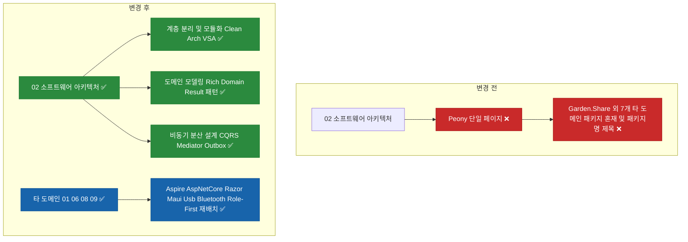

# ✅ 소프트웨어 아키텍처 도메인의 설계 이론 중심 재편 및 Garden 하위 페이지 도메인별 재배치

## 계획 관계

> **관계 스키마**: `1`
> **계획 ID**: `ibocon:261015_refac_restructure-architecture-domain-and-garden-subpages`
> **출처 판정**: `독립`
> **출처 판정 근거**: Peony 페이지 하위에 잔류한 8개 Garden 패키지 하위 페이지를 각 도메인으로 분산 재배치하고 소프트웨어 아키텍처 도메인을 설계 철학·이론 중심 하위 구조로 재편하는 리팩토링

| 관계 | 대상 계획 ID | 조건 | 근거·인수 범위 |
| --- | --- | --- | --- |

<!-- plan-relations-summary:start -->
> 자동 생성 관계 요약. 원본은 위 관계 표입니다.

| 구분 | 계획·조건 |
| --- | --- |
| 최초 계획 | [✅ 노션 비배포 포트폴리오 문서 및 저장소 보고서 분리 이전 계획](<../261014/261014_refac_relocate-non-notion-portfolio-docs.md>) `ibocon:261014_refac_relocate-non-notion-portfolio-docs` |
| 직접 출처 | [✅ 노션 이력서 9대 단일 책임 도메인(SRP) 원자적 분할 리팩토링](<../261014/261014_refac_split-notion-domains-srp.md>) `ibocon:261014_refac_split-notion-domains-srp` |
| 직접 후속 | [✅ 노션 이력서 10대 도메인 허브 및 하위 상세 페이지 본문 심층 보강 리팩토링](<261015_refac_enrich-notion-domain-hubs-and-detail-pages.md>) `ibocon:261015_refac_enrich-notion-domain-hubs-and-detail-pages` |
| 계보 경로 | [✅ 노션 비배포 포트폴리오 문서 및 저장소 보고서 분리 이전 계획](<../261014/261014_refac_relocate-non-notion-portfolio-docs.md>) `ibocon:261014_refac_relocate-non-notion-portfolio-docs` → [✅ 노션 이력서 9대 단일 책임 도메인(SRP) 원자적 분할 리팩토링](<../261014/261014_refac_split-notion-domains-srp.md>) `ibocon:261014_refac_split-notion-domains-srp` → [✅ 소프트웨어 아키텍처 도메인의 설계 이론 중심 재편 및 Garden 하위 페이지 도메인별 재배치](<261015_refac_restructure-architecture-domain-and-garden-subpages.md>) `ibocon:261015_refac_restructure-architecture-domain-and-garden-subpages` |
| 후속 | [✅ 노션 이력서 9대 단일 책임 도메인(SRP) 원자적 분할 리팩토링](<../261014/261014_refac_split-notion-domains-srp.md>) `ibocon:261014_refac_split-notion-domains-srp` — 해당 없음 |
| 착수 조건 | 가능 |
<!-- plan-relations-summary:end -->

## 결정이 필요한 사항

1. **`02. 소프트웨어 아키텍처` 도메인의 하위 페이지 구성 방식** — 설계 철학·아키텍처 이론별 하위 페이지를 두고 각 이론이 실제 프로젝트(`Monolith`, `Peony`, `nemonic Desktop`, `Garden`)에 어떻게 적용되었는지 매핑하여 서술 (권장)
- 근거: `02. 소프트웨어 아키텍처` 아래에 가계부 프로젝트(`Peony`) 하나만 두면 아키텍처 도메인이 특정 개인 프로젝트 소개에 그치게 된다. 반면 `① 계층 분리와 모듈 경계 (Clean Architecture & VSA)`, `② 도메인 주도 설계와 불변식 보호 (Rich Domain Model & Result 패턴)`, `③ 이벤트 주도 아키텍처와 분산 정합성 (CQRS & Outbox 패턴)`처럼 **설계 이론 단위로 하위 페이지를 구성**하고 각 페이지 내부에서 회사·개인 프로젝트의 실제 구현 사례를 엮어 서술하면 아키텍트로서의 설계 역량이 입체적으로 드러난다.
- 대안: 프로젝트별 하위 페이지 유지. 이미 `01. 백엔드`나 `09. 모바일`에 프로젝트가 배치되어 있어 중복되며 아키텍처 이론의 일관된 철학이 보이지 않는다.

2. **`Peony` 하위에 묶여 있던 8개 `Garden.*` 페이지의 재배치 및 명명 방식** — 사내/개인 패키지명(`Garden.Share` 등) 중심 제목을 전면 폐기하고, `[기술 역할] — 설명 (패키지명)` 형식으로 개칭하여 9대 도메인 중 해당 책임 도메인으로 각각 이동 (권장)
- 근거: 채용 담당자에게 `Garden.Share`, `Garden.Maui`, `Garden.Aspire` 같은 내부 NuGet 패키지 이름은 생소한 고유명사다. 또한 UI 컴포넌트(`Garden.Razor`), 모바일 추상화(`Garden.Maui`), USB/BLE 드라이버(`Garden.Usb/Bluetooth`), 웹 미들웨어(`Garden.AspNetCore`)가 `02. 소프트웨어 아키텍처 > Peony` 밑에 한꺼번에 매달려 있는 것은 9대 단일 책임 도메인 원칙에 정면으로 위배된다.
- 대안: `Peony` 하위에 그대로 두고 제목만 변경. 여전히 아키텍처 도메인 밑에 UI·모바일·USB/BLE 페이지가 섞여 있어 도메인 경계가 무너진다.

## 배경

- **현재 문제점**:
  1. `02. 소프트웨어 아키텍처` 도메인 하위에 `[분산 메시징] RabbitMQ & Outbox 패턴 가계부 서비스 (Peony)` 페이지가 있고, 그 자식으로 `Garden.Share`, `Garden.Razor`, `Garden.Razor.Gallery`, `Garden.Aspire`, `Garden.AspNetCore`, `Garden.Maui`, `Garden.Bluetooth`, `Garden.Usb` 8개 페이지가 그대로 매달려 있다.
  2. 이 8개 하위 페이지의 제목이 `Garden.Share — 서비스·앱 공통 기반 계층`처럼 내부 패키지 이름을 맨 앞에 내세우고 있어, 처음 보는 채용 담당자에게 인지 장벽을 유발한다(`Role-First Title` 규약 위반).
  3. `02. 소프트웨어 아키텍처 (Clean Architecture, DDD, CQRS)` 도메인이 설계 이론과 철학을 다루는 대신 `Peony` 프로젝트 전체 설명서 역할을 하고 있어, `01. 백엔드` 및 다른 도메인과 역할이 겹친다.
- **리팩토링 방향**:
  1. **`02. 소프트웨어 아키텍처` 도메인의 설계 이론 중심 재편**:
     - 하위 페이지 1: `📐 [계층 분리 · 모듈화] Clean Architecture & Vertical Slice Architecture (VSA)` — `Monolith`(5개 하위 시스템 모노레포), `Peony`(9개 마이크로서비스 슬라이스), `nemonic Desktop`(WinForms MVVM·어댑터 분리), `NetArchTest` 의존 규칙 검증 사례를 엮어 서술.
     - 하위 페이지 2: `🛡️ [도메인 모델링] Rich Domain Model · 불변식 보호 · Result 패턴` — 빈혈 도메인 모델 탈피, 엔티티 캡슐화, 예외 대신 명시적 `Result<T>` 반환, 공통 아키텍처 기반(`Garden.Share`) 적용 사례를 서술.
     - 하위 페이지 3: `🔄 [비동기 분산 설계] CQRS · 자체 Mediator · RabbitMQ 이벤트 드리븐 & Outbox` — 명령/조회 분리, 인프로세스 도메인 이벤트 디스패처와 RabbitMQ/Outbox 통합(`Peony`, `Monolith Notifier`) 구조를 서술.
  2. **`Peony` 백엔드 서비스 페이지의 도메인 이동 및 순수화**:
     - `Peony` 백엔드 마이크로서비스 본체 설명은 `01. .NET 백엔드 엔지니어링` 도메인 하위의 `🌸 [마이크로서비스 백엔드] .NET Aspire 기반 가계부 9개 서비스 & BFF (Peony)`로 이동하고, 내부에서 타 도메인 섹션(`Garden`, `Garden.Cluster`, `Garden.Harness`) 중복 서술을 정리한다.
  3. **8개 `Garden.*` 하위 페이지의 Role-First 개칭 및 도메인별 분산 배치**:
     - `3dd475218675814aa780daf1b2ac7074` (`Garden.Aspire`) & `3dd47521867581d8a8fcd90583147bef` (`Garden.AspNetCore`) → **`01. .NET 백엔드 엔지니어링`** 하위로 이동 및 `[서비스 오케스트레이션] .NET Aspire 커스텀 리소스 & ServiceDefaults (Garden.Aspire)`, `[웹 호스트 미들웨어] ASP.NET Core ProblemDetails · ETag · Bootstrap 공통 계층 (Garden.AspNetCore)`로 개칭.
     - `3dd4752186758188aa8bd9022c7b1828` (`Garden.Share`) → **`02. 소프트웨어 아키텍처`** 하위의 `🛡️ [도메인 모델링] Rich Domain Model · 불변식 보호 · Result 패턴 (Garden.Share)`로 개편.
     - `3dd475218675818dbc2ecf10106cf2fe` (`Garden.Razor`) & `3dd47521867581418667e68931599072` (`Garden.Razor.Gallery`) → **`06. 웹 디자인 시스템`** 직속 하위로 이동 및 `[컴포넌트 라이브러리] Material 3 기반 자체 Blazor 컴포넌트 44종 (Garden.Razor)`, `[컴포넌트 갤러리] Blazor WebAssembly 인터랙티브 UI 갤러리 (Garden.Razor.Gallery)`로 개칭 (기존 중복 생성 페이지와 통합).
     - `3dd47521867581999c6cc23c2973cb2b` (`Garden.Bluetooth`) & `3dd475218675810db019cbce2658c31f` (`Garden.Usb`) → **`08. 시스템 프로그래밍`** 직속 하위로 이동 및 `[BLE 프로토콜 추상화] GAP · GATT · L2CAP 5계층 크로스플랫폼 BLE 라이브러리 (Garden.Bluetooth)`, `[USB 드라이버 추상화] WinUSB · libusb · WebUSB 단일 인터페이스 라이브러리 (Garden.Usb)`로 개칭.
     - `3dd475218675818d8ea8d1638af0b561` (`Garden.Maui`) → **`09. 모바일 애플리케이션`** 직속 하위로 이동 및 `[모바일 플랫폼 추상화] .NET MAUI 인증 · 네비게이션 · 인셋 서비스 계층 (Garden.Maui)`로 개칭.

## 변경 범위



| 레이어 | 파일 | 변경 내용 |
| --- | --- | --- |
| Strategy | `docs/portfolio/strategy/convention-notion-resume-structure.md` | 라이브러리·패키지명 선행 제목 금지 및 아키텍처 도메인 이론 중심 서술 규칙 추가 |
| Strategy | `docs/portfolio/strategy/plan-strategy-05-notion-domain-hierarchy-architecture.md` | `02. 소프트웨어 아키텍처` 이론별 하위 구조 및 `Garden.*` 8종 도메인 재배치 트리 반영 |
| Resume SoT | `resume/resume-yegun-kim.md` | `01. 백엔드` 및 `02. 소프트웨어 아키텍처` 요약 표를 설계 이론 중심 구조로 갱신 |
| Resume SoT | `resume/project-personal-peony.md` | 하위에 묶여 있던 타 도메인 `Garden.*` `<page>` 블록 제거 및 순수 가계부 마이크로서비스 백엔드 기술서로 정제 |
| Resume Index | `resume/README.md` | `Peony` 및 `02. 소프트웨어 아키텍처` 매핑 설명 갱신 |

## 단계별 수정 계획

### ✅ Step 1: 컨벤션 문서(`convention-notion-resume-structure.md`)에 패키지명 선행 금지 및 아키텍처 이론 중심 구성 규칙 추가

**파일**: `docs/portfolio/strategy/convention-notion-resume-structure.md`

AS-IS:

```markdown
<a id="role-first-naming"></a>
### 2. 하위 상세 페이지 역할 중심 명명 규약 (Role-First Page Title)

도메인 폴더 산하의 개별 상세 페이지 제목은 직무/기술 역할과 핵심 성과를 전면에 내세워야 한다.

- ✅ **MUST** 하위 상세 페이지 제목은 `[직무/기술 역할] — 핵심 성과 및 기술 스택 (프로젝트명)` 형식을 준수한다.
- ⛔ **MUST NOT** 하위 페이지 제목에 사내 프로젝트 코드명만 단독으로 표기한다.
- ☑ **SHOULD** 사이드바 말줄임(Truncation)을 고려하여 앞 12자 이내에 핵심 직무 키워드를 배치한다.
```

TO-BE:

```markdown
<a id="role-first-naming"></a>
### 2. 하위 상세 페이지 역할·이론 중심 명명 규약 (Role-First & Theory-First Page Title)

도메인 폴더 산하의 모든 하위 페이지(2차·3차 하위 페이지 포함) 제목은 직무/기술 역할이나 설계 이론을 전면에 내세워야 한다.

- ✅ **MUST** 모든 하위 페이지 제목은 `[직무 역할 또는 설계 이론] 핵심 내용 및 기술 스택 (보조 프로젝트/패키지명)` 형식을 준수한다.
- ✅ **MUST** `02. 소프트웨어 아키텍처` 도메인의 하위 페이지는 특정 프로젝트 이름이 아니라 설계 철학·아키텍처 이론(예: Clean Architecture & VSA, Rich Domain Model & Result 패턴, CQRS & Outbox 이벤트 드리븐) 단위로 구성하고, 각 페이지 내부에서 프로젝트별 적용 사례를 서술한다.
- ⛔ **MUST NOT** 하위 페이지나 손자 페이지 제목에 사내 프로젝트명 또는 내부 라이브러리/패키지명(예: `Garden.Share — ...`, `Garden.Razor — ...`, `Garden.Usb — ...`)을 맨 앞에 배치한다.
- ☑ **SHOULD** 사이드바 말줄임(Truncation)을 고려하여 앞 12자 이내에 핵심 직무·이론 키워드를 배치한다.
```

### ✅ Step 2: 설계서(`plan-strategy-05-notion-domain-hierarchy-architecture.md`)에 아키텍처 이론별 하위 구조 및 패키지 분산 반영

**파일**: `docs/portfolio/strategy/plan-strategy-05-notion-domain-hierarchy-architecture.md`

AS-IS:

```markdown
├── 📁 01. .NET 백엔드 엔지니어링 (ASP.NET Core, YARP, PostgreSQL, Redis)
│   ├── 📄 [백엔드 서비스] .NET 9 서비스 통합 & YARP API GW (Monolith)
│   └── 📄 [AI 백엔드] 비동기 잡 큐 & OCR/요약 마이크로서비스 (NemonicStudy)
│
├── 📁 02. 소프트웨어 아키텍처 (Clean Architecture, DDD, CQRS, VSA)
│   ├── 📄 [분산 아키텍처] RabbitMQ & Outbox 패턴 가계부 서비스 (Peony)
│   └── 📄 [공통 아키텍처 계층] 자체 Mediator · Result 패턴 · 도메인 이벤트 기반 (Garden.Share)
```

TO-BE:

```markdown
├── 📁 01. .NET 백엔드 엔지니어링 (C#, YARP, PostgreSQL)
│   ├── 📄 [백엔드 · 모노레포] .NET 9 서비스 통합 & YARP API GW (Monolith)
│   ├── 📄 [마이크로서비스 백엔드] .NET Aspire 기반 가계부 9개 서비스 & BFF (Peony)
│   ├── 📄 [AI 파이프라인] 비동기 잡 큐 & OCR/요약 마이크로서비스 (NemonicStudy)
│   ├── 📄 [서비스 오케스트레이션] .NET Aspire 커스텀 호스팅 리소스 & ServiceDefaults (Garden.Aspire)
│   └── 📄 [웹 호스트 미들웨어] ASP.NET Core ProblemDetails · ETag · Bootstrap 공통 계층 (Garden.AspNetCore)
│
├── 📁 02. 소프트웨어 아키텍처 (Clean Architecture, DDD, CQRS)
│   ├── 📄 [계층 분리 · 모듈화] Clean Architecture & Vertical Slice Architecture (Monolith · Peony · nemonic)
│   ├── 📄 [도메인 모델링] Rich Domain Model · 불변식 보호 · Result 패턴 (Garden.Share)
│   └── 📄 [비동기 분산 설계] CQRS · 자체 Mediator · RabbitMQ Outbox 패턴 (Peony · Monolith)
```

### ✅ Step 3: `resume/project-personal-peony.md`에서 타 도메인 자식 `<page>` 블록 제거 및 백엔드 기술서로 정제

**파일**: `resume/project-personal-peony.md`

AS-IS:

```markdown
<page url="https://app.notion.com/p/3dd4752186758188aa8bd9022c7b1828">Garden.Share — 서비스·앱 공통 기반 계층</page>
<page url="https://app.notion.com/p/3dd475218675818dbc2ecf10106cf2fe">Garden.Razor — Material 3 Blazor 컴포넌트 라이브러리</page>
<page url="https://app.notion.com/p/3dd47521867581418667e68931599072">`Garden.Razor.Gallery` — 컴포넌트 갤러리</page>
<page url="https://app.notion.com/p/3dd475218675814aa780daf1b2ac7074">Garden.Aspire — Aspire 호스트 리소스·ServiceDefaults</page>
<page url="https://app.notion.com/p/3dd47521867581d8a8fcd90583147bef">Garden.AspNetCore — 웹 호스트 공통 미들웨어</page>
<page url="https://app.notion.com/p/3dd475218675818d8ea8d1638af0b561">Garden.Maui — MAUI 플랫폼 서비스 추상화</page>
<page url="https://app.notion.com/p/3dd47521867581999c6cc23c2973cb2b">Garden.Bluetooth — BLE 추상화 라이브러리</page>
<page url="https://app.notion.com/p/3dd475218675810db019cbce2658c31f">Garden.Usb — 크로스플랫폼 USB 라이브러리</page>
<mention-page url="https://app.notion.com/p/3dd475218675819688c5e9a90d41afbe">[정적 분석기] Roslyn 커스텀 애널라이저 7종 & 코드픽스 (Garden.Analyzers)</mention-page>
```

TO-BE:

```markdown
- 아키텍처 및 공통 기반: <mention-page url="https://app.notion.com/p/3fa47521867581858317c5bba15dc785"/> · <mention-page url="https://app.notion.com/p/3dd4752186758188aa8bd9022c7b1828"/> · <mention-page url="https://app.notion.com/p/3fa475218675819f8f31ed43ded0baac"/>
- 오케스트레이션 및 웹 미들웨어: <mention-page url="https://app.notion.com/p/3dd475218675814aa780daf1b2ac7074"/> · <mention-page url="https://app.notion.com/p/3dd47521867581d8a8fcd90583147bef"/>
- 디자인 시스템 및 모바일 클라이언트: <mention-page url="https://app.notion.com/p/3dd475218675818dbc2ecf10106cf2fe"/> · <mention-page url="https://app.notion.com/p/3f9475218675816481e0e0938b9380f1"/> · <mention-page url="https://app.notion.com/p/3dd475218675818d8ea8d1638af0b561"/>
```

### ✅ Step 4: 마스터 이력서(`resume/resume-yegun-kim.md`) 및 색인(`resume/README.md`) 동기화

**파일**: `resume/resume-yegun-kim.md`

AS-IS:

```markdown
<tr>
<td>**01. .NET 백엔드 엔지니어링**</td>
<td>• [백엔드 · 모노레포] .NET 9 서비스 통합 & YARP API GW (Monolith)<br>• [AI 파이프라인] 비동기 OCR/요약 (NemonicStudy)</td>
<td>14개 분산 서비스 모노레포 통합(커밋 75% 기여), YARP API GW·Slack/Teams/Zapier 커넥터·비동기 OCR/요약 마이크로서비스 구축</td>
</tr>
<tr>
<td>**02. 소프트웨어 아키텍처**</td>
<td>• [분산 메시징] RabbitMQ & Outbox 가계부 (Peony)<br>• [공통 아키텍처] 자체 Mediator · Result 패턴 (Garden.Share)</td>
<td>Clean Architecture·Vertical Slice Architecture(VSA)·CQRS·도메인 이벤트 디스패처 설계 및 아키텍처 테스트로 계층 의존 규칙 고정</td>
</tr>
```

TO-BE:

```markdown
<tr>
<td>**01. .NET 백엔드 엔지니어링**</td>
<td>• [백엔드 · 모노레포] .NET 9 서비스 통합 & YARP API GW (Monolith)<br>• [마이크로서비스 백엔드] .NET Aspire 기반 가계부 9개 서비스 & BFF (Peony)<br>• [AI 파이프라인] 비동기 OCR/요약 (NemonicStudy)</td>
<td>14개 분산 서비스 모노레포 통합(커밋 75% 기여), .NET Aspire 기반 마이크로서비스 오케스트레이션, YARP API GW 및 외부 채널 커넥터 구축</td>
</tr>
<tr>
<td>**02. 소프트웨어 아키텍처**</td>
<td>• [계층 분리 · 모듈화] Clean Architecture & Vertical Slice Architecture<br>• [도메인 모델링] Rich Domain Model · 불변식 보호 · Result 패턴<br>• [비동기 분산 설계] CQRS · 자체 Mediator · RabbitMQ Outbox 패턴</td>
<td>비즈니스 불변식을 엔티티 내부에 캡슐화하고 명시적 Result 패턴·자체 Mediator·도메인 이벤트 디스패처·NetArchTest로 프로젝트 전반의 설계 일관성 유지</td>
</tr>
```

**파일**: `resume/README.md`

AS-IS:

```markdown
| **상세 프로젝트 5** | [`project-personal-peony.md`](./project-personal-peony.md) | **🌸 [분산 메시징] RabbitMQ & Outbox 패턴 가계부 서비스 (Peony)** | [`3dd475218675812d...`](https://app.notion.com/p/3dd475218675812db4c9cdc9aa23003f) |
```

TO-BE:

```markdown
| **상세 프로젝트 5** | [`project-personal-peony.md`](./project-personal-peony.md) | **🌸 [마이크로서비스 백엔드] .NET Aspire 기반 가계부 9개 서비스 & BFF (Peony)** | [`3dd475218675812d...`](https://app.notion.com/p/3dd475218675812db4c9cdc9aa23003f) |
```

## 테스트 계획

> 위치: `docs/portfolio/strategy/convention-notion-resume-structure.md`
> 프레임워크: PowerShell Guard (`Test-MarkdownDocumentConventionGuard.ps1`, `Test-NotionResumeHierarchy.ps1`)
> 패턴: Given/When/Then 정적 구조 및 Notion 계층 검증

### ✅ 테스트용 Stub 정의

`resume/project-personal-peony.md`

```markdown
# 🌸 [마이크로서비스 백엔드] .NET Aspire 기반 가계부 9개 서비스 & BFF (Peony)
```

### ✅ 테스트: `resume/resume-yegun-kim.md`

`docs/portfolio/strategy/plan-strategy-05-notion-domain-hierarchy-architecture.md`

```powershell
# Given: Garden.* 하위 페이지가 각 도메인으로 Role-First 제목으로 분산되고 02 아키텍처가 이론 중심으로 재편된 상태
# When: 마크다운 컨벤션 가드 및 노션 계층 검증 스크립트 실행
pwsh -NoProfile -ExecutionPolicy Bypass -File lib/Garden.Harness/src/markdown/guards/Test-MarkdownDocumentConventionGuard.ps1 -Path resume
pwsh -NoProfile -ExecutionPolicy Bypass -File lib/Garden.Harness/src/notion/scripts/Test-NotionResumeHierarchy.ps1
# Then: Peony 하위 타 도메인 <page> 잔류 0건, 패키지명 선행 제목 0건, 전체 검증 통과(EXIT 0)
```

### 테스트 요약

| 테스트 클래스 | 검증 대상 | 테스트 수 |
| --- | --- | ---: |
| `Test-MarkdownDocumentConventionGuard.ps1` | `resume/` 및 `docs/portfolio/` 마크다운 컨벤션 | 2 |
| `Test-NotionResumeHierarchy.ps1` | Peony 하위 패키지 잔류 차단 및 02 아키텍처 이론 중심 구조 검증 | 3 |
| **합계** | | **5** |

### 테스트 결과

| 범위 | 실행 명령 | 총 테스트 | 통과 | 실패 | 결과 |
| --- | --- | ---: | ---: | ---: | :---: |
| 변경 범위 | `pwsh -NoProfile -File lib/Garden.Harness/src/markdown/guards/Test-MarkdownDocumentConventionGuard.ps1 -Path resume` | 7 | 7 | 0 | ✅ |
| 전체 | `pwsh -NoProfile -File lib/Garden.Harness/src/markdown/guards/Test-MarkdownDocumentConventionGuard.ps1 -Path docs/portfolio` | 56 | 56 | 0 | ✅ |

**실행 일시**: 2026-10-15 14:35

## 계획 평가

| 관점 | 참조 문서 | 평가 항목 | 결과 |
| --- | --- | --- | --- |
| 클린 코드 | `clean-code.md` | 내부 패키지명(Garden.*) 대신 역할과 설계 이론을 앞세운 명확한 네이밍 | ✅ |
| 아키텍처 | `clean-architecture.md` | 아키텍처 도메인은 설계 철학·이론을 다루고, 구체 구현 패키지는 각 책임 도메인으로 분리 | ✅ |
| 디자인 패턴 | `design-pattern.md` | 이론(패턴) → 프로젝트별 적용 사례(Monolith, Peony, nemonic)로의 일관된 서술 | ✅ |
| 엔터프라이즈 패턴 | `enterprise-application-architecture.md` | 계층 분리, 도메인 모델, 비동기 메시징 패턴을 독립 문서로 구조화 | ✅ |
| 리팩토링 | `refactoring.md` | Peony 페이지에 몰려 있던 이질적 하위 페이지 냄새 제거 | ✅ |
| 테스트 품질 | `x-unit-test-patterns.md` | 정적 가드를 통한 패키지명 선행 제목 및 잘못된 하위 종속 재발 방지 | ✅ |
| .NET 도메인·컨벤션 | `dotnet/docs/guide·convention` | 마크다운 및 Notion 구조 리팩토링으로 C# 코드 변경 없음 | 해당 없음 |

**특이사항:**

없음

## 작업 순서

1. `docs/portfolio/strategy/convention-notion-resume-structure.md`에 패키지명 선행 제목 금지 및 `02. 소프트웨어 아키텍처` 이론 중심 구성 규칙을 반영한다.
2. `docs/portfolio/strategy/plan-strategy-05-notion-domain-hierarchy-architecture.md`를 업데이트한다.
3. Notion에서 `Peony` 하위의 8개 `Garden.*` 페이지를 Role-First 제목으로 개칭하여 각 해당 도메인(`01. 백엔드`, `02. 아키텍처`, `06. 디자인 시스템`, `08. 시스템 프로그래밍`, `09. 모바일`)으로 이동하고, `02. 소프트웨어 아키텍처` 하위에 3대 설계 이론 페이지(계층 분리·모듈화, 도메인 모델링, 비동기 분산 설계)를 구성한다.
4. `resume/project-personal-peony.md`, `resume/resume-yegun-kim.md`, `resume/README.md`를 Notion 구조와 1:1로 동기화한다.
5. 검증 스크립트를 실행하여 이상 유무를 확인한다.
