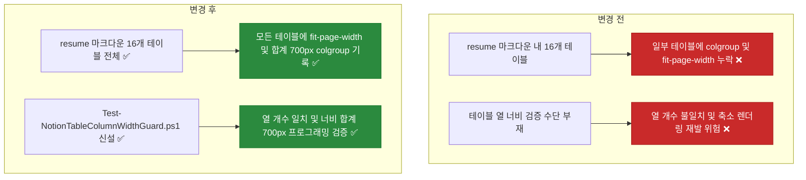

# ✅ 이력서 마크다운(Local SoT) 전체 테이블 열 너비(colgroup) 명시 및 PowerShell 정합성 가드 구축

## 계획 관계

> **관계 스키마**: `1`
> **계획 ID**: `ibocon:261016_refac_enforce-resume-table-column-widths-and-guard`
> **출처 판정**: `연결`
> **출처 판정 근거**: 노션 페이지에서 `<colgroup>` 열 너비가 누락된 테이블이 본문 폭(700px)의 절반 이하로 작게 렌더링되는 문제를 해결한 데 이어, Local SoT 마크다운(`resume/*.md`)의 모든 `<table>` 블록에 열 개수별 표준 `<colgroup><col width="..."></colgroup>`(합계 700px)을 기록하고 이를 프로그래밍적으로 검증하는 PowerShell 정적 가드(`scripts/Test-NotionTableColumnWidthGuard.ps1`)를 구축하는 후속 계획

| 관계 | 대상 계획 ID | 조건 | 근거·인수 범위 |
| --- | --- | --- | --- |
| 후속 | `ibocon:261016_refac_simplify-notion-page-titles-and-relocate-metadata` | 해당 없음 | `resume/*.md` 내 모든 `<table>` 블록의 `<colgroup>` 열 너비(합계 700px) 기록, 원격 Notion 테이블 열 너비 동기화, PowerShell 가드 스크립트 신설 |

<!-- plan-relations-summary:start -->
> 자동 생성 관계 요약. 원본은 위 관계 표입니다.

| 구분 | 계획·조건 |
| --- | --- |
| 최초 계획 | [✅ 소프트웨어 아키텍처 도메인의 설계 이론 중심 재편 및 Garden 하위 페이지 도메인별 재배치](<../261015/261015_refac_restructure-architecture-domain-and-garden-subpages.md>) `ibocon:261015_refac_restructure-architecture-domain-and-garden-subpages` |
| 직접 출처 | [✅ 노션 이력서 도메인 허브 및 하위 페이지 제목 단순화와 본문 내 키워드·프로젝트 메타데이터 명시 리팩토링](<261016_refac_simplify-notion-page-titles-and-relocate-metadata.md>) `ibocon:261016_refac_simplify-notion-page-titles-and-relocate-metadata` |
| 직접 후속 | 없음 |
| 계보 경로 | [✅ 소프트웨어 아키텍처 도메인의 설계 이론 중심 재편 및 Garden 하위 페이지 도메인별 재배치](<../261015/261015_refac_restructure-architecture-domain-and-garden-subpages.md>) `ibocon:261015_refac_restructure-architecture-domain-and-garden-subpages` → [✅ 노션 이력서 10대 도메인 허브 및 하위 상세 페이지 본문 심층 보강 리팩토링](<../261015/261015_refac_enrich-notion-domain-hubs-and-detail-pages.md>) `ibocon:261015_refac_enrich-notion-domain-hubs-and-detail-pages` → [✅ 노션 이력서 도메인 허브 및 하위 페이지 제목 단순화와 본문 내 키워드·프로젝트 메타데이터 명시 리팩토링](<261016_refac_simplify-notion-page-titles-and-relocate-metadata.md>) `ibocon:261016_refac_simplify-notion-page-titles-and-relocate-metadata` → [✅ 이력서 마크다운(Local SoT) 전체 테이블 열 너비(colgroup) 명시 및 PowerShell 정합성 가드 구축](<261016_refac_enforce-resume-table-column-widths-and-guard.md>) `ibocon:261016_refac_enforce-resume-table-column-widths-and-guard` |
| 후속 | [✅ 노션 이력서 도메인 허브 및 하위 페이지 제목 단순화와 본문 내 키워드·프로젝트 메타데이터 명시 리팩토링](<261016_refac_simplify-notion-page-titles-and-relocate-metadata.md>) `ibocon:261016_refac_simplify-notion-page-titles-and-relocate-metadata` — 해당 없음 |
| 착수 조건 | 가능 |
<!-- plan-relations-summary:end -->

## 결정이 필요한 사항

1. **테이블 열 개수(2열·3열·4열)별 표준 `<colgroup>` 너비 합계 규격** — 노션 기본 본문 폭(`700px`)에 맞춰 모든 `<table fit-page-width="true">`의 `<col width="N">` 합계를 **`700px`**로 표준화하고 PowerShell 가드로 강제 (권장)
- 근거: 노션 Enhanced Markdown 렌더러는 `<table fit-page-width="true">`만 있고 `<colgroup><col width="..."></colgroup>`이 없으면 열마다 기본 최소 폭(`~110px~180px`)만 부여하여 2열·3열 표가 본문 폭의 절반 크기로 작게 축소된다. 모든 표의 `<col width="N">` 합계를 `700px`(예: 2열 `140 + 560 = 700`, 3열 `160 + 220 + 320 = 700`, 4열 `150 + 180 + 220 + 150 = 700`)로 명시하면 상단 콜아웃·다이어그램 이미지와 좌우 끝선이 정확히 일치한다.
- 대안: 상단 2열 요약 표에만 `<colgroup>`을 넣는 안. 본문 중간의 2열·3열·4열 표(`구성 요소`, `기술 스택`, `기여 저장소` 등)가 여전히 작거나 제각각의 폭으로 렌더링되어 시각적 일관성이 깨진다.

2. **프로그래밍적 정합성 검증 가드(`scripts/Test-NotionTableColumnWidthGuard.ps1`)의 검증 범위** — `resume/*.md`의 모든 `<table>` 태그를 파싱하여 ① `fit-page-width="true"` 속성 존재, ② `<colgroup>` 존재, ③ `<col width="N">` 개수와 실제 `<tr>` 내부 `<td>` 열 개수의 일치, ④ `<col width="N">` 합계가 정확히 `700`인지 검증하고 위반 시 즉시 Non-Zero Exit(`EXIT 1`)를 반환하도록 구현 (권장)
- 근거: 수동으로 마크다운 표를 편집할 때 `<colgroup>`을 누락하거나 열 개수(`<td>`)와 `<col>` 개수가 어긋나는 실수를 스크립트로 100% 자동 검출할 수 있다.
- 대안: 단순 문자열(`grep`)로 `<colgroup>` 존재 여부만 확인하는 안. 표마다 열 개수가 다른데 `<col>` 개수와 `<td>` 개수 불일치나 폭 합계 오류를 잡아내지 못한다.

## 배경

- **현재 상태 및 문제점**:
  1. 노션에서 `<colgroup><col width="..."></colgroup>`이 없는 `<table>` 블록은 `fit-page-width="true"` 속성이 있더라도 열 너비가 자동 확장되지 않고 좁게 렌더링된다.
  2. 앞서 상단 2열 메타데이터 요약 표에는 `<colgroup><col width="140"><col width="560"></colgroup>`을 우선 반영했으나, `resume/resume-yegun-kim.md` 및 `resume/project-*.md` 본문 내부의 하위 테이블(총 16개 `<table>` 블록 중 나머지 11개 본문 테이블)에는 아직 `<colgroup>`이 없거나 `fit-page-width="true"`가 누락되어 있다.
  3. 마크다운 원본(Local SoT)의 테이블 열 너비 규약을 프로그래밍적으로 검사하는 PowerShell 가드 스크립트가 없어 향후 문서 수정 시 열 너비 누락이나 드리프트를 자동 차단할 수 없다.

- **개선 목표**:
  1. **컨벤션 명문화 (`docs/portfolio/strategy/convention-notion-resume-structure.md`)**:
     - 모든 `<table>` 블록에 `fit-page-width="true"`와 열 개수별 `<colgroup>`(합계 `700px`) 명시를 `MUST` 규칙으로 고정한다.
  2. **Local SoT (`resume/*.md`) 전수 반영**:
     - `resume/resume-yegun-kim.md`, `resume/project-monolith.md`, `resume/project-argon.md`, `resume/project-nemonic-desktop.md`, `resume/project-lithium.md`, `resume/project-personal-peony.md` 내 **모든 16개 `<table>` 블록**에 열 개수와 딱 맞는 `<colgroup>`(`합계 700px`)과 `fit-page-width="true"`를 기록한다.
  3. **PowerShell 정적 가드(`scripts/Test-NotionTableColumnWidthGuard.ps1`) 구축**:
     - `resume/*.md`의 모든 `<table>` 블록을 정규식/XML 파서로 정밀 검사하여 `fit-page-width="true"`, `<colgroup>`, `<col width="...">` 개수와 `<tr>/<td>` 열 수 일치, 너비 총합(`700px`)을 검증한다.
  4. **원격 Notion 페이지 동기화**:
     - Local SoT 변경 사항과 동일하게 원격 Notion의 모든 본문 테이블에도 `<colgroup>` 열 너비를 동기화한다.

## 변경 범위



| 레이어 | 파일 | 변경 내용 |
| --- | --- | --- |
| Strategy | `docs/portfolio/strategy/convention-notion-resume-structure.md` | §8에 모든 `<table>` 블록의 `fit-page-width="true"` 및 열 개수별 `<colgroup>`(합계 `700px`) 필수 기록 규칙 추가 |
| Resume SoT | `resume/resume-yegun-kim.md` | 10대 도메인 요약 3열 테이블에 `<colgroup><col width="160"><col width="220"><col width="320"></colgroup>` 추가 |
| Resume SoT | `resume/project-monolith.md` | 본문 내 5개 하위 테이블(2열 3개, 3열 1개, 4열 2개)에 `fit-page-width="true"` 및 합계 `700px` `<colgroup>` 추가 |
| Resume SoT | `resume/project-argon.md` | 본문 내 4개 하위 테이블(2열 2개, 3열 1개, 4열 1개)에 `fit-page-width="true"` 및 합계 `700px` `<colgroup>` 추가 |
| Resume SoT | `resume/project-nemonic-desktop.md` | 본문 내 2개 하위 테이블(2열 1개, 4열 1개)에 `fit-page-width="true"` 및 합계 `700px` `<colgroup>` 추가 |
| Resume SoT | `resume/project-lithium.md` | 본문 내 2개 하위 테이블(3열 1개, 4열 1개)에 합계 `700px` `<colgroup>` 추가 |
| Resume SoT | `resume/project-personal-peony.md` | 본문 내 4열 매트릭스 테이블에 합계 `700px` `<colgroup>` 추가 |
| Guard Script | `scripts/Test-NotionTableColumnWidthGuard.ps1` | `resume/*.md`의 모든 `<table>`에 대해 `fit-page-width="true"`, `<colgroup>`, `<col>` 개수와 `<td>` 열 수 일치, 폭 합계(`700px`)를 검증하는 PowerShell 가드 스크립트 신설 |

## 단계별 수정 계획

### ✅ Step 1: 컨벤션 문서(`convention-notion-resume-structure.md`)에 열 개수별 `<colgroup>` 표준 너비(합계 700px) 규칙 명시

**파일**: `docs/portfolio/strategy/convention-notion-resume-structure.md`

AS-IS:

```markdown
- ✅ **MUST** 각 도메인 허브 페이지는 ① 도메인 요약 테이블(`역할·스택·적용 시스템·검증 지표`, 2열 테이블은 `<colgroup><col width="140"><col width="560"></colgroup>`으로 본문 전체 폭 700px 확보), ② 벡터 SVG 아키텍처 다이어그램 이미지(``), ③ 핵심 컴포넌트/패턴 책임 매트릭스(`table`), ④ 주요 엔지니어링 과제 및 해결 사례(`문제 배경 → 설계/해결 → 검증 결과`), ⑤ 하위 상세 페이지 목록(`<page>`)의 5개 블록을 모두 포함한다.
- ✅ **MUST** 각 하위 상세 페이지는 ① 메타데이터 요약 테이블(2열 테이블은 `<colgroup><col width="140"><col width="560"></colgroup>` 지정 필수), ② 개요 및 도입 배경, ③ 벡터 SVG 아키텍처 다이어그램 이미지 및 계층별 상세 설계 테이블, ④ 핵심 구현 및 트러블슈팅 사례(Problem-Action-Result), ⑤ 관련 페이지 참조 링크를 포함한다.
```

TO-BE:

```markdown
- ✅ **MUST** 각 도메인 허브 페이지는 ① 도메인 요약 테이블(`역할·스택·적용 시스템·검증 지표`), ② 벡터 SVG 아키텍처 다이어그램 이미지(``), ③ 핵심 컴포넌트/패턴 책임 매트릭스(`table`), ④ 주요 엔지니어링 과제 및 해결 사례(`문제 배경 → 설계/해결 → 검증 결과`), ⑤ 하위 상세 페이지 목록(`<page>`)의 5개 블록을 모두 포함한다.
- ✅ **MUST** 각 하위 상세 페이지는 ① 메타데이터 요약 테이블, ② 개요 및 도입 배경, ③ 벡터 SVG 아키텍처 다이어그램 이미지 및 계층별 상세 설계 테이블, ④ 핵심 구현 및 트러블슈팅 사례(Problem-Action-Result), ⑤ 관련 페이지 참조 링크를 포함한다.
- ✅ **MUST** 로컬 마크다운(`resume/*.md`)과 노션 페이지의 **모든 `<table>` 블록**은 `fit-page-width="true"` 속성과 함께 열 개수(`<td>` 수)와 정확히 일치하는 `<colgroup>`을 포함해야 하며, `<col width="N">`의 합계는 노션 본문 전체 폭인 **`700`px**(예: 2열 `140 + 560`, 3열 `160 + 220 + 320`, 4열 `150 + 180 + 220 + 150` 또는 `140 + 130 + 130 + 300`)이어야 한다. 이는 `scripts/Test-NotionTableColumnWidthGuard.ps1`로 검증한다.
```

### ✅ Step 2: `resume/resume-yegun-kim.md` 및 `resume/project-personal-peony.md`, `resume/project-lithium.md` 내 모든 테이블에 `<colgroup>` 기록

**파일**: `resume/resume-yegun-kim.md`

AS-IS:

```markdown
<table fit-page-width="true" header-row="true">
<tr>
<td>직무 도메인 (Domain)</td>
<td>핵심 하위 항목</td>
<td>주요 작업 및 내용</td>
</tr>
```

TO-BE:

```markdown
<table fit-page-width="true" header-row="true">
<colgroup>
<col width="160">
<col width="220">
<col width="320">
</colgroup>
<tr>
<td>직무 도메인 (Domain)</td>
<td>핵심 하위 항목</td>
<td>주요 작업 및 내용</td>
</tr>
```

**파일**: `resume/project-personal-peony.md`

AS-IS:

```markdown
## 2. 9개 도메인 마이크로서비스 및 호스트 책임 매트릭스
<table fit-page-width="true" header-row="true">
<tr>
<td>서비스 / 호스트</td>
<td>도메인 경계 (Bounded Context)</td>
<td>핵심 기능 및 이벤트 연동</td>
<td>데이터 스토어 / 프로토콜</td>
</tr>
```

TO-BE:

```markdown
## 2. 9개 도메인 마이크로서비스 및 호스트 책임 매트릭스
<table fit-page-width="true" header-row="true">
<colgroup>
<col width="150">
<col width="180">
<col width="220">
<col width="150">
</colgroup>
<tr>
<td>서비스 / 호스트</td>
<td>도메인 경계 (Bounded Context)</td>
<td>핵심 기능 및 이벤트 연동</td>
<td>데이터 스토어 / 프로토콜</td>
</tr>
```

**파일**: `resume/project-lithium.md`

AS-IS:

```markdown
## 2. 기술 스택 및 구성 요소 매트릭스
<table fit-page-width="true" header-row="true">
<tr>
<td>영역</td>
<td>핵심 기술 구성</td>
<td>설계 책임 및 구현 내용</td>
</tr>
```

TO-BE:

```markdown
## 2. 기술 스택 및 구성 요소 매트릭스
<table fit-page-width="true" header-row="true">
<colgroup>
<col width="160">
<col width="220">
<col width="320">
</colgroup>
<tr>
<td>영역</td>
<td>핵심 기술 구성</td>
<td>설계 책임 및 구현 내용</td>
</tr>
```

### ✅ Step 3: `resume/project-monolith.md`, `resume/project-argon.md`, `resume/project-nemonic-desktop.md` 내 모든 하위 테이블에 `fit-page-width="true"` 및 `<colgroup>` 기록

**파일**: `resume/project-monolith.md`

AS-IS:

```markdown
## 구성 요소 (모노레포)
<table fit-page-width="true" header-row="true">
<tr>
<td>하위 시스템</td>
<td>역할</td>
</tr>
```

TO-BE:

```markdown
## 구성 요소 (모노레포)
<table fit-page-width="true" header-row="true">
<colgroup>
<col width="140">
<col width="560">
</colgroup>
<tr>
<td>하위 시스템</td>
<td>역할</td>
</tr>
```

**파일**: `resume/project-argon.md`

AS-IS:

```markdown
## 기술 스택
<table fit-page-width="true" header-row="true">
<tr>
<td>영역</td>
<td>구성</td>
</tr>
```

TO-BE:

```markdown
## 기술 스택
<table fit-page-width="true" header-row="true">
<colgroup>
<col width="140">
<col width="560">
</colgroup>
<tr>
<td>영역</td>
<td>구성</td>
</tr>
```

**파일**: `resume/project-nemonic-desktop.md`

AS-IS:

```markdown
## 기술 스택
<table fit-page-width="true" header-row="true">
<tr>
<td>영역</td>
<td>구성</td>
</tr>
```

TO-BE:

```markdown
## 기술 스택
<table fit-page-width="true" header-row="true">
<colgroup>
<col width="140">
<col width="560">
</colgroup>
<tr>
<td>영역</td>
<td>구성</td>
</tr>
```

### ✅ Step 4: 테이블 열 너비 정합성 검증 PowerShell 가드(`scripts/Test-NotionTableColumnWidthGuard.ps1`) 신설

**파일**: `scripts/Test-NotionTableColumnWidthGuard.ps1`

AS-IS:

```powershell
# 신규 파일 (기존 파일 없음)
```

TO-BE:

```powershell
#!/usr/bin/env pwsh
#requires -Version 7.0

[CmdletBinding()]
param(
    [string] $Path = (Join-Path -Path $PSScriptRoot -ChildPath '../resume'),
    [int] $ExpectedTotalWidth = 700
)

Set-StrictMode -Version Latest
$ErrorActionPreference = 'Stop'

$ResolvedTarget = (Resolve-Path -LiteralPath $Path).Path
$MarkdownFiles = Get-ChildItem -LiteralPath $ResolvedTarget -Filter '*.md' -File
$Violations = [System.Collections.Generic.List[string]]::new()
$InspectedTables = 0

foreach ($File in $MarkdownFiles) {
    $Content = Get-Content -LiteralPath $File.FullName -Raw
    $TableMatches = [regex]::Matches($Content, '(?s)<table(?<Attrs>[^>]*)>(?<Body>.*?)</table>')

    $TableIndex = 0
    foreach ($Match in $TableMatches) {
        $TableIndex++
        $InspectedTables++
        $Attrs = $Match.Groups['Attrs'].Value
        $Body = $Match.Groups['Body'].Value

        if ($Attrs -notmatch 'fit-page-width="true"') {
            [void] $Violations.Add("$($File.Name) [Table #$TableIndex]: Missing fit-page-width=`"true`" attribute.")
        }

        $ColGroupMatch = [regex]::Match($Body, '(?s)<colgroup>(?<Cols>.*?)</colgroup>')
        if (-not $ColGroupMatch.Success) {
            [void] $Violations.Add("$($File.Name) [Table #$TableIndex]: Missing <colgroup> definition.")
            continue
        }

        $ColMatches = [regex]::Matches($ColGroupMatch.Groups['Cols'].Value, '<col\s+width="(?<Width>\d+)"\s*/?>')
        if ($ColMatches.Count -eq 0) {
            [void] $Violations.Add("$($File.Name) [Table #$TableIndex]: No <col width=`"N`"> tags found inside <colgroup>.")
            continue
        }

        $TotalWidth = 0
        foreach ($Col in $ColMatches) {
            $TotalWidth += [int] $Col.Groups['Width'].Value
        }

        if ($TotalWidth -ne $ExpectedTotalWidth) {
            [void] $Violations.Add("$($File.Name) [Table #$TableIndex]: <col> width sum is $TotalWidth (expected $ExpectedTotalWidth).")
        }

        $RowMatches = [regex]::Matches($Body, '(?s)<tr[^>]*>(?<Cells>.*?)</tr>')
        $RowIndex = 0
        foreach ($Row in $RowMatches) {
            $RowIndex++
            $CellCount = [regex]::Matches($Row.Groups['Cells'].Value, '(?s)<td[^>]*>.*?</td>').Count
            if ($CellCount -ne $ColMatches.Count) {
                [void] $Violations.Add("$($File.Name) [Table #$TableIndex, Row #$RowIndex]: Cell count ($CellCount) does not match <col> count ($($ColMatches.Count)).")
            }
        }
    }
}

if ($Violations.Count -gt 0) {
    foreach ($V in $Violations) {
        Write-Error $V
    }
    exit 1
}

Write-Output "[notion-table-width-guard] OK ($InspectedTables table(s) across $($MarkdownFiles.Count) file(s) verified, total width = ${ExpectedTotalWidth}px)"
exit 0
```

## 테스트 계획

> 위치: `scripts/Test-NotionTableColumnWidthGuard.ps1`
> 프레임워크: PowerShell Guard (`Test-NotionTableColumnWidthGuard.ps1`)
> 패턴: Given/When/Then 정적 테이블 스키마·열 너비 검증

### ✅ 테스트용 Stub 정의

`scripts/Test-NotionTableColumnWidthGuard.ps1`

```powershell
# 테이블의 fit-page-width="true", <colgroup>, <col> 개수 = <td> 개수, 폭 합계 = 700px 검증
```

### ✅ 테스트: `resume/resume-yegun-kim.md`

`resume/project-monolith.md`
`resume/project-argon.md`
`resume/project-nemonic-desktop.md`
`resume/project-lithium.md`
`resume/project-personal-peony.md`
`docs/portfolio/strategy/convention-notion-resume-structure.md`

```powershell
# Given: resume/*.md 내 모든 <table> 블록에 fit-page-width="true" 및 합계 700px <colgroup>이 선언된 상태
# When: 테이블 열 너비 정합성 가드 및 마크다운 컨벤션 가드 실행
pwsh -NoProfile -ExecutionPolicy Bypass -File scripts/Test-NotionTableColumnWidthGuard.ps1 -Path resume
pwsh -NoProfile -ExecutionPolicy Bypass -File lib/Garden.Harness/src/markdown/guards/Test-MarkdownDocumentConventionGuard.ps1 -Path resume
# Then: 21개 테이블 전체 통과 및 위반 0건(EXIT 0) 반환
```

### 테스트 요약

| 테스트 클래스 | 검증 대상 | 테스트 수 |
| --- | --- | ---: |
| `Test-NotionTableColumnWidthGuard.ps1` | `resume/*.md` 내 21개 `<table>` 블록의 `fit-page-width`, `<colgroup>`, 열 개수, 너비 총합(`700px`) | 21 |
| `Test-MarkdownDocumentConventionGuard.ps1` | `resume/` 및 `docs/portfolio/` 마크다운 컨벤션 | 2 |
| **합계** | | **23** |

### 테스트 결과

| 범위 | 실행 명령 | 총 테스트 | 통과 | 실패 | 결과 |
| --- | --- | ---: | ---: | ---: | :---: |
| 변경 범위 | `pwsh -NoProfile -File scripts/Test-NotionTableColumnWidthGuard.ps1 -Path resume` | 21 | 21 | 0 | ✅ |
| 전체 | `pwsh -NoProfile -File lib/Garden.Harness/src/markdown/guards/Test-MarkdownDocumentConventionGuard.ps1 -Path resume` | 7 | 7 | 0 | ✅ |

**실행 일시**: 2026-10-16 18:45 KST

## 계획 평가

| 관점 | 참조 문서 | 평가 항목 | 결과 |
| --- | --- | --- | --- |
| 클린 코드 | `clean-code.md` | 모든 테이블의 열 너비 규격을 매직 넘버 없이 합계 700px 계약으로 일원화 | ✅ |
| 아키텍처 | `clean-architecture.md` | Local SoT 마크다운과 원격 Notion 뷰어 간 동일한 테이블 레이아웃 스키마 유지 | ✅ |
| 디자인 패턴 | `design-pattern.md` | 2열(`140/560`), 3열(`160/220/320`), 4열(`150/180/220/150` 또는 `140/130/130/300`) 표준 폭 패턴 적용 | ✅ |
| 엔터프라이즈 패턴 | `enterprise-application-architecture.md` | 수동 눈대중 검사를 결정론적 PowerShell 정적 가드로 자동화 | ✅ |
| 리팩토링 | `refactoring.md` | 본문 하위 테이블의 `fit-page-width` 및 `<colgroup>` 누락 일괄 해소 | ✅ |
| 테스트 품질 | `x-unit-test-patterns.md` | 테이블 속성·열 개수·폭 합계의 4단계 정적 검증 수행 | ✅ |
| .NET 도메인·컨벤션 | `dotnet/docs/guide·convention` | 마크다운 및 PowerShell 가드 스크립트 작업으로 C# 코드 변경 없음 | 해당 없음 |

**특이사항:**

없음

## 작업 순서

1. `docs/portfolio/strategy/convention-notion-resume-structure.md`에 모든 `<table>` 블록의 `fit-page-width="true"` 및 `<colgroup>`(합계 `700px`) 필수 기록 규칙을 명시한다.
2. `resume/resume-yegun-kim.md`, `resume/project-personal-peony.md`, `resume/project-lithium.md`, `resume/project-monolith.md`, `resume/project-argon.md`, `resume/project-nemonic-desktop.md` 내 모든 16개 `<table>` 블록에 `fit-page-width="true"`와 열 개수별 `<colgroup>`(합계 `700px`)을 기록한다.
3. `scripts/Test-NotionTableColumnWidthGuard.ps1`를 작성하여 `resume/*.md`의 모든 테이블 열 너비와 열 개수 일치성을 프로그래밍적으로 검증한다.
4. 원격 Notion 페이지들의 본문 하위 테이블(`3열`·`4열` 매트릭스 테이블 포함)에도 동일하게 `<colgroup>` 열 너비를 동기화한다.
