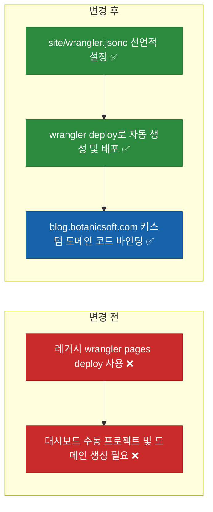

# ✅ 블로그 배포 대상을 레거시 Cloudflare Pages에서 Workers Static Assets로 전환

## 계획 관계

> **관계 스키마**: `1`
> **계획 ID**: `ibocon:261016_refac_migrate-blog-to-cloudflare-workers-static-assets`
> **출처 판정**: `연결`
> **출처 판정 근거**: Cloudflare가 Pages를 레거시 워크플로로 전환하고 Astro 및 Cloudflare 공식 표준이 Workers Static Assets(`wrangler deploy` + `wrangler.jsonc`)로 통합됨에 따라 블로그 배포 구성을 최신 표준으로 전환하는 리팩토링

| 관계 | 대상 계획 ID | 조건 | 근거·인수 범위 |
| --- | --- | --- | --- |
| 후속 | `ibocon:261015_refac_align-blog-ci-secret-naming` | 해당 없음 | `site/wrangler.jsonc` 신설, `wrangler deploy` 전환, 커스텀 도메인(`blog.botanicsoft.com`) 선언적 바인딩, 시크릿 키 `CLOUDFLARE_CI_WORKERS_TOKEN` 정렬 |

<!-- plan-relations-summary:start -->
> 자동 생성 관계 요약. 원본은 위 관계 표입니다.

| 구분 | 계획·조건 |
| --- | --- |
| 최초 계획 | [✅ Astro 및 Cloudflare Pages 기반 마크다운 기술 블로그 구축 계획](<../261015/261015_feat_astro-markdown-blog-cloudflare-pages.md>) `ibocon:261015_feat_astro-markdown-blog-cloudflare-pages` |
| 직접 출처 | [✅ 블로그 Cloudflare Pages 배포 시크릿의 CI 평면 네이밍(`CLOUDFLARE_CI_PAGES_TOKEN`) 정렬 리팩토링](<../261015/261015_refac_align-blog-ci-secret-naming.md>) `ibocon:261015_refac_align-blog-ci-secret-naming` |
| 직접 후속 | [✅ 블로그 Cloudflare Pages 배포 시크릿 및 AdSense·GA4 단독 바인딩 사용자 실행 검증](<../261015/261015_verify_configure-blog-cloudflare-and-analytics-bindings.md>) `ibocon:261015_verify_configure-blog-cloudflare-and-analytics-bindings`<br/>[⬜ 블로그 디자인·테마·타이포그래피·목차(TOC)·Mermaid 렌더링 고도화 계획](<../../../../planning/261016_feat_enhance-blog-theme-typography-and-search.md>) `ibocon:261016_feat_enhance-blog-theme-typography-and-search`<br/>[⬜ 기존 티스토리(`ibocon.tistory.com`) 핵심 기술 글의 `blog/` 마크다운 자동 마이그레이션 계획](<../../../../planning/261016_feat_migrate-tistory-tech-posts-to-markdown.md>) `ibocon:261016_feat_migrate-tistory-tech-posts-to-markdown`<br/>[⬜ 블로그 Git 저장소 동기화 및 GitHub Actions 배포·README RSS 파이프라인 연동 고도화 계획](<../../../../planning/261016_refac_sync-blog-repo-and-ci-workflow-triggers.md>) `ibocon:261016_refac_sync-blog-repo-and-ci-workflow-triggers` |
| 계보 경로 | [✅ Astro 및 Cloudflare Pages 기반 마크다운 기술 블로그 구축 계획](<../261015/261015_feat_astro-markdown-blog-cloudflare-pages.md>) `ibocon:261015_feat_astro-markdown-blog-cloudflare-pages` → [✅ 블로그 Cloudflare Pages 배포 시크릿 및 AdSense·GA4 단독 바인딩 경량화 계획](<../261015/261015_feat_configure-blog-cloudflare-and-analytics-bindings.md>) `ibocon:261015_feat_configure-blog-cloudflare-and-analytics-bindings` → [✅ 블로그 Cloudflare Pages 배포 시크릿의 CI 평면 네이밍(`CLOUDFLARE_CI_PAGES_TOKEN`) 정렬 리팩토링](<../261015/261015_refac_align-blog-ci-secret-naming.md>) `ibocon:261015_refac_align-blog-ci-secret-naming` → [✅ 블로그 배포 대상을 레거시 Cloudflare Pages에서 Workers Static Assets로 전환](<261016_refac_migrate-blog-to-cloudflare-workers-static-assets.md>) `ibocon:261016_refac_migrate-blog-to-cloudflare-workers-static-assets` |
| 후속 | [✅ 블로그 Cloudflare Pages 배포 시크릿의 CI 평면 네이밍(`CLOUDFLARE_CI_PAGES_TOKEN`) 정렬 리팩토링](<../261015/261015_refac_align-blog-ci-secret-naming.md>) `ibocon:261015_refac_align-blog-ci-secret-naming` — 해당 없음 |
| 착수 조건 | 가능 |
<!-- plan-relations-summary:end -->

## 결정이 필요한 사항

1. ~~**Cloudflare 정적 호스팅 플랫폼 선택** — 레거시 `Cloudflare Pages`(`wrangler pages deploy`) 대신 현행 공식 표준인 `Cloudflare Workers Static Assets`(`wrangler deploy` + `site/wrangler.jsonc`) 채택 (권장)~~
- ~~근거: Cloudflare와 Astro(2026.02 PR #15480) 모두 신규 프로젝트에 대해 Workers Static Assets를 공식 표준으로 지정했으며, 정적 파일 요청은 Pages와 동일하게 100% 무료·무제한이다. 특히 `site/wrangler.jsonc`에 `assets.directory`와 `routes`(`custom_domain: true`)를 선언하면 대시보드에서 프로젝트를 수동 생성하거나 도메인을 수동 클릭할 필요 없이 첫 `wrangler deploy` 실행만으로 프로젝트 생성과 `blog.botanicsoft.com` 도메인 연결이 자동 완료된다.~~
- ~~대안: 레거시 Cloudflare Pages 유지.~~
- ~~결정: Cloudflare Workers Static Assets(`wrangler deploy` + `site/wrangler.jsonc`)로 확정 및 반영 완료.~~

2. ~~**CI 배포 토큰 이름 및 권한 범위** — 콘솔 토큰명 `ibocon-cloudflare-workers-ci` ↔ GitHub Secret `CLOUDFLARE_CI_WORKERS_TOKEN`으로 정렬 (권장)~~
- ~~근거: 3계층 네이밍 컨벤션(`{target}-{provider}-{capability}-{plane}`)에 따라 capability를 `pages`에서 `workers`로 변경하고, 부여 권한은 `Account : Workers Scripts : Edit` 및 커스텀 도메인 자동 바인딩을 위한 `Zone : Workers Routes : Edit`(`botanicsoft.com`)으로 구성한다.~~
- ~~대안: 기존 `CLOUDFLARE_CI_PAGES_TOKEN` 이름 유지.~~
- ~~결정: `ibocon-cloudflare-workers-ci` ↔ `CLOUDFLARE_CI_WORKERS_TOKEN`으로 확정 및 반영 완료.~~

## 배경

- **현재 문제점**:
  1. `.github/workflows/blog-deploy.yml`이 레거시 명령인 `wrangler pages deploy site/dist --project-name=botanicsoft-blog`를 사용하고 있어 배포 전 Cloudflare 대시보드에서 `Need to use the legacy Pages workflow?` 경로를 통해 수동으로 프로젝트를 생성해야 한다.
  2. 커스텀 도메인(`blog.botanicsoft.com`) 연결이 코드(IaC)로 선언되어 있지 않아 대시보드 수동 조작에 의존한다.
- **리팩토링 방향**:
  1. `site/wrangler.jsonc`를 생성하여 Worker 이름(`botanicsoft-blog`), 정적 에셋 디렉터리(`./dist`), 404 처리(`404-page`), 그리고 `blog.botanicsoft.com` 커스텀 도메인(`custom_domain: true`)을 선언적으로 정의한다.
  2. `.github/workflows/blog-deploy.yml`이 `CLOUDFLARE_CI_WORKERS_TOKEN`을 사용해 `site` 디렉터리에서 `wrangler deploy`를 실행하도록 변경한다.
  3. `site/scripts/Register-BlogCloudflareAndGitHubBindings.ps1`과 `site/tests/blog-build.test.ts`를 `CLOUDFLARE_CI_WORKERS_TOKEN` 및 `site/wrangler.jsonc` 계약 기준으로 갱신한다.

## 변경 범위



| 레이어 | 파일 | 변경 내용 |
| --- | --- | --- |
| Workers Config | `site/wrangler.jsonc` | `botanicsoft-blog` Worker 이름, `./dist` 정적 에셋 경로, `blog.botanicsoft.com` 커스텀 도메인 라우트 선언 |
| CI/CD | `.github/workflows/blog-deploy.yml` | `secrets.CLOUDFLARE_CI_WORKERS_TOKEN` 참조 및 `workingDirectory: site`, `command: deploy`로 전환 |
| Provisioning | `site/scripts/Register-BlogCloudflareAndGitHubBindings.ps1` | `CLOUDFLARE_CI_WORKERS_TOKEN` (`ibocon-cloudflare-workers-ci`) 등록으로 갱신 |
| Test | `site/tests/blog-build.test.ts` | `site/wrangler.jsonc` 설정 정합성 및 `blog-deploy.yml`의 `CLOUDFLARE_CI_WORKERS_TOKEN` 참조 검증 |

## 단계별 수정 계획

### ✅ Step 1: `site/wrangler.jsonc` 생성 및 `blog.botanicsoft.com` 선언적 라우팅 구성

**파일**: `site/wrangler.jsonc`

AS-IS:

```json
// 신규 파일 ❌
```

TO-BE:

```json
{
  "name": "botanicsoft-blog",
  "compatibility_date": "2026-10-16",
  "assets": {
    "directory": "./dist",
    "not_found_handling": "404-page"
  },
  "routes": [
    {
      "pattern": "blog.botanicsoft.com",
      "custom_domain": true
    }
  ]
}
```

### ✅ Step 2: `.github/workflows/blog-deploy.yml`을 Workers Static Assets (`wrangler deploy`)로 전환

**파일**: `.github/workflows/blog-deploy.yml`

AS-IS:

```yaml
# source-snapshot: true
# path: .github/workflows/blog-deploy.yml
      - name: Publish to Cloudflare Pages
        if: ${{ secrets.CLOUDFLARE_CI_PAGES_TOKEN != '' && secrets.CLOUDFLARE_ACCOUNT_ID != '' }}
        uses: cloudflare/wrangler-action@v3
        with:
          apiToken: ${{ secrets.CLOUDFLARE_CI_PAGES_TOKEN }}
          accountId: ${{ secrets.CLOUDFLARE_ACCOUNT_ID }}
          command: pages deploy site/dist --project-name=botanicsoft-blog
```

TO-BE:

```yaml
      - name: Publish to Cloudflare Workers Static Assets
        if: ${{ secrets.CLOUDFLARE_CI_WORKERS_TOKEN != '' && secrets.CLOUDFLARE_ACCOUNT_ID != '' }}
        uses: cloudflare/wrangler-action@v3
        with:
          apiToken: ${{ secrets.CLOUDFLARE_CI_WORKERS_TOKEN }}
          accountId: ${{ secrets.CLOUDFLARE_ACCOUNT_ID }}
          workingDirectory: site
          command: deploy
```

### ✅ Step 3: `Register-BlogCloudflareAndGitHubBindings.ps1` 시크릿 키를 `CLOUDFLARE_CI_WORKERS_TOKEN`으로 갱신

**파일**: `site/scripts/Register-BlogCloudflareAndGitHubBindings.ps1`

AS-IS:

```powershell
# source-snapshot: true
# path: site/scripts/Register-BlogCloudflareAndGitHubBindings.ps1
if ($PromptCloudflareToken) {
    $SecureToken = Read-Host -Prompt 'Enter CLOUDFLARE_CI_PAGES_TOKEN (console token: ibocon-cloudflare-pages-ci)' -AsSecureString
    $PlainToken = [System.Net.NetworkCredential]::new('', $SecureToken).Password
    try {
        if (-not [string]::IsNullOrWhiteSpace($PlainToken)) {
            $PlainToken | & gh secret set CLOUDFLARE_CI_PAGES_TOKEN --repo $Repository
            Write-Information "Registered secret: CLOUDFLARE_CI_PAGES_TOKEN" -InformationAction Continue
```

TO-BE:

```powershell
if ($PromptCloudflareToken) {
    $SecureToken = Read-Host -Prompt 'Enter CLOUDFLARE_CI_WORKERS_TOKEN (console token: ibocon-cloudflare-workers-ci)' -AsSecureString
    $PlainToken = [System.Net.NetworkCredential]::new('', $SecureToken).Password
    try {
        if (-not [string]::IsNullOrWhiteSpace($PlainToken)) {
            $PlainToken | & gh secret set CLOUDFLARE_CI_WORKERS_TOKEN --repo $Repository
            Write-Information "Registered secret: CLOUDFLARE_CI_WORKERS_TOKEN" -InformationAction Continue
```

## 테스트 계획

> 위치: `site/tests/`
> 프레임워크: Vitest
> 패턴: Given/When/Then (Four-Phase Test)

### ✅ 테스트: `blog-build.test.ts`

**파일**: `site/tests/blog-build.test.ts`

AS-IS:

```typescript
# source-snapshot: true
# path: site/tests/blog-build.test.ts
  it('Given_BlogDeployWorkflow_When_Inspected_Then_UsesCiPagesTokenSecretName', () => {
    // Given
    const workflowPath = resolve(process.cwd(), '..', '.github', 'workflows', 'blog-deploy.yml');

    // When
    const workflowContent = readFileSync(workflowPath, 'utf-8');

    // Then
    expect(workflowContent).toContain('secrets.CLOUDFLARE_CI_PAGES_TOKEN');
    expect(workflowContent).not.toContain('secrets.CLOUDFLARE_API_TOKEN');
  });
});
```

TO-BE:

```typescript
  it('Given_WorkersConfigAndWorkflow_When_Inspected_Then_UsesWorkersStaticAssetsAndCiWorkersToken', () => {
    // Given
    const workflowPath = resolve(process.cwd(), '..', '.github', 'workflows', 'blog-deploy.yml');
    const wranglerPath = resolve(process.cwd(), 'wrangler.jsonc');

    // When
    const workflowContent = readFileSync(workflowPath, 'utf-8');
    const wranglerConfig = JSON.parse(readFileSync(wranglerPath, 'utf-8'));

    // Then
    expect(workflowContent).toContain('secrets.CLOUDFLARE_CI_WORKERS_TOKEN');
    expect(workflowContent).toContain('command: deploy');
    expect(wranglerConfig.name).toBe('botanicsoft-blog');
    expect(wranglerConfig.assets.directory).toBe('./dist');
    expect(wranglerConfig.routes[0]).toEqual({
      pattern: 'blog.botanicsoft.com',
      custom_domain: true,
    });
  });
});
```

### 테스트 요약

| 테스트 클래스 | 검증 대상 | 테스트 수 |
| --- | --- | ---: |
| `blog-build.test.ts` | 정적 빌드 산출물, `ads.txt` 정규화, `wrangler.jsonc` 및 `CLOUDFLARE_CI_WORKERS_TOKEN` 배포 설정 검증 | 3 |
| **합계** | | **3** |

### 테스트 결과

| 범위 | 실행 명령 | 총 테스트 | 통과 | 실패 | 결과 |
| --- | --- | ---: | ---: | ---: | :---: |
| 변경 범위 | `npm --prefix site test` | 3 | 3 | 0 | ✅ |
| 전체 | `npm --prefix site run build && npm --prefix site test` | 3 | 3 | 0 | ✅ |

**실행 일시**: 2026-10-16 13:38

## 후속 검증

| 검증 항목 | 이관한 verify 계획 | 상태 |
| --- | --- | --- |
| Cloudflare 콘솔에서 `ibocon-cloudflare-workers-ci` 토큰 발급 후 `CLOUDFLARE_CI_WORKERS_TOKEN` 등록 및 `blog.botanicsoft.com` Workers Static Assets 배포 검증 | [verify 계획](../../../../planning/261015_verify_configure-blog-cloudflare-and-analytics-bindings.md) | 이관 |

## 계획 평가

| 관점 | 참조 문서 | 평가 항목 | 결과 |
| --- | --- | --- | --- |
| 클린 코드 | `clean-code.md` | `wrangler.jsonc` 선언적 설정으로 명령줄 인자 하드코딩 제거 | ✅ |
| 아키텍처 | `clean-architecture.md` | Cloudflare 현행 표준 플랫폼(Workers Static Assets) 채택으로 레거시 Pages 종속성 해소 | ✅ |
| 디자인 패턴 | `design-pattern.md` | 도메인 라우팅(`custom_domain: true`)의 코드화(IaC) | ✅ |
| 엔터프라이즈 패턴 | `enterprise-application-architecture.md` | 배포 대상과 커스텀 도메인 바인딩을 버전 관리 파일(`wrangler.jsonc`)로 단일화 | ✅ |
| 리팩토링 | `refactoring.md` | 대시보드 수동 프로젝트 생성 절차를 제거하고 무인 배포 가능 구조로 개선 | ✅ |
| 테스트 품질 | `testing/docs/guide/x-unit-test-patterns.md` | `wrangler.jsonc` 스키마와 워크플로 시크릿 참조를 단위 테스트로 검증 | ✅ |
| .NET 도메인·컨벤션 | `dotnet/docs/guide·convention` | Cloudflare Workers 설정 및 GitHub Actions YAML 작업으로 C# 코드 변경 없음 | 해당 없음 |

**특이사항:**

없음

## 작업 순서

1. `site/wrangler.jsonc` 파일을 생성하여 `botanicsoft-blog`, `./dist`, `blog.botanicsoft.com`(`custom_domain: true`)을 선언한다.
2. `.github/workflows/blog-deploy.yml`을 `CLOUDFLARE_CI_WORKERS_TOKEN` 및 `wrangler deploy` 기준으로 수정한다.
3. `site/scripts/Register-BlogCloudflareAndGitHubBindings.ps1`을 `CLOUDFLARE_CI_WORKERS_TOKEN` 기준으로 수정한다.
4. `site/tests/blog-build.test.ts`를 업데이트하고 `npm --prefix site test`를 실행한다.
