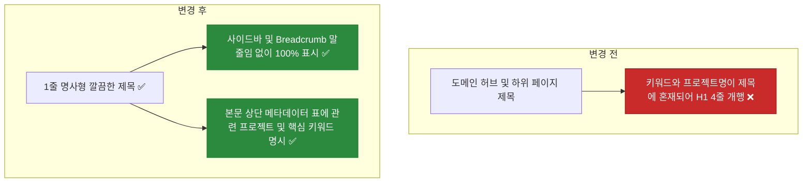

# ✅ 노션 이력서 도메인 허브 및 하위 페이지 제목 단순화와 본문 내 키워드·프로젝트 메타데이터 명시 리팩토링

## 계획 관계

> **관계 스키마**: `1`
> **계획 ID**: `ibocon:261016_refac_simplify-notion-page-titles-and-relocate-metadata`
> **출처 판정**: `연결`
> **출처 판정 근거**: 10대 도메인 허브 및 20개 하위 상세 페이지 본문 보강 이후, 제목(H1)에 대괄호·기술 키워드·사내 프로젝트 코드명이 중복 결합되어 노션 본문 H1이 2~4줄로 개행되고 좌측 사이드바와 상단 경로(Breadcrumb)가 말줄임(`...`)으로 잘리는 가독성 문제를 해결하기 위한 후속 리팩토링

| 관계 | 대상 계획 ID | 조건 | 근거·인수 범위 |
| --- | --- | --- | --- |
| 후속 | `ibocon:261015_refac_enrich-notion-domain-hubs-and-detail-pages` | 해당 없음 | 상위 도메인 10종 및 하위 페이지 20종의 제목을 1줄 명사형으로 단순화하고, 제목에서 제거한 기술 키워드와 관련 프로젝트명을 본문 최상단 메타데이터 표(`관련 프로젝트` · `핵심 키워드`)에 누락 없이 명시 |

<!-- plan-relations-summary:start -->
> 자동 생성 관계 요약. 원본은 위 관계 표입니다.

| 구분 | 계획·조건 |
| --- | --- |
| 최초 계획 | [✅ 소프트웨어 아키텍처 도메인의 설계 이론 중심 재편 및 Garden 하위 페이지 도메인별 재배치](<../261015/261015_refac_restructure-architecture-domain-and-garden-subpages.md>) `ibocon:261015_refac_restructure-architecture-domain-and-garden-subpages` |
| 직접 출처 | [✅ 노션 이력서 10대 도메인 허브 및 하위 상세 페이지 본문 심층 보강 리팩토링](<../261015/261015_refac_enrich-notion-domain-hubs-and-detail-pages.md>) `ibocon:261015_refac_enrich-notion-domain-hubs-and-detail-pages` |
| 직접 후속 | [✅ 이력서 마크다운(Local SoT) 전체 테이블 열 너비(colgroup) 명시 및 PowerShell 정합성 가드 구축](<261016_refac_enforce-resume-table-column-widths-and-guard.md>) `ibocon:261016_refac_enforce-resume-table-column-widths-and-guard` |
| 계보 경로 | [✅ 소프트웨어 아키텍처 도메인의 설계 이론 중심 재편 및 Garden 하위 페이지 도메인별 재배치](<../261015/261015_refac_restructure-architecture-domain-and-garden-subpages.md>) `ibocon:261015_refac_restructure-architecture-domain-and-garden-subpages` → [✅ 노션 이력서 10대 도메인 허브 및 하위 상세 페이지 본문 심층 보강 리팩토링](<../261015/261015_refac_enrich-notion-domain-hubs-and-detail-pages.md>) `ibocon:261015_refac_enrich-notion-domain-hubs-and-detail-pages` → [✅ 노션 이력서 도메인 허브 및 하위 페이지 제목 단순화와 본문 내 키워드·프로젝트 메타데이터 명시 리팩토링](<261016_refac_simplify-notion-page-titles-and-relocate-metadata.md>) `ibocon:261016_refac_simplify-notion-page-titles-and-relocate-metadata` |
| 후속 | [✅ 노션 이력서 10대 도메인 허브 및 하위 상세 페이지 본문 심층 보강 리팩토링](<../261015/261015_refac_enrich-notion-domain-hubs-and-detail-pages.md>) `ibocon:261015_refac_enrich-notion-domain-hubs-and-detail-pages` — 해당 없음 |
| 착수 조건 | 가능 |
<!-- plan-relations-summary:end -->

## 결정이 필요한 사항

1. **도메인 허브(`01.`~`10.`) 및 하위 상세 페이지(`01.01.`~`10.03.`) 제목 단순화 규칙** — 제목에서 `(...)` 키워드/프로젝트 나열과 `[...]` 대괄호 태그를 모두 제거하여 **전 페이지 1줄 명사형 제목**으로 정리하고, 제거된 키워드와 관련 프로젝트명은 **문서 본문 상단 메타데이터 요약 표(`관련 프로젝트` 및 `핵심 기술 키워드` 행)**에 필수 기재 (권장)
- 근거: 현행 제목(예: `01.01. [계층 분리 · 모듈화] Clean Architecture & Vertical Slice Architecture (Monolith · Peony · nemonic)`)은 번호·대괄호·기술명·프로젝트명 4가지 요소를 한 줄에 우겨 넣어 노션 H1에서 4줄로 줄바꿈되고 사이드바·Breadcrumb에서 모두 `...`으로 잘린다. 제목은 `01.01. 계층 분리와 모듈화 설계`처럼 핵심 주제만 1줄로 깔끔하게 제시하고, 관련 프로젝트(`Monolith`, `Peony`, `nemonic`)와 기술 키워드(`Clean Architecture`, `Vertical Slice Architecture`)는 제목 바로 아래 본문 요약 콜아웃과 메타데이터 표의 첫 행에서 구조적으로 보여주는 것이 가독성과 정보 완결성을 동시에 만족한다.
- 대안: 제목 끝에 `(프로젝트명)`만 남기는 안. 여전히 사내 코드명이 사이드바에 노출되고 제목이 2줄 이상으로 넘어간다.

## 배경

- **현재 문제점 (노션 화면 실측 진단)**:
  1. **상위 도메인 허브(`01.`~`10.`) 제목의 괄호 키워드 과잉**:
     - `01. 소프트웨어 아키텍처 (Clean Architecture, DDD, CQRS, TDD)`처럼 괄호 안 키워드 때문에 본문 H1이 2줄로 개행되고 좌측 사이드바에서 `03. 클라우드 및 온프레미스 인프라 (Kubernetes, Proxmox, Rook...`처럼 잘린다.
  2. **하위 상세 페이지(`01.01.`~`10.03.`) 제목의 4중 결합으로 인한 심각한 줄바꿈**:
     - `XX.YY.` + `[분류]` + `기술 키워드 나열` + `(관련 프로젝트명)`이 결합되어 본문 H1이 3~4줄까지 개행되며 화면 상단 절반을 차지한다.
  3. **본문 상단 표와의 중복 및 메타데이터 행 명칭 편차**:
     - 본문 최상단에 이미 요약 콜아웃과 메타데이터 표가 존재하지만, 일부 페이지는 `관련 프로젝트` 행이 별도로 분리되어 있지 않거나 표기 방식이 조금씩 다르다.
- **리팩토링 방향 (Local SoT `.md` 선행 수정 → 원격 Notion 동기화)**:
  1. **제목(H1) 1줄 명사형 단순화**:
     - 상위 도메인 10종: `01. 소프트웨어 아키텍처`, `02. .NET 백엔드 엔지니어링` 등 직무 도메인 명칭만 1줄로 표기.
     - 하위 페이지 20종: `01.01. 계층 분리와 모듈화 설계`, `02.01. 클라우드 프린팅 모노레포 백엔드 및 API 게이트웨이` 등 대괄호·괄호 없는 1줄 명사형 제목으로 통일.
  2. **본문 내 `관련 프로젝트` 및 `핵심 기술 키워드` 명시 보장 (정보 유실 0%)**:
     - 제목에서 빠진 관련 프로젝트·패키지명(`Monolith`, `Peony`, `Argon`, `NemonicStudy`, `nemonic`, `Lithium`, `Mango`, `Garden.*`)과 기술 키워드를 모든 페이지 본문 최상단 메타데이터 테이블의 **`관련 프로젝트`** 행과 **`핵심 키워드`** 행(및 상단 콜아웃)에 빠짐없이 명시한다.
  3. **실행 순서 엄수**:
     - Local SoT(`docs/portfolio/strategy/*.md`, `resume/*.md`)를 먼저 수정·검증한 뒤 원격 Notion 31개 페이지(루트 1 + 도메인 허브 10 + 하위 20)를 동기화한다.

## 변경 범위



| 레이어 | 파일 | 변경 내용 |
| --- | --- | --- |
| Strategy | `docs/portfolio/strategy/convention-notion-resume-structure.md` | §1·§2에 제목 내 키워드/프로젝트 괄호 병기 금지(1줄 명사형 제목 강제) 및 본문 상단 표 내 `관련 프로젝트`·`핵심 키워드` 필수 명시 규칙 반영 |
| Strategy | `docs/portfolio/strategy/plan-strategy-05-notion-domain-hierarchy-architecture.md` | §3 폴더 트리 및 §5 매핑표를 1줄 명사형 제목 + 본문 내 프로젝트·키워드 매핑 구조로 갱신 |
| Resume SoT | `resume/resume-yegun-kim.md` | 10대 도메인 요약 테이블 및 `<page>` 블록 제목을 1줄 명사형으로 갱신하고 관련 프로젝트·키워드는 요약 열에 명시 |
| Resume SoT | `resume/project-monolith.md` | H1 제목을 `# 🧱 02.01. 클라우드 프린팅 모노레포 백엔드 및 API 게이트웨이`로 단순화하고 상단 표에 `관련 프로젝트`(`Monolith · Oxygen · Mango · Argon`) 명시 |
| Resume SoT | `resume/project-personal-peony.md` | H1 제목을 `# 🌸 02.02. 가계부 마이크로서비스 백엔드 및 BFF`로 단순화하고 상단 표에 `관련 프로젝트`(`Peony · Garden.*`) 명시 |
| Resume SoT | `resume/project-argon.md` | H1 제목을 `# ☸️ 04.01. 듀얼 사이트 GitOps 배포 및 재해복구 자동화`로 단순화하고 상단 표에 `관련 프로젝트`(`Argon · Monolith · kc5 · pameus`) 명시 |
| Resume SoT | `resume/project-lithium.md` | H1 제목을 `# 🏷️ 08.02. 모바일 라벨 편집기 앱 유지보수 및 SDK 34 현대화`로 단순화하고 상단 표에 `관련 프로젝트`(`Lithium / FINECUBE · Mangoslab.Drawing`) 명시 |
| Resume SoT | `resume/project-nemonic-desktop.md` | H1 제목을 `# 🖨️ 09.01. WYSIWYG 메모 인쇄 엔진 및 .NET 9 현대화`로 단순화하고 상단 표에 `관련 프로젝트`(`nemonic Desktop · Mango SDK · Nemonic.AMPV`) 명시 |
| Resume Index | `resume/README.md` | 1절 로컬 마스터 마크다운 색인 표의 대응 Notion 페이지 제목 동기화 |

## 단계별 수정 계획

### ✅ Step 1: 컨벤션 문서(`convention-notion-resume-structure.md`)에 1줄 명사형 제목 및 본문 메타데이터 이관 규칙 반영

**파일**: `docs/portfolio/strategy/convention-notion-resume-structure.md`

AS-IS:

```markdown
<a id="role-first-naming"></a>
### 2. 하위 상세 페이지 2자리 계층형 번호(`XX.YY.`) 및 역할·이론 중심 명명 규약 (WBS Numbering & Role-First Title)

도메인 폴더 산하의 모든 하위 페이지 제목은 상위 도메인 번호(`01.`~`10.`)를 상속한 2자리 계층형 번호(`XX.YY.`)와 직무/기술 역할 또는 설계 이론을 전면에 내세워야 한다.

- ✅ **MUST** 모든 하위 페이지 제목은 `{도메인 2자리}.{하위 2자리}. [직무 역할 또는 설계 이론] 핵심 내용 및 기술 스택 (보조 프로젝트/패키지명)` 형식(예: `01.01. [계층 분리 · 모듈화] ...`, `02.01. [백엔드 · 모노레포] ...`, `10.01. [USB · BLE 드라이버] ...`)을 준수한다.
- ⛔ **MUST NOT** 하위 페이지 번호를 상위 도메인 접두사 없이 로컬 번호(`01.`, `02.`)로만 표기한다. (노션 `Recents(최근 항목)`, 검색창, `<mention-page>` 인라인 링크에서 상위 도메인(`01.`~`10.`)과 하위 페이지(`01.`~`05.`)가 겹쳐 소속 도메인과 계층 깊이를 식별할 수 없게 된다.)
- ✅ **MUST** `01. 소프트웨어 아키텍처` 도메인의 하위 페이지(`01.01.`~`01.04.`)는 특정 프로젝트 이름이 아니라 설계 철학·아키텍처 이론(예: Clean Architecture & VSA, Rich Domain Model & Result 패턴, CQRS & Outbox 이벤트 드리븐, 테스트 설계) 단위로 구성하고, 각 페이지 내부에서 프로젝트별 적용 사례를 서술한다.
- ⛔ **MUST NOT** 하위 페이지나 손자 페이지 제목에 사내 프로젝트명 또는 내부 라이브러리/패키지명(예: `Garden.Share — ...`, `Garden.Razor — ...`, `Garden.Usb — ...`)을 맨 앞에 배치한다.
- ☑ **SHOULD** 사이드바 말줄임(Truncation)을 고려하여 번호 직후 대괄호(`[...]`) 안에 핵심 직무·이론 키워드를 배치한다.

근거: 사이드바 폭이 좁거나 노션 `Recents`·검색 결과에서 단독으로 노출될 때도 어느 도메인(`XX`)의 몇 번째 문서(`YY`)이며 어떤 역할을 수행했는지 즉시 식별할 수 있어야 한다.
```

TO-BE:

```markdown
<a id="role-first-naming"></a>
### 2. 도메인 허브 및 하위 페이지 1줄 명사형 제목 규약과 본문 내 프로젝트·키워드 명시 (Clean 1-Line Title & In-Body Metadata)

상위 도메인(`01.`~`10.`)과 하위 상세 페이지(`01.01.`~`10.03.`) 제목은 괄호·대괄호·키워드 나열·사내 프로젝트명을 배제한 간결한 1줄 명사형으로 작성하고, 관련 프로젝트명과 세부 기술 키워드는 문서 본문 상단 메타데이터 테이블에서 제공한다.

- ✅ **MUST** 상위 도메인 허브 제목은 `{2자리 번호}. {직무 도메인명}` 형식(예: `01. 소프트웨어 아키텍처`, `02. .NET 백엔드 엔지니어링`)으로 작성하며, 제목 뒤에 `(Clean Architecture, DDD...)` 같은 기술 키워드 괄호를 덧붙이지 않는다.
- ✅ **MUST** 모든 하위 상세 페이지 제목은 `{도메인 2자리}.{하위 2자리}. {핵심 설계/구축 주제 명사구}` 형식(예: `01.01. 계층 분리와 모듈화 설계`, `02.01. 클라우드 프린팅 모노레포 백엔드 및 API 게이트웨이`)으로 작성하여 노션 본문 H1이 1줄을 유지하고 사이드바·Breadcrumb에서 말줄임(`...`)이 발생하지 않도록 한다.
- ⛔ **MUST NOT** 페이지 제목에 `[대괄호 분류]`, `(사내 프로젝트/패키지명)`, 또는 3개 이상의 기술 키워드 나열(`·`, `&`, `,`)을 넣는다.
- ✅ **MUST** 제목에서 분리한 **관련 프로젝트/패키지명**(`Monolith`, `Peony`, `Argon`, `nemonic`, `Lithium`, `Garden.*` 등)과 **핵심 기술 키워드**는 삭제하지 않고, 반드시 각 문서 본문 최상단 요약 콜아웃 및 메타데이터 테이블의 `관련 프로젝트(적용 시스템)` 행과 `핵심 키워드(주요 기술 스택)` 행에 빠짐없이 명시한다.
- ⛔ **MUST NOT** 하위 페이지 번호를 상위 도메인 접두사 없이 로컬 번호(`01.`, `02.`)로만 표기한다.

근거: 제목에 분류 태그·기술 스택·사내 프로젝트명을 모두 넣으면 본문 H1이 3~4줄로 개행되어 시각적 피로도를 유발하고 사이드바/경로 표시줄이 모두 잘리므로, 제목은 1줄 주제어로 정리하고 프로젝트·기술 키워드는 본문 상단 표에서 구조적으로 제시해야 한다.
```

### ✅ Step 2: 아키텍처 설계서(`plan-strategy-05-notion-domain-hierarchy-architecture.md`) 트리 및 매핑표 갱신

**파일**: `docs/portfolio/strategy/plan-strategy-05-notion-domain-hierarchy-architecture.md`

AS-IS:

```markdown
```text
├── 📁 01. 소프트웨어 아키텍처 (Clean Architecture, DDD, CQRS, TDD)
│   ├── 📄 01.01. [계층 분리 · 모듈화] Clean Architecture & Vertical Slice Architecture (Monolith · Peony · nemonic)
│   ├── 📄 01.02. [도메인 모델링] Rich Domain Model · 불변식 보호 · Result 패턴 (Garden.Share)
│   ├── 📄 01.03. [비동기 분산 설계] CQRS · 자체 Mediator · RabbitMQ Outbox 패턴 (Peony · Monolith)
│   └── 📄 01.04. [테스트 설계] Four-Phase Test · NetArchTest · Testcontainers 통합 검증 (Monolith · Peony · Garden)
│
├── 📁 02. .NET 백엔드 엔지니어링 (C#, YARP, PostgreSQL)
│   ├── 📄 02.01. [백엔드 · 모노레포] .NET 9 서비스 통합 & YARP API GW (Monolith)
│   ├── 📄 02.02. [마이크로서비스 백엔드] .NET Aspire 기반 가계부 9개 서비스 & BFF (Peony)
│   ├── 📄 02.03. [AI 파이프라인] 비동기 잡 큐 & OCR/요약 마이크로서비스 (NemonicStudy)
│   ├── 📄 02.04. [서비스 오케스트레이션] .NET Aspire 커스텀 호스팅 리소스 & ServiceDefaults (Garden.Aspire)
│   └── 📄 02.05. [웹 호스트 미들웨어] ASP.NET Core ProblemDetails · ETag · Bootstrap 공통 계층 (Garden.AspNetCore)
│
├── 📁 03. 클라우드 및 온프레미스 인프라 (Kubernetes, Proxmox, Rook-Ceph)
│   └── 📄 03.01. [클러스터 GitOps] 하이브리드 K8s(Proxmox·AKS) 클러스터 구성 (Garden.Cluster)
│
├── 📁 04. DevOps 엔지니어링 (Flux GitOps, CI/CD, Container)
│   └── 📄 04.01. [K8s GitOps] 온프레미스 듀얼 사이트 K8s & Active-Standby DR (Argon)
│
├── 📁 05. 개발자 경험 (DevEx, Roslyn Analyzer, NuGet)
│   └── 📄 05.01. [정적 분석기] Roslyn 커스텀 애널라이저 7종 & 코드픽스 (Garden.Analyzers)
│
├── 📁 06. 하네스 엔지니어링 (AI Agent Harness, MCP, Static Guards)
│   └── 📄 06.01. [AI 에이전트 하네스] 4대 코딩 에이전트 공통 규약 & 정적 가드 (Garden.Harness)
│
├── 📁 07. 웹 디자인 시스템 (Penpot, Blazor, Material 3)
│   ├── 📄 07.01. [디자인 시스템] Penpot 토큰 동기화 & Material 3 자체 Blazor 컴포넌트 44종 (Garden.Razor)
│   └── 📄 07.02. [컴포넌트 갤러리] Blazor WebAssembly 인터랙티브 UI 갤러리 (Garden.Razor.Gallery)
│
├── 📁 08. 모바일 애플리케이션 (.NET MAUI, Xamarin.Forms, Android, iOS)
│   ├── 📄 08.01. [모바일 가계부 앱] .NET MAUI Blazor Hybrid 크로스플랫폼 클라이언트 (Peony Mobile)
│   ├── 📄 08.02. [모바일 라벨러 앱] FINECUBE Android · iOS 앱 유지보수 및 targetSdk 34 상향 (Lithium)
│   └── 📄 08.03. [모바일 플랫폼 추상화] .NET MAUI 인증 · 네비게이션 · 인셋 서비스 계층 (Garden.Maui)
│
├── 📁 09. Windows 데스크톱 애플리케이션 (.NET 9, WinForms, WPF)
│   └── 📄 09.01. [데스크톱 클라이언트] WYSIWYG 인쇄 엔진 & .NET 9 현대화 (nemonic)
│
└── 📁 10. 시스템 프로그래밍 (Win32, GDI+, USB, BLE 디바이스 연동)
    ├── 📄 10.01. [USB · BLE 드라이버] WinUSB · WebUSB · 5계층 BLE 프로토콜 추상화 SDK (Mango & Garden)
    ├── 📄 10.02. [BLE 프로토콜 추상화] GAP · GATT · L2CAP 5계층 크로스플랫폼 BLE 라이브러리 (Garden.Bluetooth)
    └── 📄 10.03. [USB 드라이버 추상화] WinUSB · libusb · WebUSB 단일 인터페이스 라이브러리 (Garden.Usb)
```
```

TO-BE:

```markdown
```text
├── 📁 01. 소프트웨어 아키텍처
│   ├── 📄 01.01. 계층 분리와 모듈화 설계
│   ├── 📄 01.02. 도메인 모델링과 불변식 보호
│   ├── 📄 01.03. 비동기 이벤트 기반 분산 설계
│   └── 📄 01.04. 다층 테스트 아키텍처와 통합 검증
│
├── 📁 02. .NET 백엔드 엔지니어링
│   ├── 📄 02.01. 클라우드 프린팅 모노레포 백엔드 및 API 게이트웨이
│   ├── 📄 02.02. 가계부 마이크로서비스 백엔드 및 BFF
│   ├── 📄 02.03. 비동기 OCR 및 AI 요약 파이프라인 백엔드
│   ├── 📄 02.04. 분산 애플리케이션 호스팅 및 관측성 표준화
│   └── 📄 02.05. 웹 API 공통 미들웨어 및 부트스트랩 계층
│
├── 📁 03. 클라우드 및 온프레미스 인프라
│   └── 📄 03.01. 하이브리드 Kubernetes 클러스터 구축 및 운영
│
├── 📁 04. DevOps 엔지니어링
│   └── 📄 04.01. 듀얼 사이트 GitOps 배포 및 재해복구 자동화
│
├── 📁 05. 개발자 경험 (DevEx)
│   └── 📄 05.01. Roslyn 커스텀 정적 분석기 및 코드픽스
│
├── 📁 06. 하네스 엔지니어링
│   └── 📄 06.01. 멀티 코딩 에이전트 공통 규약 및 정적 가드
│
├── 📁 07. 웹 디자인 시스템
│   ├── 📄 07.01. 디자인 토큰 동기화 및 자체 Blazor 컴포넌트
│   └── 📄 07.02. 인터랙티브 웹 컴포넌트 갤러리
│
├── 📁 08. 모바일 애플리케이션
│   ├── 📄 08.01. Blazor Hybrid 크로스플랫폼 가계부 모바일 앱
│   ├── 📄 08.02. 모바일 라벨 편집기 앱 유지보수 및 SDK 34 현대화
│   └── 📄 08.03. 모바일 네이티브 인증·네비게이션·화면 인셋 추상화
│
├── 📁 09. Windows 데스크톱 애플리케이션
│   └── 📄 09.01. WYSIWYG 메모 인쇄 엔진 및 .NET 9 현대화
│
└── 📁 10. 시스템 프로그래밍
    ├── 📄 10.01. 크로스플랫폼 프린터 하드웨어 제어 통합 SDK
    ├── 📄 10.02. 5계층 크로스플랫폼 BLE 프로토콜 스택
    └── 📄 10.03. 멀티 플랫폼 USB 드라이버 추상화 라이브러리
```
```

### ✅ Step 3: 마스터 이력서(`resume/resume-yegun-kim.md`)의 도메인 링크 단순화 및 본문 요약 표 내 키워드·프로젝트 명시

**파일**: `resume/resume-yegun-kim.md`

AS-IS:

```markdown
## 📂 10대 직무 도메인별 상세 포트폴리오 (Domain Hub)
<span color="gray">각 도메인 폴더를 클릭하시면 해당 기술 영역의 상세 작업 내역을 확인하실 수 있습니다.</span>
<page url="https://app.notion.com/p/3fa475218675817b914ac9fa6ff9a9f4">01. 소프트웨어 아키텍처 (Clean Architecture, DDD, CQRS, TDD)</page>
<page url="https://app.notion.com/p/3f9475218675816e9d0bf75ee6a51ba6">02. .NET 백엔드 엔지니어링 (C#, YARP, PostgreSQL)</page>
<page url="https://app.notion.com/p/3fa475218675819995bfeab3391da08b">03. 클라우드 및 온프레미스 인프라 (Kubernetes, Proxmox, Rook-Ceph)</page>
<page url="https://app.notion.com/p/3f9475218675819baf65f8976281b85d">04. DevOps 엔지니어링 (Flux GitOps, CI/CD, Container)</page>
<page url="https://app.notion.com/p/3f947521867581e69559d6fbaa56760f">05. 개발자 경험 (DevEx, Roslyn Analyzer, NuGet)</page>
<page url="https://app.notion.com/p/3fa475218675818fbd9cea22db77bce4">06. 하네스 엔지니어링 (AI Agent Harness, MCP, Static Guards)</page>
<page url="https://app.notion.com/p/3fa47521867581be8577cd764904163d">07. 웹 디자인 시스템 (Penpot, Blazor, Material 3)</page>
<page url="https://app.notion.com/p/3f947521867581bbbc88ec8bf5a9dff9">08. 모바일 애플리케이션 (.NET MAUI, Xamarin.Forms, Android, iOS)</page>
<page url="https://app.notion.com/p/3f94752186758126a28cd2ecf057ead7">09. Windows 데스크톱 애플리케이션 (.NET 9, WinForms, WPF)</page>
<page url="https://app.notion.com/p/3fa47521867581968228f136738abaca">10. 시스템 프로그래밍 (Win32, GDI+, USB, BLE 디바이스 연동)</page>
```

TO-BE:

```markdown
## 📂 10대 직무 도메인별 상세 포트폴리오 (Domain Hub)
<span color="gray">각 도메인 폴더를 클릭하시면 해당 기술 영역의 상세 작업 내역을 확인하실 수 있습니다.</span>
<page url="https://app.notion.com/p/3fa475218675817b914ac9fa6ff9a9f4">01. 소프트웨어 아키텍처</page>
<page url="https://app.notion.com/p/3f9475218675816e9d0bf75ee6a51ba6">02. .NET 백엔드 엔지니어링</page>
<page url="https://app.notion.com/p/3fa475218675819995bfeab3391da08b">03. 클라우드 및 온프레미스 인프라</page>
<page url="https://app.notion.com/p/3f9475218675819baf65f8976281b85d">04. DevOps 엔지니어링</page>
<page url="https://app.notion.com/p/3f947521867581e69559d6fbaa56760f">05. 개발자 경험 (DevEx)</page>
<page url="https://app.notion.com/p/3fa475218675818fbd9cea22db77bce4">06. 하네스 엔지니어링</page>
<page url="https://app.notion.com/p/3fa47521867581be8577cd764904163d">07. 웹 디자인 시스템</page>
<page url="https://app.notion.com/p/3f947521867581bbbc88ec8bf5a9dff9">08. 모바일 애플리케이션</page>
<page url="https://app.notion.com/p/3f94752186758126a28cd2ecf057ead7">09. Windows 데스크톱 애플리케이션</page>
<page url="https://app.notion.com/p/3fa47521867581968228f136738abaca">10. 시스템 프로그래밍</page>
```

### ✅ Step 4: 5대 프로젝트 Local SoT(`resume/project-*.md`) 및 색인(`resume/README.md`)의 제목 단순화 및 본문 상단 `관련 프로젝트` 행 명시

**파일**: `resume/project-monolith.md`

AS-IS:

```markdown
# 🧱 02.01. [백엔드 · 모노레포] .NET 9 서비스 통합 & YARP API GW (Monolith)

> **Single Source of Truth (SoT)**: Local Markdown Master  
> **동기화 Notion URL**: [🧱 02.01. [백엔드 · 모노레포] .NET 9 서비스 통합 & YARP API GW (Monolith)](https://app.notion.com/p/3dd4752186758105801dea0310df86f5)  
> **최종 동기화 일시**: 2026-10-15

---

<table fit-page-width="true" header-column="true">
<tr>
<td>기간</td>
<td>2025.08 – 현재</td>
</tr>
```

TO-BE:

```markdown
# 🧱 02.01. 클라우드 프린팅 모노레포 백엔드 및 API 게이트웨이

> **Single Source of Truth (SoT)**: Local Markdown Master  
> **동기화 Notion URL**: [🧱 02.01. 클라우드 프린팅 모노레포 백엔드 및 API 게이트웨이](https://app.notion.com/p/3dd4752186758105801dea0310df86f5)  
> **최종 동기화 일시**: 2026-10-16

---

<table fit-page-width="true" header-column="true">
<tr>
<td>관련 프로젝트</td>
<td>`Monolith` (`Oxygen` 12개 마이크로서비스 · `Mango` SDK · `Lithium` · `Argon` · `Firmware` 5개 하위 시스템 통합)</td>
</tr>
<tr>
<td>기간</td>
<td>2025.08 – 현재</td>
</tr>
```

**파일**: `resume/project-personal-peony.md`

AS-IS:

```markdown
# 🌸 02.02. [마이크로서비스 백엔드] .NET Aspire 기반 가계부 9개 서비스 & BFF (Peony)

> **Single Source of Truth (SoT)**: Local Markdown Master  
> **동기화 Notion URL**: [🌸 02.02. [마이크로서비스 백엔드] .NET Aspire 기반 가계부 9개 서비스 & BFF (Peony)](https://app.notion.com/p/3dd475218675812db4c9cdc9aa23003f)  
> **최종 동기화 일시**: 2026-10-15

---

<callout icon="🌸" color="gray_bg">
	**핵심 요약**: 가계부 도메인을 구성하는 **9개 마이크로서비스(`Ledger`, `User`, `Billing`, `Autofill`, `Counterparty`, `Importer`, `Product`, `Provisioning`, `Notifier`)**와 **YARP 기반 `ApiGateway(BFF)`**, 운영 콘솔(`Management`), 초기화 잡(`Bootstrap`)을 `.NET Aspire`로 오케스트레이션하고 `Keycloak OIDC` · `RabbitMQ` · `SignalR`로 연결한 분산 백엔드 시스템입니다.
</callout>
<table fit-page-width="true" header-column="true">
<tr>
<td>기간</td>
<td>2021.06 – 현재</td>
</tr>
```

TO-BE:

```markdown
# 🌸 02.02. 가계부 마이크로서비스 백엔드 및 BFF

> **Single Source of Truth (SoT)**: Local Markdown Master  
> **동기화 Notion URL**: [🌸 02.02. 가계부 마이크로서비스 백엔드 및 BFF](https://app.notion.com/p/3dd475218675812db4c9cdc9aa23003f)  
> **최종 동기화 일시**: 2026-10-16

---

<callout icon="🌸" color="gray_bg">
	**핵심 요약**: 가계부 도메인을 구성하는 **9개 마이크로서비스(`Ledger`, `User`, `Billing`, `Autofill`, `Counterparty`, `Importer`, `Product`, `Provisioning`, `Notifier`)**와 **YARP 기반 `ApiGateway(BFF)`**, 운영 콘솔(`Management`), 초기화 잡(`Bootstrap`)을 `.NET Aspire`로 오케스트레이션하고 `Keycloak OIDC` · `RabbitMQ` · `SignalR`로 연결한 분산 백엔드 시스템입니다.
</callout>
<table fit-page-width="true" header-column="true">
<tr>
<td>관련 프로젝트</td>
<td>`Peony` (가계부 9개 마이크로서비스 · `Peony.ApiGateway` BFF · `Garden.Share` · `Garden.Aspire` · `Garden.AspNetCore`)</td>
</tr>
<tr>
<td>기간</td>
<td>2021.06 – 현재</td>
</tr>
```

**파일**: `resume/project-argon.md`

AS-IS:

```markdown
# ☸️ 04.01. [K8s GitOps] 온프레미스 듀얼 사이트 K8s & Active-Standby DR (Argon)

> **Single Source of Truth (SoT)**: Local Markdown Master  
> **동기화 Notion URL**: [☸️ 04.01. [K8s GitOps] 온프레미스 듀얼 사이트 K8s & Active-Standby DR (Argon)](https://app.notion.com/p/3dd4752186758104a1e1d8e1f9174433)  
> **최종 동기화 일시**: 2026-10-15

---

<table fit-page-width="true" header-column="true">
<tr>
<td>기간</td>
<td>2026.06 – 현재 (전신인 kc5 단일 클러스터 GitOps 저장소는 2025.05부터 운영)</td>
</tr>
```

TO-BE:

```markdown
# ☸️ 04.01. 듀얼 사이트 GitOps 배포 및 재해복구 자동화

> **Single Source of Truth (SoT)**: Local Markdown Master  
> **동기화 Notion URL**: [☸️ 04.01. 듀얼 사이트 GitOps 배포 및 재해복구 자동화](https://app.notion.com/p/3dd4752186758104a1e1d8e1f9174433)  
> **최종 동기화 일시**: 2026-10-16

---

<table fit-page-width="true" header-column="true">
<tr>
<td>관련 프로젝트</td>
<td>`Argon` (`Monolith/src/Argon` 듀얼 사이트 GitOps · `pameus` 및 `kc5` 클러스터 · `Mangoslab.IaC`)</td>
</tr>
<tr>
<td>기간</td>
<td>2026.06 – 현재 (전신인 kc5 단일 클러스터 GitOps 저장소는 2025.05부터 운영)</td>
</tr>
```

**파일**: `resume/project-lithium.md`

AS-IS:

```markdown
# 🏷️ 08.02. [모바일 라벨러 앱] FINECUBE Android · iOS 앱 유지보수 및 targetSdk 34 상향 (Lithium)

> **Single Source of Truth (SoT)**: Local Markdown Master  
> **동기화 Notion URL**: [🏷️ 08.02. [모바일 라벨러 앱] FINECUBE Android · iOS 앱 유지보수 및 targetSdk 34 상향 (Lithium)](https://app.notion.com/p/3dd475218675813aa4cdfa7fca9e534a)  
> **최종 동기화 일시**: 2026-10-15

---

<callout icon="🏷️" color="gray_bg">
	**핵심 요약**: 상용 라벨 프린터 **FINECUBE**의 Android · iOS 앱(`Lithium`)입니다. **SkiaSharp 기반 터치 캔버스 라벨 편집기(텍스트·바코드·클립아트·이미지 레이어, Undo/Redo, 핀치·드래그)**, **Android 14(`targetSdk 34`) 스토어 정책 대응 및 AAB 릴리스**, 다국어(한·영·일·대만 번체·러시아어) 지원을 담당했으며 현재 `Monolith`의 `Lithium` 하위 시스템으로 통합되었습니다. *(※ BLE 프로토콜 스택 상세는 `10. 시스템 프로그래밍` 도메인에서 다룹니다.)*
</callout>
<table fit-page-width="true" header-column="true">
<tr>
<td>기간</td>
<td>2022.01 – 2025.07</td>
</tr>
```

TO-BE:

```markdown
# 🏷️ 08.02. 모바일 라벨 편집기 앱 유지보수 및 SDK 34 현대화

> **Single Source of Truth (SoT)**: Local Markdown Master  
> **동기화 Notion URL**: [🏷️ 08.02. 모바일 라벨 편집기 앱 유지보수 및 SDK 34 현대화](https://app.notion.com/p/3dd475218675813aa4cdfa7fca9e534a)  
> **최종 동기화 일시**: 2026-10-16

---

<callout icon="🏷️" color="gray_bg">
	**핵심 요약**: 상용 라벨 프린터 **FINECUBE**의 Android · iOS 앱(`Lithium`)입니다. **SkiaSharp 기반 터치 캔버스 라벨 편집기(텍스트·바코드·클립아트·이미지 레이어, Undo/Redo, 핀치·드래그)**, **Android 14(`targetSdk 34`) 스토어 정책 대응 및 AAB 릴리스**, 다국어(한·영·일·대만 번체·러시아어) 지원을 담당했으며 현재 `Monolith`의 `Lithium` 하위 시스템으로 통합되었습니다. *(※ BLE 프로토콜 스택 상세는 `10. 시스템 프로그래밍` 도메인에서 다룹니다.)*
</callout>
<table fit-page-width="true" header-column="true">
<tr>
<td>관련 프로젝트</td>
<td>`Lithium` (상용 **FINECUBE** Android · iOS 앱 · `Mangoslab.Drawing` SkiaSharp 캔버스 코어 · `Monolith/src/Lithium`)</td>
</tr>
<tr>
<td>기간</td>
<td>2022.01 – 2025.07</td>
</tr>
```

**파일**: `resume/project-nemonic-desktop.md`

AS-IS:

```markdown
# 🖨️ 09.01. [데스크톱 클라이언트] WYSIWYG 인쇄 엔진 & .NET 9 현대화 (nemonic)

> **Single Source of Truth (SoT)**: Local Markdown Master  
> **동기화 Notion URL**: [🖨️ 09.01. [데스크톱 클라이언트] WYSIWYG 인쇄 엔진 & .NET 9 현대화 (nemonic)](https://app.notion.com/p/3dd4752186758193b90bc453e00b9b25)  
> **최종 동기화 일시**: 2026-10-15

---

<table fit-page-width="true" header-column="true">
<tr>
<td>기간</td>
<td>2017.07 – 현재 (초기 개발 2017.07–2018.05 · 현대화 2026.09–)</td>
</tr>
```

TO-BE:

```markdown
# 🖨️ 09.01. WYSIWYG 메모 인쇄 엔진 및 .NET 9 현대화

> **Single Source of Truth (SoT)**: Local Markdown Master  
> **동기화 Notion URL**: [🖨️ 09.01. WYSIWYG 메모 인쇄 엔진 및 .NET 9 현대화](https://app.notion.com/p/3dd4752186758193b90bc453e00b9b25)  
> **최종 동기화 일시**: 2026-10-16

---

<table fit-page-width="true" header-column="true">
<tr>
<td>관련 프로젝트</td>
<td>`nemonic Desktop` (`NemonicBasicWindows` · `NemonicLabelWindows` · `Nemonic.AMPV` · `Mango SDK` 어댑터 통합)</td>
</tr>
<tr>
<td>기간</td>
<td>2017.07 – 현재 (초기 개발 2017.07–2018.05 · 현대화 2026.09–)</td>
</tr>
```

**파일**: `resume/README.md`

AS-IS:

```markdown
| **메인 이력서** | [`resume-yegun-kim.md`](./resume-yegun-kim.md) | **📄 이력서 — 김예건** (루트 메인 · 10대 도메인 허브 5-Block 아키텍처 포함) | [`3dd47521...`](https://app.notion.com/p/3dd475218675811299b0e3d6b2baa43d) |
| **상세 프로젝트 1** | [`project-monolith.md`](./project-monolith.md) | **🧱 02.01. [백엔드 · 모노레포] .NET 9 서비스 통합 & YARP API GW (Monolith)** | [`3dd4752186758105...`](https://app.notion.com/p/3dd4752186758105801dea0310df86f5) |
| **상세 프로젝트 2** | [`project-argon.md`](./project-argon.md) | **☸️ 04.01. [K8s GitOps] 온프레미스 듀얼 사이트 K8s & Active-Standby DR (Argon)** | [`3dd4752186758104...`](https://app.notion.com/p/3dd4752186758104a1e1d8e1f9174433) |
| **상세 프로젝트 3** | [`project-nemonic-desktop.md`](./project-nemonic-desktop.md) | **🖨️ 09.01. [데스크톱 클라이언트] WYSIWYG 인쇄 엔진 & .NET 9 현대화 (nemonic)** | [`3dd4752186758193...`](https://app.notion.com/p/3dd4752186758193b90bc453e00b9b25) |
| **상세 프로젝트 4** | [`project-lithium.md`](./project-lithium.md) | **🏷️ 08.02. [모바일 라벨러 앱] FINECUBE Android · iOS 앱 유지보수 및 targetSdk 34 상향 (Lithium)** | [`3dd475218675813a...`](https://app.notion.com/p/3dd475218675813aa4cdfa7fca9e534a) |
| **상세 프로젝트 5** | [`project-personal-peony.md`](./project-personal-peony.md) | **🌸 02.02. [마이크로서비스 백엔드] .NET Aspire 기반 가계부 9개 서비스 & BFF (Peony)** | [`3dd475218675812d...`](https://app.notion.com/p/3dd475218675812db4c9cdc9aa23003f) |
```

TO-BE:

```markdown
| **메인 이력서** | [`resume-yegun-kim.md`](./resume-yegun-kim.md) | **📄 이력서 — 김예건** (루트 메인 · 10대 도메인 허브 5-Block 아키텍처 포함) | [`3dd47521...`](https://app.notion.com/p/3dd475218675811299b0e3d6b2baa43d) |
| **상세 프로젝트 1** | [`project-monolith.md`](./project-monolith.md) | **🧱 02.01. 클라우드 프린팅 모노레포 백엔드 및 API 게이트웨이** | [`3dd4752186758105...`](https://app.notion.com/p/3dd4752186758105801dea0310df86f5) |
| **상세 프로젝트 2** | [`project-argon.md`](./project-argon.md) | **☸️ 04.01. 듀얼 사이트 GitOps 배포 및 재해복구 자동화** | [`3dd4752186758104...`](https://app.notion.com/p/3dd4752186758104a1e1d8e1f9174433) |
| **상세 프로젝트 3** | [`project-nemonic-desktop.md`](./project-nemonic-desktop.md) | **🖨️ 09.01. WYSIWYG 메모 인쇄 엔진 및 .NET 9 현대화** | [`3dd4752186758193...`](https://app.notion.com/p/3dd4752186758193b90bc453e00b9b25) |
| **상세 프로젝트 4** | [`project-lithium.md`](./project-lithium.md) | **🏷️ 08.02. 모바일 라벨 편집기 앱 유지보수 및 SDK 34 현대화** | [`3dd475218675813a...`](https://app.notion.com/p/3dd475218675813aa4cdfa7fca9e534a) |
| **상세 프로젝트 5** | [`project-personal-peony.md`](./project-personal-peony.md) | **🌸 02.02. 가계부 마이크로서비스 백엔드 및 BFF** | [`3dd475218675812d...`](https://app.notion.com/p/3dd475218675812db4c9cdc9aa23003f) |
```

## 테스트 계획

> 위치: `docs/portfolio/strategy/convention-notion-resume-structure.md`
> 프레임워크: PowerShell Guard (`Test-MarkdownDocumentConventionGuard.ps1`)
> 패턴: Given/When/Then 정적 구조 및 마크다운 검증

### ✅ 테스트용 Stub 정의

`docs/portfolio/strategy/convention-notion-resume-structure.md`

```markdown
<a id="role-first-naming"></a>
### 2. 도메인 허브 및 하위 페이지 1줄 명사형 제목 규약과 본문 내 프로젝트·키워드 명시 (Clean 1-Line Title & In-Body Metadata)
```

### ✅ 테스트: `resume/README.md`

`docs/portfolio/strategy/plan-strategy-05-notion-domain-hierarchy-architecture.md`

```powershell
# Given: Local SoT 파일과 원격 Notion 31개 페이지의 제목이 1줄 명사형으로 정리되고 관련 프로젝트·키워드가 본문 표에 명시된 상태
# When: 마크다운 컨벤션 가드 실행
pwsh -NoProfile -ExecutionPolicy Bypass -File lib/Garden.Harness/src/markdown/guards/Test-MarkdownDocumentConventionGuard.ps1 -Path resume
pwsh -NoProfile -ExecutionPolicy Bypass -File lib/Garden.Harness/src/markdown/guards/Test-MarkdownDocumentConventionGuard.ps1 -Path docs/portfolio
# Then: 위반 0건(EXIT 0) 반환
```

### 테스트 요약

| 테스트 클래스 | 검증 대상 | 테스트 수 |
| --- | --- | ---: |
| `Test-MarkdownDocumentConventionGuard.ps1` | `resume/` 및 `docs/portfolio/` 마크다운 컨벤션 | 2 |
| **합계** | | **2** |

### 테스트 결과

| 범위 | 실행 명령 | 총 테스트 | 통과 | 실패 | 결과 |
| --- | --- | ---: | ---: | ---: | :---: |
| 변경 범위 | `pwsh -NoProfile -File lib/Garden.Harness/src/markdown/guards/Test-MarkdownDocumentConventionGuard.ps1 -Path resume` | 7 | 7 | 0 | ✅ |
| 전체 | `pwsh -NoProfile -File lib/Garden.Harness/src/markdown/guards/Test-MarkdownDocumentConventionGuard.ps1 -Path docs/portfolio` | 56 | 56 | 0 | ✅ |

**실행 일시**: 2026-10-16 13:35 KST

## 계획 평가

| 관점 | 참조 문서 | 평가 항목 | 결과 |
| --- | --- | --- | --- |
| 클린 코드 | `clean-code.md` | 제목은 단일 책임(주제 식별)만 수행하고 세부 스펙·프로젝트명은 본문 메타데이터 표로 분리 | ✅ |
| 아키텍처 | `clean-architecture.md` | 상위 도메인(`XX.`)과 하위 페이지(`XX.YY.`) 간 명확한 계층 식별성 유지 | ✅ |
| 디자인 패턴 | `design-pattern.md` | 모든 페이지 상단 메타데이터 테이블(`관련 프로젝트`, `핵심 키워드`) 일관된 템플릿 적용 | ✅ |
| 엔터프라이즈 패턴 | `enterprise-application-architecture.md` | Local SoT 마크다운 우선 수정 후 원격 뷰어(Notion) 동기화 원칙 준수 | ✅ |
| 리팩토링 | `refactoring.md` | 제목에서 제거된 프로젝트·키워드 정보를 본문 표로 무손실 이관 | ✅ |
| 테스트 품질 | `x-unit-test-patterns.md` | 정적 가드를 통한 마크다운 및 계층 정합성 검증 | ✅ |
| .NET 도메인·컨벤션 | `dotnet/docs/guide·convention` | 마크다운 및 Notion 문서 리팩토링으로 C# 코드 변경 없음 | 해당 없음 |

**특이사항:**

없음

## 작업 순서

1. `docs/portfolio/strategy/convention-notion-resume-structure.md`와 `docs/portfolio/strategy/plan-strategy-05-notion-domain-hierarchy-architecture.md`에 1줄 명사형 제목 규약 및 본문 내 `관련 프로젝트`·`핵심 키워드` 명시 규칙을 먼저 반영한다.
2. `resume/` 하위의 Local SoT 마크다운 파일 7종(`resume-yegun-kim.md`, `project-monolith.md`, `project-personal-peony.md`, `project-argon.md`, `project-lithium.md`, `project-nemonic-desktop.md`, `README.md`)의 제목을 1줄 명사형으로 수정하고 본문 상단 표에 `관련 프로젝트`와 `핵심 키워드`를 명시한다.
3. 원격 Notion의 10대 도메인 허브 페이지(`01.`~`10.`)와 20개 하위 상세 페이지(`01.01.`~`10.03.`)의 제목(`title` 속성)을 1줄 명사형으로 업데이트하고, 각 페이지 본문 상단 메타데이터 테이블에 `관련 프로젝트(적용 시스템/패키지)`와 `핵심 기술 키워드`가 빠짐없이 포함되도록 동기화한다.
4. 마크다운 및 노션 계층 정합성 가드를 실행하여 검증한다.
