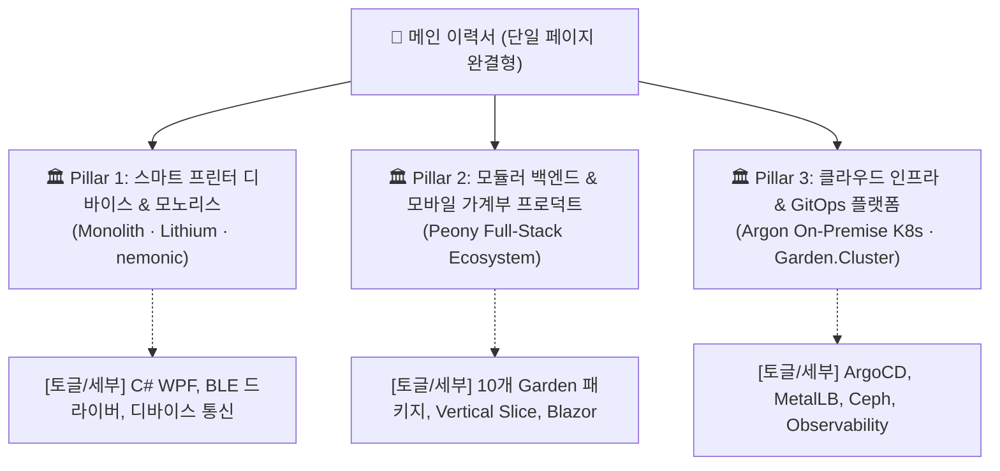

# 노션 기반 개발자 이력서 30선 벤치마크 및 포트폴리오 구조화 가이드

## 개요

본 문서는 대규모·모노레포·멀티 프로젝트를 다루는 개발자의 이력서/포트폴리오가 **"채용담당자(HR 및 기술 면접관)에게 사전 지식 없이도 3분 안에 직관적으로 읽히도록"** 하기 위한 구조화 방법론과, 실제 공개된 **노션(Notion) 기반 개발자 이력서 30선**의 실전 레퍼런스를 분석·기록한 벤치마크 보고서입니다.

---

## 1. 문제 진단: 왜 프로젝트가 많을수록 채용담당자는 읽기 어려워하는가?

현재 김예건 님의 노션 이력서(`이력서 — 김예건`) 및 하위 페이지 구조를 채용담당자 관점에서 분석했을 때 발생하는 인지 부하(Cognitive Load)의 핵심 원인은 다음과 같습니다.

### 1.1 저장소(Repository/Project) 1:1 매핑으로 인한 파편화
- 현재 이력서 하위에는 `Peony`, `Monolith`, `Lithium`, `nemonic Desktop`, `Argon`, `Garden.Usb`, `Garden.Bluetooth`, `Garden.Maui`, `Garden.Aspire`, `Garden.Razor`, `Garden.Razor.Gallery`, `Garden.AspNetCore`, `Garden.Analyzers`, `Garden.Share` 등 **15개 이상의 하위 페이지**가 분산되어 있습니다.
- 사내 맥락(Context)을 모르는 채용담당자는 각 페이지를 열어보기 전까지 "이것이 메인 서비스인지, 사내 공용 패키지인지, 개인 사이드 프로젝트인지" 구분할 수 없습니다.

### 1.2 "비즈니스 프로덕트"와 "기술 부품"의 위계 부재
- 채용담당자가 가장 먼저 보고 싶어 하는 것은 **"어떤 문제를 해결하는 프로덕트(서비스)를 만들었으며, 그 결과 어떤 비즈니스/기술적 임팩트가 있었는가?"**입니다.
- 그러나 `Garden.Usb`, `Garden.Bluetooth`, `Garden.Razor` 등 하위 라이브러리가 최상위 프로젝트와 동등한 레벨로 나열되면, "숲(전체 시스템)"을 보지 못하고 "나무의 잔가지"만 보다가 피로감을 느끼게 됩니다.

### 1.3 도메인 지식 없는 면접관의 3단계 스키밍(Skimming) 실패
면접관은 한 명의 서류를 검토할 때 평균 2~3분을 할애하며 다음과 같은 순서로 읽습니다:
1. **10초 (Summary)**: 어떤 개발자인가? 주력 기술과 연차, 주요 도메인은 무엇인가?
2. **60초 (Macro View)**: 어떤 핵심 시스템/프로덕트를 총괄했는가? (전체 아키텍처, 팀 내 역할, 주요 지표)
3. **90초 (Micro View)**: 가장 난이도 높았던 엔지니어링 문제와 그 해결 과정은 무엇인가? (Deep-dive)
- 현재 구조는 1단계에서 2단계로 넘어갈 때 15개의 하위 페이지로 분기되면서 스키밍이 차단됩니다.

---

## 2. 해결 전략: 3단계 계층형 정보 아키텍처 (3-Tier IA)

성공적인 시니어/리드 개발자 노션 이력서들이 채택하는 공통 해결책은 **"프로젝트 원본 소스를 3대 기둥(Pillars)으로 압축하고, 토글/팝업을 통해 상세 내역을 점진적으로 노출하는 방식"**입니다.



### 핵심 재구성 원칙
1. **1프로젝트 1한줄요약 필수 표기**: 프로덕트명 옆에 `[무엇을 하는 서비스인가]`, `[담당 역할/기여도]`, `[핵심 수치 성과]`를 명시합니다.
2. **라이브러리군 통합 (Pillar화)**: 10개의 `Garden.*` 패키지를 개별 프로젝트로 나누지 않고, **"Garden: 전사 도메인 공용 프레임워크 & 컴포넌트 생태계"**라는 하나의 대형 성과 아래 하위 컴포넌트 리스트로 묶습니다.
3. **아키텍처 다이어그램 1장 삽입**: 서비스 본체(Peony), 공용 라이브러리(Garden), 인프라(Argon K8s)가 어떻게 유기적으로 맞물리는지 보여주는 개념도 1장을 최상단에 배치합니다.

---

## 3. 노션 기반 개발자 이력서 30선 레퍼런스 카탈로그

실제 웹에 공개되어 업계에서 검증된 프론트엔드, 백엔드, 풀스택, 모바일, 인프라 개발자의 노션 이력서/포트폴리오 30선 목록입니다.

### 3.1 빠른 요약 비교표

| 번호 | 이름 / 닉네임 | 직무 분야 | 주요 경력 / 특징 | Notion 링크 |
|:---:|:---|:---|:---|:---|
| 01 | 김석현 (Lob) | 백엔드 엔지니어 | 카카오스타일 주니어 백엔드, 핵심 성과 중심 압축형 | [링크](https://dev-lob.notion.site/26-Junior-Backend-Developer-e51c02b15e89401abe00604d95d4846d) |
| 02 | 안지우 (JIWOOPOLIO) | 서버 개발자 | 우아한형제들 B마트 전시 도메인 분리 및 대규모 최적화 | [링크](https://mima-o.notion.site/JIWOOPOLIO-57115a663d1f43ddab213eb448b96946) |
| 03 | 권태윤 (Taeyoon) | 풀스택 / 테크리드 | 스타트업 CTO 8년, Panoptes VM 반도체 ML 플랫폼 | [링크](https://taeyoonkwon.notion.site/Taeyoon-Kwon-Resume-Portfolio-1ec72785fae548c188b6a9449511dc37) |
| 04 | Wonny | 데이터 / 테크리드 | 강남언니 프론트 리드, 트레바리 초기 테크 리드 & PO | [링크](https://wonny.notion.site/Wonny-e64e2e55653c4d8b8b632118b36bdd72) |
| 05 | 장형원 | 프론트엔드 엔지니어 | 커머스 스타트업 5개 서비스 5,600 커밋 전담 및 앱 출시 | [링크](https://productive-lyric-ffb.notion.site/Frontend-Developer-3d28bd3dd2b7802e88ffd0ae9bc8b56a) |
| 06 | 조은 (John Cho) | 프론트엔드 / 웹표준 | 네이버/당근 등 웹 접근성 및 표준 전문가 | [링크](https://eun.notion.site/eun/John-Cho-Resume-public-0208d6fec948496c95ecb031a583010c) |
| 07 | 정규호 (Kuyho) | 소프트웨어 엔지니어 | 글로벌 SW 엔지니어 이력서 작성 표준 사례 | [링크](https://kchung1995.notion.site/Kuyho-Chung-22bf0263d71a4fe5a8789ff9691d284a) |
| 08 | 유찬익 (yceffort) | 웹 성능 / 프론트엔드 | 웹 성능 최적화 전문 블로거 및 기술 이력서 | [링크](https://yceffort.notion.site/9fc4262c01744a63a849cdccdde5c85f) |
| 09 | 이지호 (Jiho Lee) | 시스템 / 백엔드 | 한국어 시스템/백엔드 엔지니어 기술 이력서 | [링크](https://jiho-lee.notion.site/jiho-lee/Jiho-Lee-e2033eeaaf20408b8bec52b41710f592) |
| 10 | 이동수 | 풀스택 / 프로덕트 | 캠핏 캠핑 예약/결제 웹·앱·어드민 구축 리드 | [링크](https://sonicce99.notion.site/907ecc80c359442c910659a926d2eb30) |
| 11 | 김병욱 (Deaguowl) | 백엔드 엔지니어 | 폴센트 개발 총괄, 다노샵/챌린지 백엔드 | [링크](https://deaguowl.notion.site/1ac49c9e98d14bcfbf48852cd43e26f6) |
| 12 | 이은성 | 프론트엔드 개발자 | 뎁스 최소화 및 직무 다이어트형 이력서 v2.0 | [링크](https://eunseong.notion.site/eunseong/0e35606c8c7f4a8c877cb340e2686fd6) |
| 13 | 김재민 | 프론트엔드 개발자 | 기획-개발 융합형 인터페이스 및 스터디 구축 | [링크](https://third-guanaco-42e.notion.site/c4c0d3a32d1d4684ad02aec5dc1a7772) |
| 14 | 정쿠 (Cucus) | 풀스택 프로그래머 | 5년 차 Special Records 및 기술 스택 한눈 정리 | [링크](https://cucus.notion.site/FullStack-Programmer-26ad44edea894f59b4d35442b286271d) |
| 15 | 장석원 | 프론트엔드 개발자 | 기간·역할·커밋/PR 지표 테이블 기반 프로젝트 정리 | [링크](https://app.notion.com/p/3d030f0adc5881308de0e740b205fcf9) |
| 16 | 양예성 (0start) | 백엔드 엔지니어 | 모바일 청첩장 링크메리 및 클라우드 배포 파이프라인 | [링크](https://0start.notion.site/14298205e3a3809c9ccff8e3a24668c4) |
| 17 | 김주영 (JadeKim) | 백엔드 엔지니어 | 아키텍처 다이어그램 및 도메인별 기능 분리 기술서 | [링크](https://sticky-amusement-21c.notion.site/Demo-Fresh-Trash-3cd71413eefe4bc385d13e7b2ea59bd4) |
| 18 | 유병국 | 백엔드 엔지니어 | 백엔드 프로젝트 개요 및 수치 성과 정리 포트폴리오 | [링크](https://app.notion.com/p/Backend-Portfolio-17226d4c90ec80219c8cf70782c9d5ad) |
| 19 | 공용빈 (Kongyb) | 웹 / 프론트엔드 | 부스트캠프 웹 크립토 그래프 시각화 프로젝트 중심 | [링크](https://kongyb.notion.site/d9ecf75afb6245b9b558e3e7db6dc1dd) |
| 20 | 김경환 (kimxwan0319) | iOS 엔지니어 | Tuist 오픈소스 컨트리뷰터 및 iOS 앱 구조화 | [링크](https://xxw9999.notion.site/xxw9999/iOS-8585a34b2886419586960c5c02b9d845) |
| 21 | 박창현 (Kid-Chang) | 소프트웨어 엔지니어 | 오픈소스 기여 및 개발자 행사 운영 연계 이력서 | [링크](https://sharechang.notion.site/s-Resume-ca6fb048b1ed47df86bda6161580afe5) |
| 22 | 박제영 | 프론트엔드 엔지니어 | Dev-Event 오픈소스 컨트리뷰션 중심 기술서 | [링크](https://lunar-jackrabbit-760.notion.site/Park-Jeyoung-fcd38d99e99f41e09937dc47ffb99b17) |
| 23 | 윤인도 (indosaram) | 백엔드 엔지니어 | 미니멀 1페이지 요약형 백엔드 엔지니어 이력서 | [링크](https://indosaram.notion.site/) |
| 24 | 조용원 (nyongone) | 웹 엔지니어 | 개인 블로그/깃허브 연계형 콤팩트 노션 이력서 | [링크](https://choyongwon.notion.site) |
| 25 | 권용훈 (Dev_YH) | 클라이언트 / 게임 | Unity 클라이언트 및 그래픽스 프로젝트 상세 정리 | [링크](https://shimmering-fibre-cb8.notion.site/Dev_YH-resume-0b9fce7125684f229fa313cc444d3f6f) |
| 26 | 장은준 (Silverjun) | 게임 프로그래머 | 주니어 게임 개발 프로젝트 및 C++ 엔진 학습 기록 | [링크](https://silverjun.notion.site/8e117ec921874150a336715d9b93d192) |
| 27 | 이나현 | 웹 개발자 | e포트폴리오 우수상 수상작, 스토리텔링 중심 구성 | [링크](https://common-cowbell-e3c.notion.site/2024_e-_-_-Developer-478a4d26d9934a8aad544fdf3d8fcec1) |
| 28 | Jesse Gilbert | 소프트웨어 엔지니어 | 프로젝트 갤러리와 기술 블로그를 허브형으로 결합 | [링크](https://jessegilbert.notion.site/) |
| 29 | 이정재 | 데브옵스 / 백엔드 | CodeRabbit / GitHub Action 기반 자동화 특화 | [링크](https://magic-fennel-2ec.notion.site/3babce8f698b49c680ac60dfaac92a9f) |
| 30 | 이재익 (Jaeik Lee) | 풀스택 엔지니어 | 노션 DB 연동 반응형 2열 웹 이력서 & PDF 템플릿 | [링크](https://fluorescent-airplane-153.notion.site/Jaeik-Lee-Resume-Database-278b61feddfe80628aadf4982bcb492a) |

---

## 4. 대표 우수 사례별 구조 상세 분석

### Case 02: 안지우 (우아한형제들 서버 개발자) — "대규모 도메인 분리 & 수치 기반 성과"
- **핵심 특징**: 거대한 레거시 시스템에서 도메인을 분리한 경험을 구조화했습니다.
- **프로젝트 표기법**:
  ```text
  [프로젝트명] B마트 전시통합 시스템 신규 구축
  - 배경: EC2 인스턴스, 10개 모듈, 약 400개 테이블에서 전시 도메인 분리
  - 문제: 파편화된 스레드풀과 클래스 의존성으로 인한 OOM 및 배포 지연
  - 해결: Google App Script/도구로 1,000개 클래스 일괄 자동 리팩토링, 멀티 데이터소스 구성
  - 결과: TPS 23% 향상, P99 응답 속도 98% 감축 (수치 명시)
  ```
- **벤치마킹 포인트**: 김예건 님의 `Monolith`(400개 테이블 모노레포) 및 `Argon`(온프레미스 K8s) 프로젝트에 동일한 STAR(상황-과제-행동-결과) 포맷을 적용하기에 가장 적합합니다.

### Case 03: 권태윤 (스타트업 CTO/테크리드) — "비즈니스 컨텍스트 + 기술 지표의 결합"
- **핵심 특징**: 8년 차 테크리드로서 복잡한 엔터프라이즈 도메인(반도체 가상 계측 AI 플랫폼)을 사전 지식 없는 면접관에게 3줄로 설명했습니다.
- **프로젝트 표기법**:
  ```text
  [비즈니스 맥락] SK하이닉스·인텔 공정 엔지니어를 위한 반도체 센서 데이터 실시간 가상 계측 웹 플랫폼
  [아키텍처 혁신] Next.js/NestJS 기반 전체 재설계, Orval을 통한 프론트-백 엔드투엔드 타입 세이프티 자동화
  [수치 성과] K8s 리소스 소비 75% 절감, 핵심 쿼리 성능 30,000% (300배) 개선
  ```
- **벤치마킹 포인트**: `nemonic Desktop`과 `Peony`의 분산 아키텍처를 설명할 때, "어떤 엔터프라이즈 문제를 풀기 위해 이 시스템이 탄생했는가"를 한 단락으로 요약하는 방식을 도입해야 합니다.

### Case 05: 장형원 (프론트엔드 개발자) — "복잡한 멀티 서비스의 1페이지 테이블 압축"
- **핵심 특징**: 7개의 분산 서비스와 4개의 개인 프로젝트를 운영하면서도, 상단에 `분류 | 기술스택 | 기여도` 테이블을 두고 상세 내용은 펼침 토글로 감췄습니다.
- **벤치마킹 포인트**: 15개의 하위 페이지를 최상단 1개 테이블(프로젝트명, 서비스 유형, 담당 범위, 핵심 기술, 링크)로 압축하는 데 바로 응용할 수 있습니다.

### Case 30: 이재익 (Notion DB 하이브리드 이력서) — "모바일/PDF 2열 압축 레이아웃"
- **핵심 특징**: 노션의 긴 스크롤 문제를 해결하기 위해 노션 DB를 백엔드로 쓰고, 출력용으로는 2열 컴팩트 뷰를 제공하여 A4 2~3장 분량으로 요약했습니다.
- **벤치마킹 포인트**: 노션의 자유도 높은 블록이 오히려 면접관에게는 "정리되지 않은 산문"으로 보일 수 있음을 인지하고, 표(Table)와 불릿 포인트를 활용해 밀도를 높여야 합니다.

---

## 5. 김예건 님 이력서 적용을 위한 실전 리팩토링 청사진

앞선 30개 레퍼런스의 공통 성공 요소를 바탕으로, 현재의 15개 분산 프로젝트를 면접관 친화적으로 재구성하는 구체적인 가이드입니다.

### 5.1 추천 프로젝트 그룹핑 (3대 기둥)

```text
🏛️ 1. 엔터프라이즈 하드웨어 연동 & 클라이언트 플랫폼 (MANGOSLAB 모노레포)
     └─ [프로덕트] Monolith (통합 백엔드) · Lithium (FINECUBE 앱) · nemonic Desktop (WPF 인쇄 앱)
     └─ [핵심 성과] 3대 OS(Windows/iOS/Android) 통합 BLE/USB 프린팅 파이프라인 구축 및 온프레미스 배포

🏛️ 2. Peony & Garden 모듈러 아키텍처 생태계 (개인/사이드 핵심 프로덕트)
     └─ [프로덕트] Peony (모듈러 모노리스 백엔드 & Blazor MAUI 가계부 서비스)
     └─ [공용 프레임워크] Garden Core 패키지군 (Usb, Bluetooth, Maui, Aspire, Razor, Analyzers 등 10개)
     └─ [핵심 성과] Vertical Slice Architecture 적용, 코드 재사용성 극대화 및 공용 아키텍처 가드 수립

🏛️ 3. 온프레미스 인프라 엔지니어링 & GitOps (Argon 클러스터)
     └─ [시스템] Argon (Dual-site Kubernetes 클러스터) · OpenBao 시크릿 제어면 · 관측성 스택
     └─ [핵심 성과] MetalLB, Ceph 스토리지, Flux GitOps 기반 무중단 배포 및 자동화된 하네스 거버넌스
```

### 5.2 프로젝트 기술 템플릿 (사전 지식 없는 면접관용 표준 양식)

각 프로젝트 카드는 반드시 아래 5개 블록으로 고정하여 작성합니다:

```markdown
### [프로젝트명] (진행 기간 / 인원 및 역할)
> **한 줄 소개**: [누구를 위해 무엇을 해결하는 서비스인지 일상 언어로 1문장 작성]

- **아키텍처 & 기술 스택**: [주요 프레임워크, DB, 인프라 나열]
- **핵심 당면 과제 (Problem)**: [사전 지식이 없어도 공감할 수 있는 구체적인 병목 또는 기술적 난제]
- **엔지니어링 접근 (Action)**: [본인이 주도적으로 설계/구현한 핵심 로직 또는 패턴]
- **측정 가능한 성과 (Impact)**: [숫자로 환산된 성능 개선, 코드 감소량, 가용성 수치, 운영 효율성]
- **관련 저장소/링크**: [GitHub 링크 또는 라이브 데모 / 상세 기술 문서 토글]
```

---

## 6. 결론

채용담당 개발자가 지원자의 이력서를 보고 감탄하는 지점은 **"얼마나 많은 코드를 작성했는가"**가 아니라, **"복잡한 시스템 엔지니어링 문제를 얼마나 체계적으로 추상화하고 명쾌하게 전달할 수 있는가"**입니다.

위 30개 레퍼런스에서 확인된 것처럼, 15개의 서브 프로젝트를 개별적으로 열어보게 만드는 대신, **3개의 핵심 비즈니스 축으로 통합하고 수치 기반의 STAR 포맷으로 요약**하면 도메인에 대한 사전 지식이 없는 면접관도 지원자의 기술적 깊이와 아키텍처 역량을 즉시 파악할 수 있습니다.
