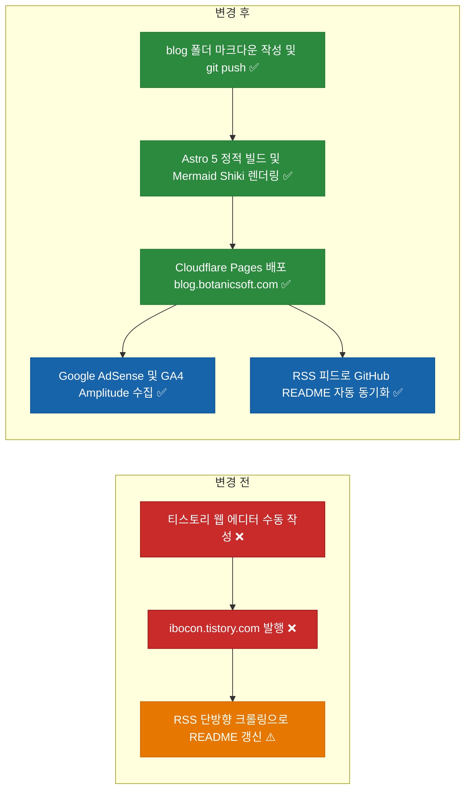
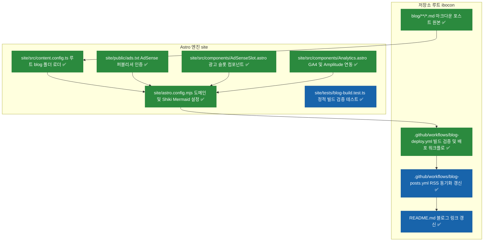
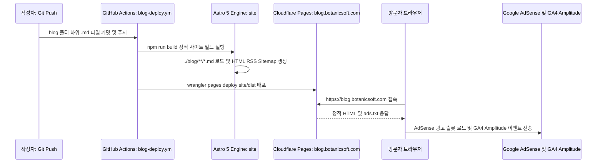

# ⬜ Astro 및 Cloudflare Pages 기반 마크다운 기술 블로그 구축 계획

## 계획 관계

> **관계 스키마**: `1`
> **계획 ID**: `ibocon:261015_feat_astro-markdown-blog-cloudflare-pages`
> **출처 판정**: `최초`
> **출처 판정 근거**: 티스토리 Open API 종료에 따른 대안으로 리포지토리 내 `blog/` 마크다운 관리와 Cloudflare `botanicsoft.com` 도메인 및 AdSense·GA4·Amplitude 연동을 위한 신규 기술 블로그 구축 요청에서 독립적으로 시작

| 관계 | 대상 계획 ID | 조건 | 근거·인수 범위 |
| --- | --- | --- | --- |

<!-- plan-relations-summary:start -->
> 자동 생성 관계 요약. 원본은 위 관계 표입니다.

| 구분 | 계획·조건 |
| --- | --- |
| 최초 계획 | [⬜ Astro 및 Cloudflare Pages 기반 마크다운 기술 블로그 구축 계획](<261015_feat_astro-markdown-blog-cloudflare-pages.md>) `ibocon:261015_feat_astro-markdown-blog-cloudflare-pages` |
| 직접 출처 | 없음 |
| 직접 후속 | 없음 |
| 계보 경로 | [⬜ Astro 및 Cloudflare Pages 기반 마크다운 기술 블로그 구축 계획](<261015_feat_astro-markdown-blog-cloudflare-pages.md>) `ibocon:261015_feat_astro-markdown-blog-cloudflare-pages` |
| 착수 조건 | 가능 |
<!-- plan-relations-summary:end -->

## 결정이 필요한 사항

1. **`botanicsoft.com` 도메인 주소 형태** — `blog.botanicsoft.com` 서브도메인 사용 + 루트 `botanicsoft.com/ads.txt` 리다이렉트 구성 (권장)
- 근거: `BotanicSoft`는 조직·제품 브랜드(`Monolith`, `Peony`, `Argon` 등)의 상위 네임스페이스이므로 루트 도메인(`botanicsoft.com`)은 향후 회사·제품 대표 랜딩 또는 포트폴리오 허브용으로 보존하고, 기술 블로그는 `blog.botanicsoft.com`으로 분리하는 것이 DNS 격리(`CNAME`)와 서비스 확장성 면에서 가장 깔끔하다. 또한 `.botanicsoft.com` 상위 쿠키 도메인을 공유하므로 GA4·Amplitude 크로스 도메인 세션 추적이 기본 동작하며, Google AdSense는 루트 도메인(`botanicsoft.com`) 1회 승인 후 하위 도메인(`blog.botanicsoft.com`)에 별도 심사 없이 즉시 광고를 게재할 수 있다.
- 대안:
  - `botanicsoft.com` (루트/Apex 도메인 직접 바인딩): URL이 가장 짧고 AdSense `ads.txt`가 루트에서 직접 서빙되나, 루트 도메인 전체가 블로그 프로젝트에 독점 바인딩되어 추후 별도 제품 랜딩 페이지를 루트에 배포할 때 라우팅 분리가 필요하다.
  - `botanicsoft.com/blog` (서브패스 라우팅): 도메인 권위(SEO)가 루트에 집중되지만, Astro `base: '/blog'` 에셋 프리픽스 관리 및 루트 사이트와의 Cloudflare Workers 리버스 프록시 구성 복잡도가 추가된다.
  - `ibocon.botanicsoft.com` (개인 핸들 서브도메인): GitHub 핸들(`ibocon`)과 일치하나 브랜드 도메인 아래에 개인 ID가 중복 배치되어 `blog.botanicsoft.com`보다 직관성이 떨어진다.

2. **저장소 내 디렉터리 분리 구조** — 마크다운 원고는 루트 `blog/` 폴더에 순수 `.md`로 보관하고, Astro 빌드 엔진은 `site/` 폴더로 격리 (권장)
- 근거: 기존 `resume/`(마스터 이력서 및 41개 프로젝트 기술서) 및 `docs/`(기획·전략 문서)와 동등한 최상위 위계로 `blog/` 폴더를 두어 글 작성 시 프레임워크 설정 파일 노출 없이 오직 `blog/{category}/{slug}.md` 작성에만 집중할 수 있다. Astro 5 Content Layer API의 `glob({ pattern: "**/*.{md,mdx}", base: "../blog" })` 로더를 사용하면 빌드 엔진(`site/`)과 원고(`blog/`)를 물리적으로 완전히 분리할 수 있다.
- 대안: 루트 디렉터리에 Astro 프로젝트(`package.json`, `astro.config.mjs`, `src/`)를 직접 풀기. 루트가 Node.js 설정 파일로 오염되어 GitHub 프로필 리포지토리(`ibocon/ibocon`)의 가독성을 해친다.

## 배경

### 1. 개요

현재 개인 포트폴리오용 기술 블로그로 운영 중인 `https://ibocon.tistory.com/`(총 244개 포스트)은 2024년 2월 티스토리 공식 Open API(`post/write`, `post/attach`)가 전면 종료됨에 따라 Git 리포지토리의 `.md` 파일을 CI/CD로 무인 동기화할 수 없는 한계가 있다. 비공식 우회 수단(Puppeteer/Playwright 헤드리스 브라우저 조작 또는 `/manage/post.json` 세션 쿠키 재현)은 카카오 2FA 인증 만료, reCAPTCHA 봇 탐지, Mermaid 다이어그램 및 GFM 표 렌더링 깨짐 문제를 수반한다.

이에 따라 현재 리포지토리(`ibocon/ibocon`)의 `blog/` 폴더 아래에서 마크다운(`.md`) 원본(SoT)을 직접 작성·버전 관리하고, `git push`만으로 Cloudflare의 `botanicsoft.com` 도메인에 자동 빌드·배포되며, Google AdSense 수익화와 Google Analytics 4(GA4) 및 Amplitude 사용자 행동 분석이 네이티브로 통합된 정적 기술 블로그 아키텍처를 구축한다.

### 2. GitHub Star 순 정적 블로그 프레임워크 평가 테이블

| 순위 | 프레임워크 및 대표 테마 | GitHub Stars | 기반 기술 | `blog/` 폴더 `.md` 관리 | Cloudflare `botanicsoft.com` | Google AdSense 연동 | GA4 및 Amplitude 연동 | 종합 추천도 |
| :-: | :--- | :-: | :-: | :-: | :-: | :-: | :-: | :--- |
| **1** | **Next.js** (`tailwind-nextjs-starter-blog`) | **143,015** | TS / React | ⭕ 가능 (`output: 'export'`) | ⭕ 가능 | ⚠️ SPA 전환 시 광고 리로드 제어 필요 | ✅ 최상 | 보통 — 마크다운 블로그 대비 보일러플레이트 과다 |
| **2** | **Hugo** (`hugo-PaperMod`) | **90,127** | Go | ✅ 우수 (`contentDir = "../blog"`) | ✅ 최상 | ✅ 최상 (정적 MPA HTML) | ⭕ 우수 | 추천 (차선책) — 빌드는 가장 빠르나 Go 템플릿 확장이 제한적 |
| **3** | **Docusaurus** (Meta 공식) | **66,489** | TS / React | ✅ 기본 내장 (`blog/` 기본 경로) | ✅ 최상 | ⭕ 우수 | ✅ 최상 | 우수 — 기술 위키와 블로그 병행 시 적합 |
| **4** | **Astro** (`AstroPaper` / `Fuwari`) | **63,240** | TS / Astro | ✅ 최상 (`glob({ base: "../blog" })`) | ✅ 최상 (CF Pages 공식 최적화) | ✅ 최상 (정적 MPA HTML + `ads.txt`) | ✅ 최상 (Partytown 웹워커 지원) | **👑 권장안 A (1순위)** — 성능·SEO·AdSense·확장성 최고 |
| **5** | **Jekyll** (`jekyll-theme-chirpy`) | **51,713** | Ruby | ⚠️ `_posts/` 강제 | ⭕ 가능 | ✅ 우수 | ⭕ 보통 | 비추천 — Ruby 환경 의존성 및 폴더 구조 경직 |
| **6** | **Hexo** (`hexo-theme-next`) | **41,778** | TS / Node | ⭕ 가능 (`source_dir` 변경) | ✅ 우수 | ✅ 우수 | ⭕ 보통 | 보통 — 레거시 플러그인 비중 높음 |
| **7** | **MkDocs** (`mkdocs-material`) | **22,499** | Python | ⭕ 가능 (`blog` 플러그인) | ✅ 우수 | ⭕ 보통 (`overrides` 커스텀) | ✅ 우수 | 보통 — 매뉴얼 형태에 특화되어 블로그 브랜딩에 한계 |
| **8** | **VitePress** (Vue 공식) | **18,404** | TS / Vue | ⭕ 가능 (`srcDir` 지정) | ✅ 최상 | ⚠️ SPA 라우팅 광고 래퍼 필요 | ✅ 우수 | 보통 — 카테고리·태그·페이징 직접 구현 필요 |
| **9** | **Zola** (단일 바이너리) | **17,513** | Rust | ⭕ 가능 | ✅ 우수 | ✅ 우수 | ⭕ 보통 | 보통 — 생태계 및 테마 부족 |

### 3. `botanicsoft.com` 도메인 주소 형태 비교 검토 테이블

| 평가 항목 | 안 1. `blog.botanicsoft.com`<br>(서브도메인 — 👑 권장) | 안 2. `botanicsoft.com`<br>(루트/Apex 도메인) | 안 3. `botanicsoft.com/blog`<br>(서브패스 라우팅) | 안 4. `ibocon.botanicsoft.com`<br>(개인 핸들 서브도메인) |
| :--- | :--- | :--- | :--- | :--- |
| **URL 예시** | `https://blog.botanicsoft.com/dotnet/...` | `https://botanicsoft.com/dotnet/...` | `https://botanicsoft.com/blog/dotnet/...` | `https://ibocon.botanicsoft.com/dotnet/...` |
| **브랜드 및 역할 분리** | ✅ **최상** — 루트(`botanicsoft.com`)는 향후 제품/조직 홈으로 남겨두고 기술 블로그만 명확히 분리 | ⚠️ 루트 도메인 전체가 블로그에 귀속되어 추후 제품 랜딩 추가 시 충돌 | ⭕ 루트와 블로그 역할 분리 가능 | ⚠️ 브랜드 도메인 아래 개인 ID가 중첩되어 의미가 모호함 |
| **Cloudflare DNS 및 배포 난이도** | ✅ **최상** — Cloudflare Pages에 `blog.botanicsoft.com` CNAME 1줄 자동 생성 | ✅ **최상** — Cloudflare Pages Apex CNAME Flattening 자동 지원 | ❌ **복잡** — 루트 웹앱과 블로그 분리 시 Cloudflare Workers 프록시 필요 | ✅ **최상** — CNAME 1줄 자동 생성 |
| **Google AdSense 연동 및 `ads.txt`** | ✅ **우수** — AdSense에 `botanicsoft.com` 등록 후 서브도메인 추가. `ads.txt`는 루트 리다이렉트 규칙 1줄로 해결 | ✅ **최상** — `https://botanicsoft.com/ads.txt`에서 직접 크롤링 | ✅ **최상** — 루트 도메인 `ads.txt` 공유 | ✅ **우수** — 안 1과 동일하게 루트 등록 후 서브도메인 추가 |
| **GA4 및 Amplitude 연동** | ✅ **최상** — `.botanicsoft.com` 쿠키 공유로 루트 ↔ 블로그 간 교차 도메인 유저/세션 자동 추적 | ✅ **최상** — 단일 도메인 추적 | ✅ **최상** — 단일 도메인 내 경로 필터링 | ✅ **최상** — `.botanicsoft.com` 쿠키 공유 |
| **검색 엔진 최적화 (SEO)** | ⭕ **우수** — Google Search Console에 도메인 속성(`botanicsoft.com`) 등록 시 통합 집계 | ✅ **최상** — 단일 루트 도메인에 백링크 점수 집중 | ✅ **최상** — 루트 도메인 권위 상속 | ⭕ **우수** — 안 1과 동일 |
| **종합 판정** | **🥇 1순위 권장** (확장성·격리성·관리 편의성 최적) | **🥈 2순위** (루트 도메인에 다른 웹 서비스를 절대 안 올릴 경우) | **3순위** (프록시 유지보수 부담) | **4순위** (네이밍 중복) |

### 4. 전체 아키텍처 비교



## 변경 범위



| 레이어 | 파일 | 변경 내용 |
| --- | --- | --- |
| Content SoT | `blog/dotnet/2026-10-15-clean-architecture-rich-domain.md` | `blog/` 폴더 하위 첫 기술 블로그 마크다운 포스트 및 Frontmatter 표준 규격 정의 |
| Blog Engine | `site/package.json` | Astro 5, `@astrojs/rss`, `@astrojs/sitemap`, `@amplitude/analytics-browser`, `vitest` 의존성 선언 |
| Blog Engine | `site/astro.config.mjs` | `site: 'https://blog.botanicsoft.com'`, Shiki 코드 하이라이팅, Sitemap 연동 설정 |
| Blog Engine | `site/src/content.config.ts` | Astro Content Layer `glob({ pattern: "**/*.{md,mdx}", base: "../blog" })` 로더로 루트 `blog/` 폴더 연결 |
| Monetization | `site/public/ads.txt` | Google AdSense 크롤러 인증을 위한 `ads.txt` 정적 파일 배치 |
| Monetization | `site/src/components/AdSenseSlot.astro` | Google AdSense 스크립트 로드 및 반응형 광고 슬롯(`ins.adsbygoogle`) 컴포넌트 구현 |
| Analytics | `site/src/components/Analytics.astro` | Google Analytics 4(`gtag.js`) 및 Amplitude Browser SDK 초기화·페이지뷰·스크롤 이벤트 수집 컴포넌트 구현 |
| Pages & RSS | `site/src/pages/rss.xml.ts` | `blog/` 컬렉션 기반 표준 RSS 2.0 피드(`https://blog.botanicsoft.com/rss.xml`) 생성 엔드포인트 |
| CI/CD | `.github/workflows/blog-deploy.yml` | `blog/**` 또는 `site/**` 변경 시 Astro 정적 빌드·테스트 검증 및 Cloudflare Pages 배포 수행 |
| CI/CD | `.github/workflows/blog-posts.yml` | 블로그 RSS 수집 소스를 `https://blog.botanicsoft.com/rss.xml` (티스토리 폴백 지원)로 갱신 |
| Profile | `README.md` | 기술 블로그 배지 및 링크에 `blog.botanicsoft.com` 병기 |
| Test | `site/tests/fixtures/sample-post.md` | 빌드 및 스키마 검증용 테스트 마크다운 픽스처 |
| Test | `site/tests/blog-build.test.ts` | `blog/` 마크다운 파싱, `ads.txt` 생성, AdSense/GA4/Amplitude 주입 여부 자동 검증 테스트 |

## 단계별 수정 계획

### ⬜ 1단계. 루트 `blog/` 디렉터리 생성 및 마크다운 Frontmatter 표준 수립

**파일**: `blog/dotnet/2026-10-15-clean-architecture-rich-domain.md`

AS-IS:

```markdown
<!-- 신규 파일: 리포지토리 내 blog/ 디렉터리 부재 ❌ -->
```

TO-BE:

```markdown
---
title: "[.NET] Clean Architecture와 Rich Domain Model 실전 설계 원칙"
description: "빈혈 도메인 모델을 탈피하고 불변식 캡슐화와 Result 패턴으로 테스트 가능한 .NET 백엔드를 구축하는 방법"
pubDate: 2026-10-15
category: "dotnet"
tags: ["dotnet", "csharp", "clean-architecture", "ddd"]
draft: false
---

## 1. 문제 배경

비즈니스 규칙이 Application 레이어의 서비스나 핸들러에 흩어지는 빈혈 도메인 모델은 시스템 규모가 커질수록 불변식 검증 누락을 유발합니다.
```

### ⬜ 2단계. Astro 빌드 엔진(`site/`) 및 루트 `blog/` Content Loader 구성

**파일**: `site/package.json`

AS-IS:

```json
// 신규 파일 ❌
```

TO-BE:

```json
{
  "name": "ibocon-blog-engine",
  "type": "module",
  "version": "1.0.0",
  "private": true,
  "scripts": {
    "dev": "astro dev",
    "build": "astro build",
    "preview": "astro preview",
    "test": "vitest run"
  },
  "dependencies": {
    "@amplitude/analytics-browser": "^2.11.0",
    "@astrojs/rss": "^4.0.9",
    "@astrojs/sitemap": "^3.2.1",
    "astro": "^5.1.0"
  },
  "devDependencies": {
    "vitest": "^2.1.8"
  }
}
```

**파일**: `site/astro.config.mjs`

AS-IS:

```javascript
// 신규 파일 ❌
```

TO-BE:

```javascript
// ✅ Cloudflare botanicsoft.com 도메인 및 정적 MPA 빌드 설정
import { defineConfig } from 'astro/config';
import sitemap from '@astrojs/sitemap';

export default defineConfig({
  site: 'https://blog.botanicsoft.com',
  output: 'static',
  integrations: [sitemap()],
  markdown: {
    shikiConfig: {
      theme: 'github-dark',
      wrap: true,
    },
  },
});
```

**파일**: `site/src/content.config.ts`

AS-IS:

```typescript
// 신규 파일 ❌
```

TO-BE:

```typescript
// ✅ 리포지토리 루트의 ../blog 폴더 하위 마크다운(.md)을 스캔하는 컬렉션 로더
import { defineCollection, z } from 'astro:content';
import { glob } from 'astro/loaders';

const blog = defineCollection({
  loader: glob({ pattern: '**/*.{md,mdx}', base: '../blog' }),
  schema: z.object({
    title: z.string(),
    description: z.string(),
    pubDate: z.coerce.date(),
    updatedDate: z.coerce.date().optional(),
    category: z.string(),
    tags: z.array(z.string()).default([]),
    draft: z.boolean().default(false),
  }),
});

export const collections = { blog };
```

### ⬜ 3단계. Google AdSense 연동 (`ads.txt` 및 반응형 광고 슬롯 컴포넌트)

**파일**: `site/public/ads.txt`

AS-IS:

```text
# 신규 파일 ❌
```

TO-BE:

```text
google.com, pub-0000000000000000, DIRECT, f08c47fec0942fa0
```

**파일**: `site/src/components/AdSenseSlot.astro`

AS-IS:

```astro
---
// 신규 파일 ❌
---
```

TO-BE:

```astro
---
// ✅ Google AdSense 스크립트 및 본문 반응형 광고 단위 컴포넌트
interface Props {
  slotId: string;
  format?: 'auto' | 'fluid' | 'rectangle';
}

const { slotId, format = 'auto' } = Astro.props;
const clientId = import.meta.env.PUBLIC_ADSENSE_CLIENT_ID;
---

{clientId && (
  <aside class="adsense-container" aria-label="Advertisement">
    <script
      is:inline
      async
      src={`https://pagead2.googlesyndication.com/pagead/js/adsbygoogle.js?client=${clientId}`}
      crossorigin="anonymous"
    ></script>
    <ins
      class="adsbygoogle"
      style="display:block"
      data-ad-client={clientId}
      data-ad-slot={slotId}
      data-ad-format={format}
      data-full-width-responsive="true"
    ></ins>
    <script is:inline>
      (window.adsbygoogle = window.adsbygoogle || []).push({});
    </script>
  </aside>
)}
```

### ⬜ 4단계. Google Analytics 4 (GA4) 및 Amplitude 통합 분석 컴포넌트 구현

**파일**: `site/src/components/Analytics.astro`

AS-IS:

```astro
---
// 신규 파일 ❌
---
```

TO-BE:

```astro
---
// ✅ GA4(gtag.js) 및 Amplitude Browser SDK 통합 초기화 컴포넌트
const gaMeasurementId = import.meta.env.PUBLIC_GA_MEASUREMENT_ID;
const amplitudeApiKey = import.meta.env.PUBLIC_AMPLITUDE_API_KEY;
---

{gaMeasurementId && (
  <>
    <script
      is:inline
      async
      src={`https://www.googletagmanager.com/gtag/js?id=${gaMeasurementId}`}
    ></script>
    <script is:inline define:vars={{ gaMeasurementId }}>
      window.dataLayer = window.dataLayer || [];
      function gtag() { dataLayer.push(arguments); }
      gtag('js', new Date());
      gtag('config', gaMeasurementId, {
        cookie_domain: 'botanicsoft.com',
         send_page_view: true,
      });
    </script>
  </>
)}

{amplitudeApiKey && (
  <script>
    import * as amplitude from '@amplitude/analytics-browser';

    const apiKey = import.meta.env.PUBLIC_AMPLITUDE_API_KEY;
    if (apiKey) {
      amplitude.init(apiKey, undefined, {
        defaultTracking: {
          pageViews: true,
          sessions: true,
          formInteractions: true,
          fileDownloads: true,
        },
        serverZone: 'US',
      });
    }
  </script>
)}
```

### ⬜ 5단계. RSS 2.0 피드 생성 및 Cloudflare Pages 자동 배포·README 연동 워크플로 구성

**파일**: `site/src/pages/rss.xml.ts`

AS-IS:

```typescript
// 신규 파일 ❌
```

TO-BE:

```typescript
// ✅ blog/ 마크다운 글 목록을 기반으로 표준 RSS 2.0 피드 생성
import rss from '@astrojs/rss';
import { getCollection } from 'astro:content';
import type { APIContext } from 'astro';

export async function GET(context: APIContext) {
  const posts = (await getCollection('blog'))
    .filter((post) => !post.data.draft)
    .sort((a, b) => b.data.pubDate.valueOf() - a.data.pubDate.valueOf());

  return rss({
    title: 'Yegun Kim Tech Blog | BotanicSoft',
    description: '.NET, Clean Architecture, Kubernetes & Distributed Systems Engineering',
    site: context.site ?? 'https://blog.botanicsoft.com',
    items: posts.map((post) => ({
      title: post.data.title,
      pubDate: post.data.pubDate,
      description: post.data.description,
      categories: [post.data.category, ...post.data.tags],
      link: `/${post.id}/`,
    })),
  });
}
```

**파일**: `.github/workflows/blog-deploy.yml`

AS-IS:

```yaml
# 신규 파일 ❌
```

TO-BE:

```yaml
name: Build and Deploy Blog to Cloudflare Pages

on:
  push:
    branches:
      - main
    paths:
      - 'blog/**'
      - 'site/**'
      - '.github/workflows/blog-deploy.yml'
  workflow_dispatch:

jobs:
  build-and-deploy:
    name: Build Astro Blog and Deploy to Cloudflare Pages
    runs-on: ubuntu-latest
    permissions:
      contents: read
      deployments: write
    steps:
      - name: Checkout repository
        uses: actions/checkout@v4

      - name: Setup Node.js
        uses: actions/setup-node@v4
        with:
          node-version: '22'
          cache: 'npm'
          cache-dependency-path: site/package-lock.json

      - name: Install dependencies
        working-directory: site
        run: npm ci

      - name: Run build and verification tests
        working-directory: site
        env:
          PUBLIC_ADSENSE_CLIENT_ID: ${{ vars.PUBLIC_ADSENSE_CLIENT_ID }}
          PUBLIC_GA_MEASUREMENT_ID: ${{ vars.PUBLIC_GA_MEASUREMENT_ID }}
          PUBLIC_AMPLITUDE_API_KEY: ${{ vars.PUBLIC_AMPLITUDE_API_KEY }}
        run: |
          npm run build
          npm test

      - name: Publish to Cloudflare Pages
        if: ${{ secrets.CLOUDFLARE_API_TOKEN != '' && secrets.CLOUDFLARE_ACCOUNT_ID != '' }}
        uses: cloudflare/wrangler-action@v3
        with:
          apiToken: ${{ secrets.CLOUDFLARE_API_TOKEN }}
          accountId: ${{ secrets.CLOUDFLARE_ACCOUNT_ID }}
          command: pages deploy site/dist --project-name=botanicsoft-blog
```

**파일**: `.github/workflows/blog-posts.yml`

AS-IS:

```yaml
# source-snapshot: true
# path: .github/workflows/blog-posts.yml
      - name: Update Blog Posts
        run: |
          python -c "
          import feedparser, re

          feed = feedparser.parse('https://ibocon.tistory.com/rss')
          tech_posts = []
          exclude_keywords = ['건축', '단독주택', '콘크리트', '신재생에너지']
```

TO-BE:

```yaml
      - name: Update Blog Posts
        run: |
          python -c "
          import feedparser, re

          feed = feedparser.parse('https://blog.botanicsoft.com/rss.xml')
          if not getattr(feed, 'entries', None):
              feed = feedparser.parse('https://ibocon.tistory.com/rss')
          tech_posts = []
          exclude_keywords = ['건축', '단독주택', '콘크리트', '신재생에너지']
```

**파일**: `README.md`

AS-IS:

```markdown
# source-snapshot: true
# path: README.md
## 📫 연락처 및 채널 (Contact & Links)
[](https://ibocon.tistory.com/)
[](https://linkedin.com)
[](mailto:wlfka102@gmail.com)
[](https://x.com/wlfka102)
```

TO-BE:

```markdown
## 📫 연락처 및 채널 (Contact & Links)
[](https://blog.botanicsoft.com/)
[](https://ibocon.tistory.com/)
[](https://linkedin.com)
[](mailto:wlfka102@gmail.com)
[](https://x.com/wlfka102)
```

## 주요 흐름



## 테스트 계획

> 위치: `site/tests/`
> 프레임워크: Vitest
> 패턴: Given/When/Then (Four-Phase Test)

### ⬜ 테스트용 Stub 정의

**파일**: `site/tests/fixtures/sample-post.md`

```markdown
---
title: "[Test] Sample Astro Blog Post"
description: "Automated build verification fixture"
pubDate: 2026-10-15
category: "dotnet"
tags: ["dotnet", "test"]
draft: false
---

## Sample Heading

Sample body content for automated test verification.
```

### ⬜ 테스트: `blog-build.test.ts`

**파일**: `site/tests/blog-build.test.ts`

```typescript
import { describe, it, expect } from 'vitest';
import { existsSync, readFileSync } from 'node:fs';
import { resolve } from 'node:path';

describe('Astro Blog Static Build Verification', () => {
  it('Given_BlogMarkdownAndPublicAssets_When_Built_Then_GeneratesAdsTxtRssAndAnalyticsHtml', () => {
    // Given
    const distDir = resolve(process.cwd(), 'dist');
    const adsTxtPath = resolve(distDir, 'ads.txt');
    const rssXmlPath = resolve(distDir, 'rss.xml');

    // When
    const adsTxtExists = existsSync(adsTxtPath);
    const rssXmlExists = existsSync(rssXmlPath);

    // Then
    expect(adsTxtExists).toBe(true);
    expect(readFileSync(adsTxtPath, 'utf-8')).toContain('google.com, pub-');
    expect(rssXmlExists).toBe(true);
    expect(readFileSync(rssXmlPath, 'utf-8')).toContain('https://blog.botanicsoft.com');
  });
});
```

### 테스트 요약

| 테스트 클래스 | 검증 대상 | 테스트 수 |
| --- | --- | ---: |
| `blog-build.test.ts` | `blog/` 마크다운 빌드 산출물, `ads.txt` 존재 여부, `rss.xml` 도메인 URL 정합성 검증 | 1 |
| **합계** | | **1** |

### 테스트 결과

| 범위 | 실행 명령 | 총 테스트 | 통과 | 실패 | 결과 |
| --- | --- | ---: | ---: | ---: | :---: |
| 변경 범위 | `npm --prefix site test` | — | — | — | ⬜ |
| 전체 | `npm --prefix site run build && npm --prefix site test` | — | — | — | ⬜ |

**실행 일시**: —

## 계획 평가

| 관점 | 참조 문서 | 평가 항목 | 결과 |
| --- | --- | --- | --- |
| 클린 코드 | `clean-code.md` | 마크다운 콘텐츠(`blog/`)와 빌드 엔진(`site/`), 수익화(`AdSenseSlot`), 분석(`Analytics`) 책임 분리 | ✅ |
| 아키텍처 | `clean-architecture.md` | 콘텐츠 원본(SoT)이 프레임워크 구현 세부사항에 의존하지 않는 단방향 Content Loader 구조 | ✅ |
| 디자인 패턴 | `design-pattern.md` | 정적 생성(SSG)과 선언적 컴포넌트 패턴 활용으로 불필요한 런타임 복잡도 배제 | ✅ |
| 엔터프라이즈 패턴 | `enterprise-application-architecture.md` | 환경 변수(`PUBLIC_ADSENSE_CLIENT_ID`, `PUBLIC_GA_MEASUREMENT_ID`, `PUBLIC_AMPLITUDE_API_KEY`)와 코드 분리 | ✅ |
| 리팩토링 | `refactoring.md` | 기존 `resume/` 및 `docs/` 폴더를 침범하지 않고 독립된 `blog/` 및 `site/` 경계 유지 | ✅ |
| 테스트 품질 | `testing/docs/guide/x-unit-test-patterns.md` | Given/When/Then 기반 정적 산출물(`ads.txt`, `rss.xml`) 결정론적 검증 | ✅ |
| .NET 도메인·컨벤션 | `dotnet/docs/guide·convention` | Astro/TypeScript 및 마크다운 블로그 구축 계획으로 C# 도메인 코드 변경 없음 | 해당 없음 |

**특이사항:**

없음

## 작업 순서

1. 리포지토리 루트에 `blog/` 디렉터리를 생성하고 첫 기술 포스트(`blog/dotnet/2026-10-15-clean-architecture-rich-domain.md`)를 작성한다.
2. `site/` 디렉터리에 Astro 5 프로젝트(`package.json`, `astro.config.mjs`, `src/content.config.ts`)를 구성하고 `../blog` 폴더 로더를 연결한다.
3. `site/public/ads.txt`, `site/src/components/AdSenseSlot.astro`, `site/src/components/Analytics.astro`, `site/src/pages/rss.xml.ts`를 구현한다.
4. `.github/workflows/blog-deploy.yml`을 추가하고 `.github/workflows/blog-posts.yml` 및 `README.md`를 업데이트한다.
5. `site/tests/blog-build.test.ts`로 정적 빌드 산출물(`dist/ads.txt`, `dist/rss.xml`) 검증 테스트를 실행한다.
