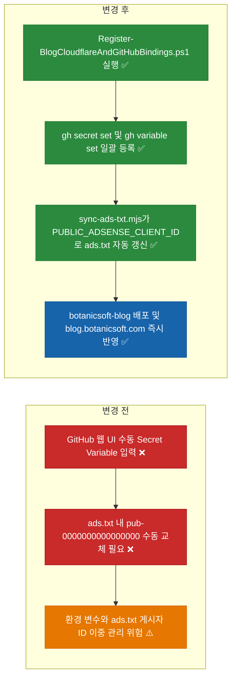
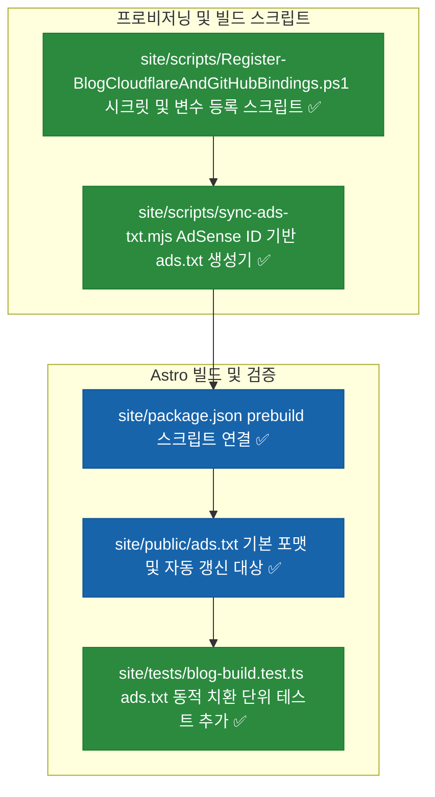
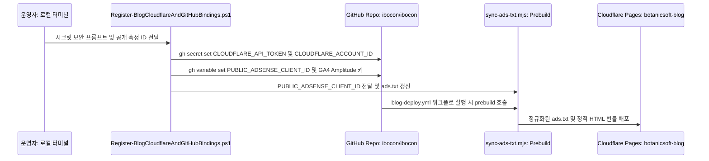

# ⬜ 블로그 Cloudflare Pages 배포 시크릿 및 AdSense·GA4·Amplitude 바인딩 자동화 계획

## 계획 관계

> **관계 스키마**: `1`
> **계획 ID**: `ibocon:261015_feat_configure-blog-cloudflare-and-analytics-bindings`
> **출처 판정**: `연결`
> **출처 판정 근거**: Astro 및 Cloudflare Pages 기반 마크다운 기술 블로그 구축 완료 이후, 잔여 외부 설정인 GitHub Secrets/Variables 등록과 Cloudflare Pages 프로젝트·도메인 연결 및 `ads.txt` 게시자 ID 자동 치환을 구성하는 후속 작업

| 관계 | 대상 계획 ID | 조건 | 근거·인수 범위 |
| --- | --- | --- | --- |
| 후속 | `ibocon:261015_feat_astro-markdown-blog-cloudflare-pages` | 해당 없음 | GitHub Secrets(`CLOUDFLARE_API_TOKEN`, `CLOUDFLARE_ACCOUNT_ID`), GitHub Variables(`PUBLIC_ADSENSE_CLIENT_ID`, `PUBLIC_GA_MEASUREMENT_ID`, `PUBLIC_AMPLITUDE_API_KEY`) 등록 스크립트 및 `ads.txt` 빌드 타임 자동 동기화 구성 |

<!-- plan-relations-summary:start -->
> 자동 생성 관계 요약. 원본은 위 관계 표입니다.

| 구분 | 계획·조건 |
| --- | --- |
| 최초 계획 | [✅ Astro 및 Cloudflare Pages 기반 마크다운 기술 블로그 구축 계획](<../history/2610/W3/261015/261015_feat_astro-markdown-blog-cloudflare-pages.md>) `ibocon:261015_feat_astro-markdown-blog-cloudflare-pages` |
| 직접 출처 | [✅ Astro 및 Cloudflare Pages 기반 마크다운 기술 블로그 구축 계획](<../history/2610/W3/261015/261015_feat_astro-markdown-blog-cloudflare-pages.md>) `ibocon:261015_feat_astro-markdown-blog-cloudflare-pages` |
| 직접 후속 | [⬜ 블로그 Cloudflare Pages 배포 시크릿 및 AdSense·GA4·Amplitude 바인딩 사용자 실행 검증](<261015_verify_configure-blog-cloudflare-and-analytics-bindings.md>) `ibocon:261015_verify_configure-blog-cloudflare-and-analytics-bindings` |
| 계보 경로 | [✅ Astro 및 Cloudflare Pages 기반 마크다운 기술 블로그 구축 계획](<../history/2610/W3/261015/261015_feat_astro-markdown-blog-cloudflare-pages.md>) `ibocon:261015_feat_astro-markdown-blog-cloudflare-pages` → [⬜ 블로그 Cloudflare Pages 배포 시크릿 및 AdSense·GA4·Amplitude 바인딩 자동화 계획](<261015_feat_configure-blog-cloudflare-and-analytics-bindings.md>) `ibocon:261015_feat_configure-blog-cloudflare-and-analytics-bindings` |
| 후속 | [✅ Astro 및 Cloudflare Pages 기반 마크다운 기술 블로그 구축 계획](<../history/2610/W3/261015/261015_feat_astro-markdown-blog-cloudflare-pages.md>) `ibocon:261015_feat_astro-markdown-blog-cloudflare-pages` — 해당 없음 |
| 착수 조건 | 가능 |
<!-- plan-relations-summary:end -->

## 결정이 필요한 사항

1. **`site/public/ads.txt` 게시자 ID 관리 방식** — `PUBLIC_ADSENSE_CLIENT_ID` 환경 변수에서 빌드 시점에 `ads.txt`를 자동 생성·갱신하는 프리빌드 스크립트(`site/scripts/sync-ads-txt.mjs`) 도입 (권장)
- 근거: GitHub Repository Variables에 `PUBLIC_ADSENSE_CLIENT_ID`(`ca-pub-XXXXXXXXXXXXXXXX` 또는 `pub-XXXXXXXXXXXXXXXX`)를 한 번만 등록하면 `AdSenseSlot.astro` 컴포넌트와 `site/public/ads.txt`의 `pub-XXXXXXXXXXXXXXXX` 레코드가 단일 진실 공급원(SSoT)으로 동기화되어 수동 파일 수정 실수를 원천 차단할 수 있다.
- 대안: `site/public/ads.txt`를 수동으로 편집해 커밋하고 GitHub Variable에도 별도 입력. 두 곳에 중복 관리해야 하므로 ID 불일치 위험이 있다.

2. **GitHub Secrets 및 Variables 등록 방식** — 평문 노출을 차단하는 보안 프롬프트 기반 PowerShell 프로비저닝 스크립트(`site/scripts/Register-BlogCloudflareAndGitHubBindings.ps1`) 제공 (권장)
- 근거: `CLOUDFLARE_API_TOKEN` 등 민감 시크릿이 셸 히스토리나 로그에 평문 인자로 남지 않도록 `Read-Host -AsSecureString`으로 입력받아 `gh secret set`과 `gh variable set`으로 주입하고, Cloudflare Pages 프로젝트(`botanicsoft-blog`) 생성까지 일괄 수행할 수 있다.
- 대안: GitHub 웹 UI 및 Cloudflare 대시보드에서 모든 항목을 수동 클릭으로 개별 등록.

## 배경

### 1. 개요

선행 계획(`ibocon:261015_feat_astro-markdown-blog-cloudflare-pages`)을 통해 루트 `blog/` 마크다운 로더와 Astro 5 정적 빌드 엔진(`site/`), 그리고 `.github/workflows/blog-deploy.yml` 파이프라인을 구축했다. 이제 실제 운영 배포와 수익화·분석 수집을 활성화하기 위해 다음 3가지 작업을 자동화한다:

1. **Cloudflare Pages 배포 활성화**: GitHub Repository Secrets에 `CLOUDFLARE_API_TOKEN`, `CLOUDFLARE_ACCOUNT_ID`를 안전하게 등록하고 Cloudflare Pages 프로젝트(`botanicsoft-blog`) 및 커스텀 도메인(`blog.botanicsoft.com`)을 바인딩한다.
2. **수익화 및 분석 활성화**: GitHub Repository Variables에 `PUBLIC_ADSENSE_CLIENT_ID`, `PUBLIC_GA_MEASUREMENT_ID`, `PUBLIC_AMPLITUDE_API_KEY`를 등록한다.
3. **`ads.txt` 단일 진실 공급원(SSoT) 동기화**: `PUBLIC_ADSENSE_CLIENT_ID` 값으로부터 `site/public/ads.txt`의 `pub-XXXXXXXXXXXXXXXX` 값을 빌드 시점에 자동 치환하여 별도 수동 파일 수정 없이도 정식 AdSense 크롤러 인증이 통과되도록 구성한다.

### 2. 전체 아키텍처 비교



## 변경 범위



| 레이어 | 파일 | 변경 내용 |
| --- | --- | --- |
| Build Script | `site/scripts/sync-ads-txt.mjs` | `PUBLIC_ADSENSE_CLIENT_ID`(`ca-pub-...` 또는 `pub-...`)를 정규화하여 `site/public/ads.txt`를 자동 생성하는 스크립트 추가 |
| Provisioning | `site/scripts/Register-BlogCloudflareAndGitHubBindings.ps1` | GitHub Secrets(`CLOUDFLARE_API_TOKEN`, `CLOUDFLARE_ACCOUNT_ID`) 보안 입력 및 GitHub Variables(`PUBLIC_ADSENSE_CLIENT_ID`, `PUBLIC_GA_MEASUREMENT_ID`, `PUBLIC_AMPLITUDE_API_KEY`) 등록·`ads.txt` 동기화 스크립트 추가 |
| Blog Engine | `site/package.json` | `build` 스크립트 실행 전 `node scripts/sync-ads-txt.mjs`가 자동 실행되도록 `prebuild` 훅 추가 |
| Monetization | `site/public/ads.txt` | `sync-ads-txt.mjs`를 통해 갱신되는 Google AdSense 공인 판매자 레코드 파일 |
| Test | `site/tests/blog-build.test.ts` | `PUBLIC_ADSENSE_CLIENT_ID` 값 주입 시 `ca-pub-` 접두어 정규화 및 `ads.txt` 반영 여부를 검증하는 단위 테스트 추가 |

## 단계별 수정 계획

### ⬜ 1단계. `PUBLIC_ADSENSE_CLIENT_ID` 기반 `ads.txt` 자동 동기화 스크립트(`sync-ads-txt.mjs`) 구현

**파일**: `site/scripts/sync-ads-txt.mjs`

AS-IS:

```javascript
// 신규 파일 ❌
```

TO-BE:

```javascript
// ✅ PUBLIC_ADSENSE_CLIENT_ID 환경 변수에서 pub-ID를 추출해 public/ads.txt를 자동 갱신
import { writeFileSync } from 'node:fs';
import { resolve } from 'node:path';

export function normalizeAdSensePublisherId(rawClientId) {
  const trimmed = (rawClientId ?? '').trim();
  if (!trimmed) {
    return 'pub-0000000000000000';
  }
  if (trimmed.startsWith('ca-pub-')) {
    return trimmed.slice(3);
  }
  if (trimmed.startsWith('pub-')) {
    return trimmed;
  }
  return `pub-${trimmed}`;
}

export function formatAdsTxtLine(rawClientId) {
  const publisherId = normalizeAdSensePublisherId(rawClientId);
  return `google.com, ${publisherId}, DIRECT, f08c47fec0942fa0\n`;
}

if (import.meta.url === `file://${process.argv[1]?.replace(/\\/g, '/')}`) {
  const targetPath = resolve(process.cwd(), 'public', 'ads.txt');
  const content = formatAdsTxtLine(process.env.PUBLIC_ADSENSE_CLIENT_ID);
  writeFileSync(targetPath, content, 'utf-8');
}
```

**파일**: `site/package.json`

AS-IS:

```json
# source-snapshot: true
# path: site/package.json
  "scripts": {
    "dev": "astro dev",
    "build": "astro build",
    "preview": "astro preview",
    "test": "vitest run"
  },
```

TO-BE:

```json
  "scripts": {
    "prebuild": "node scripts/sync-ads-txt.mjs",
    "dev": "astro dev",
    "build": "astro build",
    "preview": "astro preview",
    "test": "vitest run"
  },
```

**파일**: `site/public/ads.txt`

AS-IS:

```text
# source-snapshot: true
# path: site/public/ads.txt
google.com, pub-0000000000000000, DIRECT, f08c47fec0942fa0
```

TO-BE:

```text
google.com, pub-0000000000000000, DIRECT, f08c47fec0942fa0
```

### ⬜ 2단계. GitHub Secrets / Variables 및 Cloudflare Pages 바인딩 스크립트 구현

**파일**: `site/scripts/Register-BlogCloudflareAndGitHubBindings.ps1`

AS-IS:

```powershell
# 신규 파일 ❌
```

TO-BE:

```powershell
#requires -Version 7
[CmdletBinding()]
param(
    [string] $Repository = 'ibocon/ibocon',
    [string] $CloudflareAccountId,
    [string] $AdSenseClientId,
    [string] $GaMeasurementId,
    [string] $AmplitudeApiKey,
    [switch] $PromptCloudflareToken
)

$ErrorActionPreference = 'Stop'

if (-not [string]::IsNullOrWhiteSpace($CloudflareAccountId)) {
    $CloudflareAccountId | & gh secret set CLOUDFLARE_ACCOUNT_ID --repo $Repository
    Write-Information "Registered secret: CLOUDFLARE_ACCOUNT_ID" -InformationAction Continue
}

if ($PromptCloudflareToken) {
    $SecureToken = Read-Host -Prompt 'Enter CLOUDFLARE_API_TOKEN' -AsSecureString
    $PlainToken = [System.Net.NetworkCredential]::new('', $SecureToken).Password
    try {
        if (-not [string]::IsNullOrWhiteSpace($PlainToken)) {
            $PlainToken | & gh secret set CLOUDFLARE_API_TOKEN --repo $Repository
            Write-Information "Registered secret: CLOUDFLARE_API_TOKEN" -InformationAction Continue
        }
    }
    finally {
        $PlainToken = $null
    }
}

$Variables = @{
    PUBLIC_ADSENSE_CLIENT_ID = $AdSenseClientId
    PUBLIC_GA_MEASUREMENT_ID = $GaMeasurementId
    PUBLIC_AMPLITUDE_API_KEY = $AmplitudeApiKey
}

foreach ($Entry in $Variables.GetEnumerator()) {
    if (-not [string]::IsNullOrWhiteSpace($Entry.Value)) {
        & gh variable set $Entry.Key --body $Entry.Value --repo $Repository
        Write-Information "Registered variable: $($Entry.Key)" -InformationAction Continue
    }
}

if (-not [string]::IsNullOrWhiteSpace($AdSenseClientId)) {
    $env:PUBLIC_ADSENSE_CLIENT_ID = $AdSenseClientId
    Push-Location -LiteralPath (Join-Path -Path $PSScriptRoot -ChildPath '..')
    try {
        & node scripts/sync-ads-txt.mjs
    }
    finally {
        Pop-Location
    }
}
```

## 주요 흐름



## 테스트 계획

> 위치: `site/tests/`
> 프레임워크: Vitest
> 패턴: Given/When/Then (Four-Phase Test)

### ⬜ 테스트: `blog-build.test.ts`

**파일**: `site/tests/blog-build.test.ts`

AS-IS:

```typescript
# source-snapshot: true
# path: site/tests/blog-build.test.ts
    // Then
    expect(adsTxtExists).toBe(true);
    expect(readFileSync(adsTxtPath, 'utf-8')).toContain('google.com, pub-');
    expect(rssXmlExists).toBe(true);
    expect(readFileSync(rssXmlPath, 'utf-8')).toContain('https://blog.botanicsoft.com');
  });
});
```

TO-BE:

```typescript
    // Then
    expect(adsTxtExists).toBe(true);
    expect(readFileSync(adsTxtPath, 'utf-8')).toContain('google.com, pub-');
    expect(rssXmlExists).toBe(true);
    expect(readFileSync(rssXmlPath, 'utf-8')).toContain('https://blog.botanicsoft.com');
  });

  it('Given_CaPubClientId_When_FormattedForAdsTxt_Then_NormalizesToPubPrefix', async () => {
    // Given
    const { formatAdsTxtLine, normalizeAdSensePublisherId } = await import('../scripts/sync-ads-txt.mjs');

    // When
    const normalized = normalizeAdSensePublisherId('ca-pub-1234567890123456');
    const line = formatAdsTxtLine('ca-pub-1234567890123456');

    // Then
    expect(normalized).toBe('pub-1234567890123456');
    expect(line).toBe('google.com, pub-1234567890123456, DIRECT, f08c47fec0942fa0\n');
  });
});
```

### 테스트 요약

| 테스트 클래스 | 검증 대상 | 테스트 수 |
| --- | --- | ---: |
| `blog-build.test.ts` | 정적 빌드 산출물(`ads.txt`, `rss.xml`) 및 `PUBLIC_ADSENSE_CLIENT_ID` → `ads.txt` 정규화 로직 검증 | 2 |
| **합계** | | **2** |

### 테스트 결과

| 범위 | 실행 명령 | 총 테스트 | 통과 | 실패 | 결과 |
| --- | --- | ---: | ---: | ---: | :---: |
| 변경 범위 | `npm --prefix site test` | — | — | — | ⬜ |
| 전체 | `npm --prefix site run build && npm --prefix site test` | — | — | — | ⬜ |

**실행 일시**: —

## 후속 검증

| 검증 항목 | 이관한 verify 계획 | 상태 |
| --- | --- | --- |
| GitHub Secrets(`CLOUDFLARE_API_TOKEN`, `CLOUDFLARE_ACCOUNT_ID`) 및 Variables(`PUBLIC_ADSENSE_CLIENT_ID`, `PUBLIC_GA_MEASUREMENT_ID`, `PUBLIC_AMPLITUDE_API_KEY`) 등록과 Cloudflare Pages(`botanicsoft-blog`, `blog.botanicsoft.com`) 실배포 검증 | [verify 계획](261015_verify_configure-blog-cloudflare-and-analytics-bindings.md) | 이관 |

## 계획 평가

| 관점 | 참조 문서 | 평가 항목 | 결과 |
| --- | --- | --- | --- |
| 클린 코드 | `clean-code.md` | AdSense 게시자 ID 정규화(`normalizeAdSensePublisherId`)와 파일 출력 책임 분리 | ✅ |
| 아키텍처 | `clean-architecture.md` | GitHub Variables 단일 진실 공급원(SSoT)에서 컴포넌트와 `ads.txt`가 함께 파생되는 단방향 구조 | ✅ |
| 디자인 패턴 | `design-pattern.md` | `prebuild` 훅을 통한 빌드 파이프라인 자동 동기화 적용 | ✅ |
| 엔터프라이즈 패턴 | `enterprise-application-architecture.md` | 민감 시크릿(`SecureString`)과 공개 설정 변수(`gh variable`)의 저장 평면 분리 | ✅ |
| 리팩토링 | `refactoring.md` | 하드코딩된 `pub-0000000000000000` 수동 교체 냄새를 환경 변수 기반 자동화로 제거 | ✅ |
| 테스트 품질 | `testing/docs/guide/x-unit-test-patterns.md` | `ca-pub-` 접두어 입력에 대한 결정론적 단위 테스트 추가 | ✅ |
| .NET 도메인·컨벤션 | `dotnet/docs/guide·convention` | Node.js 빌드 스크립트 및 PowerShell 프로비저닝 스크립트 작업으로 C# 코드 변경 없음 | 해당 없음 |

**특이사항:**

없음

## 작업 순서

1. `site/scripts/sync-ads-txt.mjs`를 작성하고 `site/package.json`에 `prebuild` 스크립트를 연결한다.
2. `site/scripts/Register-BlogCloudflareAndGitHubBindings.ps1` 프로비저닝 스크립트를 작성한다.
3. `site/tests/blog-build.test.ts`에 `ads.txt` 게시자 ID 정규화 단위 테스트를 추가하고 빌드 및 테스트를 검증한다.
4. 후속 검증 계획서(`261015_verify_configure-blog-cloudflare-and-analytics-bindings.md`)에 따라 실제 시크릿·변수 주입 및 도메인 연결 검증을 진행한다.
