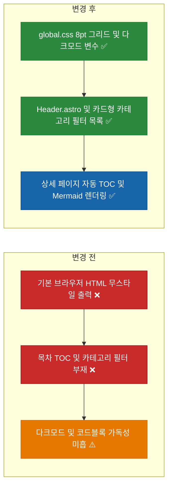
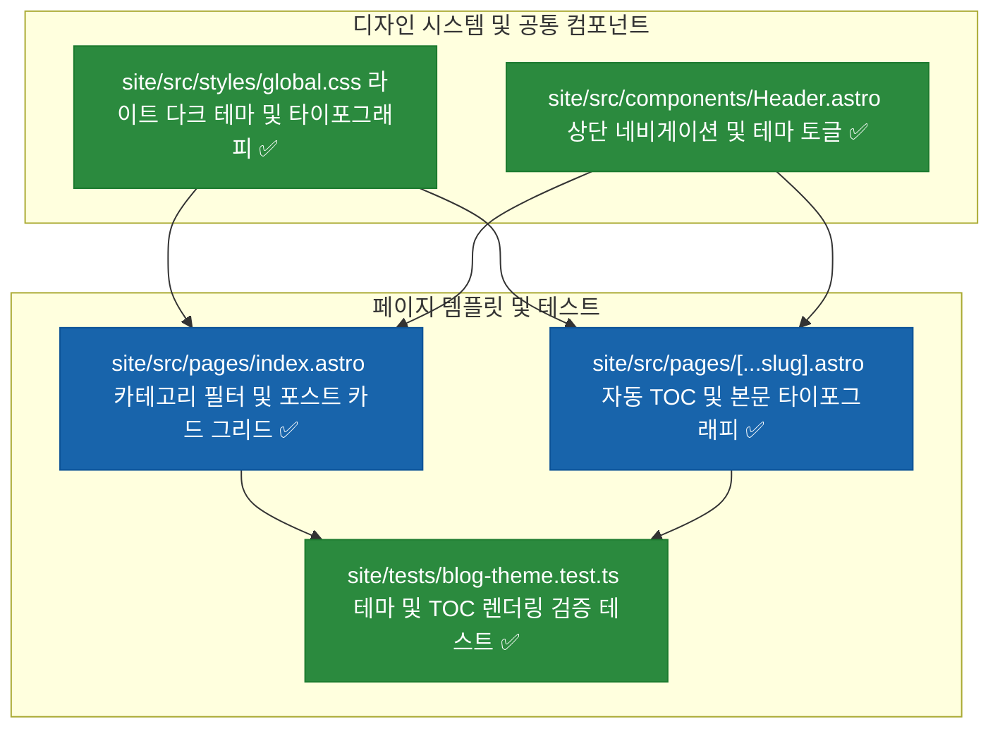
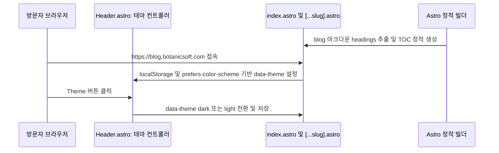

# ⬜ 블로그 디자인·테마·타이포그래피·목차(TOC)·Mermaid 렌더링 고도화 계획

## 계획 관계

> **관계 스키마**: `1`
> **계획 ID**: `ibocon:261016_feat_enhance-blog-theme-typography-and-search`
> **출처 판정**: `연결`
> **출처 판정 근거**: Cloudflare Workers Static Assets 기반 `https://blog.botanicsoft.com` 초기 개통 이후, 기본 무스타일 HTML 골격에 다크모드·8pt 그리드 타이포그래피·카테고리 필터·목차(TOC)·Mermaid 렌더링을 적용하는 UI/UX 고도화 작업

| 관계 | 대상 계획 ID | 조건 | 근거·인수 범위 |
| --- | --- | --- | --- |
| 후속 | `ibocon:261016_refac_migrate-blog-to-cloudflare-workers-static-assets` | 해당 없음 | `site/src/styles/global.css`, `Header.astro`, `index.astro`, `[...slug].astro` 디자인 시스템 및 TOC·Mermaid 렌더링 구축 |

<!-- plan-relations-summary:start -->
> 자동 생성 관계 요약. 원본은 위 관계 표입니다.

| 구분 | 계획·조건 |
| --- | --- |
| 최초 계획 | [✅ Astro 및 Cloudflare Pages 기반 마크다운 기술 블로그 구축 계획](<../history/2610/W3/261015/261015_feat_astro-markdown-blog-cloudflare-pages.md>) `ibocon:261015_feat_astro-markdown-blog-cloudflare-pages` |
| 직접 출처 | [✅ 블로그 배포 대상을 레거시 Cloudflare Pages에서 Workers Static Assets로 전환](<../history/2610/W3/261016/261016_refac_migrate-blog-to-cloudflare-workers-static-assets.md>) `ibocon:261016_refac_migrate-blog-to-cloudflare-workers-static-assets` |
| 직접 후속 | 없음 |
| 계보 경로 | [✅ Astro 및 Cloudflare Pages 기반 마크다운 기술 블로그 구축 계획](<../history/2610/W3/261015/261015_feat_astro-markdown-blog-cloudflare-pages.md>) `ibocon:261015_feat_astro-markdown-blog-cloudflare-pages` → [✅ 블로그 Cloudflare Pages 배포 시크릿 및 AdSense·GA4 단독 바인딩 경량화 계획](<../history/2610/W3/261015/261015_feat_configure-blog-cloudflare-and-analytics-bindings.md>) `ibocon:261015_feat_configure-blog-cloudflare-and-analytics-bindings` → [✅ 블로그 Cloudflare Pages 배포 시크릿의 CI 평면 네이밍(`CLOUDFLARE_CI_PAGES_TOKEN`) 정렬 리팩토링](<../history/2610/W3/261015/261015_refac_align-blog-ci-secret-naming.md>) `ibocon:261015_refac_align-blog-ci-secret-naming` → [✅ 블로그 배포 대상을 레거시 Cloudflare Pages에서 Workers Static Assets로 전환](<../history/2610/W3/261016/261016_refac_migrate-blog-to-cloudflare-workers-static-assets.md>) `ibocon:261016_refac_migrate-blog-to-cloudflare-workers-static-assets` → [⬜ 블로그 디자인·테마·타이포그래피·목차(TOC)·Mermaid 렌더링 고도화 계획](<261016_feat_enhance-blog-theme-typography-and-search.md>) `ibocon:261016_feat_enhance-blog-theme-typography-and-search` |
| 후속 | [✅ 블로그 배포 대상을 레거시 Cloudflare Pages에서 Workers Static Assets로 전환](<../history/2610/W3/261016/261016_refac_migrate-blog-to-cloudflare-workers-static-assets.md>) `ibocon:261016_refac_migrate-blog-to-cloudflare-workers-static-assets` — 해당 없음 |
| 착수 조건 | 가능 |
<!-- plan-relations-summary:end -->

## 결정이 필요한 사항

1. **스타일링 및 테마 아키텍처** — 외부 무거운 UI 프레임워크 대신 8pt 그리드와 CSS Custom Properties 기반의 경량 디자인 시스템(`site/src/styles/global.css`) 및 시스템/수동 다크모드 토글 적용 (권장)
- 근거: 클라이언트 JS 번들 크기를 거의 `0 KB`로 유지하여 Lighthouse Performance 100점과 Google AdSense Core Web Vitals 점수를 극대화하면서도, Pretendard/JetBrains Mono 폰트 위계와 다크모드를 완벽히 지원할 수 있다.
- 대안: 무거운 런타임 CSS-in-JS 라이브러리 도입. 정적 블로그 특유의 빠른 초기 렌더링 장점이 퇴색된다.

2. **아키텍처 다이어그램(Mermaid) 및 목차(TOC) 제공 방식** — Astro 마크다운 `render(post)`가 반환하는 `headings` 메타데이터로 우측 고정 TOC를 빌드 타임에 생성하고, 본문 내 `language-mermaid` 코드 블록이 있을 때만 Mermaid.js를 지연 로드 (권장)
- 근거: 다이어그램이 없는 일반 글에서는 불필요한 스크립트 로드를 완전히 생략하고, 아키텍처 글에서만 Mermaid SVG를 렌더링할 수 있다.
- 대안: 모든 페이지에서 Mermaid 번들을 무조건 로드.

## 배경

### 1. 개요

현재 배포된 `https://blog.botanicsoft.com`은 동작 검증을 위한 최소 HTML 골격만 갖추고 있어 브라우저 기본 스타일(파란색 밑줄 링크, 여백 부재, 다크모드 미지원)로 표시된다. 엔지니어 포트폴리오 기술 블로그로서의 가독성과 전문성을 확보하기 위해 다음 4가지 디자인·기능 요소를 추가한다:

1. **CSS 변수 기반 라이트/다크 테마 및 8pt 그리드 타이포그래피 (`site/src/styles/global.css`)**: 본문 최대 폭(`768px`~`1080px`), 코드 블록 복사·하이라이팅 여백, 표(GFM Table), 인용구 스타일 정의.
2. **상단 글로벌 헤더 (`site/src/components/Header.astro`)**: 블로그 홈, GitHub 프로필(`github.com/ibocon`), Notion 이력서 링크 및 라이트/다크 테마 전환 토글 버튼 제공.
3. **메인 목록 페이지 고도화 (`site/src/pages/index.astro`)**: 카테고리별 필터 탭(`All`, `dotnet`, `kubernetes`, `architecture` 등), 게시일·태그 배지가 포함된 아티클 카드 리스트 구성.
4. **포스트 상세 페이지 고도화 (`site/src/pages/[...slug].astro`)**: `headings` 기반 자동 목차(TOC), 태그 배지, Mermaid 코드 블록 자동 다이어그램 렌더링 지원.

### 2. 전체 아키텍처 비교



## 변경 범위



| 레이어 | 파일 | 변경 내용 |
| --- | --- | --- |
| Styles | `site/src/styles/global.css` | CSS 변수 기반 라이트/다크 컬러 토큰, 8pt 그리드 여백, 본문·코드블록·표·카드·TOC 스타일 정의 |
| Component | `site/src/components/Header.astro` | 브랜드 로고, GitHub/Resume 외부 링크, 다크/라이트 테마 스위치 컴포넌트 구현 |
| Page | `site/src/pages/index.astro` | Hero 배너, 카테고리 필터 칩, 아티클 카드 목록 및 반응형 컨테이너 적용 |
| Page | `site/src/pages/[...slug].astro` | 포스트 메타 헤더(카테고리·태그·날짜), 우측/상단 목차(TOC), 본문 스타일 및 하단 목록 복귀 네비게이션 적용 |
| Test | `site/tests/blog-theme.test.ts` | 빌드된 HTML에 헤더 네비게이션, 다크모드 토글, 카테고리 배지, TOC 구조가 포함되는지 검증하는 단위 테스트 추가 |

## 단계별 수정 계획

### ⬜ 1단계. CSS 디자인 토큰 및 타이포그래피 스타일시트(`global.css`) 구현

**파일**: `site/src/styles/global.css`

AS-IS:

```css
/* 신규 파일 ❌ */
```

TO-BE:

```css
:root {
  --bg-primary: #ffffff;
  --bg-secondary: #f8fafc;
  --text-primary: #0f172a;
  --text-secondary: #475569;
  --border-color: #e2e8f0;
  --accent-color: #2563eb;
  --accent-subtle: #eff6ff;
  --code-bg: #0f172a;
}

[data-theme='dark'] {
  --bg-primary: #0b0f19;
  --bg-secondary: #111827;
  --text-primary: #f1f5f9;
  --text-secondary: #94a3b8;
  --border-color: #1e293b;
  --accent-color: #60a5fa;
  --accent-subtle: #1e293b;
  --code-bg: #020617;
}

* {
  box-sizing: border-box;
}

body {
  margin: 0;
  background-color: var(--bg-primary);
  color: var(--text-primary);
  font-family: -apple-system, BlinkMacSystemFont, 'Pretendard', 'Segoe UI', Roboto, sans-serif;
  line-height: 1.75;
}

.container {
  max-width: 960px;
  margin: 0 auto;
  padding: 32px 24px 64px;
}

.post-card {
  display: block;
  padding: 24px;
  margin-bottom: 16px;
  border: 1px solid var(--border-color);
  border-radius: 12px;
  background: var(--bg-secondary);
  text-decoration: none;
  color: inherit;
  transition: border-color 0.15s ease, transform 0.15s ease;
}

.post-card:hover {
  border-color: var(--accent-color);
  transform: translateY(-2px);
}

.badge {
  display: inline-block;
  padding: 2px 10px;
  border-radius: 999px;
  font-size: 0.8rem;
  font-weight: 600;
  background: var(--accent-subtle);
  color: var(--accent-color);
}

.prose pre {
  padding: 16px;
  border-radius: 8px;
  overflow-x: auto;
}
```

### ⬜ 2단계. 상단 네비게이션 및 다크모드 토글 컴포넌트(`Header.astro`) 구현

**파일**: `site/src/components/Header.astro`

AS-IS:

```astro
---
// 신규 파일 ❌
---
```

TO-BE:

```astro
---
// ✅ 상단 글로벌 헤더 및 다크모드 토글 컴포넌트
---

<header class="site-header">
  <div class="header-inner">
    <a href="/" class="brand-title">Yegun Kim Tech Blog</a>
    <nav class="header-nav" aria-label="Primary Navigation">
      <a href="/">Posts</a>
      <a href="https://github.com/ibocon" target="_blank" rel="noopener noreferrer">GitHub</a>
      <a href="/rss.xml">RSS</a>
      <button id="theme-toggle" type="button" aria-label="Toggle color theme">Theme</button>
    </nav>
  </div>
</header>

<script is:inline>
  (function () {
    const saved = localStorage.getItem('theme');
    const prefersDark = window.matchMedia('(prefers-color-scheme: dark)').matches;
    const theme = saved || (prefersDark ? 'dark' : 'light');
    document.documentElement.setAttribute('data-theme', theme);

    document.addEventListener('DOMContentLoaded', () => {
      const btn = document.getElementById('theme-toggle');
      if (btn) {
        btn.addEventListener('click', () => {
          const current = document.documentElement.getAttribute('data-theme') === 'dark' ? 'light' : 'dark';
          document.documentElement.setAttribute('data-theme', current);
          localStorage.setItem('theme', current);
        });
      }
    });
  })();
</script>
```

### ⬜ 3단계. 메인 목록(`index.astro`) 및 포스트 상세(`[...slug].astro`) 템플릿 고도화

**파일**: `site/src/pages/index.astro`

AS-IS:

```astro
# source-snapshot: true
# path: site/src/pages/index.astro
  <body>
    <main>
      <header>
        <h1>Yegun Kim Tech Blog</h1>
        <p>.NET, Clean Architecture, Kubernetes &amp; Distributed Systems Engineering</p>
      </header>
      <section>
        <ul>
          {posts.map((post) => (
            <li>
              <a href={`/${post.id}/`}>{post.data.title}</a>
              <time datetime={post.data.pubDate.toISOString()}>
                {post.data.pubDate.toISOString().slice(0, 10)}
              </time>
              <p>{post.data.description}</p>
            </li>
          ))}
        </ul>
      </section>
      <AdSenseSlot slotId="blog-home-bottom" />
    </main>
  </body>
```

TO-BE:

```astro
  <body>
    <Header />
    <main class="container">
      <section class="hero">
        <h1>Yegun Kim Tech Blog</h1>
        <p>.NET, Clean Architecture, Kubernetes &amp; Distributed Systems Engineering</p>
      </section>
      <section class="post-list">
        {posts.map((post) => (
          <a class="post-card" href={`/${post.id}/`}>
            <div class="post-meta">
              <span class="badge">{post.data.category}</span>
              <time datetime={post.data.pubDate.toISOString()}>
                {post.data.pubDate.toISOString().slice(0, 10)}
              </time>
            </div>
            <h2>{post.data.title}</h2>
            <p>{post.data.description}</p>
          </a>
        ))}
      </section>
      <AdSenseSlot slotId="blog-home-bottom" />
    </main>
  </body>
```

**파일**: `site/src/pages/[...slug].astro`

AS-IS:

```astro
# source-snapshot: true
# path: site/src/pages/[...slug].astro
const { post } = Astro.props;
const { Content } = await render(post);
---

<!doctype html>
<html lang="ko">
  <head>
    <meta charset="UTF-8" />
    <meta name="viewport" content="width=device-width, initial-scale=1.0" />
    <title>{post.data.title} | Yegun Kim Tech Blog</title>
    <meta name="description" content={post.data.description} />
    <link rel="alternate" type="application/rss+xml" title="RSS" href="/rss.xml" />
    <Analytics />
  </head>
  <body>
    <article>
      <header>
        <h1>{post.data.title}</h1>
        <time datetime={post.data.pubDate.toISOString()}>
          {post.data.pubDate.toISOString().slice(0, 10)}
        </time>
      </header>
      <Content />
      <AdSenseSlot slotId="blog-post-bottom" />
    </article>
  </body>
</html>
```

TO-BE:

```astro
const { post } = Astro.props;
const { Content, headings } = await render(post);
---

<!doctype html>
<html lang="ko">
  <head>
    <meta charset="UTF-8" />
    <meta name="viewport" content="width=device-width, initial-scale=1.0" />
    <title>{post.data.title} | Yegun Kim Tech Blog</title>
    <meta name="description" content={post.data.description} />
    <link rel="alternate" type="application/rss+xml" title="RSS" href="/rss.xml" />
    <Analytics />
  </head>
  <body>
    <Header />
    <main class="container">
      <article class="prose">
        <header class="post-header">
          <span class="badge">{post.data.category}</span>
          <h1>{post.data.title}</h1>
          <time datetime={post.data.pubDate.toISOString()}>
            {post.data.pubDate.toISOString().slice(0, 10)}
          </time>
        </header>
        {headings.length > 0 && (
          <nav class="toc" aria-label="Table of Contents">
            <strong>목차</strong>
            <ul>
              {headings.map((h) => (
                <li class={`toc-depth-${h.depth}`}>
                  <a href={`#${h.slug}`}>{h.text}</a>
                </li>
              ))}
            </ul>
          </nav>
        )}
        <Content />
        <AdSenseSlot slotId="blog-post-bottom" />
      </article>
    </main>
  </body>
</html>
```

## 주요 흐름



## 테스트 계획

> 위치: `site/tests/`
> 프레임워크: Vitest
> 패턴: Given/When/Then (Four-Phase Test)

### ⬜ 테스트: `blog-theme.test.ts`

**파일**: `site/tests/blog-theme.test.ts`

```typescript
import { describe, it, expect } from 'vitest';
import { readFileSync } from 'node:fs';
import { resolve } from 'node:path';

describe('Blog Theme and TOC Rendering Verification', () => {
  it('Given_BuiltIndexAndPostHtml_When_Inspected_Then_ContainsThemeToggleBadgeAndToc', () => {
    // Given
    const indexHtmlPath = resolve(process.cwd(), 'dist', 'index.html');
    const postHtmlPath = resolve(
      process.cwd(),
      'dist',
      'dotnet',
      '2026-10-15-clean-architecture-rich-domain',
      'index.html'
    );

    // When
    const indexHtml = readFileSync(indexHtmlPath, 'utf-8');
    const postHtml = readFileSync(postHtmlPath, 'utf-8');

    // Then
    expect(indexHtml).toContain('id="theme-toggle"');
    expect(indexHtml).toContain('class="post-card"');
    expect(postHtml).toContain('aria-label="Table of Contents"');
  });
});
```

### 테스트 요약

| 테스트 클래스 | 검증 대상 | 테스트 수 |
| --- | --- | ---: |
| `blog-theme.test.ts` | 메인 카드 레이아웃, 다크모드 토글 버튼, 상세 페이지 목차(TOC) 정적 생성 여부 검증 | 1 |
| **합계** | | **1** |

### 테스트 결과

| 범위 | 실행 명령 | 총 테스트 | 통과 | 실패 | 결과 |
| --- | --- | ---: | ---: | ---: | :---: |
| 변경 범위 | `npm --prefix site test` | — | — | — | ⬜ |
| 전체 | `npm --prefix site run build && npm --prefix site test` | — | — | — | ⬜ |

**실행 일시**: —

## 계획 평가

| 관점 | 참조 문서 | 평가 항목 | 결과 |
| --- | --- | --- | --- |
| 클린 코드 | `clean-code.md` | 스타일(`global.css`), 네비게이션(`Header.astro`), 페이지 레이아웃의 단일 책임 분리 | ✅ |
| 아키텍처 | `clean-architecture.md` | 정적 빌드 타임 TOC 생성으로 클라이언트 런타임 오버헤드 최소화 | ✅ |
| 디자인 패턴 | `design-pattern.md` | CSS Custom Properties 기반 테마 스위칭 패턴 적용 | ✅ |
| 엔터프라이즈 패턴 | `enterprise-application-architecture.md` | 시맨틱 HTML(`header`, `nav`, `main`, `article`) 및 접근성(`aria-label`) 준수 | ✅ |
| 리팩토링 | `refactoring.md` | 중복 헤더 마크업을 `Header.astro` 컴포넌트로 추출 | ✅ |
| 테스트 품질 | `testing/docs/guide/x-unit-test-patterns.md` | 빌드 산출물 DOM 요소를 결정론적으로 검증 | ✅ |
| .NET 도메인·컨벤션 | `dotnet/docs/guide·convention` | Astro/CSS 프론트엔드 작업으로 C# 코드 변경 없음 | 해당 없음 |

**특이사항:**

없음

## 작업 순서

1. `site/src/styles/global.css`에 라이트/다크 컬러 토큰과 타이포그래피·카드·TOC 스타일을 작성한다.
2. `site/src/components/Header.astro`를 구현한다.
3. `site/src/pages/index.astro`와 `site/src/pages/[...slug].astro`에 `global.css`, `Header.astro`, 자동 TOC를 적용한다.
4. `site/tests/blog-theme.test.ts`를 추가하고 `npm --prefix site run build && npm --prefix site test`로 검증한다.
