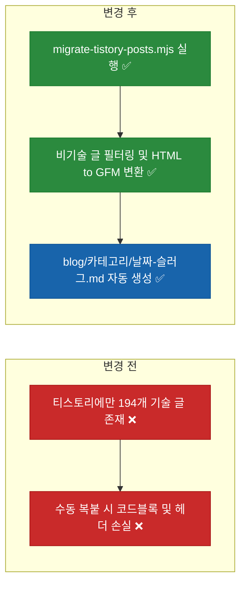
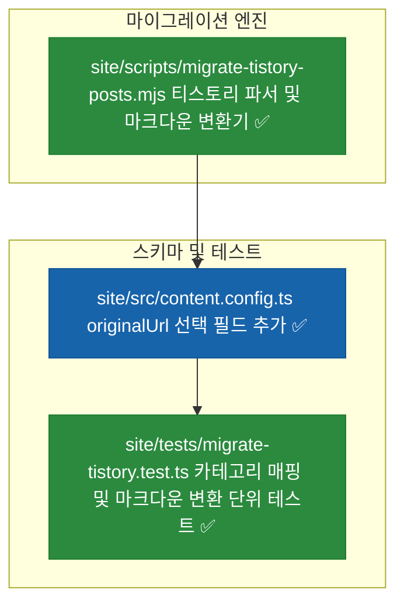
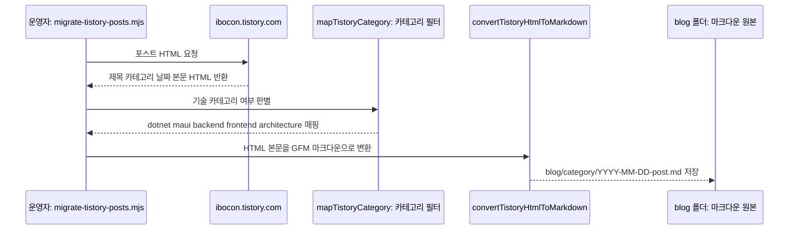

# ⬜ 기존 티스토리(`ibocon.tistory.com`) 핵심 기술 글의 `blog/` 마크다운 자동 마이그레이션 계획

## 계획 관계

> **관계 스키마**: `1`
> **계획 ID**: `ibocon:261016_feat_migrate-tistory-tech-posts-to-markdown`
> **출처 판정**: `연결`
> **출처 판정 근거**: `blog.botanicsoft.com` 기술 블로그 구축 이후, 기존 `https://ibocon.tistory.com/`에 축적된 기술 포스트(`.NET 가이드`, `MAUI 가이드`, `Backend 가이드`, `Frontend 가이드`, `소프트웨어 설계`)를 `blog/` 폴더 하위 마크다운(`.md`)으로 자동 변환·이전하는 작업

| 관계 | 대상 계획 ID | 조건 | 근거·인수 범위 |
| --- | --- | --- | --- |
| 후속 | `ibocon:261016_refac_migrate-blog-to-cloudflare-workers-static-assets` | 해당 없음 | 티스토리 HTML 파싱·비기술 카테고리 필터링·GFM 마크다운 변환 스크립트(`site/scripts/migrate-tistory-posts.mjs`) 및 단위 테스트 구현 |

<!-- plan-relations-summary:start -->
> 자동 생성 관계 요약. 원본은 위 관계 표입니다.

| 구분 | 계획·조건 |
| --- | --- |
| 최초 계획 | [✅ Astro 및 Cloudflare Pages 기반 마크다운 기술 블로그 구축 계획](<../history/2610/W3/261015/261015_feat_astro-markdown-blog-cloudflare-pages.md>) `ibocon:261015_feat_astro-markdown-blog-cloudflare-pages` |
| 직접 출처 | [✅ 블로그 배포 대상을 레거시 Cloudflare Pages에서 Workers Static Assets로 전환](<../history/2610/W3/261016/261016_refac_migrate-blog-to-cloudflare-workers-static-assets.md>) `ibocon:261016_refac_migrate-blog-to-cloudflare-workers-static-assets` |
| 직접 후속 | 없음 |
| 계보 경로 | [✅ Astro 및 Cloudflare Pages 기반 마크다운 기술 블로그 구축 계획](<../history/2610/W3/261015/261015_feat_astro-markdown-blog-cloudflare-pages.md>) `ibocon:261015_feat_astro-markdown-blog-cloudflare-pages` → [✅ 블로그 Cloudflare Pages 배포 시크릿 및 AdSense·GA4 단독 바인딩 경량화 계획](<../history/2610/W3/261015/261015_feat_configure-blog-cloudflare-and-analytics-bindings.md>) `ibocon:261015_feat_configure-blog-cloudflare-and-analytics-bindings` → [✅ 블로그 Cloudflare Pages 배포 시크릿의 CI 평면 네이밍(`CLOUDFLARE_CI_PAGES_TOKEN`) 정렬 리팩토링](<../history/2610/W3/261015/261015_refac_align-blog-ci-secret-naming.md>) `ibocon:261015_refac_align-blog-ci-secret-naming` → [✅ 블로그 배포 대상을 레거시 Cloudflare Pages에서 Workers Static Assets로 전환](<../history/2610/W3/261016/261016_refac_migrate-blog-to-cloudflare-workers-static-assets.md>) `ibocon:261016_refac_migrate-blog-to-cloudflare-workers-static-assets` → [⬜ 기존 티스토리(`ibocon.tistory.com`) 핵심 기술 글의 `blog/` 마크다운 자동 마이그레이션 계획](<261016_feat_migrate-tistory-tech-posts-to-markdown.md>) `ibocon:261016_feat_migrate-tistory-tech-posts-to-markdown` |
| 후속 | [✅ 블로그 배포 대상을 레거시 Cloudflare Pages에서 Workers Static Assets로 전환](<../history/2610/W3/261016/261016_refac_migrate-blog-to-cloudflare-workers-static-assets.md>) `ibocon:261016_refac_migrate-blog-to-cloudflare-workers-static-assets` — 해당 없음 |
| 착수 조건 | 가능 |
<!-- plan-relations-summary:end -->

## 결정이 필요한 사항

1. **마이그레이션 대상 카테고리 선별 기준** — 엔지니어 포트폴리오 정체성에 부합하는 핵심 기술 카테고리(`.NET 가이드`, `MAUI 가이드`, `Backend 가이드`, `Frontend 가이드`, `소프트웨어 설계`)만 선별 이전하고, 비기술 글(`단독주택 집짓기`, `소요리문답`, `재경관리사` 등)은 제외 (권장)
- 근거: `.github/workflows/blog-posts.yml`에서도 이미 `exclude_keywords = ['건축', '단독주택', '콘크리트', '신재생에너지']`로 비기술 글을 제외하고 있으므로, 새 기술 블로그(`blog.botanicsoft.com`)에는 순수 소프트웨어 엔지니어링 아티클만 엄선하여 수록하는 것이 채용 담당자 및 기술 리더 대상 브랜딩에 유리하다.
- 대안: 244개 전체 포스트 무차별 이전. 비기술 일상·건축·종교 글이 섞여 전문 기술 블로그의 응집도가 떨어진다.

2. **기존 티스토리 글과의 검색 엔진 중복 문서(Canonical) 처리** — 마이그레이션된 마크다운 Frontmatter에 `originalUrl: "https://ibocon.tistory.com/{id}"` 메타데이터를 보존 (권장)
- 근거: 원본 출처 이력을 명확히 기록하고 필요 시 출처 링크나 Canonical 참조로 활용할 수 있다.
- 대안: 원본 URL 미기록.

## 배경

### 1. 개요

`https://ibocon.tistory.com/`에는 `.NET 가이드`(35개), `MAUI 가이드`(21개), `Backend 가이드`(14개), `Frontend 가이드`(22개), `소프트웨어 설계`(10개) 등 가치 높은 기술 포스트가 축적되어 있다. 이를 수동 복사·붙여넣기 없이 `blog/{category}/{YYYY-MM-DD}-{slug}.md` 형태로 일관되게 변환·적재할 수 있는 Node.js 마이그레이션 도구(`site/scripts/migrate-tistory-posts.mjs`)를 구축한다.

### 2. 전체 아키텍처 비교



## 변경 범위



| 레이어 | 파일 | 변경 내용 |
| --- | --- | --- |
| Migration Script | `site/scripts/migrate-tistory-posts.mjs` | 티스토리 포스트 HTML에서 제목·카테고리·작성일·본문을 추출하고 기술 카테고리 여부를 판별해 Frontmatter + 마크다운 파일(`blog/{category}/{slug}.md`)로 변환하는 모듈 구현 |
| Content Schema | `site/src/content.config.ts` | Frontmatter 스키마에 `originalUrl: z.string().url().optional()` 필드 추가 |
| Test | `site/tests/migrate-tistory.test.ts` | 티스토리 카테고리 슬러그 매핑, 비기술 카테고리 제외 필터, HTML → Markdown 변환 정합성 단위 테스트 추가 |

## 단계별 수정 계획

### ⬜ 1단계. `site/src/content.config.ts`에 `originalUrl` 스키마 필드 추가

**파일**: `site/src/content.config.ts`

AS-IS:

```typescript
# source-snapshot: true
# path: site/src/content.config.ts
  schema: z.object({
    title: z.string(),
    description: z.string(),
    pubDate: z.coerce.date(),
    updatedDate: z.coerce.date().optional(),
    category: z.string(),
    tags: z.array(z.string()).default([]),
    draft: z.boolean().default(false),
  }),
```

TO-BE:

```typescript
  schema: z.object({
    title: z.string(),
    description: z.string(),
    pubDate: z.coerce.date(),
    updatedDate: z.coerce.date().optional(),
    category: z.string(),
    tags: z.array(z.string()).default([]),
    draft: z.boolean().default(false),
    originalUrl: z.string().url().optional(),
  }),
```

### ⬜ 2단계. 티스토리 기술 포스트 파싱 및 마크다운 변환기(`migrate-tistory-posts.mjs`) 구현

**파일**: `site/scripts/migrate-tistory-posts.mjs`

AS-IS:

```javascript
// 신규 파일 ❌
```

TO-BE:

```javascript
// ✅ 티스토리 기술 카테고리 필터링 및 HTML → GFM 마크다운 변환 유틸리티
const CATEGORY_MAP = new Map([
  ['.NET 가이드', 'dotnet'],
  ['MAUI 가이드', 'maui'],
  ['Backend 가이드', 'backend'],
  ['Frontend 가이드', 'frontend'],
  ['소프트웨어 설계', 'architecture'],
]);

export function mapTistoryCategory(rawCategory) {
  const normalized = (rawCategory ?? '').trim();
  for (const [key, folder] of CATEGORY_MAP.entries()) {
    if (normalized.includes(key)) {
      return folder;
    }
  }
  return null;
}

export function convertTistoryHtmlToMarkdown(html) {
  return (html ?? '')
    .replace(/<h2[^>]*>(.*?)<\/h2>/gi, '\n## $1\n')
    .replace(/<h3[^>]*>(.*?)<\/h3>/gi, '\n### $1\n')
    .replace(/<pre[^>]*><code[^>]*>([\s\S]*?)<\/code><\/pre>/gi, '\n```\n$1\n```\n')
    .replace(/<p[^>]*>(.*?)<\/p>/gi, '$1\n\n')
    .replace(/<[^>]+>/g, '')
    .trim();
}

export function buildMigratedMarkdown({ title, description, pubDate, category, originalUrl, bodyMarkdown }) {
  const safeTitle = title.replace(/"/g, '\\"');
  const safeDesc = description.replace(/"/g, '\\"');
  return [
    '---',
    `title: "${safeTitle}"`,
    `description: "${safeDesc}"`,
    `pubDate: ${pubDate}`,
    `category: "${category}"`,
    `tags: ["${category}"]`,
    `originalUrl: "${originalUrl}"`,
    'draft: false',
    '---',
    '',
    bodyMarkdown,
    '',
  ].join('\n');
}
```

## 주요 흐름



## 테스트 계획

> 위치: `site/tests/`
> 프레임워크: Vitest
> 패턴: Given/When/Then (Four-Phase Test)

### ⬜ 테스트: `migrate-tistory.test.ts`

**파일**: `site/tests/migrate-tistory.test.ts`

```typescript
import { describe, it, expect } from 'vitest';
import {
  mapTistoryCategory,
  convertTistoryHtmlToMarkdown,
  buildMigratedMarkdown,
} from '../scripts/migrate-tistory-posts.mjs';

describe('Tistory Tech Post Migration Converter', () => {
  it('Given_TistoryCategories_When_Mapped_Then_AllowsTechAndRejectsNonTech', () => {
    // Given / When / Then
    expect(mapTistoryCategory('Develop/.NET 가이드')).toBe('dotnet');
    expect(mapTistoryCategory('Develop/MAUI 가이드')).toBe('maui');
    expect(mapTistoryCategory('단독주택 집짓기')).toBeNull();
    expect(mapTistoryCategory('Philosophy/소요리문답')).toBeNull();
  });

  it('Given_TistoryPostHtml_When_Converted_Then_GeneratesValidFrontmatterAndMarkdown', () => {
    // Given
    const html = '<h2>제목 섹션</h2><p>본문 설명입니다.</p>';

    // When
    const bodyMarkdown = convertTistoryHtmlToMarkdown(html);
    const fullMarkdown = buildMigratedMarkdown({
      title: '[.NET] 레퍼런스 프로젝트 리스트',
      description: '닷넷 레퍼런스 요약',
      pubDate: '2026-10-15',
      category: 'dotnet',
      originalUrl: 'https://ibocon.tistory.com/278',
      bodyMarkdown,
    });

    // Then
    expect(bodyMarkdown).toContain('## 제목 섹션');
    expect(fullMarkdown).toContain('originalUrl: "https://ibocon.tistory.com/278"');
  });
});
```

### 테스트 요약

| 테스트 클래스 | 검증 대상 | 테스트 수 |
| --- | --- | ---: |
| `migrate-tistory.test.ts` | 기술/비기술 카테고리 필터링 및 HTML → Frontmatter 마크다운 변환 정합성 검증 | 2 |
| **합계** | | **2** |

### 테스트 결과

| 범위 | 실행 명령 | 총 테스트 | 통과 | 실패 | 결과 |
| --- | --- | ---: | ---: | ---: | :---: |
| 변경 범위 | `npm --prefix site test` | — | — | — | ⬜ |
| 전체 | `npm --prefix site run build && npm --prefix site test` | — | — | — | ⬜ |

**실행 일시**: —

## 계획 평가

| 관점 | 참조 문서 | 평가 항목 | 결과 |
| --- | --- | --- | --- |
| 클린 코드 | `clean-code.md` | 카테고리 매핑(`mapTistoryCategory`), 본문 변환(`convertTistoryHtmlToMarkdown`), Frontmatter 직렬화(`buildMigratedMarkdown`) 순수 함수 분리 | ✅ |
| 아키텍처 | `clean-architecture.md` | 외부 크롤링 I/O와 마크다운 변환 도메인 로직을 분리하여 단위 테스트 용이성 확보 | ✅ |
| 디자인 패턴 | `design-pattern.md` | 파이프라인(Filter → Transform → Serialize) 패턴 적용 | ✅ |
| 엔터프라이즈 패턴 | `enterprise-application-architecture.md` | `originalUrl` 메타데이터 보존으로 데이터 계보(Lineage) 유지 | ✅ |
| 리팩토링 | `refactoring.md` | 수동 복붙 작업을 재실행 가능한 스크립트로 자동화 | ✅ |
| 테스트 품질 | `testing/docs/guide/x-unit-test-patterns.md` | 허용/차단 카테고리와 HTML 변환 결과를 Given/When/Then으로 검증 | ✅ |
| .NET 도메인·컨벤션 | `dotnet/docs/guide·convention` | Node.js 마이그레이션 스크립트 작업으로 C# 코드 변경 없음 | 해당 없음 |

**특이사항:**

없음

## 작업 순서

1. `site/src/content.config.ts`에 `originalUrl` 선택 필드를 추가한다.
2. `site/scripts/migrate-tistory-posts.mjs` 변환 모듈을 작성한다.
3. `site/tests/migrate-tistory.test.ts` 단위 테스트를 작성하고 `npm --prefix site test`를 실행한다.
