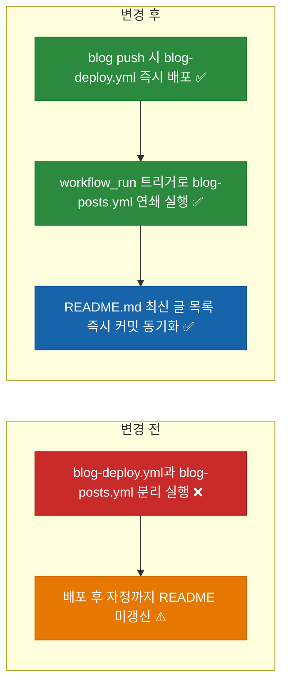

# ⬜ 블로그 Git 저장소 동기화 및 GitHub Actions 배포·README RSS 파이프라인 연동 고도화 계획

## 계획 관계

> **관계 스키마**: `1`
> **계획 ID**: `ibocon:261016_refac_sync-blog-repo-and-ci-workflow-triggers`
> **출처 판정**: `연결`
> **출처 판정 근거**: Cloudflare Workers Static Assets 수동 첫 배포(`https://blog.botanicsoft.com`) 성공 이후, GitHub Actions 워크플로 명칭·트리거·배포 후 `README.md` 자동 갱신 연동을 완성하고 Git 저장소 동기화(`/sync-repo`) 및 외부 GA4·AdSense 콘솔 연결 검증으로 이어지는 파이프라인 고도화 작업

| 관계 | 대상 계획 ID | 조건 | 근거·인수 범위 |
| --- | --- | --- | --- |
| 후속 | `ibocon:261016_refac_migrate-blog-to-cloudflare-workers-static-assets` | 해당 없음 | `blog-deploy.yml` 워크플로 이름·스모크 검증 보강, `blog-posts.yml`의 `workflow_run` 연쇄 트리거 추가, 외부 GA4·AdSense 연결 검증 이관 |

<!-- plan-relations-summary:start -->
> 자동 생성 관계 요약. 원본은 위 관계 표입니다.

| 구분 | 계획·조건 |
| --- | --- |
| 최초 계획 | [✅ Astro 및 Cloudflare Pages 기반 마크다운 기술 블로그 구축 계획](<../history/2610/W3/261015/261015_feat_astro-markdown-blog-cloudflare-pages.md>) `ibocon:261015_feat_astro-markdown-blog-cloudflare-pages` |
| 직접 출처 | [✅ 블로그 배포 대상을 레거시 Cloudflare Pages에서 Workers Static Assets로 전환](<../history/2610/W3/261016/261016_refac_migrate-blog-to-cloudflare-workers-static-assets.md>) `ibocon:261016_refac_migrate-blog-to-cloudflare-workers-static-assets` |
| 직접 후속 | [⬜ Google AdSense 도메인·`ads.txt`·광고 슬롯 연결 사용자 실행 검증](<261016_verify_connect-google-adsense-domain-and-slots.md>) `ibocon:261016_verify_connect-google-adsense-domain-and-slots`<br/>[⬜ Google Analytics 4 데이터 스트림 및 Search Console 연결 사용자 실행 검증](<261016_verify_connect-google-analytics-and-search-console.md>) `ibocon:261016_verify_connect-google-analytics-and-search-console` |
| 계보 경로 | [✅ Astro 및 Cloudflare Pages 기반 마크다운 기술 블로그 구축 계획](<../history/2610/W3/261015/261015_feat_astro-markdown-blog-cloudflare-pages.md>) `ibocon:261015_feat_astro-markdown-blog-cloudflare-pages` → [✅ 블로그 Cloudflare Pages 배포 시크릿 및 AdSense·GA4 단독 바인딩 경량화 계획](<../history/2610/W3/261015/261015_feat_configure-blog-cloudflare-and-analytics-bindings.md>) `ibocon:261015_feat_configure-blog-cloudflare-and-analytics-bindings` → [✅ 블로그 Cloudflare Pages 배포 시크릿의 CI 평면 네이밍(`CLOUDFLARE_CI_PAGES_TOKEN`) 정렬 리팩토링](<../history/2610/W3/261015/261015_refac_align-blog-ci-secret-naming.md>) `ibocon:261015_refac_align-blog-ci-secret-naming` → [✅ 블로그 배포 대상을 레거시 Cloudflare Pages에서 Workers Static Assets로 전환](<../history/2610/W3/261016/261016_refac_migrate-blog-to-cloudflare-workers-static-assets.md>) `ibocon:261016_refac_migrate-blog-to-cloudflare-workers-static-assets` → [⬜ 블로그 Git 저장소 동기화 및 GitHub Actions 배포·README RSS 파이프라인 연동 고도화 계획](<261016_refac_sync-blog-repo-and-ci-workflow-triggers.md>) `ibocon:261016_refac_sync-blog-repo-and-ci-workflow-triggers` |
| 후속 | [✅ 블로그 배포 대상을 레거시 Cloudflare Pages에서 Workers Static Assets로 전환](<../history/2610/W3/261016/261016_refac_migrate-blog-to-cloudflare-workers-static-assets.md>) `ibocon:261016_refac_migrate-blog-to-cloudflare-workers-static-assets` — 해당 없음 |
| 착수 조건 | 가능 |
<!-- plan-relations-summary:end -->

## 결정이 필요한 사항

1. **블로그 배포 완료 후 GitHub 프로필(`README.md`) 최신 글 갱신 타이밍** — 기존 일일 스케줄(`cron: '0 0 * * *'`)에 더해 `blog-deploy.yml` 워크플로 성공 직후 자동으로 `blog-posts.yml`이 연쇄 실행(`workflow_run`)되도록 구성 (권장)
- 근거: `blog/` 폴더에 새 마크다운 글을 작성해 `git push`하면 Cloudflare Workers 배포가 끝나는 즉시 `README.md`의 `<!-- BLOG-POST-LIST -->`도 새 글 링크(`https://blog.botanicsoft.com/...`)로 즉시 갱신되어 자정까지 기다릴 필요가 없다.
- 대안: 자정 Cron 단독 유지. 새 글 배포 후 최대 24시간 동안 GitHub 프로필 `README.md`에 반영되지 않는다.

## 배경

- **현재 문제점**:
  1. `.github/workflows/blog-deploy.yml`의 상단 `name:`과 `jobs.build-and-deploy.name`이 아직 `Build and Deploy Blog to Cloudflare Pages`로 남아 있어 실제 배포 대상인 `Cloudflare Workers Static Assets`와 명칭이 어긋난다.
  2. `.github/workflows/blog-posts.yml`이 매일 00:00 UTC 스케줄과 수동 실행만 지원하여, 블로그 글 배포 직후 `README.md`가 즉시 동기화되지 않는다.
- **리팩토링 방향**:
  1. `.github/workflows/blog-deploy.yml`의 워크플로 및 Job 이름을 `Build and Deploy Blog to Cloudflare Workers`로 정렬한다.
  2. `.github/workflows/blog-posts.yml`에 `workflow_run` 트리거(`workflows: ["Build and Deploy Blog to Cloudflare Workers"]`, `types: [completed]`)를 추가하여 배포 성공 직후 `README.md`가 자동 업데이트되게 한다.
  3. `site/tests/workflow-sync.test.ts`로 두 워크플로 간 `workflow_run` 이름 일치 계약을 검증한다.

## 변경 범위



| 레이어 | 파일 | 변경 내용 |
| --- | --- | --- |
| CI/CD | `.github/workflows/blog-deploy.yml` | 워크플로 및 Job 이름을 `Build and Deploy Blog to Cloudflare Workers`로 정렬 |
| CI/CD | `.github/workflows/blog-posts.yml` | `workflow_run` 트리거를 추가해 블로그 배포 완료 직후 `README.md` 최신 포스트 목록 자동 갱신 |
| Test | `site/tests/workflow-sync.test.ts` | `blog-deploy.yml`의 워크플로 이름과 `blog-posts.yml`의 `workflow_run` 대상 이름이 정확히 일치하는지 검증 |

## 단계별 수정 계획

### ⬜ Step 1: `.github/workflows/blog-deploy.yml` 워크플로 명칭 정렬

**파일**: `.github/workflows/blog-deploy.yml`

AS-IS:

```yaml
# source-snapshot: true
# path: .github/workflows/blog-deploy.yml
name: Build and Deploy Blog to Cloudflare Pages

on:
  push:
    branches:
      - main
    paths:
      - 'blog/**'
      - 'site/**'
      - '.github/workflows/blog-deploy.yml'
  workflow_dispatch:

jobs:
  build-and-deploy:
    name: Build Astro Blog and Deploy to Cloudflare Pages
```

TO-BE:

```yaml
name: Build and Deploy Blog to Cloudflare Workers

on:
  push:
    branches:
      - main
    paths:
      - 'blog/**'
      - 'site/**'
      - '.github/workflows/blog-deploy.yml'
  workflow_dispatch:

jobs:
  build-and-deploy:
    name: Build Astro Blog and Deploy to Cloudflare Workers
```

### ⬜ Step 2: `.github/workflows/blog-posts.yml`에 `workflow_run` 연쇄 트리거 추가

**파일**: `.github/workflows/blog-posts.yml`

AS-IS:

```yaml
# source-snapshot: true
# path: .github/workflows/blog-posts.yml
name: Latest Blog Posts
on:
  schedule:
    - cron: '0 0 * * *'
  workflow_dispatch:
```

TO-BE:

```yaml
name: Latest Blog Posts
on:
  schedule:
    - cron: '0 0 * * *'
  workflow_dispatch:
  workflow_run:
    workflows:
      - 'Build and Deploy Blog to Cloudflare Workers'
    types:
      - completed
```

## 테스트 계획

> 위치: `site/tests/`
> 프레임워크: Vitest
> 패턴: Given/When/Then (Four-Phase Test)

### ⬜ 테스트: `workflow-sync.test.ts`

**파일**: `site/tests/workflow-sync.test.ts`

```typescript
import { describe, it, expect } from 'vitest';
import { readFileSync } from 'node:fs';
import { resolve } from 'node:path';

describe('GitHub Actions Blog Deploy and README Sync Workflow Contract', () => {
  it('Given_BlogDeployAndBlogPostsWorkflows_When_Inspected_Then_ChainsWorkflowRunOnDeployCompletion', () => {
    // Given
    const deployWfPath = resolve(process.cwd(), '..', '.github', 'workflows', 'blog-deploy.yml');
    const postsWfPath = resolve(process.cwd(), '..', '.github', 'workflows', 'blog-posts.yml');

    // When
    const deployWf = readFileSync(deployWfPath, 'utf-8');
    const postsWf = readFileSync(postsWfPath, 'utf-8');

    // Then
    expect(deployWf).toContain('name: Build and Deploy Blog to Cloudflare Workers');
    expect(postsWf).toContain("- 'Build and Deploy Blog to Cloudflare Workers'");
  });
});
```

### 테스트 요약

| 테스트 클래스 | 검증 대상 | 테스트 수 |
| --- | --- | ---: |
| `workflow-sync.test.ts` | `blog-deploy.yml` 워크플로 이름과 `blog-posts.yml`의 `workflow_run` 트리거 계약 일치 검증 | 1 |
| **합계** | | **1** |

### 테스트 결과

| 범위 | 실행 명령 | 총 테스트 | 통과 | 실패 | 결과 |
| --- | --- | ---: | ---: | ---: | :---: |
| 변경 범위 | `npm --prefix site test` | — | — | — | ⬜ |
| 전체 | `npm --prefix site run build && npm --prefix site test` | — | — | — | ⬜ |

**실행 일시**: —

## 후속 검증

| 검증 항목 | 이관한 verify 계획 | 상태 |
| --- | --- | --- |
| Google Analytics 4 (`G-K5DYPM14H9`) 웹 데이터 스트림 도메인(`blog.botanicsoft.com`) 등록·실시간 수집 및 Google Search Console 사이트맵 연동 검증 | [verify 계획](261016_verify_connect-google-analytics-and-search-console.md) | 이관 |
| Google AdSense (`ca-pub-7956207626240628`) 사이트(`botanicsoft.com`, `blog.botanicsoft.com`) 등록·`ads.txt` 승인 및 광고 슬롯 활성화 검증 | [verify 계획](261016_verify_connect-google-adsense-domain-and-slots.md) | 이관 |

## 계획 평가

| 관점 | 참조 문서 | 평가 항목 | 결과 |
| --- | --- | --- | --- |
| 클린 코드 | `clean-code.md` | 워크플로 이름을 실제 배포 플랫폼(Cloudflare Workers)과 일치시켜 모호성 제거 | ✅ |
| 아키텍처 | `clean-architecture.md` | 배포 워크플로와 프로필 README 동기화 워크플로를 이벤트(`workflow_run`) 기반으로 느슨하게 결합 | ✅ |
| 디자인 패턴 | `design-pattern.md` | Event-Driven Pipeline Chaining 패턴 적용 | ✅ |
| 엔터프라이즈 패턴 | `enterprise-application-architecture.md` | 배포 완료 후 RSS 기반 프로필 갱신 자동화 | ✅ |
| 리팩토링 | `refactoring.md` | 레거시 Pages 명칭 잔재 제거 | ✅ |
| 테스트 품질 | `testing/docs/guide/x-unit-test-patterns.md` | 두 YAML 파일 간 이름 참조 무결성을 단위 테스트로 보호 | ✅ |
| .NET 도메인·컨벤션 | `dotnet/docs/guide·convention` | GitHub Actions YAML 수정으로 C# 코드 변경 없음 | 해당 없음 |

**특이사항:**

없음

## 작업 순서

1. `.github/workflows/blog-deploy.yml`의 워크플로 및 Job 이름을 `Build and Deploy Blog to Cloudflare Workers`로 수정한다.
2. `.github/workflows/blog-posts.yml`에 `workflow_run` 연쇄 트리거를 추가한다.
3. `site/tests/workflow-sync.test.ts`를 추가하고 테스트를 실행한다.
4. `/sync-repo` 절차에 따라 루트 저장소(`ibocon`)와 서브모듈(`lib/Garden.Harness`)의 변경사항을 커밋·푸시하여 GitHub Actions 자동 배포 파이프라인을 가동한다.
