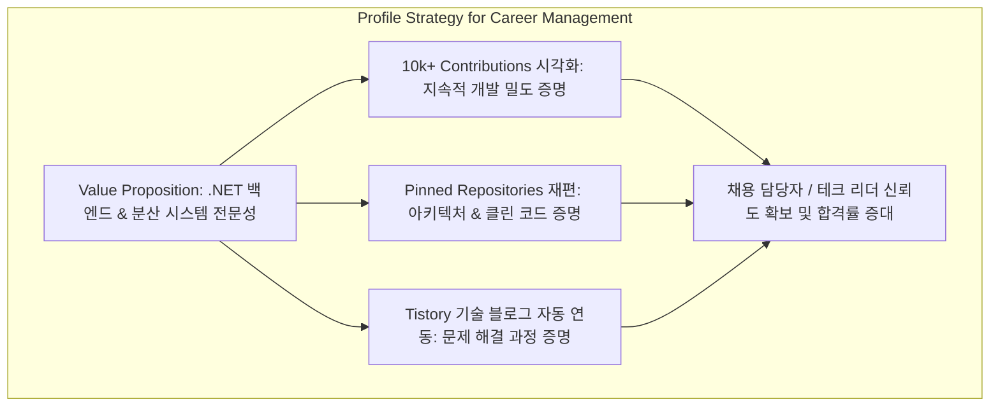

# GitHub 프로필(@ibocon) 고도화 및 엔지니어 이력 관리 체계 구축 계획

---

## 1. 계획 개요

* **문서명**: GitHub 프로필(@ibocon) 고도화 및 엔지니어 이력 관리 체계 구축 계획
* **대상 계정**: [https://github.com/ibocon](https://github.com/ibocon) (Yegun Kim)
* **소속 및 활동 기반**: MANGOSLAB, BotanicSoft (Monolith, Peony, Garden.Cluster 등 27개+ 리포지토리 기여)
* **목적**:
  1. 최근 1년 **10,159 Contributions**의 지속적인 개발 활동과 성실성을 시각적으로 전달.
  2. 분산된 활동 내역을 `.NET/C# 시스템 백엔드 및 분산 시스템 엔지니어`라는 명확한 브랜딩으로 응결.
  3. 채용 담당자(Recruiter)와 테크 리더의 기술 인터뷰 및 이력서(Resume/CV) 연계에 최적화된 포트폴리오 대시보드 구축.

---

## 2. 추진 배경 및 AS-IS 현황 진단

```
[ AS-IS 프로필 진단 ]
┌──────────────────────────────┬────────────────────────────────────────────────────────┐
│ 진단 영역                    │ 현황 및 문제점 분석                                    │
├──────────────────────────────┼────────────────────────────────────────────────────────┤
│ 1. Profile README            │ ❌ 부재 (ibocon/ibocon 특수 리포지토리 미생성)          │
│                              │ → 방문자가 엔지니어의 핵심 역량과 배경을 한눈에 파악 불가│
├──────────────────────────────┼────────────────────────────────────────────────────────┤
│ 2. Pinned Repositories       │ ⚠️ 학부/알고리즘 스터디 위주 고정                       │
│                              │ (Study-ReferenceCode, Study-CodingInterview,           │
│                              │  try-samples, LedgerServer, SVG, StackOverflow)        │
│                              │ → 연간 1만 커밋 엔지니어의 아키텍처 역량을 대변하지 못함│
├──────────────────────────────┼────────────────────────────────────────────────────────┤
│ 3. Activity Overview         │ ⚠️ 커밋 95%, PR 2%, 리뷰 0%로 편중                     │
│                              │ → 높은 커밋 수에 비해 협업/코드리뷰 역량이 가려질 위험  │
├──────────────────────────────┼────────────────────────────────────────────────────────┤
│ 4. 외부 링크 및 메타데이터   │ ⚠️ 보안 프로토콜 미적용 (http://ibocon.tistory.com/)   │
│                              │ → 직관적인 Bio 및 기술 블로그/LinkedIn 연계 미흡       │
└──────────────────────────────┴────────────────────────────────────────────────────────┘
```

---

## 3. 벤치마킹 및 선행 자료 분석

제공된 4개 아티클을 분석하여 도출한 핵심 프로필 구성 기법은 다음과 같습니다.

1. **[이유진 벨로그](https://velog.io/@yeuljliyn/GitHub-%EA%B9%83%ED%97%88%EB%B8%8C-%ED%94%84%EB%A1%9C%ED%95%84-%EA%BE%B8%EB%AF%B8%EA%B8%B0-README.md)**
   * **Special Repository 메커니즘**: 계정명과 동일한 `ibocon/ibocon` 리포지토리를 Public으로 생성하고 README.md를 활성화하여 프로필 메인에 임베드.
   * **기술 스택 뱃지화**: Shields.io + Simple Icons 조합으로 시각적 통일성 확보.
   * **Pinned Gist 활용**: `productive-box`(코딩 시간대 분석), `github-stats-box`(커밋 통계)를 GitHub Actions와 Gist에 연동하여 고정.
2. **[연진쓰 블로그](https://lyjduswls.tistory.com/17)**
   * **Header Visual**: `capsule-render`를 통해 동적이고 깔끔한 상단 타이틀 구성.
   * **중앙 정렬 레이아웃**: 섹션별 구분선과 통일된 뱃지 스타일을 통해 가독성 극대화.
3. **[younggil2 블로그](https://younggil2.github.io/it/2026-01-26-github-profile-decoration/) & [김다미 벨로그](https://velog.io/@oka1313/Github-%EA%B9%83%ED%97%88%EB%B8%8C-%ED%94%84%EB%A1%9C%ED%95%84-%EA%BE%B8%EB%AF%B8%EA%B8%B0)**
   * **동적 텍스트 애니메이션**: `readme-typing-svg`를 도입하여 엔지니어링 모토와 주력 분야를 동적으로 노출.
   * **스택 분류 체계화**: 단순 언어 나열을 지양하고 `Tech Stack`, `Studying`, `Tools`, `Contact`로 그룹화.

---

## 4. 이력 관리(Career & Resume) 최적화 전략

글로벌 테크 리쿠르팅 및 ATS 관점에서 GitHub 프로필은 단순 미관용이 아닌 **"검증 가능한 기술 자산"**이어야 합니다.



### 4.1 핵심 전략 5원칙
1. **10초 스캔 원칙 (Visual Hierarchy)**: 첫 화면에서 "누구이며, 주력 스택은 무엇이고, 어떤 시스템을 만드는가"가 3줄 이내로 전달되어야 함.
2. **기술 스택의 위계화 (Skill Tiering)**: '다룰 줄 아는 모든 기술'을 나열하지 않고 `Core (.NET/C#)`, `Architecture & Systems`, `Cloud & Infra`로 분류.
3. **Pinned Repositories의 포트폴리오화**:
   * 토이 프로젝트/코딩테스트 레포 대신 **아키텍처 패턴(Clean Architecture/DDD), 단위 테스트(xUnit), 패키지/라이브러리 기여작**을 고정.
   * 고정된 리포지토리는 반드시 명확한 설명(Description), 태그(Topics), 완성도 높은 README.md를 구비.
4. **문제 해결 기록의 자동 노출 (Proof of Work)**:
   * 운영 중인 기술 블로그(Tistory)의 글을 GitHub Actions를 통해 최신 5개 항목으로 자동 갱신.
5. **다크 모드 / 반응형 대응**:
   * GitHub의 Light/Dark 모드 전환에 깨지지 않도록 투명 배경 SVG 및 미디어 쿼리(`prefers-color-scheme`) 적용.

---

## 5. 상세 구현 설계 (TO-BE Content Architecture)

### 5.1 프로필 정보 구조도 (IA)

```
┌────────────────────────────────────────────────────────┐
│ 1. Hero Header (Capsule Render + Typings SVG)          │
├────────────────────────────────────────────────────────┤
│ 2. Executive Summary (핵심 경력, 지향점, 10k 커밋)     │
├────────────────────────────────────────────────────────┤
│ 3. Core Tech Stack (분야별 통일 뱃지)                  │
├────────────────────────────────────────────────────────┤
│ 4. Featured Engineering Highlights (주요 기여 요약 표) │
├────────────────────────────────────────────────────────┤
│ 5. Automated Tistory Tech Posts (Actions 연동)         │
├────────────────────────────────────────────────────────┤
│ 6. GitHub Contribution Visualizer (Snake + Stats)      │
├────────────────────────────────────────────────────────┤
│ 7. Contact & Network (LinkedIn, Tistory, Email)        │
└────────────────────────────────────────────────────────┘
```

### 5.2 `ibocon/ibocon` README.md 소스 코드 설계

```markdown
<!-- 1. Header Banner -->
<div align="center">
  
</div>

<!-- 2. Typing Intro -->
<div align="center">
  <a href="https://readme-typing-svg.demolab.com">
    
  </a>
</div>

<br/>

## 👨‍💻 About Me

- 🔭 **Current Focus**: MANGOSLAB에서 디바이스 연동 및 고가용성 소프트웨어 플랫폼을 개발하고 있습니다.
- 🧱 **Architecture Philosophy**: Clean Architecture, CQRS, 도메인 주도 설계(DDD)를 실무에 적용하여 변경에 유연하고 테스트 가능한 구조를 지향합니다.
- ⚡ **Consistency & Output**: 최근 1년간 **10,000+ Contributions**을 기록하며 매일 지속적인 코드 개선과 검증 사이클을 유지하고 있습니다.
- ✍️ **Knowledge Sharing**: 기술적 시행착오와 아키텍처 설계 고민을 [티스토리 블로그](https://ibocon.tistory.com)에 기록하고 공유합니다.

---

## 🛠 Tech Stack

### Core & Backend


### Architecture & Platform


### Testing & Engineering Practices


---

## 🚀 Key Engineering Projects

| Project | Description | Role & Highlights |
| :--- | :--- | :--- |
| **Monolith** | 핵심 데스크톱 및 백엔드 통합 솔루션 플랫폼 | Clean Architecture 수립, 빌드 최적화, xUnit 기반 TDD |
| **Peony** | 이벤트 기반 백엔드 및 도메인 모델 고도화 | CQRS 구조 적용, RabbitMQ 비동기 메시징, 도메인 행위 집중화 |
| **Garden.Cluster** | 사내 GitOps 및 쿠버네티스 오케스트레이션 | Flux 기반 GitOps 파이프라인 구축 및 컨테이너 관측성 확보 |

---

## 📝 Recent Blog Posts
<!-- BLOG-POST-LIST:START -->
- [Clean Architecture에서 도메인 이벤트 분리와 트랜잭션 보장](https://ibocon.tistory.com)
- [.NET 고성능 로깅 및 Structured Logging 베스트 프랙티스](https://ibocon.tistory.com)
- [Kubernetes 클러스터 환경에서의 GitOps 파이프라인 구축기](https://ibocon.tistory.com)
<!-- BLOG-POST-LIST:END -->

---

## 📊 GitHub Analytics & Activity

<div align="center">
  
  
</div>

<div align="center">
  <picture>
    <source media="(prefers-color-scheme: dark)" srcset="https://raw.githubusercontent.com/ibocon/ibocon/output/github-contribution-grid-snake-dark.svg">
    <source media="(prefers-color-scheme: light)" srcset="https://raw.githubusercontent.com/ibocon/ibocon/output/github-contribution-grid-snake.svg">
    
  </picture>
</div>

---

## 📫 Contact & Links
[](https://ibocon.tistory.com/)
[](https://linkedin.com)
[](mailto:wlfka102@gmail.com)
[](https://x.com/wlfka102)
```

---

## 6. GitHub Actions 자동화 파이프라인 구축 계획

### 6.1 Tistory 블로그 포스트 자동 갱신 워크플로
* **파일명**: `.github/workflows/blog-posts.yml`
* **동작 주기**: 매일 00:00 UTC (Cron) 및 수동 실행 (`workflow_dispatch`)
* **역할**: Tistory RSS 피드를 수신하여 README.md의 `<!-- BLOG-POST-LIST -->` 영역을 최신 글 링크로 자동 교체.

```yaml
name: Latest Blog Posts
on:
  schedule:
    - cron: '0 0 * * *'
  workflow_dispatch:

jobs:
  update-readme-with-blog:
    name: Update this repo's README with latest blog posts
    runs-on: ubuntu-latest
    steps:
      - name: Checkout
        uses: actions/checkout@v4
      - name: Pull in posts
        uses: gautamkrishnar/blog-post-workflow@v1
        with:
          feed_list: "https://ibocon.tistory.com/rss"
          max_post_count: 5
```

### 6.2 Contribution Snake 애니메이션 생성 워크플로
* **파일명**: `.github/workflows/snake.yml`
* **동작 주기**: 매일 자정 자동 실행
* **역할**: 잔디 그리드를 탐색하는 스네이크 SVG를 생성하여 `output` 브랜치에 자동 푸시.

```yaml
name: Generate Snake Contribution Grid
on:
  schedule:
    - cron: "0 15 * * *" # 매일 자정 (KST)
  workflow_dispatch:

jobs:
  build:
    runs-on: ubuntu-latest
    steps:
      - uses: Platane/snk@v3
        with:
          github_user_name: ibocon
          outputs: |
            dist/github-contribution-grid-snake.svg
            dist/github-contribution-grid-snake-dark.svg?palette=github-dark
        env:
          GITHUB_TOKEN: ${{ secrets.GITHUB_TOKEN }}
      - uses: crazy-max/ghaction-github-pages@v4
        with:
          target_branch: output
          build_dir: dist
        env:
          GITHUB_TOKEN: ${{ secrets.GITHUB_TOKEN }}
```

---

## 7. Pinned Repositories 재편 계획

채용 담당자의 시선이 가장 먼저 머무는 6개 Pinned 슬롯을 전략적으로 재배치합니다.

```
[ Pinned Repositories 교체 계획표 ]
┌────┬─────────────────────────────┬───────────────────────────┬──────────────────────────────────────────┐
│ No │ AS-IS (현재)                │ TO-BE (교체 대상)         │ 선정 목적 및 채용 연계 포인트            │
├────┼─────────────────────────────┼───────────────────────────┼──────────────────────────────────────────┤
│ 1  │ Study-ReferenceCode         │ ibocon/ibocon             │ 프로필 리포지토리 자체를 고정하여 진입성 확보 │
│ 2  │ Study-CodingInterview       │ Monolith (또는 대표 .NET) │ 대규모 시스템 아키텍처 및 C# 엔지니어링 역량│
│ 3  │ try-samples                 │ Peony (도메인 백엔드)     │ CQRS, 메시징 큐, 도메인 중심 설계 증명   │
│ 4  │ LedgerServer (Archive)      │ Garden.Cluster            │ GitOps, Kubernetes 클러스터 운영 역량    │
│ 5  │ SVG (Fork)                  │ 대표 오픈소스/라이브러리  │ 생태계 기여 및 오픈소스 협업 역량 증명   │
│ 6  │ StackOverflow               │ Tech Blog / 문서 레포     │ 기술적 문제 해결 및 기술 문서화 역량     │
└────┴─────────────────────────────┴───────────────────────────┴──────────────────────────────────────────┘
```

> **필수 조치 사항**:
> * 각 Pinned 레포지토리의 `About` 섹션에 명확한 한 줄 설명(Description) 기재.
> * `Topics`(태그) 등록: `dotnet`, `csharp`, `clean-architecture`, `kubernetes`, `gitops` 등 검색 키워드 매핑.

---

## 8. 단계별 실행 일정 (WBS)

| 단계 | 작업 항목 | 세부 내용 | 산출물 / 완료 기준 |
| :---: | :--- | :--- | :--- |
| **Phase 1** | 리포지토리 개설 및 프로필 정비 | • `ibocon/ibocon` Public 레포지토리 생성<br>• 프로필 메타데이터 수정 (`https://` 프로토콜 반영, Bio 작성) | 레포지토리 생성 및 메인 노출 확인 |
| **Phase 2** | README 기본 마크다운 적용 | • Header, About Me, Tech Stack 뱃지 작성<br>• Key Projects 테이블 정의 및 마크다운 커밋 | 프로필 대시보드 1차 레이아웃 완성 |
| **Phase 3** | GitHub Actions 파이프라인 구축 | • `blog-posts.yml` 작성 및 티스토리 RSS 연동<br>• `snake.yml` 작성 및 `output` 브랜치 자동 배포 | 잔디 스네이크 및 블로그 글 자동 갱신 |
| **Phase 4** | Pinned Repositories 큐레이션 | • 기존 스터디/아카이브 레포 언핀(Unpin)<br>• 핵심 아키텍처 및 시스템 레포 6개 선별 고정 | Pinned Repositories 목록 갱신 |
| **Phase 5** | 최종 QA 및 크로스 플랫폼 검증 | • GitHub Mobile 앱 화면 레이아웃 점검<br>• Light / Dark 모드 대비 시인성 점검 | 전 플랫폼 렌더링 정상 판정 |

---

## 9. 웹 탐색 추천 레퍼런스 10선 (링크 및 활용 가이드)

프로필 고도화 및 이력서 연계 시 즉시 활용할 수 있는 검증된 10개 레퍼런스입니다.

1. **[Awesome GitHub Profile README (abhisheknaiidu)](https://github.com/abhisheknaiidu/awesome-github-profile-readme)**
   * **선정 이유**: 전 세계 개발자들의 실전 프로필을 카테고리별로 집대성한 공식 레퍼런스 저장소.
   * **활용 포인트**: `Minimalistic` 및 `Dynamic Realtime` 섹션을 참고하여 실무 중심 레이아웃 벤치마킹.
2. **[Capsule Render (kyechan99)](https://github.com/kyechan99/capsule-render)**
   * **선정 이유**: 마크다운 파라미터만으로 다크/라이트 모드에 최적화된 헤더 배너를 실시간 생성.
   * **활용 포인트**: `type=waving&color=auto` 파라미터로 세련된 시각적 첫인상 제공.
3. **[Readme Typing SVG (DenverCoder1)](https://github.com/DenverCoder1/readme-typing-svg)**
   * **선정 이유**: 정적인 텍스트 대신 터미널 스타일의 동적 타이핑 효과를 제공하는 벡터 애니메이션 툴.
   * **활용 포인트**: 핵심 포지션, 아키텍처 철학, 연간 1만 커밋 성과를 롤링 텍스트로 노출.
4. **[GitHub Readme Stats (anuraghazra)](https://github.com/anuraghazra/github-readme-stats)**
   * **선정 이유**: 실시간 커밋 수, 언어 사용 점유율 카드를 렌더링하는 표준 통계 위젯.
   * **활용 포인트**: `include_all_commits=true`, `count_private=true` 옵션으로 실무 기여량 누락 방지.
5. **[Platane/snk (Snake Contribution Grid)](https://github.com/Platane/snk)**
   * **선정 이유**: 커밋 잔디 데이터를 애니메이션 SVG로 생성하여 1만 커밋의 밀도를 시각적으로 극대화.
   * **활용 포인트**: GitHub Actions를 통해 매일 자정 자동 빌드하여 유지보수 제로화 달성.
6. **[Blog Post Workflow (gautamkrishnar)](https://github.com/gautamkrishnar/blog-post-workflow)**
   * **선정 이유**: 기술 블로그의 RSS 피드를 주기적으로 파싱하여 README를 자동 업데이트하는 Action.
   * **활용 포인트**: 티스토리(`ibocon.tistory.com/rss`) 연동을 통해 지속적인 학습과 지식 공유 활동 증명.
7. **[Shields.io](https://shields.io/) & [Simple Icons](https://simpleicons.org/)**
   * **선정 이유**: 글로벌 표준 기술 스택 뱃지 생성 플랫폼 및 브랜드 공식 SVG 아이콘/HEX 컬러 데이터베이스.
   * **활용 포인트**: 통일된 규격(`style=for-the-badge`)을 적용해 시각적 난잡함을 제거하고 전문성 확보.
8. **[Lowlighter Metrics](https://github.com/lowlighter/metrics)**
   * **선정 이유**: 코딩 시간대, 언어별 라인 수, 기여 프로젝트 등 40여 개 플러그인을 지원하는 고급 통계 엔진.
   * **활용 포인트**: 시니어 엔지니어링 역량(이슈/PR 기여도, 코드 리뷰 비율)을 심층 카드로 시각화.
9. **[GitHub Profile Upgrade Guide (irjudson)](https://github.com/irjudson/github-profile-upgrade)**
   * **선정 이유**: 주니어부터 시니어/테크리드 단계별로 리쿠루터 관점의 프로필 작성 기준을 정리한 가이드.
   * **활용 포인트**: `EXAMPLE-MID-CAREER.md`의 커리어 타임라인 및 비즈니스 임팩트 기술 방식 적용.
10. **[The Complete Guide to Putting GitHub on Your Resume (Resume Worded)](https://resumeworded.com/blog/github-on-resume-post/)**
    * **선정 이유**: 글로벌 채용 플랫폼 및 ATS 관점에서 GitHub 프로필을 영문 이력서와 연계하는 방법론 제시.
    * **활용 포인트**: 이력서 상단 헤더 연계, 프로젝트 기술서 내 GitHub 코드 링크 배치 기준 준수.

---

## 10. 기대 효과 및 결론

* **정량적 효과**:
  * 연간 **10,159개 커밋 실적**이 프로필 첫 화면에서 시각적으로 직관화되어 높은 엔지니어링 성실성 입증.
  * Pinned 리포지토리 클릭률 및 기술 블로그(Tistory) 유입률 증대.
* **정성적 효과**:
  * 단순 코더가 아닌 **Clean Architecture와 분산 시스템을 구축하는 전문 소프트웨어 엔지니어**로서의 브랜딩 확립.
  * 채용 담당자와 기술 면접관에게 잘 정돈된 코드 베이스와 신뢰할 수 있는 개발 이력 제공.
