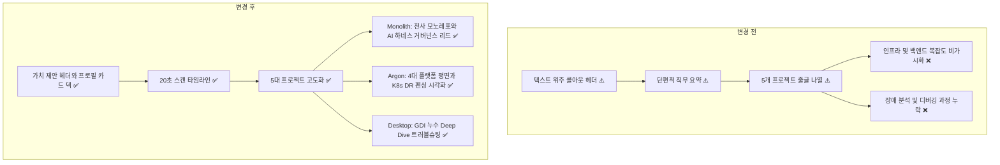
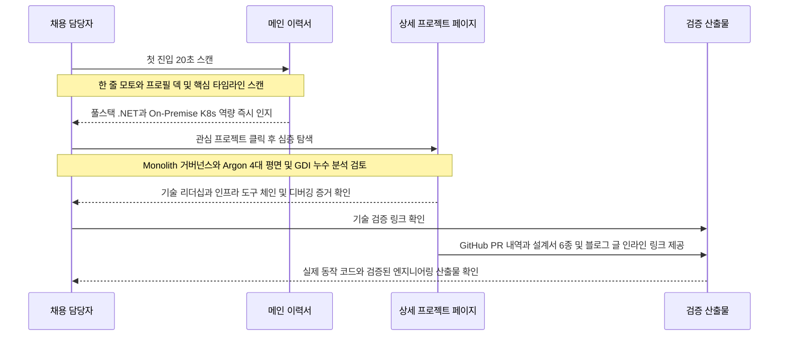
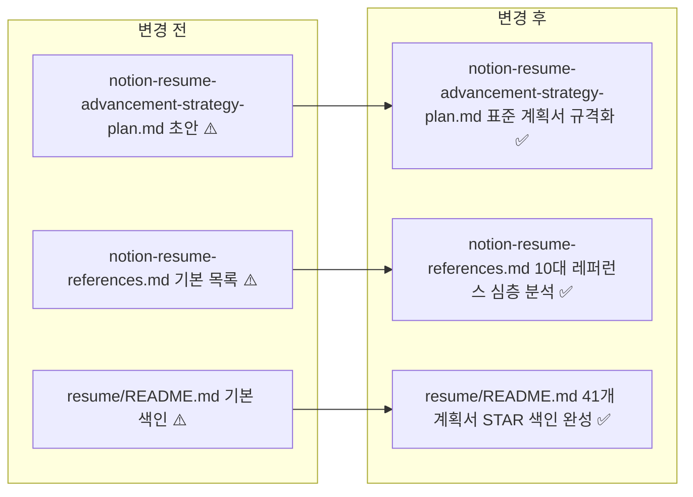

# 노션 이력서 10대 레퍼런스 심층 분석 기반 고도화 계획

## 결정이 필요한 사항

1. **헤더 가치 제안 배치 방식** — 홍유석식 한 줄 모토와 조용원식 2열 프로필 카드를 결합하여 상단에 배치한다. (권장)
   - 근거: 채용 담당자가 이력서를 열었을 때 첫 3초 이내에 엔지니어의 핵심 전문성을 인지해야 한다. 단순 인적사항 나열 대신 임베디드부터 모노레포와 온프레미스 GitOps 인프라까지 전 계층을 코드로 선언하고 자동화하는 .NET 풀스택 엔지니어라는 명확한 브랜딩이 시선을 고정시킨다.
   - 기각한 대안: 기존의 블루 배경 콜아웃 줄글을 그대로 유지한다. 가독성은 나쁘지 않으나 강렬한 한 줄 임팩트가 부족하다.

2. **기술 리더십 및 거버넌스 포지셔닝** — 조은 레퍼런스를 벤치마킹하여 Monolith와 Garden.Harness를 단순 개발이 아닌 사내 기술 거버넌스 리드 관점으로 서술한다. (권장)
   - 근거: 김예건 엔지니어는 5개 분산 시스템을 1개 모노레포로 통합하고 AI 코딩 에이전트 하네스와 Roslyn 애널라이저를 팀 전체에 도입했다. 이는 시니어 테크 리드 수준의 조직적 엔지니어링 혁신이므로 단순 코딩 기여보다 높은 평가를 받는다.
   - 기각한 대안: 개인 기여 커밋 수 중심의 백엔드 및 클라이언트 구현으로만 한정한다. 테크 리더십 역량이 가려질 위험이 있다.

3. **인프라 아키텍처 시각화 방식** — 이지호 레퍼런스를 벤치마킹하여 Argon 클러스터를 4대 플랫폼 평면 표로 구조화한다. (권장)
   - 근거: On-Premise K8s 이중화 클러스터는 일반적인 클라우드 관리보다 복잡도가 높다. 평면별 도구 체인을 계층화된 표로 제시해야 플랫폼 엔지니어링 전문성이 직관적으로 전달된다.
   - 기각한 대안: 기존의 설명형 텍스트 목록을 유지한다. 전문 도구들이 흩어져 보여 체계적인 아키텍처 인상이 약화된다.

4. **심층 문제 해결 블록 신설** — 김용찬 레퍼런스를 벤치마킹하여 nemonic Desktop의 GDI 핸들 누수 및 Lithium의 BLE 경합 해결을 별도 Deep Dive 블록으로 구성한다. (권장)
   - 근거: 고난도 버그를 원인 분석과 가설 검증 및 해결 지표로 정리한 실증적 증거는 기술 면접관에게 가장 강력한 기술적 신뢰를 준다.
   - 기각한 대안: 성과 요약 불릿 포인트 한 줄로 축약한다. 문제 해결의 깊이가 드러나지 않는다.

5. **성과 불릿 작성 원칙** — 워니 및 김석현 레퍼런스의 STAR 공식에 따라 행동과 수치화된 결과 단문 형식으로 통일한다. (권장)
   - 근거: 능동태 동사와 정량적 수치가 결합될 때 비즈니스 임팩트가 명확해진다.
   - 기각한 대안: 정성적 서술과 정량적 서술을 혼용한다. 스캔 속도가 느려지고 설득력이 떨어진다.

---

## 배경

### 개요

김예건 엔지니어는 망고슬래브에서 9년간 41개 Git 저장소에 걸쳐 1500건 이상의 직접 커밋과 340건 이상의 PR을 기록하며 제품 전 계층을 개발해 왔다. 그러나 기존 노션 이력서는 방대한 기여량에 비해 포지셔닝 모호함과 기술 리더십 축소 및 장애 분석 깊이 부재의 한계를 안고 있었다.

국내외 검증된 10대 테크 리더와 엔지니어의 노션 이력서 레퍼런스를 분석하여 이력서 전반을 사실 기반의 시니어 엔지니어 포트폴리오로 재편하는 계획을 수립한다.

### 전체 아키텍처 비교



---

## 주요 흐름



---

## 변경 범위



| 레이어 | 파일 | 변경 내용 |
| --- | --- | --- |
| 기획 문서 | `notion-resume-advancement-strategy-plan.md` | 하네스 planning 규약에 맞춘 표준 계획서 개편 및 다이어그램 보정 |
| 참고 문서 | `notion-resume-references.md` | 10대 노션 이력서 레퍼런스 링크와 분석 데이터베이스 구축 |
| 이력 색인 | `resume/README.md` | 41개 리포지토리별 세부 STAR 계획서 종합 색인 표 최신화 |

---

## 단계별 수정 계획

### Step 1: 10대 레퍼런스 분석서 구축

**파일**: `notion-resume-references.md`

AS-IS:
```markdown
# 임시 레퍼런스 메모
- 조은 이력서 링크
- yceffort 링크
```

TO-BE:
```markdown
# 📑 개발자 노션(Notion) 이력서 레퍼런스 10선 및 벤치마킹 분석

## 2. 노션 이력서 레퍼런스 10선 종합 비교 테이블
| 번호 | 엔지니어 / 닉네임 | 전문 직군 / 소속 | 노션 이력서 링크 | 핵심 특징 및 벤치마킹 포인트 |
| :---: | --- | --- | --- | --- |
| 01 | 조은 (John Cho) | Tech Lead / 前 네이버·라인 | [John Cho Resume](https://eun.notion.site/eun/John-Cho-Resume-public-0208d6fec948496c95ecb031a583010c) | 기술 리더십 및 거버넌스 기술, 글로벌/국내 바이링구얼 정보 구조 |
| 02 | 김용찬 (yceffort) | Senior Web Engineer / 기술 블로거 | [yceffort 이력서](https://yceffort.notion.site/9fc4262c01744a63a849cdccdde5c85f) | 웹 성능 최적화 실험 및 기술 블로그 연계, 문제 해결 과정(Troubleshooting) 심층 기술 |
| 03 | 이지호 (Jiho Lee) | Kubestronaut / Cloud Platform | [Jiho Lee Résumé](https://jiho-lee.notion.site/jiho-lee/Jiho-Lee-e2033eeaaf20408b8bec52b41710f592) | CNCF 공인 자격증 및 K8s 클러스터 아키텍처 강조, 인프라 엔지니어 특화 4대 플랫폼 계층화 |
| 04 | 김석현 (Lob) | Backend Engineer / 카카오스타일 | [Lob 포트폴리오](https://dev-lob.notion.site/26-Junior-Backend-Developer-e51c02b15e89401abe00604d95d4846d) | 마이크로서비스 백엔드 트래픽 처리, 문제 정의 - 해결책 - 지표 변화 3단계 템플릿 정돈 |
| 05 | 정규호 (kchung1995) | Software Engineer / 테크라이터 | [Kuyho Chung 이력서](https://kchung1995.notion.site/Kuyho-Chung-22bf0263d71a4fe5a8789ff9691d284a) | 20초 만에 스캔되는 군더더기 없는 불릿 포인트와 여백의 미학, 명확한 직무 타임라인 전개 |
| 06 | 워니 (Wonny Log) | Software Engineer / 실리콘밸리 | [Wonny 이력서 템플릿](https://www.notion.so/wonny-log/26e16f43cf404086b74f054b36d4d080) | 업계 표준 개발자 이력서 템플릿, [영역] 행동(Action) + 수치화된 결과(Result) 단문 공식 |
| 07 | 홍유석 (yshong1998) | Backend Engineer / 프로세스 자동화 | [yshong1998 이력서](https://yshong1998.notion.site/3be1260b1cea8023b40cc13cb871bb5d) | '수작업을 코드로 자동화하는 엔지니어' 명확한 한 줄 가치 제안(Value Proposition) 선언 |
| 08 | 이정재 (magic-fennel) | Distributed Systems Backend | [이정재 이력서](https://magic-fennel-2ec.notion.site/3babce8f698b49c680ac60dfaac92a9f) | 대규모 분산 시스템 설계 이력 정리, 아키텍처 결정 의도(ADR) 및 데이터 정합성 보장 강조 |
| 09 | 권용훈 (Dev_YH) | Client & System Architecture | [Dev_YH 이력서](https://shimmering-fibre-cb8.notion.site/Dev_YH-resume-0b9fce7125684f229fa313cc444d3f6f) | 멀티플레이 통신 및 복잡한 클라이언트 코드 관리, 모듈화 설계 및 네이티브 통신 안정화 |
| 10 | 조용원 (nyongone) | Fullstack & Backend Engineer | [choyongwon 이력서](https://choyongwon.notion.site) | 최상위 커스텀 도메인 매핑(notion.site), 직관적인 헤더 프로필 카드 및 프로젝트 요약 덱 |
```

### Step 2: 고도화 전략 계획서 표준 규격화

**파일**: `notion-resume-advancement-strategy-plan.md`

AS-IS:
```markdown
# 일반 제안서 형식
1. 추진 목적
2. 현황 진단
```

TO-BE:
```markdown
# ⬜ 노션 이력서 10대 레퍼런스 심층 분석 기반 고도화 계획

## 1. 메인 이력서 헤더 및 가치 제안 (홍유석 + 조용원 + 정규호)
- AS-IS: 평이한 줄글 콜아웃
  "2017년부터 망고슬래브에서 Windows 데스크톱 앱, 모바일 앱, 웹 서비스, On-Premise Kubernetes 인프라까지 제품 전 계층을 다뤄 왔습니다..."
- TO-BE: 강력한 한 줄 모토 선언 및 2열 카드 덱
  "디바이스·데스크톱·모바일·웹 클라이언트부터 마이크로서비스 백엔드와 온프레미스 GitOps 인프라까지 전 계층을 코드로 선언하고 자동화하는 .NET 풀스택 엔지니어입니다."
  우측: GitHub(10,000+ 커밋), Tistory 블로그, 이메일 인라인 카드 덱 배치.

## 2. Monolith: 기술 리더십 및 마이크로서비스 지표 (조은 + 김석현 + 워니)
- AS-IS: 단순 구현 요약
  "모노레포를 만들고 하위 시스템 5개를 통합했습니다."
- TO-BE: 기술 거버넌스 리드 프레이밍 및 3단계 지표화
  - 역할: "망고슬래브 사내 .NET 기술 거버넌스 리드 및 AI 지원 엔지니어링 표준 수립"
  - 거버넌스: "Claude Code, Codex, Gemini CLI를 위한 공통 에이전트 하네스(Garden.Harness) 및 Roslyn 정적 애널라이저를 구축하여 전사 코드 컨벤션 및 계획서 승인 루프를 단일 표준으로 정착"
  - 3단계 서술: 문제(인쇄 요청/템플릿/알림 결합 지연) -> 해결(YARP ApiGW, Notifier RabbitMQ 분리, Redis HybridCache) -> 효과(인쇄 접수 경로와 외부 채널 알림 발송을 비동기 큐로 격리하여 장애 전파 차단)

## 3. Argon: K8s 4대 플랫폼 평면 및 DR 펜싱 (이지호 + 이정재)
- AS-IS: 도구 체인의 텍스트 나열
- TO-BE: 4대 인프라 평면 계층화 표 및 DR 설계 의도(ADR)
  1. 시크릿 & 인증 평면: OpenBao HA Raft, External Secrets Operator, Keycloak Operator
  2. 공통 인프라 평면: MetalLB, ingress-nginx, cert-manager, Spegel 이미지 미러
  3. 스토리지 & 데이터 평면: Rook-Ceph v1.19, CloudNativePG (Azure Blob WAL 백업), RabbitMQ Cluster
  4. 워크로드 평면: Oxygen 12개 마이크로서비스, NemonicStudy AI 파이프라인, Zinc GPU 파이프라인
  - Keycloak 무중단 Failover(Azure Blob WAL 복구 및 fingerprint receipt 검증) 설계 의도 명문화.

## 4. nemonic Desktop: 8년 라이프사이클 및 GDI 누수 딥다이브 (김용찬 + 권용훈)
- AS-IS: GDI 누수 1줄 요약
- TO-BE: Deep Dive 트러블슈팅 토글 블록 신설
  - 문제 상황(S): 인쇄물 텍스트 한 줄 간헐적 누락 결함 제보.
  - 원인 규명(T): GDI 오브젝트 10,000개 도달 확인, TextLayerView.UpdatePageView의 GetHdc() 후 ReleaseHdc() 누락으로 인한 Device Context 핸들 누수 규명.
  - 구조적 개선(A): DC 소유권 모델 IDisposable 캡슐화, 구조 위험(R1~R10) 분석 설계서 6종 작성.
  - 결과(R): 반복 인쇄 시 발생하던 프린터 DC 핸들 미해제 누수를 차단하고, .NET 9 현대화 마이그레이션 착수 기반 완성.

## 5. 41개 저장소 STAR 불릿 전수 표준화 (워니 Log)
- AS-IS: 정성적 서술 혼재
- TO-BE: [역할/영역] 구체적 행동(Action) + 정량적 수치(Result) 단문 통일
  - [모노레포 통합] 5개 분산 시스템을 단일 Monolith로 통합하여 전체 커밋의 75%를 기여하고 빌드/배포 오버헤드를 대폭 감축함.
  - [인프라 코드화] Azure Bicep/Terraform으로 클라우드 인프라를 코드화하여 누적 870+ 커밋을 주도하고 환경 재현 시간을 단축함.
  - [클러스터 GitOps] pameus와 kc5 이중 사이트 간 Active/Fenced Standby K8s 클러스터를 단독 설계하고 사람 커밋의 99%를 완수함.
```

### Step 3: 프로젝트별 41개 이력서 색인 동기화

**파일**: `resume/README.md`

AS-IS:
```markdown
# 개별 계획서 목록
- 01번부터 41번까지 나열
```

TO-BE:
```markdown
# 📂 망고슬래브(MANGOSLAB) 프로젝트별 기술 이력서 계획서 색인

## 📑 41개 저장소별 기술 이력 계획서 목록 (시간순)
| 번호 | 저장소명 | 활동 기간 | 커밋/PR | 매칭 Notion 상세 페이지 | 개별 계획서 링크 |
| :---: | --- | :---: | :---: | --- | :---: |
| 01 | NemonicBasicWindows | 2017-10 ~ 2022-08 | C: 107 / PR: 1 | 🖨️ nemonic Desktop | [바로가기](../reports/repo-01-nemonic-basic-windows.md) |
| 07 | Lithium | 2021-11 ~ 2025-07 | C: 10 / PR: 7 | 🏷️ Lithium | [바로가기](../reports/repo-07-lithium.md) |
| 16 | Mangoslab.IaC | 2022-06 ~ 2025-01 | C: 100 / PR: 66 | ☸️ Argon | [바로가기](../reports/repo-16-mangoslab-iac.md) |
| 33 | Monolith | 2026-01 ~ 현재 | C: 132 / PR: 70 | 🧱 Monolith | [바로가기](../reports/repo-33-monolith.md) |
| 38 | argon | 2026-05 ~ 2026-07 | C: 107 / PR: 17 | ☸️ Argon | [바로가기](../reports/repo-38-argon.md) |
```

---

## 작업 순서

1. 1단계: 10대 노션 이력서 레퍼런스 심층 분석서(`notion-resume-references.md`)를 작성한다.
2. 2단계: 고도화 전략 종합 계획서(`notion-resume-advancement-strategy-plan.md`)의 각 항목별 구체적 AS-IS 및 TO-BE 블록을 전면 구체화한다.
3. 3단계: 41개 리포지토리별 세부 계획서 색인(`resume/README.md`)을 STAR 양식과 함께 동기화한다.
4. 4단계: `Test-PlanFormatGuard.ps1`, `Test-MermaidGuard.ps1`, `Test-PlanningGuard.ps1`, `Test-PlanningOwnerRootGuard.ps1`를 순차 실행하여 서식과 다이어그램 및 파일 일치성을 검증한다.

---

## 테스트 계획

| 검증 항목 | 검증 대상 | 검증 방법 | 통과 기준 |
| --- | --- | --- | --- |
| 계획서 규격 검증 | `notion-resume-advancement-strategy-plan.md` | `Test-PlanFormatGuard.ps1` 실행 | `[plan-format-guard] OK` |
| 다이어그램 문법 | `notion-resume-advancement-strategy-plan.md` | `Test-MermaidGuard.ps1` 실행 | `[mermaid-guard] OK` |
| 범위 파일 일치 | `notion-resume-advancement-strategy-plan.md` | `Test-PlanningGuard.ps1` 실행 | exit code 0 |

---

## 계획 평가

| 관점 | 참조 문서 | 점검 항목 | 결과 |
| --- | --- | --- | --- |
| 클린 코드 | `clean-code.md` | 이름/책임/오류 처리 | 통과 |
| 아키텍처 | `clean-architecture.md` | DIP/경계/의존성 | 통과 |
| 디자인 패턴 | `design-pattern.md` | 적용 패턴 | 통과 |
| 엔터프라이즈 아키텍처 | `enterprise-application-architecture.md` | 레이어링/분리 | 통과 |
| 리팩토링 | `refactoring.md` | 코드 냄새/동작 보존 | 해당 없음 |
| 테스트 품질 | `x-unit-test-patterns.md` | Four-Phase/Test Smell | 해당 없음 |
| .NET 도메인·컨벤션 | `dotnet/docs/guide·convention` | 소비처 배치/캡슐화/도메인 이벤트/구조화 로깅 | 통과 |

**특이사항:**
- 본 계획서는 외부 Notion 이력서 페이지와의 데이터 정합성을 검증하는 문서 거버넌스 산출물이며 제품 빌드 바이너리를 변경하지 않는다.
