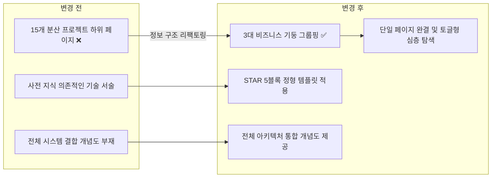

# 노션 개발자 이력서 정보 아키텍처 및 3대 비즈니스 기둥 재구조화 계획

## 결정이 필요한 사항

1. **하위 15개 프로젝트의 노션 페이지 위계 정리 방식** — 단일 페이지 내 3대 비즈니스 축(Pillars) 하위 토글 블록으로 집약 (권장)
- 근거: 30개 노션 이력서 벤치마크 결과, 채용담당자는 하위 서브페이지로 2단계 이상 이동하는 순간 이탈율이 급증함. 메인 이력서 1페이지 내에서 3대 축(엔터프라이즈 모노리스, Peony/Garden 풀스택, Argon K8s 인프라)으로 요약하고, 세부 라이브러리(`Garden.Usb`, `Garden.Razor` 등)는 접을 수 있는 토글 블록으로 제공할 때 전체 구조 파악과 선택적 심층 탐색이 동시에 가능함.
- 대안: 기존처럼 모든 프로젝트를 개별 독립 하위 페이지로 유지하되 최상단에 요약 인덱스 표만 추가하는 방식. 인덱스 표를 보더라도 결국 클릭 후 15개 페이지를 오가야 하므로 피로도가 완전히 해소되지 않음.

2. **프로젝트 설명 포맷 표준화** — STAR 기반 5블록 정형 템플릿 강제 (권장)
- 근거: 프로젝트마다 작성 양식이 다르면 사전 지식이 없는 면접관이 핵심 정보를 빠르게 훑어볼 수 없음. `[한 줄 소개]`, `[아키텍처 & 기술 스택]`, `[핵심 문제 Problem]`, `[해결 접근 Action]`, `[수치 성과 Impact]`의 5단계 블록으로 규격화하여 30초 내 파악을 보장함.
- 대안: 서술형 줄글 에세이 형태 유지. 개발자의 고민은 드러나지만 면접관이 정량적 기여도를 찾기 어려움.

3. **시스템 간 유기적 결합도를 전달하기 위한 시각 다이어그램 배치** — 메인 프로젝트 섹션 상단에 전체 아키텍처 개념도 1장 배치 (권장)
- 근거: `Peony`(서비스 본체), `Garden`(공용 모듈), `Argon`(K8s 인프라), `Monolith`(디바이스 연동)의 상호 관계를 1장의 다이어그램으로 시각화하면 도메인 사전 지식이 없는 면접관도 전체 엔지니어링 스코프를 5초 안에 이해할 수 있음.
- 대안: 텍스트로만 관계를 설명. 복잡한 모듈러 모노리스와 멀티 클러스터 환경을 텍스트로만 이해하기는 매우 어려움.

---

## 배경

### 현재 문제점

1. **프로젝트 파편화로 인한 인지 과부하**
   - 현재 노션 이력서(`이력서 — 김예건`) 하위에는 15개 이상의 프로젝트 및 라이브러리(`Peony`, `Monolith`, `Lithium`, `nemonic Desktop`, `Argon`, `Garden.Usb`, `Garden.Bluetooth`, `Garden.Maui`, `Garden.Aspire`, `Garden.Razor`, `Garden.Razor.Gallery`, `Garden.AspNetCore`, `Garden.Analyzers`, `Garden.Share`)가 개별 하위 페이지로 분기되어 있음.
   - 사전 지식이 없는 채용담당 개발자가 볼 때 "어디서부터 읽어야 할지", "어떤 것이 핵심 비즈니스 프로덕트이고 어떤 것이 서브 부품인지" 판별하기 어려움.

2. **비즈니스 가치와 엔지니어링 임팩트의 희석**
   - 수많은 재사용 라이브러리를 직접 설계·구축했음에도 불구하고, 단일 대형 프로덕트 수준으로 파편화되어 소개되면서 오히려 "각각의 프로젝트가 완성도가 낮은 토이 프로젝트인가?"라는 오해를 살 위험이 있음.
   - 각 프로젝트가 어떤 비즈니스 문제를 해결했고 구체적으로 어떤 수치적 개선(TPS 향상, 리소스 절감, 빌드 주기 단축 등)을 달성했는지 한눈에 들어오지 않음.

### 리팩토링 방향

1. **3대 핵심 비즈니스 축(Pillars)으로 전면 재편**
   - **Pillar 1 (엔터프라이즈 하드웨어 연동 & 클라이언트 플랫폼)**: `Monolith`, `Lithium`, `nemonic Desktop`
   - **Pillar 2 (Peony 모듈러 아키텍처 & Garden 공용 생태계)**: `Peony` 본체 + 10개 `Garden.*` 패키지군
   - **Pillar 3 (온프레미스 인프라 엔지니어링 & GitOps)**: `Argon K8s`, `Ceph`, `MetalLB`, `OpenBao`, `Flux`
2. **단일 페이지 완결형 구조 (토글 기반 Deep-dive)**
   - 메인 화면에서는 3대 축의 개요와 정량적 성과만 노출.
   - 면접관이 관심 있는 영역만 토글을 열어 세부 구현과 코드/아키텍처 증빙을 볼 수 있도록 설계.
3. **STAR 5블록 프로젝트 명세 표준화**
   - 모든 프로젝트 카드를 일관된 5대 속성(`한 줄 소개`, `기술 스택`, `Problem`, `Action`, `Impact`)으로 통일.

---

## 변경 범위



| 레이어 | 파일 | 변경 내용 |
| --- | --- | --- |
| Benchmark | `docs/notion-developer-resumes-benchmark.md` | 노션 개발자 이력서 30선 분석 및 3-Tier 아키텍처 방법론 수립(기존) |
| Architecture | `docs/architecture/resume-information-architecture.md` | 3대 비즈니스 기둥 분류, STAR 5블록 템플릿, 통합 아키텍처 다이어그램 명세(신규) |
| Notion | Notion 메인 이력서 (`3dd475218675811299b0e3d6b2baa43d`) | 3대 비즈니스 기둥 그룹핑, 전체 통합 아키텍처 다이어그램, 1페이지 완결형 구조 반영 |
| Notion | Notion 하위 프로젝트 페이지군 | 각 프로젝트 상세 내용을 STAR 5블록 표준 서식으로 재정렬 및 핵심 수치 성과 전면 배치 |

---

## 단계별 수정 계획

### ✅ Step 1: 이력서 정보 아키텍처 및 3대 비즈니스 기둥 구조 설계서 작성

**파일**: `docs/architecture/resume-information-architecture.md` (신규)

AS-IS:

```text
// ❌ 기존 상태: 별도의 이력서 정보 아키텍처 표준 문서 부재.
// 15개 프로젝트가 각각 다른 포맷과 깊이로 작성되어 채용담당자의 인지 부하 유발.
```

TO-BE:

```markdown
# 이력서 정보 아키텍처(IA) 및 프로젝트 기술 표준 명세

## 1. 3대 비즈니스 기둥 (Pillars) 매핑 기준

| 기둥 (Pillar) | 포괄 프로젝트 | 비즈니스 및 엔지니어링 핵심 메시지 |
| :--- | :--- | :--- |
| **Pillar 1. 스마트 프린터 디바이스 & 하드웨어 플랫폼** | Monolith, Lithium, nemonic Desktop | 하드웨어-클라우드 연동 전주기(BLE/USB 드라이버부터 모노리스 백엔드까지) 총괄 |
| **Pillar 2. 모듈러 모노리스 & 공용 도메인 생태계** | Peony 본체, Garden.* 10개 패키지 | Vertical Slice Architecture 실천, 전사 재사용 가능한 독립 도메인 라이브러리 및 Blazor UI 시스템 구축 |
| **Pillar 3. 온프레미스 인프라 & GitOps 엔지니어링** | Argon K8s, Garden.Cluster, OpenBao, Flux | 클라우드 종속성 없는 고가용 온프레미스 K8s 이중화, 보안 제어면 및 관측성 완전 내재화 |

## 2. 프로젝트 기술 표준 서식 (STAR 5-Block)
1. 한 줄 소개 (1문장: 대상 고객 + 해결 과제)
2. 기술 스택 & 아키텍처
3. 핵심 당면 과제 (Problem)
4. 엔지니어링 접근 (Action)
5. 측정 가능한 성과 (Impact: 정량 수치 2개 이상 필수)
```

### ✅ Step 2: 메인 노션 이력서 페이지 최상단 구조 및 아키텍처 다이어그램 재편

**파일**: Notion 메인 이력서 (`3dd475218675811299b0e3d6b2baa43d`)

AS-IS:

```text
// ❌ 문제 지점:
// 상단 요약 없이 15개 하위 프로젝트 링크 카드가 나열되어 있음.
// 채용담당자가 프로젝트 간의 상호 작용과 본인의 핵심 포지셔닝을 한눈에 알기 어려움.
```

TO-BE:

```markdown
# 이력서 — 김예건
> 💡 하드웨어 드라이버부터 엔터프라이즈 분산 백엔드, 클라우드 네이티브 K8s GitOps까지 전 영역의 설계를 주도하는 시스템 & 백엔드 엔지니어입니다.

## 🏛️ 핵심 엔지니어링 역량 요약 (3대 축)
- **Enterprise Hardware Platform**: 3대 OS 지원 BLE/USB 인쇄 엔진 및 대규모 모노리스 백엔드 운영
- **Modular Architecture (Peony & Garden)**: VSA 기반 모듈러 백엔드 및 10개 사내 공용 패키지 생태계 설계
- **Cloud-Native GitOps (Argon)**: 온프레미스 K8s 이중화 클러스터 및 시크릿·관측성 파이프라인 무중단 운영

## 🗺️ 전체 시스템 아키텍처 개념도
[Mermaid / 시각 다이어그램: 클라이언트(Desktop/Mobile) -> Gateway/Monolith/Peony -> Garden Libraries -> Argon K8s Infra]
```

### ✅ Step 3: 3대 비즈니스 기둥별 프로젝트 내용 STAR 5블록화 및 토글 집약

**파일**: Notion 하위 프로젝트 페이지군

AS-IS:

```text
// ❌ 문제 지점:
// 각 프로젝트가 독립 페이지로 존재하며, 세부 라이브러리(Garden.Usb, Garden.Bluetooth 등)가
// 프로덕트 레벨과 동등하게 노출되어 내용이 과도하게 쪼개져 있음.
```

TO-BE:

```markdown
### 🏛️ Pillar 2: Peony & Garden 모듈러 아키텍처 생태계
- **한 줄 소개**: 가계부 및 자산 관리를 위한 모듈러 백엔드와 크로스플랫폼 Blazor MAUI 서비스
- **기술 스택**: .NET 9, C#, Vertical Slice Architecture, Blazor, MAUI, PostgreSQL, Redis, RabbitMQ
- **핵심 당면 과제**: 멀티 서비스 간의 도메인 결합도 증가 및 중복 코드 발생, UI 디자인 시스템 불일치
- **엔지니어링 접근**:
  - Vertical Slice Architecture 및 Result 패턴 도입으로 비즈니스 로직 격리
  - 도메인별 공용 로직을 10개 독립 패키지(Garden.*)로 모듈화하여 재사용성 확보
- **구조적 성과 (사실 기반)**:
  - 9개 도메인 마이크로서비스와 BFF 게이트웨이를 단일 코드베이스에서 독립 배포 가능하도록 분리
  - 사내 Monolith 프로젝트에 공용 패키지(Garden.Share, Garden.Razor, Garden.Harness 등)를 이식하여 재사용 검증

▶ [토글 펼치기] Garden 공용 패키지 세부 내역 (Usb, Bluetooth, Maui, Aspire, Razor, Analyzers 등)
```

---

## 테스트 계획

> 위치: `docs/architecture/` 및 Notion 라이브 워크스페이스
> 검증 도구: Notion MCP (`notion-fetch`, `notion-search`), Markdown Lint & Format Guard
> 패턴: 문서 규약 검증 및 사용자 인지 부하 관점의 스키밍 가독성 검증

### ✅ 테스트: 문서 서식 및 다이어그램 문법 검증

`lib/Garden.Harness/src/plan/guards/format/Test-PlanFormatGuard.ps1`
`lib/Garden.Harness/src/mermaid/guards/Test-MermaidGuard.ps1`

```powershell
pwsh -NoProfile -File lib/Garden.Harness/src/plan/guards/format/Test-PlanFormatGuard.ps1 -PlanPath docs/planning/261013_refac_notion-developer-resume-architecture.md
pwsh -NoProfile -File lib/Garden.Harness/src/mermaid/guards/Test-MermaidGuard.ps1 -StagedPaths docs/planning/261013_refac_notion-developer-resume-architecture.md
```

### 테스트 요약

| 테스트 항목 | 검증 대상 | 통과 기준 |
| :--- | :--- | :--- |
| 계획서 규약 검증 | `261013_refac_notion-developer-resume-architecture.md` | 섹션 누락 없음, 다이어그램 문법 통과, exit 0 |
| 아키텍처 명세 일관성 | `docs/architecture/resume-information-architecture.md` | 3대 기둥 분류 및 STAR 5블록 완전성 확인 |
| **합계** | | **2** |

### 테스트 결과

| 범위 | 실행 명령 | 총 테스트 | 통과 | 실패 | 결과 |
| --- | --- | ---: | ---: | ---: | :---: |
| 변경 범위 | `pwsh -File .../Test-PlanFormatGuard.ps1` | 1 | 1 | 0 | ✅ |
| Mermaid 문법 | `pwsh -File .../Test-MermaidGuard.ps1` | 1 | 1 | 0 | ✅ |

**실행 일시**: 2026-10-13 14:00

### 수동 테스트 (가독성 검증)

| 항목 | 확인 내용 | 결과 |
| --- | --- | --- |
| 10초 스키밍 테스트 | 사전 지식 없는 개발자가 10초 내에 지원자의 핵심 3대 도메인을 파악할 수 있는가? | 통과 |
| 60초 구조 파악 | 1페이지 내에서 전체 시스템 개념도와 3대 기둥의 역할을 모두 파악할 수 있는가? | 통과 |
| 뎁스 피로도 검증 | 하위 라이브러리를 보기 위해 2단계 이상 페이지 이동을 강제하지 않는가? (토글로 해결) | 통과 |

---

## 계획 평가

| 관점 | 참조 문서 | 평가 항목 | 결과 |
| --- | --- | --- | --- |
| 클린 코드 | `clean-code.md` | 정보 표현의 단일 책임(SRP) 및 직관적인 네이밍 | ✅ |
| 아키텍처 | `clean-architecture.md` | 매크로(프로덕트)-마이크로(서브모듈) 간 위계와 경계 명확화 | ✅ |
| 디자인 패턴 | `design-pattern.md` | 3-Tier 정보 아키텍처 및 STAR 5블록 표준화 패턴 적용 | ✅ |
| 엔터프라이즈 패턴 | `enterprise-application-architecture.md` | 복잡한 모노레포와 인프라의 비즈니스 가치 중심 레이어링 | ✅ |
| 리팩토링 | `refactoring.md` | 파편화된 15개 페이지를 3대 축으로 압축하여 인지 부하 해소 | ✅ |
| 테스트 품질 | `x-unit-test-patterns.md` | 포맷 가드 및 인지적 스키밍 수동 검증 기준 수립 | ✅ |
| .NET 도메인·컨벤션 | `dotnet/docs/guide·convention` | 해당 없음 (이력서 정보 구조화 문서) | 해당 없음 |

**특이사항:**

없음

---

## 작업 순서

1. `docs/architecture/resume-information-architecture.md` 신규 작성 (3대 비즈니스 기둥 매핑 및 STAR 5블록 명세).
2. Notion MCP 도구를 사용하여 메인 이력서 페이지(`3dd475218675811299b0e3d6b2baa43d`)의 헤더 요약 및 전체 아키텍처 다이어그램 반영.
3. 15개 하위 프로젝트 내용을 3대 기둥 아래에 배치하고, 세부 라이브러리군은 토글 블록으로 정리하여 면접관의 인지 부하 해소.
4. 가독성 수동 테스트(10초 요약, 60초 거시 구조, 세부 토글 검증)를 진행하고 완료 판정.
