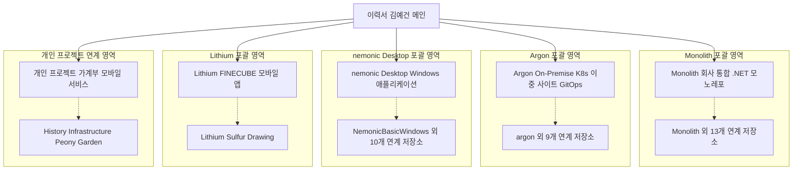

# 노션 기반 프로젝트 기술 이력 체계화 및 경력 기술서 고도화 계획

---

## 1. 계획 개요

* **문서명**: Notion 기반 프로젝트 기술 이력 체계화 및 경력 기술서 고도화 계획서
* **작성자 / 대상 계정**: 김예건 ([@ibocon](https://github.com/ibocon) / `wlfka102@gmail.com`)
* **소속 및 활동 기반**: 망고슬래브(MANGOSLAB, 2017.07 ~ 현재, 9년 차), BotanicSoft
* **기준 Notion 이력서**: [📄 이력서 — 김예건](https://app.notion.com/p/3dd475218675811299b0e3d6b2baa43d) (`3dd47521-8675-8112-99b0-e3d6b2baa43d`)
* **목적**:
  1. GitHub **MANGOSLABCoLtd** 조직 내에서 직접 기여한 **41개 Git 저장소**의 실제 개발·아키텍처 실적을 Notion 이력서 내 **5대 핵심 프로젝트 상세 페이지**에 정밀하게 매핑.
  2. 2017년부터 2026년 현재까지 9년간의 엔지니어링 라이프사이클(초기 윈도우/모바일 클라이언트 → 클라우드 백엔드/인프라 → On-Premise K8s GitOps → 회사 통합 .NET 모노레포 및 AI 코딩 에이전트 하네스)을 관통하는 전문성 입증.
  3. 채용 담당자(Recruiter)와 테크 리더의 기술 인터뷰에서 즉시 검증 가능한 코드·아키텍처·운영 지표 기반의 고도화된 기술 경력 기술서 체계 구축.

---

## 2. 추진 배경 및 AS-IS 현황 진단

```
[ 기술 이력 및 포트폴리오 진단 ]
┌──────────────────────────────┬────────────────────────────────────────────────────────┐
│ 진단 영역                    │ 현황 및 개선 필요점                                    │
├──────────────────────────────┼────────────────────────────────────────────────────────┤
│ 1. Git 저장소 기여 파편화    │ ⚠️ 41개에 달하는 MANGOSLABCoLtd 저장소에 기여했으나,    │
│                              │    각 저장소가 이력서 상의 어떤 비즈니스 맥락과 기술적 │
│                              │    성과로 이어지는지 종합적인 매핑 문서가 부재함       │
├──────────────────────────────┼────────────────────────────────────────────────────────┤
│ 2. Notion 상세 페이지 연계   │ ⚠️ 노션 이력서에 5대 핵심 프로젝트 페이지가 존재하나,   │
│                              │    모노레포 이전의 전신 저장소(Hub, Slack, Teams,      │
│                              │    kc5, Drawing 등)들의 구체적인 기여 내역이 압축됨    │
├──────────────────────────────┼────────────────────────────────────────────────────────┤
│ 3. 롱텀 프로젝트 연속성 입증 │ ⚠️ 2017년 네모닉 데스크톱 초기 출시(1.2~1.8)부터         │
│                              │    2026년 .NET 9 현대화 이관까지 8년간의 제품 수명주기  │
│                              │    관리 및 아키텍처 설계서 작성 역량이 더욱 부각될 필요│
├──────────────────────────────┼────────────────────────────────────────────────────────┤
│ 4. 인프라·플랫폼 진화 과정   │ ⚠️ Azure IaC(870+ 커밋) → 단일 K8s(kc5) → 이중 사이트  │
│                              │    Active/Fenced Standby(Argon)로 진화한 고난도 인프라 │
│                              │    엔지니어링 스토리의 인과관계 구체화 필요            │
└──────────────────────────────┴────────────────────────────────────────────────────────┘
```

---

## 3. Notion 이력서 정보 구조(IA) 및 5대 대단위 프로젝트 아키텍처

기준 Notion 이력서(`3dd475218675811299b0e3d6b2baa43d`)는 메인 이력서 아래 5개의 대단위 프로젝트 상세 페이지를 두고 있으며, 41개 GitHub 저장소는 아래 구조로 수렴됩니다.



---

## 4. 41개 GitHub 저장소 전수 매핑 테이블 (시간순)

2017년부터 2026년까지 기여한 41개 저장소의 활동 기간, 기여량, 매칭되는 노션 페이지와 핵심 기술 서술 포인트입니다.

| 번호 | GitHub 저장소 | 기여 기간 | 활동 통계 | 매칭 Notion 상세 페이지 | 기술 이력서 서술 및 매칭 포인트 |
|:---:|---|:---:|:---:|---|---|
| **1** | **NemonicBasicWindows** | 2017-10 ~ 2022-08 | Commits: 107+<br/>PR: 1 | 🖨️ nemonic Desktop | **[메인 실적]** WYSIWYG 편집 엔진 구축, WinForms MVVM 구조 전환, USB 통신, 2026년 .NET 9 및 Mango SDK 현대화 이관 |
| **2** | **NemonicBasicAndroid** | 2017-11 ~ 2018-06 | Commits: 28 | 🖨️ nemonic Desktop | **[초기 클라이언트]** 네모닉 1세대 Android 프린터 클라이언트 초기 개발 및 하드웨어 통신 연동 |
| **3** | **NemonicAndroidIntern** | 2017-11 ~ 2018-06 | Commits: 28 | 🖨️ nemonic Desktop | **[R&D / 프로토타입]** 초기 네모닉 모바일 기능 실험 및 인쇄 프로토타입 검증 |
| **4** | **NemonicBasiciOS** | 2017-11 ~ 2022-01 | Commits: 2 | 🖨️ nemonic Desktop | **[초기 코드 등록]** 네모닉 1세대 iOS 앱 초기 저장소 코드 등록 |
| **5** | **NemonicPluginAndroid** | 2018-08 ~ 2018-08 | Commits: 1 | 🖨️ nemonic Desktop | **[인쇄 플러그인]** Android Print Service Plugin 저장소 초기 구성 참여 |
| **6** | **NemonicLabelWindows** | 2020-07 ~ 2020-07 | Commits: 48 | 🖨️ nemonic Desktop | **[데스크톱 제품군 확장]** 라벨 전용 네모닉 Windows 에디터 및 인쇄 드라이버 개발 |
| **7** | **Lithium** | 2021-11 ~ 2025-07 | Commits: 10<br/>PR: 7, Issue: 8 | 🏷️ Lithium | **[메인 실적]** FINECUBE 모바일 앱 유지보수, BLE 동기화 경합 해결, targetSdk 33→34 마이그레이션 및 Monolith 이관 |
| **8** | **Mangoslab.Drawing** | 2021-12 ~ 2025-06 | Commits: 71<br/>PR: 26, Issue: 29 | 🧱 Monolith / 🏷️ Lithium | **[공통 컴포넌트]** SkiaSharp 기반 캔버스 그리기 및 레이어 편집기 코어 라이브러리 (Monolith Mango로 흡수) |
| **9** | **Sulfur** | 2022-01 ~ 2022-01 | Commits: 8<br/>PR: 1 | 🏷️ Lithium | **[하드웨어 BLE 제어]** Aesty 무선 헤어 스트레이트너 디바이스 관리 모바일 앱 초기 아키텍처 구성 |
| **10** | **Firmware** | 2022-02 ~ 2022-02 | Commits: 2<br/>PR: 1, Issue: 1 | 🖨️ nemonic Desktop | **[형상 관리 보조]** 펌웨어 저장소 .gitignore 정비 및 형상 관리 보조 |
| **11** | **Mangoslab.Infrastructure** | 2022-06 ~ 2026-05 | Commits: 129+<br/>PR: 23, Issue: 85 | 🧱 Monolith / 🌸 개인 프로젝트 | **[아키텍처 프레임워크]** 사내 백엔드 공통 인프라, 자체 Mediator/도메인 이벤트 디스패치 기반 구축 |
| **12** | **MemoView** | 2022-06 ~ 2022-06 | Commits: 2 | 🖨️ nemonic Desktop | **[UI 렌더러]** 메모 뷰어 UI 컴포넌트 저장소 초기 구성 참여 |
| **13** | **Mangoslab.Usb** | 2022-06 ~ 2022-06 | Commits: 4 | 🧱 Monolith / 🖨️ nemonic Desktop | **[디바이스 통신]** 디바이스 USB 통신 공통 라이브러리 초기 저장소 구성 (`Mango.Usb`로 통합 이관) |
| **14** | **Mangoslab.Nemonic** | 2022-06 ~ 2025-06 | Commits: 77<br/>PR: 41, Issue: 22 | 🧱 Monolith (Mango) | **[디바이스 도메인]** 네모닉 프린터 제어 핵심 도메인 로직 및 서비스 라이브러리 |
| **15** | **Mangoslab.Bluetooth** | 2022-06 ~ 2023-07 | Commits: 47<br/>PR: 25, Issue: 10 | 🧱 Monolith / 🏷️ Lithium | **[무선 연결]** BLE 스캔 및 연결 예외 처리 표준화 라이브러리 |
| **16** | **Mangoslab.IaC** | 2022-06 ~ 2025-01 | Commits: 870+<br/>PR: 66, Issue: 46 | ☸️ Argon | **[인프라 코드화 전신]** Azure Bicep/Terraform 기반 클라우드 리소스 코드화 (커밋 870+ 건의 주도적 구축) |
| **17** | **Oxygen.Nemonic.Pro.SettingsApp** | 2022-09 ~ 2023-08 | Commits: 4<br/>PR: 3, Issue: 3 | 🧱 Monolith (`Oxy.Desktop`) | **[데스크톱 앱]** nemonic Pro 장치 설정 앱 개발 (이후 Nemonic Connect Desktop으로 발전) |
| **18** | **Oxygen.Teams** | 2022-09 ~ 2025-12 | Commits: 101+<br/>PR: 2 | 🧱 Monolith (`Cnctr/Teams`) | **[외부 플랫폼 연동]** Microsoft Teams 봇(NemonicAgent) 개발, Graph API 연동, 모노레포 이관 |
| **19** | **Oxygen.Jira** | 2022-09 ~ 2022-09 | Issue: 1 | 🧱 Monolith | **[업무 도구 연동]** Jira 이슈 인쇄 앱 공증 배포 요건 검토 이슈 등록 |
| **20** | **Oxygen.Hub** | 2023-01 ~ 2026-01 | Commits: 37<br/>Issue: 6 | 🧱 Monolith (`Svc/ApiGW`) | **[백엔드 통합]** 분산된 인쇄 서비스를 중계하던 Hub 서버 (이후 Monolith 마이크로서비스/게이트웨이로 흡수) |
| **21** | **Oxygen.Slack** | 2023-02 ~ 2025-12 | Commits: 43<br/>PR: 1, Issue: 9 | 🧱 Monolith (`Cnctr/Slack`) | **[외부 플랫폼 연동]** Slack Block Kit 기반 커넥터, 홈 탭 대시보드 및 슬래시 커맨드 인쇄 구현 |
| **22** | **Oxygen.Amplitude** | 2023-04 ~ 2025-11 | Commits: 2<br/>Issue: 2 | 🧱 Monolith | **[데이터 분석]** Amplitude 클라이언트 인터페이스 추상화 및 의존성·리소스 구성 정리 |
| **23** | **Mangoslab.Pipeline** | 2023-05 ~ 2024-04 | Commits: 21<br/>PR: 18, Issue: 7 | ☸️ Argon / 🧱 Monolith | **[CI/CD 자동화]** GitHub Actions 워크플로 템플릿, 패키지 배포 및 이미지 빌드 파이프라인 |
| **24** | **History** | 2023-06 ~ 2023-12 | Commits: 5<br/>PR: 22, Issue: 1 | 🧱 Monolith / ☸️ Argon | **[문서 거버넌스]** RFC, 계획서(planning) 및 작업 아카이브(history) 문서 체계 구축 |
| **25** | **Nemonic.Ampv** | 2023-06 ~ 2023-11 | Commits: 12<br/>PR: 3 | 🖨️ nemonic Desktop | **[운영 관측성]** nemonic AMPV(프린터 사용정보 백그라운드 수집 프로세스) 설계 및 S3/HTTPS 연동 |
| **26** | **Zinc.NemonicAi** | 2024-02 ~ 2024-05 | Commits: 7<br/>PR: 6 | ☸️ Argon (`Zinc nemonic AI`) | **[AI 모바일 앱/워크로드]** Nemonic AI 모바일 클라이언트 개발 및 Argon 클러스터 GPU 배포 워크로드 |
| **27** | **kc5** | 2025-05 ~ 2026-07 | Commits: 100+ | ☸️ Argon (`clusters/kc5`) | **[클러스터 GitOps 전신]** Argon의 전신인 kc5 단일 On-Premise K8s GitOps 저장소, 실패 시 차단(fail-closed) 이관 |
| **28** | **Zinc.NemonicStudy** | 2025-05 ~ 2026-07 | Commits: 106+<br/>PR: 4, Issue: 5 | ☸️ Argon (`NemonicStudy`) | **[AI 교육 서비스]** NemonicStudy 모바일 앱 메인 개발 및 배포 환경 연동 |
| **29** | **kc6** | 2025-06 ~ 2025-11 | Commits: 100+ | ☸️ Argon | **[클라이언트/디바이스]** 온프레미스 클러스터 연계 특수 단말 클라이언트 개발 |
| **30** | **Mangoslab** | 2025-06 ~ 2026-01 | Commits: 65 | 🧱 Monolith | **[통합 선행 연구]** 개별 저장소 분산 구조를 단일 레포로 통합하기 위한 초기 PoC |
| **31** | **Oxygen.Web** | 2025-09 ~ 2025-09 | Commits: 19 | 🧱 Monolith (`Svc/Web`) | **[웹 프론트엔드]** Blazor 기반 웹 인쇄 BFF 및 사용자 웹 포털 개발 |
| **32** | **Zinc.Zapier** | 2025-11 ~ 2025-11 | Commits: 1 | 🧱 Monolith (`Cnctr/Zap`) | **[SaaS 연동]** Zapier 연동 환경별 설정 구성 및 Monolith `Cnctr/Zap` 이관 후 인쇄 API 개발 |
| **33** | **Monolith** | 2026-01 ~ 2026-10 (현재) | Commits: 132+<br/>PR: 70, Issue: 84 | 🧱 Monolith | **[현재 핵심 주도 프로젝트]** 전체 커밋의 75%, Oxygen 12개 서비스, .NET Aspire, YARP, AI 하네스 도입 |
| **34** | **Radium** | 2026-03 ~ 2026-03 | Commits: 52 | 🧱 Monolith (신규 R&D) | **[차세대 서비스 PoC]** 현대화된 .NET 9 기반 프로토타입 개발 |
| **35** | **MIP-301-Centerm-FW-Test** | 2026-04 ~ 2026-05 | Commits: 2<br/>Issue: 8 | 🖨️ nemonic Desktop / 🧱 Monolith | **[품질 관리]** MIP-301 프린터 펌웨어 테스트 이슈 8건 등록 및 트래킹 |
| **36** | **Zinc.NemonicStudy.Service.Summary** | 2026-05 ~ 2026-06 | Commits: 31<br/>PR: 1 | ☸️ Argon (`NemonicStudy`) | **[AI 마이크로서비스]** Gemini 2.5 Flash 기반 AI 요약 생성 서비스, 멀티 슬롯 API 키 로테이션, K8s 배포 |
| **37** | **Firmware.TestUtility** | 2026-05 ~ 2026-05 | Commits: 5<br/>PR: 1 | 🖨️ nemonic Desktop | **[테스트 자동화]** 펌웨어 생산/검증용 유틸리티 리팩토링 |
| **38** | **argon** | 2026-05 ~ 2026-07 | Commits: 107+<br/>PR: 17 | ☸️ Argon | **[인프라 핵심 주도 프로젝트]** pameus·kc5 이중 사이트 Active/Fenced Standby 설계, OpenBao, Rook-Ceph, Keycloak DR |
| **39** | **Zinc.NemonicStudy.Bff.Api** | 2026-06 ~ 2026-06 | Commits: 23<br/>PR: 4 | ☸️ Argon (`NemonicStudy`) | **[BFF 백엔드]** AI 스터디 앱 전용 BFF API 개발, 비동기 요약/OCR 큐 처리, K8s 배포 파이프라인 구축 |
| **40** | **Zinc.NemonicStudy.Service.Ocr** | 2026-06 ~ 2026-07 | Commits: 48 | ☸️ Argon (`NemonicStudy`) | **[AI 파이프라인]** 비동기 문제 크롭/인식 OCR 서비스 구축 및 Argon 클러스터 배포 |
| **41** | **Nemonic.Sdk.Image.Flutter** | 2026-07 ~ 2026-07 | Commits: 1 | 🧱 Monolith (Mango) | **[멀티플랫폼 SDK]** Flutter용 네모닉 이미지 전처리 SDK 저장소 초기 설정 지원 |

---

## 5. Notion 상세 페이지별 기술 이력 심층 서술 전략

각 Notion 프로젝트 페이지에 서술할 핵심 STAR(Situation, Task, Action, Result) 기반 기술 전략입니다.

### 5.1 🧱 Monolith — 회사 통합 .NET 모노레포 (`3dd4752186758105801dea0310df86f5`)

* **포괄 저장소**: `Monolith`, `Oxygen.Hub`, `Oxygen.Teams`, `Oxygen.Slack`, `Zinc.Zapier`, `Oxygen.Web`, `Oxygen.Amplitude`, `Oxygen.Nemonic.Pro.SettingsApp`, `Mangoslab.Nemonic`, `Mangoslab.Drawing`, `Mangoslab.Usb`, `Mangoslab.Bluetooth`, `Radium`, `Nemonic.Sdk.Image.Flutter` (14개)
* **Situation (상황)**:
  - 5개 이상의 분산 저장소(`Oxygen.Hub`, `Teams`, `Slack`, `Zapier`, `Web`)로 인해 공유 모델 및 DTO의 버전 불일치 발생, 배포 오버헤드와 중복 코드 증가.
* **Task (과제)**:
  - 단일 모노레포로의 통합 아키텍처 수립, 공용 라이브러리(`Mango`, `Garden`) 체계 구축, 동일한 인증(Keycloak)과 관측성(OTLP) 계약 정립.
* **Action (해결)**:
  - **백엔드 마이크로서비스 및 게이트웨이**: YARP 기반 `ApiGW`, `User`, `Printer`, `PrintJob`, `Temp`, `Notifier` 서비스로 분리하고 `Contract`/`Client` 프로젝트로 타입 안전한 통신 구현.
  - **커넥터 통합**: Slack(Block Kit), Teams(Graph/Agent), Zapier(Asp.Versioning REST)를 동일 인프라 위에서 통합 서비스.
  - **로컬 개발 환경 가속화**: `.NET Aspire AppHost`로 PostgreSQL, Redis, RabbitMQ, Keycloak, Seq, OTel Collector를 원클릭 기동하고 Tailscale 앰배서더로 외부 웹훅 검증 지원.
  - **AI 코딩 에이전트 하네스 정착**: Claude Code/Codex/Gemini CLI가 공통 준수하는 컨벤션, 계획서(`docs/planning`) 및 PowerShell 정적 검증 가드 구축.
* **Result (성과)**:
  - 전체 커밋의 약 75% 기여, 12개 서비스의 컨테이너화 및 staging 자동 배포 체계 완성.

---

### 5.2 ☸️ Argon — On-Premise Kubernetes 이중 사이트 GitOps (`3dd4752186758104a1e1d8e1f9174433`)

* **포괄 저장소**: `argon`, `kc5`, `kc6`, `Mangoslab.IaC`, `Mangoslab.Pipeline`, `Zinc.NemonicStudy`, `Zinc.NemonicStudy.Bff.Api`, `Zinc.NemonicStudy.Service.Summary`, `Zinc.NemonicStudy.Service.Ocr`, `Zinc.NemonicAi` (10개)
* **Situation (상황)**:
  - 단일 클러스터(`kc5`) 운영의 가용성 한계 및 분산 서비스 배포 시 수동 작업과 시크릿 유출 리스크 존재.
* **Task (과제)**:
  - 이중 사이트(pameus, kc5) 간 Active / Fenced Standby 고가용성 DR 체계 구축 및 GitOps 선언적 인프라 통일.
* **Action (해결)**:
  - **DR 아키텍처 수립**: `EnvironmentAuthority`·`EnvironmentEndpointContract` 선언을 통해 단일 writer 및 epoch 기반 fencing 강제, Pester 가드 118개로 drift 차단.
  - **kc5 fail-closed 이관**: 전신 저장소의 316개 파일을 snapshot 경계로 들여오고 평문 Secret 16개를 ExternalSecret으로 완전 치환.
  - **시크릿 & 인증 플랫폼**: OpenBao HA Raft + External Secrets Operator 연동으로 Git 내 평문 시크릿 제로화. Keycloak 무중단 failover 체계 수립.
  - **AI 스터디 워크로드 배포**: NemonicStudy BFF, AI Summary(Gemini 2.5 Flash), OCR 비동기 큐 워커를 Harbor + Flux ImageUpdateAutomation 파이프라인으로 연결.
* **Result (성과)**:
  - 사람 커밋의 99% 담당, 12개 Oxygen 서비스 및 NemonicStudy AI 워크로드의 안정적 무중단 운영 달성.

---

### 5.3 🖨️ nemonic Desktop — Windows 애플리케이션 (`3dd4752186758193b90bc453e00b9b25`)

* **포괄 저장소**: `NemonicBasicWindows`, `NemonicLabelWindows`, `Nemonic.Ampv`, `NemonicBasicAndroid`, `NemonicAndroidIntern`, `NemonicBasiciOS`, `NemonicPluginAndroid`, `MemoView`, `Firmware`, `Firmware.TestUtility`, `MIP-301-Centerm-FW-Test` (11개)
* **Situation (상황)**:
  - .NET Framework 4.8 기반의 레거시 구조, 분산된 USB/WMI 직접 질의, 8년간 축적된 기술 부채 및 최신 OS 대응 한계.
* **Task (과제)**:
  - .NET 9 현대화, 공용 SDK(`Mango`)로의 하드웨어 제어 이관, 장기 유지보수를 위한 아키텍처 문서화 및 치명적 인쇄 결함 해결.
* **Action (해결)**:
  - **초기 기반 구축 (2017~2018)**: 화면-출력물 간 크기·회전 불일치를 해결한 WYSIWYG 엔진 개발, WinForms MVVM 구조 전환, WiX/MSI 배포 및 코드 서명 체계 수립.
  - **현대화 마이그레이션 (2026.09)**: SDK 스타일 csproj 전환, 레거시 DLL 제거 후 사내 공용 `Mango` SDK 어댑터(`MangoPrinterQueryBridge`)로 일원화.
  - **구조 설계서 6종 작성**: 프로젝트 인벤토리, 의존 그래프, 프로세스 모델, 품질 현황, 구조 위험 R1~R10 문서화.
  - **인쇄 결함 해결**: 사용자 제보 인쇄 누락 현상을 `GetHdc`/`ReleaseHdc` 미호출로 인한 GDI 핸들 누수로 진단하고 DC 소유권 모델 수정 계획서 수립.
* **Result (성과)**:
  - 커밋 177건(전체 2위), 8년의 시차를 두고 제품의 탄생과 현대화를 모두 주도한 라이프사이클 관리 역량 증명.

---

### 5.4 🏷️ Lithium — FINECUBE 모바일 앱 (`3dd475218675813aa4cdfa7fca9e534a`)

* **포괄 저장소**: `Lithium`, `Sulfur`, `Mangoslab.Drawing` (3개)
* **핵심 서술 내용**:
  - 라벨 프린터 FINECUBE의 Xamarin.Forms + MvvmCross 기반 모바일 앱 유지보수 및 앱스토어 릴리스 전담.
  - BLE 연결 시 프린터 상태 갱신 작업 간 경합(Race Condition) 해소 및 자동 연결 예외 처리.
  - Google Play의 targetSdk 33(2022) → 34(2025) 정책 상향에 맞춘 릴리스 서명 및 AAB 배포 완료, 이후 Monolith 하위 시스템으로 성공적 이관.

---

### 5.5 🌸 개인 프로젝트 — 가계부 모바일 서비스 (`3dd475218675812db4c9cdc9aa23003f`)

* **포괄 저장소**: `History`, `Mangoslab.Infrastructure` (2개) 및 사외 개인 리포지토리(`Peony`, `Garden`, `Garden.Cluster`, `Garden.Harness`)
* **핵심 서술 내용**:
  - 기획부터 .NET MAUI 앱, 마이크로서비스 백엔드, On-Premise K8s GitOps 클러스터까지 1인 단독 풀스택 설계·운영.
  - 개인 프로젝트에서 연구·검증한 Clean Architecture, 자체 Mediator, Roslyn 애널라이저, AI 코딩 에이전트 하네스를 회사 프로젝트(`Monolith`)의 전사 표준으로 성공적으로 역도입(Technology Transfer).

---

## 6. 단계별 실행 일정 (WBS)

| 단계 | 작업 항목 | 세부 추진 내용 | 산출물 / 완료 기준 |
|:---:|---|---|---|
| **Phase 1** | **Git 기여 메타데이터 정합성 검증** | • 41개 저장소의 커밋 수, 기간, 태그 데이터 최종 검증<br/>• 대표 커밋/PR 링크 큐레이션 | 리포지토리 분석 데이터베이스 확정 |
| **Phase 2** | **Notion 상세 페이지 5종 보강** | • Monolith 페이지 내 전신 저장소 13개 기여 내역 보강<br/>• Argon 페이지 내 kc5 이관 및 NemonicStudy AI 워크로드 보강<br/>• nemonic Desktop 페이지 내 8년 라이프사이클 및 .NET 9 이관 기술 보강 | Notion 5대 하위 페이지 업데이트 완료 |
| **Phase 3** | **메인 이력서 요약 및 링크 재배선** | • 메인 이력서(`3dd47521...`)의 프로젝트 요약 설명 최신화<br/>• GitHub 프로필(`github-profile-plan.md`)과 Pinned Repositories 상호 링크 연결 | 메인 이력서 가독성 및 완성도 확보 |
| **Phase 4** | **PDF / 포트폴리오 익스포트 검증** | • Notion 내보내기 시 줄바꿈, 폰트, 표 렌더링 검증<br/>• 외부 지원용 원페이지 레주메 요약본 작성 | 최종 이력서 제출 패키지 완성 |

---

## 7. 기대 효과 및 결론

* **정량적 효과**:
  - 41개 저장소에 걸친 **누적 1,500+ 직접 커밋과 수백 건의 PR/Issue 실적**이 노션 이력서 5대 프로젝트의 명확한 기술 근거로 환원됨.
* **정성적 효과**:
  - 파편화된 코드 조각이 아닌 **"비즈니스 문제를 해결하고 아키텍처를 진화시킨 시니어 소프트웨어 엔지니어"**로서의 설득력 있는 스토리라인 완성.
  - 테크 리더 및 면접관에게 단순 기능 개발자가 아닌, 대규모 모노레포 설계·온프레미스 K8s DR 클러스터 운영·레거시 현대화까지 제품 전 주기를 책임지는 엔지니어임을 입증.
