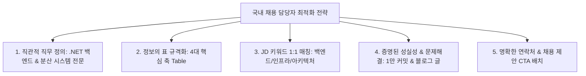

# 국내 채용 담당자 관점 GitHub 프로필 최적화 계획

---

## 1. 계획 개요

* **문서명**: 국내 채용 담당자 관점 GitHub 프로필 최적화 계획
* **작성 목적**:
  - 국내 IT/테크 기업의 **HR 채용 담당자, 헤드헌터, 테크 리드(Hiring Manager)**가 프로필을 열람했을 때, **30초 이내에 핵심 직무 적합성과 엔지니어링 역량을 확신**할 수 있도록 GitHub 프로필 구조와 콘텐츠를 전면 최적화함.
* **타깃 독자(Persona)**:
  1. **HR 채용 담당자 / 테크 리크루터**: 채용 공고(JD)의 자격 요건과 부합하는지 키워드, 직무, 연차, 정량적 성실성을 빠르게 스캔하는 1차 검토자.
  2. **테크 리드 / 개발 총괄**: 실제 아키텍처 설계 역량, 코드 품질, 문제 해결 깊이, 기술 공유 태도를 검증하는 실무 면접관.

---

## 2. 국내 채용 담당자의 평가 행동 패턴 및 페인포인트 분석

```
[ 국내 채용 담당자의 3단계 열람 행동 패턴 ]
┌─────────────────────────────────────────────────────────────────────────────┐
│ 1단계: 첫인상 스캔 (0~5초)                                                   │
│   → "이 사람의 주력 포지션이 무엇인가? (프론트? 백엔드? DevOps?)"           │
│   → 확인 요소: 프로필 사진, 한 줄 소개(Bio), 헤더 배너, 타이핑 키워드       │
├─────────────────────────────────────────────────────────────────────────────┤
│ 2단계: JD 매칭 및 정량 검증 (5~20초)                                        │
│   → "우리 회사가 찾는 스택(C#/.NET/DB/K8s)을 실제로 깊이 있게 썼는가?"    │
│   → "얼마나 성실하고 꾸준한가? (최근 1년 10,000+ 커밋 잔디의 압도감)"      │
│   → 확인 요소: 한국어 소개 표(About Me), 기술 스택 뱃지, 기여도 그래프      │
├─────────────────────────────────────────────────────────────────────────────┤
│ 3단계: 실무 깊이 및 인터뷰 연결 (20~40초)                                   │
│   → "어떤 프로젝트에서 어떤 아키텍처 결정을 내렸는가? 기술 글이 있는가?"    │
│   → 확인 요소: 주요 엔지니어링 프로젝트 표, 최근 블로그 포스트, 연락처 CTA │
└─────────────────────────────────────────────────────────────────────────────┘
```

### 2.1 기존(AS-IS) 영문/불릿 방식의 한계점
* **가독성 저하**: 영문 불릿 포인트 나열은 국내 HR 담당자가 핵심 정보(현재 소속, 전문 분야, 정량 성과)를 빠르게 추출하기 어려움.
* **난해한 기술어 나열**: 비즈니스 관점의 문제 해결 및 기여도가 드러나지 않아 '단순 개발자'로 오인될 위험.
* **행동 유도(Call-to-Action) 부재**: 채용 제안(이메일, 커피챗)이나 포트폴리오 원문으로 이어지는 유입 경로가 약함.

---

## 3. 국내 채용 담당자 맞춤형 프로필 개편 전략



### 3.1 전략 세부 항목
1. **명확한 한국어 직무 타이틀 고정**:
   * 모호한 표현 대신 `소프트웨어 엔지니어 | .NET 백엔드 & 분산 시스템`으로 포지션 단일화.
2. **소개 영역(About Me)의 4대 핵심 축 구조화**:
   * `[현재 소속 및 역할]`, `[핵심 아키텍처 철학]`, `[정량적 실적/생산성]`, `[지식 공유 & 문제 해결]`의 2단 테이블 체계 확립.
3. **국내 테크 채용 시장 우대 요건 적극 부각**:
   * 대규모 트랜잭션, Clean Architecture, CQRS, Rich Domain Model, GitOps, Kubernetes 등 시니어/리드급 우대 요건을 프로젝트 표에 명시.
4. **증명된 개발 밀도 (10,000+ Contributions)**:
   * "성실함"을 추상적 문구가 아닌 수치(연간 1만+ 커밋, 잔디 스네이크 애니메이션)로 즉시 각인.
5. **원클릭 연락망 및 기술 블로그 노출**:
   * 이메일, 티스토리 블로그, 링크드인으로 바로 이어지는 버튼형 뱃지 배치.

---

## 4. 상세 콘텐츠 명세 및 TO-BE 설계

### 4.1 상단 헤더 및 타이핑 텍스트 (한국어 중심)
* **상단 배너**:
  - 메인 텍스트: `Yegun Kim (김예건)`
  - 서브 텍스트: `소프트웨어 엔지니어 | .NET 백엔드 & 분산 시스템`
* **동적 타이핑 텍스트 (`Noto Sans KR` 폰트)**:
  - 1행: `견고한 .NET 백엔드 및 분산 시스템 구축`
  - 2행: `Clean Architecture & 도메인 주도 설계(DDD)`
  - 3행: `연간 10,000+ 커밋의 지속성과 높은 생산성`
  - 4행: `기술 블로그(ibocon.tistory.com)를 통한 지식 공유`

---

### 4.2 엔지니어 소개 테이블 (About Me)

| 구분 | 국내 채용 담당자 맞춤형 서술 내용 |
| :---: | :--- |
| **🏢 현재 소속 및 담당** | **MANGOSLAB** — 디바이스 연동 및 고가용성 소프트웨어 통합 플랫폼 개발 |
| **🧱 아키텍처 철학** | **Clean Architecture**, **CQRS**, **도메인 주도 설계(DDD)**를 실무에 적용하여 변경에 유연하고 테스트 가능한 구조 지향 |
| **⚡ 실적 및 개발 생산성** | 최근 1년간 **10,000+ Contributions** 달성 — 매일 지속적인 코드 개선과 TDD 기반의 검증 사이클 유지 |
| **✍️ 기술 공유 & 블로그** | 기술적 난제 해결 과정과 아키텍처 설계 고민을 [티스토리 블로그](https://ibocon.tistory.com)에 기록하고 공유 |

---

### 4.3 기술 스택 분류 (국내 채용 JD 기준 3대 카테고리)

1. **백엔드 및 코어 언어 (Core & Backend)**
   * `C#`, `.NET 9`, `Python`, `PostgreSQL`, `Redis`
   * *채용 연계 포인트: 최신 .NET 버전 이해도 및 고성능 RDBMS/캐시 활용 역량*
2. **아키텍처 및 플랫폼 (Architecture & Platform)**
   * `Clean Architecture`, `Docker`, `Kubernetes`, `GitOps (Flux)`
   * *채용 연계 포인트: MSA/분산 시스템 환경에서의 컨테이너 오케스트레이션 및 배포 자동화*
3. **품질 검증 및 관측성 (Testing & Observability)**
   * `xUnit (TDD)`, `GitHub Actions (CI/CD)`, `Seq (Structured Logging)`
   * *채용 연계 포인트: 테스트 자동화 및 분산 추적/로깅을 통한 프로덕션 안정성 관리*

---

### 4.4 주요 프로젝트 요약 표 (Key Projects)

국내 테크 리드가 가장 집중해서 확인하는 실무 프로젝트의 '역할'과 '기술적 깊이'를 일목요연하게 전달합니다.

| 프로젝트 | 시스템 성격 및 규모 | 담당 역할 및 핵심 기술 기여 |
| :--- | :--- | :--- |
| **Monolith** | 핵심 데스크톱 앱 및 백엔드 통합 플랫폼 | • Clean Architecture 수립 및 Result 패턴 도입<br>• MSBuild 가속 루프 구축으로 로컬 빌드 속도 대폭 개선<br>• xUnit 기반 단위/통합 테스트 스위트 표준화 |
| **Peony** | 이벤트 기반 트랜잭션 및 금융 가계부 백엔드 | • Milan Jovanović 원칙 기반 Rich Domain Model 리팩토링<br>• RabbitMQ 비동기 메시징 및 Outbox 패턴 구현<br>• 동시성 제어 및 멀티 디바이스 데이터 정합성 보장 |
| **Garden.Cluster** | 온프레미스 & 클라우드 쿠버네티스 인프라 | • Flux v2 기반 선언적 GitOps 파이프라인 구축<br>• OpenBao 기반 시크릿 자동화 및 보안 거버넌스 수립<br>• Seq 기반 통합 관측성 및 모니터링 환경 구축 |

---

### 4.5 최근 블로그 글 & 채용 제안 컨택 영역

* **블로그 최신 글 (자동화)**:
  - 티스토리 RSS 기반으로 최신 글 5개가 자동 노출되어, 평소 기술적 고민의 깊이와 커뮤니케이션 역량을 자연스럽게 증명.
* **컨택 포인트 (Call-To-Action)**:
  - `이메일(wlfka102@gmail.com)`, `티스토리(ibocon.tistory.com)`, `LinkedIn` 뱃지를 최하단에 배치하여 즉각적인 채용 문의 유도.

---

## 5. 단계별 적용 및 유지보수 계획

| 단계 | 추진 과제 | 세부 실행 내용 |
| :---: | :--- | :--- |
| **Step 1** | README 마크다운 반영 | 한국어 소개 테이블 및 섹션 타이틀 적용 완료 |
| **Step 2** | 타이핑 SVG 한글 최적화 | `Noto Sans KR` 폰트 및 한국어 롤링 문구 세팅 |
| **Step 3** | 블로그 자동 갱신 파이프라인 검증 | 매일 자정 RSS 크롤링 정상 동작 여부 모니터링 |
| **Step 4** | 채용 시즌 맞춤형 링크 연계 | 노션 상세 이력서 또는 이력서 PDF 다운로드 링크 추가 검토 |

---

## 6. 기대 효과

1. **서류 통과율 향상**: 국내 IT 기업 채용 담당자가 스크롤 1회 내에 지원자의 **포지션, 주력 기술, 실무 아키텍처 수준, 개발 성실도**를 완벽하게 파악.
2. **기술 면접 질문 주도**: 프로젝트 표에 기재된 명확한 아키텍처 키워드(CQRS, Outbox, GitOps, Clean Architecture)를 바탕으로 지원자가 자신 있는 주제로 기술 면접을 유도.
3. **엔지니어 신뢰도 극대화**: 텍스트 주장뿐만 아니라 연간 1만 커밋 잔디, 오픈소스 이슈 제보, 기술 블로그 글이 3중으로 뒷받침되어 대체 불가능한 시니어급 인재로 포지셔닝.
