# 🏛️ 전략 5 — 노션 이력서 도메인별 계층 구조 (폴더 트리 모델) 설계서

---

## 1. 개요 및 배경

* **문서명**: 전략 5 — 노션 이력서 도메인별 계층 구조 (폴더 트리 모델) 설계서
* **작성자**: 김예건 ([@ibocon](https://github.com/ibocon) / `wlfka102@gmail.com`)
* **관리 위치**: `docs/portfolio/strategy/plan-strategy-05-notion-domain-hierarchy-architecture.md` (Local SoT)
* **목표 Notion 메인**: [📄 이력서 — 김예건](https://app.notion.com/p/3dd475218675811299b0e3d6b2baa43d)
* **대원칙 선언**:
  > **"최상위 폴더 자체를 '프로젝트 단위'로 구성하는 것은 완전 금지(Anti-Pattern)한다."**  
  > 채용 담당자(HR 리크루터, 테크 리드)에게 `Monolith`, `Argon`, `Peony`, `Lithium` 같은 사내/개인 프로젝트 이름은 사전 지식이 없어 생소하고 난해한 암호일 뿐입니다.  
  > 따라서 **최상위 폴더는 100% 채용 시장에서 통용되는 '기술 도메인 / 직무 전문성 / 엔지니어링 영역(Domain-First)'**으로만 구성하며, 프로젝트명은 하위 상세 페이지의 보조 식별자로만 사용합니다.

---

## 2. 핵심 설계 원칙 및 사용자 피드백 반영 이력

```text
[ 채용 담당자 관점의 핵심 설계 원칙 ]
1. 최상위 프로젝트명 배치 절대 금지 (Domain-First)
   - 최상위 폴더는 채용 공고(JD) 및 업계 표준 직무 명칭(백엔드, 인프라, 디자인시스템, DevEx 등)으로만 정의.
   - 프로젝트명(Monolith, Argon, Peony 등)은 하위 문서 제목의 괄호 병기로만 한정.
2. 하위 페이지 명명 규약 (Role-First Title Rule)
   - 하위 페이지 역시 프로젝트명 단독 표기(예: 'Monolith')를 금지.
   - 반드시 '[직무/기술 역할] — 핵심 성과 및 스택 (프로젝트명)' 형식으로 작성.
   - 예: '[백엔드 · 모노레포] .NET 9 서비스 통합 & YARP API GW (Monolith)'
3. Peony와 Garden 생태계의 도메인별 프로젝트 단위 분산
   - Peony는 단순 백엔드가 아니라 백엔드 마이크로서비스 9종, .NET MAUI 모바일 앱, K8s 인프라, 디자인 시스템, AI 하네스가 망라된 복합 생태계임.
   - Peony를 백엔드 단일 페이지로 축소하지 않고, 각 도메인 레이어에서 '독립 프로젝트 단위'로 분리 서술.
4. Garden.Razor & Penpot 디자인 시스템 정식 도메인 편입
   - 오픈소스 디자인 도구 Penpot과 C# Blazor/Razor 컴포넌트 라이브러리(Garden.Razor), 컴포넌트 갤러리를 연동한 디자인 시스템 구축 실적을 독립 도메인/프로젝트로 명시.
5. 비선호 기술(Flutter) 완전 제외
   - 모바일은 Lithium 중심의 무선 하드웨어 연동 및 BLE 패킷 최적화에 집중.
6. 과장 표현 배제 및 실증적 근거 중심 서술 (Fact-Only)
   - 근거가 확인되지 않은 정량 수치나 호들갑스러운 수식어(예: '글로벌 50만 대 제어', '100TB급 Rook-Ceph' 등)는 이력서 전체의 신뢰성을 급격히 하락시키므로 엄격히 배제.
   - 코드, 커밋, 아키텍처 설계서로 즉시 검증 가능한 사실(예: 'WYSIWYG 인쇄 엔진 & .NET 9 현대화', '하이브리드 K8s(Proxmox·AKS) 클러스터 구성')만 기재.
```

### 2.1 절대 금지 안티패턴(Anti-Pattern) 및 폐기 사유 기록 (재발 방지)

과거 검토 과정에서 제기되었으나 채용 공학적 관점에서 심각한 결함이 확인되어 **영구 폐기 및 금지된 안티패턴**을 기록합니다. 향후 어떠한 이력서 개편에서도 동일한 실수를 반복하지 않도록 합니다.

| 폐기된 안티패턴 모델 | 설계 내용 | 폐기 및 절대 금지 사유 |
| :--- | :--- | :--- |

```mermaid
graph TD
    Root[이력서 김예건 메인]

    D1[01 .NET 백엔드 엔지니어링]
    D2[02 소프트웨어 아키텍처]
    D3[03 DevOps 엔지니어링]
    D4[04 클라우드 및 온프레미스 인프라]
    D5[05 개발자 경험]
    D6[06 웹 디자인 시스템]
    D7[07 Windows 데스크톱 애플리케이션]
    D8[08 시스템 프로그래밍]
    D9[09 모바일 애플리케이션]

    Root --> D1
    Root --> D2
    Root --> D3
    Root --> D4
    Root --> D5
    Root --> D6
    Root --> D7
    Root --> D8
    Root --> D9

    subgraph 도메인 1 백엔드 상세
        D1 --> P1_1[백엔드 서비스 Monolith]
        D1 --> P1_2[AI 백엔드 NemonicStudy]
    end

    subgraph 도메인 2 아키텍처 상세
        D2 --> P2_1[분산 아키텍처 Outbox 가계부 Peony]
        D2 --> P2_2[공통 아키텍처 계층 Garden.Share]
    end

    subgraph 도메인 3 DevOps 상세
        D3 --> P3_1[GitOps 배포 및 사이트 전환 Argon]
        D3 --> P3_2[CI CD 컨테이너 퍼블리시 Pipeline]
    end

    subgraph 도메인 4 인프라 상세
        D4 --> P4_1[하이브리드 K8s 클러스터 Garden.Cluster]
    end

    subgraph 도메인 5 개발자 경험 상세
        D5 --> P5_1[AI 에이전트 하네스 Garden.Harness]
        D5 --> P5_2[Roslyn 정적 애널라이저 Garden.Analyzers]
    end

    subgraph 도메인 6 웹 디자인 시스템 상세
        D6 --> P6_1[Penpot 토큰 동기화 컴포넌트 Garden.Razor]
        D6 --> P6_2[Blazor WASM 컴포넌트 갤러리 Garden.Razor.Gallery]
    end

    subgraph 도메인 7 데스크톱 상세
        D7 --> P7_1[데스크톱 클라이언트 nemonic Desktop]
    end

    subgraph 도메인 8 시스템 프로그래밍 상세
        D8 --> P8_1[USB BLE 드라이버 프로토콜 SDK Mango Garden]
    end

    subgraph 도메인 9 모바일 상세
        D9 --> P9_1[모바일 가계부 앱 Peony Mobile]
        D9 --> P9_2[모바일 라벨러 앱 Lithium]
    end
```

| **⛔ 안티패턴 A**<br>`5대 프로젝트 단위 최상위 폴더 모델` | 최상위 폴더를 `[Monolith]`, `[Argon]`, `[Peony]` 등 사내 프로젝트 단위로 구성하고 하위에 도메인 기술 | **1. 채용 담당자의 인지 장벽 극대화**: 외부 리크루터나 테크 리드는 지원자의 사내 코드명에 대한 배경지식이 전무하여 암호처럼 느껴짐.<br>**2. 10초 스캔 실패**: 채용 담당자가 찾는 것은 "백엔드 개발자인가? 인프라 엔지니어인가?"이지 프로젝트명이 아님.<br>**3. JD 매칭 불가능**: 채용 공고의 자격 요건 키워드와 최상위 폴더가 매칭되지 않아 1차 서류 탈락 위험 초래. |
| **⛔ 안티패턴 B**<br>`회사 vs 자체 플랫폼 2대 축 분리형` | 최상위 폴더를 `01. 엔터프라이즈(MANGOSLAB)`와 `02. 자체 플랫폼(BotanicSoft)`으로 양분 | **1. 지원자 중심의 편의적 분류**: 공급 주체(회사/개인)를 가르는 것은 지원자 개인의 관점일 뿐, 채용 담당자의 관심사가 아님.<br>**2. 기술 전문성 파편화**: 동일한 백엔드/인프라 역량이 회사 폴더와 자체 플랫폼 폴더로 양분되어 역량의 총량이 분산되어 보임. |
| **⛔ 안티패턴 C**<br>`근거 없는 수치 부풀리기 및 과장형 제목` | 확인된 근거 없이 `[데스크톱 클라이언트] 글로벌 50만 대 제어 & .NET 9 현대화 (nemonic)`, `100TB급 Rook-Ceph`, `전사 빌드 70% 단축`, `400개 테이블`처럼 제어 대수·용량·성능 개선율을 호들갑스럽게 부풀려 표기 | **1. 이력서 전체 신뢰성 급락**: 과장된 표현이 단 하나라도 발견되면 지원자가 실제로 달성한 다른 모든 엔지니어링 성과까지 신뢰를 잃게 됨.<br>**2. 기술 면접 역검증 리스크**: 면접관이 수치 산출 근거와 실측 데이터를 질문했을 때 입증하지 못하면 치명적 결격 사유로 작용함.<br>**3. 사실 기반 원칙 위배**: 근거가 없으면 부풀리지 않고 `WYSIWYG 인쇄 엔진 & .NET 9 현대화`, `하이브리드 K8s(Proxmox·AKS) 클러스터 구성`처럼 코드와 커밋으로 검증된 사실만 기술해야 함. |



---

## 3. 최상위 도메인 중심 노션 폴더 구조 및 최종 채택안

> **공식 채택 결정**:  
> 복합 도메인(`백엔드 & 아키텍처`, `DevOps & 인프라`, `DevEx & 웹 디자인 시스템`, `Windows 데스크톱 & 시스템 프로그래밍`, `모바일 & BLE`)이 두 개 이상의 직무 책임을 혼합하는 문제를 해결하기 위해, **단일 책임 원칙(SRP)에 기반한 9대 원자적 도메인 모델**을 최종 표준안으로 공식 채택합니다.  
> 특히 **BLE 디바이스 연동**은 모바일에서 분리하여 Win32·GDI+·USB 드라이버와 함께 **`08. 시스템 프로그래밍`**에 편입하고, **`09. 모바일 애플리케이션`**은 모바일 앱 단독 도메인으로 구성합니다.

---

### [최종 확정 채택안] 9대 단일 책임(SRP) 도메인 분리형 — ⭐ **최종 확정**
> **특징**: 각 최상위 폴더가 오직 하나의 직무/기술 영역만 담당하도록 9개 원자적 도메인으로 분리하고, BLE 하드웨어 통신을 시스템 프로그래밍 도메인으로 응집시킨 구조.

```text
├── 📁 01. .NET 백엔드 엔지니어링 (ASP.NET Core, YARP, PostgreSQL, Redis)
│   ├── 📄 [백엔드 서비스] .NET 9 서비스 통합 & YARP API GW (Monolith)
│   └── 📄 [AI 백엔드] 비동기 잡 큐 & OCR/요약 마이크로서비스 (NemonicStudy)
│
├── 📁 02. 소프트웨어 아키텍처 (Clean Architecture, DDD, CQRS, VSA)
│   ├── 📄 [분산 아키텍처] RabbitMQ & Outbox 패턴 가계부 서비스 (Peony)
│   └── 📄 [공통 아키텍처 계층] 자체 Mediator · Result 패턴 · 도메인 이벤트 기반 (Garden.Share)
│
├── 📁 03. DevOps 엔지니어링 (Flux GitOps, CI/CD, Container Release)
│   ├── 📄 [GitOps 배포] Flux v2 멀티 클러스터 배포 & Active-Standby 전환 계약 (Argon)
│   └── 📄 [CI/CD 파이프라인] GitHub Actions 컨테이너 퍼블리시 & 자체 호스팅 러너 (Pipeline)
│
├── 📁 04. 클라우드 및 온프레미스 인프라 (Kubernetes, Proxmox, Rook-Ceph, OpenBao)
│   ├── 📄 [클러스터 인프라] Proxmox VE & Azure AKS 하이브리드 클러스터 운영 (Garden.Cluster)
│   └── 📄 [데이터 · 보안 제어면] Rook-Ceph 스토리지 · CloudNativePG · OpenBao 시크릿 (Infra)
│
├── 📁 05. 개발자 경험 (DevEx, AI Agent Harness, Roslyn Analyzer)
│   ├── 📄 [AI 에이전트 하네스] 4대 코딩 에이전트 공통 규약 & 정적 가드 (Garden.Harness)
│   └── 📄 [정적 분석기] Roslyn 커스텀 애널라이저 7종 & 코드픽스 (Garden.Analyzers)
│
├── 📁 06. 웹 디자인 시스템 (Penpot, Blazor, Material 3, SCSS Tokens)
│   ├── 📄 [디자인 시스템] Penpot 토큰 동기화 Material 3 Blazor 컴포넌트 44종 (Garden.Razor)
│   └── 📄 [컴포넌트 갤러리] Blazor WebAssembly 인터랙티브 UI 갤러리 (Garden.Razor.Gallery)
│
├── 📁 07. Windows 데스크톱 애플리케이션 (.NET 9, WinForms, WPF, MVVM)
│   └── 📄 [데스크톱 클라이언트] WYSIWYG 인쇄 엔진 & .NET 9 현대화 (nemonic Desktop)
│
├── 📁 08. 시스템 프로그래밍 (Win32, GDI+, USB, BLE 디바이스 연동)
│   ├── 📄 [USB · BLE 드라이버] WinUSB · WebUSB · 5계층 BLE 프로토콜 추상화 SDK (Mango & Garden)
│   └── 📄 [BLE 디바이스 제어] 프린터 상태 폴링 경합 해소 & GDI DC 핸들 제어 (Device Interop)
│
└── 📁 09. 모바일 애플리케이션 (.NET MAUI, Xamarin.Forms, Android, iOS)
    ├── 📄 [모바일 가계부 앱] .NET MAUI Blazor Hybrid 크로스플랫폼 클라이언트 (Peony Mobile)
    └── 📄 [모바일 라벨러 앱] FINECUBE Android · iOS 앱 유지보수 및 targetSdk 34 상향 (Lithium)
```

---

### [대안 A] JD 키워드 4대 직무 정밀 압축형 (4영역 슬림 모델)
> **특징**: 4개 대분류 틀을 유지하되 실제 JD의 핵심 필수/우대 키워드를 앞단 15자 이내로 전진 배치하고 말줄임을 방어한 모델.

```text
├── 📁 01. .NET 백엔드 & 분산 아키텍처 (.NET 9, Clean Arch, CQRS)
│   ├── 📄 [전사 백엔드] .NET 9 모듈 모노레포 & API GW (Monolith)
│   ├── 📄 [분산 메시징] RabbitMQ & Outbox CQRS 가계부 (Peony Backend)
│   └── 📄 [AI 파이프라인] 비동기 잡 큐 & OCR 마이크로서비스 (NemonicStudy)
│
├── 📁 02. DevOps & 클라우드 인프라 (K8s, GitOps, Ceph, DevEx)
│   ├── 📄 [K8s GitOps] 온프레미스 듀얼 사이트 DR 오케스트레이션 (Argon)
│   ├── 📄 [클러스터 GitOps] 하이브리드 K8s(Proxmox·AKS) 운영 (Garden.Cluster)
│   └── 📄 [DevEx 거버넌스] Roslyn 애널라이저 & 4대 AI 에이전트 하네스 (Garden.Harness)
│
├── 📁 03. Windows 데스크톱 & 시스템 제어 (C#, WPF, Win32, USB)
│   ├── 📄 [데스크톱 클라이언트] WYSIWYG 인쇄 엔진 & .NET 9 현대화 (nemonic)
│   └── 📄 [디바이스 드라이버] OS 독립형 USB/Bluetooth 통신 SDK (Mango)
│
└── 📁 04. 모바일 & 웹 프론트엔드 (BLE IoT, MAUI, Penpot 디자인)
    ├── 📄 [모바일 클라이언트] .NET MAUI 가계부 앱 (Peony Mobile)
    ├── 📄 [하드웨어 연동 앱] FINECUBE 컬러 라벨 앱 & BLE 연동 (Lithium)
    └── 📄 [웹 디자인 시스템] Penpot 토큰 동기화 Razor 컴포넌트 (Garden.Razor)
```

---

### [대안 C] 4대 시스템 토폴로지형 (서버사이드 2축 vs 엣지 디바이스 2축)
> **특징**: 백엔드와 인프라/플랫폼(서버사이드) 2개 폴더와 데스크톱/디바이스와 모바일(엔드포인트 엣지) 2개 폴더로 물리적 레이어를 2:2 대칭으로 맞춘 모델.

```text
├── 📁 01. 백엔드 서비스 & 분산 시스템 (Core Application Services)
│   ├── 📄 [전사 백엔드] .NET 9 통합 모듈 모노레포 & YARP API GW (Monolith)
│   ├── 📄 [분산 메시징] 이벤트 주도 CQRS 가계부 마이크로서비스 (Peony Backend)
│   └── 📄 [AI 파이프라인] 비동기 OCR/요약 분산 처리 파이프라인 (NemonicStudy)
│
├── 📁 02. 클라우드 플랫폼 & 엔지니어링 거버넌스 (Infra, Storage, DevEx)
│   ├── 📄 [K8s GitOps] 온프레미스 듀얼 사이트 K8s & Rook-Ceph 스토리지 (Argon/Cluster)
│   ├── 📄 [엔지니어링 거버넌스] AI 코딩 에이전트 하네스 & Roslyn 정적 가드 (Garden.Harness)
│   └── 📄 [웹 디자인 시스템] Penpot 토큰 동기화 Blazor 컴포넌트 라이브러리 (Garden.Razor)
│
├── 📁 03. 데스크톱 & 하드웨어 제어 시스템 (Desktop & Device Systems)
│   ├── 📄 [데스크톱 클라이언트] Windows 인쇄 엔진 — 8년 수명주기 & .NET 9 현대화 (nemonic)
│   └── 📄 [디바이스 드라이버] OS 독립형 USB/Bluetooth 통합 드라이버 SDK (Mango)
│
└── 📁 04. 모바일 & 무선 IoT 애플리케이션 (Mobile & Wireless IoT)
    ├── 📄 [모바일 클라이언트] .NET MAUI Blazor Hybrid 크로스플랫폼 앱 (Peony Mobile)
    └── 📄 [하드웨어 연동 앱] FINECUBE 컬러 라벨 앱 & BLE 통신 경합 해소 (Lithium)
```

---

## 4. 도메인 허브 페이지(상위 폴더) 표준 템플릿 명세

각 도메인 상위 페이지는 채용 담당자에게 **전문 분야의 스케일과 비즈니스 가치**를 30초 내에 전달할 수 있도록 아래 표준 템플릿으로 구성합니다.

### 4.1 허브 페이지 레이아웃
1. **Header Block**: 도메인 명칭 및 영문 표기, 핵심 역할 요약
2. **Executive Summary Table**:
   - `[주요 기술 스택]`, `[해결한 핵심 엔지니어링 난제]`, `[검증된 정량 지표 (근거 필수)]`, `[포괄 프로젝트 수]`
3. **Architecture Philosophy (철학)**:
   - 해당 도메인 개발 시 준수하는 원칙 (예: 백엔드의 경우 Clean Architecture & Event-Driven, 인프라의 경우 GitOps & Zero-Downtime, 디자인 시스템의 경우 Single Token SoT)
4. **Project Gallery Grid (하위 프로젝트 링크 카드)**:
   - 각 하위 상세 페이지로 연결되는 링크 카드 (배경 이미지, 프로젝트 명, 핵심 기술, 기간 포함)

---

## 5. 9대 단일 책임 도메인별 프로젝트 매핑표

| 도메인 계층 (9대 단일 책임 도메인) | 대표 상세 페이지 (TO-BE) |
| :--- | :--- |
| **01. .NET 백엔드 엔지니어링** | 1. [백엔드 서비스] .NET 9 서비스 통합 & YARP API GW (Monolith)<br>2. [AI 백엔드] 비동기 잡 큐 & OCR/요약 마이크로서비스 (NemonicStudy) |
| **02. 소프트웨어 아키텍처** | 1. [분산 아키텍처] RabbitMQ & Outbox 패턴 가계부 서비스 (Peony)<br>2. [공통 아키텍처 계층] 자체 Mediator · Result 패턴 · 도메인 이벤트 기반 (Garden.Share) |
| **03. DevOps 엔지니어링** | 1. [GitOps 배포] Flux v2 멀티 클러스터 배포 & Active-Standby 전환 계약 (Argon)<br>2. [CI/CD 파이프라인] GitHub Actions 컨테이너 퍼블리시 & 자체 호스팅 러너 |
| **04. 클라우드 및 온프레미스 인프라** | 1. [클러스터 인프라] Proxmox VE & Azure AKS 하이브리드 클러스터 운영 (Garden.Cluster)<br>2. [데이터 · 보안 제어면] Rook-Ceph 스토리지 · CloudNativePG · OpenBao 시크릿 |
| **05. 개발자 경험 (DevEx)** | 1. [AI 에이전트 하네스] 4대 코딩 에이전트 공통 규약 & 정적 가드 (Garden.Harness)<br>2. [정적 분석기] Roslyn 커스텀 애널라이저 7종 & 코드픽스 (Garden.Analyzers) |
| **06. 웹 디자인 시스템** | 1. [디자인 시스템] Penpot 토큰 동기화 Material 3 Blazor 컴포넌트 44종 (Garden.Razor)<br>2. [컴포넌트 갤러리] Blazor WebAssembly 인터랙티브 UI 갤러리 (Garden.Razor.Gallery) |
| **07. Windows 데스크톱 애플리케이션** | 1. [데스크톱 클라이언트] WYSIWYG 인쇄 엔진 & .NET 9 현대화 (nemonic Desktop) |
| **08. 시스템 프로그래밍** | 1. [USB · BLE 드라이버] WinUSB · WebUSB · 5계층 BLE 프로토콜 추상화 SDK (Mango & Garden) |
| **09. 모바일 애플리케이션** | 1. [모바일 가계부 앱] .NET MAUI Blazor Hybrid 크로스플랫폼 클라이언트 (Peony Mobile)<br>2. [모바일 라벨러 앱] FINECUBE Android · iOS 앱 유지보수 및 targetSdk 34 상향 (Lithium) |

---

## 6. 기대 효과 및 채용 경쟁력

1. **단일 책임 원칙(SRP) 기반의 도메인 명확성**:
   - 노션 사이드바에서 두 개 이상의 직무가 묶이지 않고 **`01. 백엔드`, `02. 아키텍처`, `03. DevOps`, `04. 인프라`, `05. 개발자 경험`, `06. 웹 디자인 시스템`, `07. Windows 데스크톱`, `08. 시스템 프로그래밍`, `09. 모바일`**로 각각 분리되어 원하는 영역만 정확히 열람 가능.
2. **BLE 하드웨어 연동의 시스템 프로그래밍 응집**:
   - Win32/GDI+/WinUSB와 BLE GATT 프로토콜 제어를 `08. 시스템 프로그래밍`으로 통합하고, `09. 모바일 애플리케이션`은 모바일 클라이언트 단독으로 분리하여 각 영역의 전문성이 명확해짐.
3. **Peony 및 Garden 생태계의 온전한 가치 전달**:
   - Peony와 Garden의 구성 요소가 9개 도메인 산하의 독립 프로젝트 단위로 정밀하게 배치됨.
