```mermaid
graph TD
    Root[이력서 김예건 메인]

    D1[01 .NET 백엔드 엔지니어링]
    D2[02 소프트웨어 아키텍처]
    D3[03 DevOps 엔지니어링]
    D4[04 클라우드 및 온프레미스 인프라]
    D5[05 개발자 경험]
    D6[06 웹 디자인 시스템]
    D7[07 Windows 데스크톱 애플리케이션]
    D8[08 시스템 프로그래밍]
    D9[09 모바일 애플리케이션]

    Root --> D1
    Root --> D2
    Root --> D3
    Root --> D4
    Root --> D5
    Root --> D6
    Root --> D7
    Root --> D8
    Root --> D9

    subgraph 도메인 1 백엔드 상세
        D1 --> P1_1[백엔드 서비스 Monolith]
        D1 --> P1_2[AI 백엔드 NemonicStudy]
    end

    subgraph 도메인 2 아키텍처 상세
        D2 --> P2_1[분산 아키텍처 Outbox 가계부 Peony]
        D2 --> P2_2[공통 아키텍처 계층 Garden.Share]
    end

    subgraph 도메인 3 DevOps 상세
        D3 --> P3_1[GitOps 배포 및 사이트 전환 Argon]
        D3 --> P3_2[CI CD 컨테이너 퍼블리시 Pipeline]
    end

    subgraph 도메인 4 인프라 상세
        D4 --> P4_1[하이브리드 K8s 클러스터 Garden.Cluster]
    end

    subgraph 도메인 5 개발자 경험 상세
        D5 --> P5_1[AI 에이전트 하네스 Garden.Harness]
        D5 --> P5_2[Roslyn 정적 애널라이저 Garden.Analyzers]
    end

    subgraph 도메인 6 웹 디자인 시스템 상세
        D6 --> P6_1[Penpot 토큰 동기화 컴포넌트 Garden.Razor]
        D6 --> P6_2[Blazor WASM 컴포넌트 갤러리 Garden.Razor.Gallery]
    end

    subgraph 도메인 7 데스크톱 상세
        D7 --> P7_1[데스크톱 클라이언트 nemonic Desktop]
    end

    subgraph 도메인 8 시스템 프로그래밍 상세
        D8 --> P8_1[USB BLE 드라이버 프로토콜 SDK Mango Garden]
    end

    subgraph 도메인 9 모바일 상세
        D9 --> P9_1[모바일 가계부 앱 Peony Mobile]
        D9 --> P9_2[모바일 라벨러 앱 Lithium]
    end
```

# 🏛️ 전략 5 — 노션 이력서 도메인별 계층 구조 (폴더 트리 모델) 설계서

---

## 1. 개요 및 배경

* **문서명**: 전략 5 — 노션 이력서 도메인별 계층 구조 (폴더 트리 모델) 설계서
* **작성자**: 김예건 ([@ibocon](https://github.com/ibocon) / `wlfka102@gmail.com`)
* **관리 위치**: `docs/portfolio/strategy/plan-strategy-05-notion-domain-hierarchy-architecture.md` (Local SoT)
* **목표 Notion 메인**: [📄 이력서 — 김예건](https://app.notion.com/p/3dd475218675811299b0e3d6b2baa43d)
* **대원칙 선언**:
  > **"최상위 폴더 자체를 '프로젝트 단위'로 구성하는 것은 완전 금지(Anti-Pattern)한다."**  
  > 채용 담당자(HR 리크루터, 테크 리드)에게 `Monolith`, `Argon`, `Peony`, `Lithium` 같은 사내/개인 프로젝트 이름은 사전 지식이 없어 생소하고 난해한 암호일 뿐입니다.  
  > 따라서 **최상위 폴더는 100% 채용 시장에서 통용되는 '기술 도메인 / 직무 전문성 / 엔지니어링 영역(Domain-First)'**으로만 구성하며, 프로젝트명은 하위 상세 페이지의 보조 식별자로만 사용합니다.

---

## 2. 핵심 설계 원칙 및 사용자 피드백 반영 이력

```text
[ 채용 담당자 관점의 핵심 설계 원칙 ]
1. 최상위 프로젝트명 배치 절대 금지 (Domain-First)
   - 최상위 폴더는 채용 공고(JD) 및 업계 표준 직무 명칭(백엔드, 인프라, 디자인시스템, DevEx 등)으로만 정의.
   - 프로젝트명(Monolith, Argon, Peony 등)은 하위 문서 제목의 괄호 병기로만 한정.
2. 하위 페이지 명명 규약 (Role-First Title Rule)
   - 하위 페이지 역시 프로젝트명 단독 표기(예: 'Monolith')를 금지.
   - 반드시 '[직무/기술 역할] — 핵심 성과 및 스택 (프로젝트명)' 형식으로 작성.
   - 예: '[백엔드 · 모노레포] .NET 9 서비스 통합 & YARP API GW (Monolith)'
3. Peony와 Garden 생태계의 도메인별 프로젝트 단위 분산
   - Peony는 단순 백엔드가 아니라 백엔드 마이크로서비스 9종, .NET MAUI 모바일 앱, K8s 인프라, 디자인 시스템, AI 하네스가 망라된 복합 생태계임.
   - Peony를 백엔드 단일 페이지로 축소하지 않고, 각 도메인 레이어에서 '독립 프로젝트 단위'로 분리 서술.
4. Garden.Razor & Penpot 디자인 시스템 정식 도메인 편입
   - 오픈소스 디자인 도구 Penpot과 C# Blazor/Razor 컴포넌트 라이브러리(Garden.Razor), 컴포넌트 갤러리를 연동한 디자인 시스템 구축 실적을 독립 도메인/프로젝트로 명시.
5. 비선호 기술(Flutter) 완전 제외
   - 모바일은 Lithium 중심의 무선 하드웨어 연동 및 BLE 패킷 최적화에 집중.
6. 과장 표현 배제 및 실증적 근거 중심 서술 (Fact-Only)
   - 근거가 확인되지 않은 정량 수치나 호들갑스러운 수식어(예: '글로벌 50만 대 제어', '100TB급 Rook-Ceph' 등)는 이력서 전체의 신뢰성을 급격히 하락시키므로 엄격히 배제.
   - 코드, 커밋, 아키텍처 설계서로 즉시 검증 가능한 사실(예: 'WYSIWYG 인쇄 엔진 & .NET 9 현대화', '하이브리드 K8s(Proxmox·AKS) 클러스터 구성')만 기재.
```

### 2.1 절대 금지 안티패턴(Anti-Pattern) 및 폐기 사유 기록 (재발 방지)

과거 검토 과정에서 제기되었으나 채용 공학적 관점에서 심각한 결함이 확인되어 **영구 폐기 및 금지된 안티패턴**을 기록합니다. 향후 어떠한 이력서 개편에서도 동일한 실수를 반복하지 않도록 합니다.

| 폐기된 안티패턴 모델 | 설계 내용 | 폐기 및 절대 금지 사유 |
| :--- | :--- | :--- |
| **⛔ 안티패턴 A**<br>`5대 프로젝트 단위 최상위 폴더 모델` | 최상위 폴더를 `[Monolith]`, `[Argon]`, `[Peony]` 등 사내 프로젝트 단위로 구성하고 하위에 도메인 기술 | **1. 채용 담당자의 인지 장벽 극대화**: 외부 리크루터나 테크 리드는 지원자의 사내 코드명에 대한 배경지식이 전무하여 암호처럼 느껴짐.<br>**2. 10초 스캔 실패**: 채용 담당자가 찾는 것은 "백엔드 개발자인가? 인프라 엔지니어인가?"이지 프로젝트명이 아님.<br>**3. JD 매칭 불가능**: 채용 공고의 자격 요건 키워드와 최상위 폴더가 매칭되지 않아 1차 서류 탈락 위험 초래. |
| **⛔ 안티패턴 B**<br>`회사 vs 자체 플랫폼 2대 축 분리형` | 최상위 폴더를 `01. 엔터프라이즈(MANGOSLAB)`와 `02. 자체 플랫폼(BotanicSoft)`으로 양분 | **1. 지원자 중심의 편의적 분류**: 공급 주체(회사/개인)를 가르는 것은 지원자 개인의 관점일 뿐, 채용 담당자의 관심사가 아님.<br>**2. 기술 전문성 파편화**: 동일한 백엔드/인프라 역량이 회사 폴더와 자체 플랫폼 폴더로 양분되어 역량의 총량이 분산되어 보임. |
| **⛔ 안티패턴 C**<br>`근거 없는 수치 부풀리기 및 과장형 제목` | 확인된 근거 없이 `[데스크톱 클라이언트] 글로벌 50만 대 제어 & .NET 9 현대화 (nemonic)`, `100TB급 Rook-Ceph`, `전사 빌드 70% 단축`, `400개 테이블`처럼 제어 대수·용량·성능 개선율을 호들갑스럽게 부풀려 표기 | **1. 이력서 전체 신뢰성 급락**: 과장된 표현이 단 하나라도 발견되면 지원자가 실제로 달성한 다른 모든 엔지니어링 성과까지 신뢰를 잃게 됨.<br>**2. 기술 면접 역검증 리스크**: 면접관이 수치 산출 근거와 실측 데이터를 질문했을 때 입증하지 못하면 치명적 결격 사유로 작용함.<br>**3. 사실 기반 원칙 위배**: 근거가 없으면 부풀리지 않고 `WYSIWYG 인쇄 엔진 & .NET 9 현대화`, `하이브리드 K8s(Proxmox·AKS) 클러스터 구성`처럼 코드와 커밋으로 검증된 사실만 기술해야 함. |



---

## 3. 최상위 도메인 중심 노션 폴더 구조 및 최종 채택안

> **공식 채택 결정**:  
> 복합 도메인(`백엔드 & 아키텍처`, `DevOps & 인프라`, `DevEx & 웹 디자인 시스템`, `Windows 데스크톱 & 시스템 프로그래밍`, `모바일 & BLE`)이 두 개 이상의 직무 책임을 혼합하는 문제를 해결하기 위해, **단일 책임 원칙(SRP)에 기반한 9대 원자적 도메인 모델**을 최종 표준안으로 공식 채택합니다.  
> 특히 **BLE 디바이스 연동**은 모바일에서 분리하여 Win32·GDI+·USB 드라이버와 함께 **`08. 시스템 프로그래밍`**에 편입하고, **`09. 모바일 애플리케이션`**은 모바일 앱 단독 도메인으로 구성합니다.

---

### [최종 확정 채택안] 10대 단일 책임(SRP) 도메인 분리형 (Top-Down 아키텍처 위계) — ⭐ **최종 확정**
> **특징**: 각 최상위 폴더가 오직 하나의 직무/기술 영역만 담당하도록 10개 원자적 도메인으로 분리하고, 추상적인 아키텍처(`01`)와 백엔드(`02`)에서 시작해 인프라(`03`) → DevOps(`04`) → 개발자 경험(`05`) → 하네스 엔지니어링(`06`) → 웹 디자인 시스템(`07`) → 모바일(`08`) → 데스크톱(`09`) → 저수준 시스템 프로그래밍(`10`)으로 이어지는 Top-Down 위계 구조.

```text
├── 📁 01. 소프트웨어 아키텍처
│   ├── 📄 01.01. 계층 분리와 모듈화 설계
│   ├── 📄 01.02. 도메인 모델링과 불변식 보호
│   ├── 📄 01.03. 비동기 이벤트 기반 분산 설계
│   └── 📄 01.04. 다층 테스트 아키텍처와 통합 검증
│
├── 📁 02. .NET 백엔드 엔지니어링
│   ├── 📄 02.01. 클라우드 프린팅 모노레포 백엔드 및 API 게이트웨이
│   ├── 📄 02.02. 가계부 마이크로서비스 백엔드 및 BFF
│   ├── 📄 02.03. 비동기 OCR 및 AI 요약 파이프라인 백엔드
│   ├── 📄 02.04. 분산 애플리케이션 호스팅 및 관측성 표준화
│   └── 📄 02.05. 웹 API 공통 미들웨어 및 부트스트랩 계층
│
├── 📁 03. 클라우드 및 온프레미스 인프라
│   └── 📄 03.01. 하이브리드 Kubernetes 클러스터 구축 및 운영
│
├── 📁 04. DevOps 엔지니어링
│   └── 📄 04.01. 듀얼 사이트 GitOps 배포 및 재해복구 자동화
│
├── 📁 05. 개발자 경험 (DevEx)
│   └── 📄 05.01. Roslyn 커스텀 정적 분석기 및 코드픽스
│
├── 📁 06. 하네스 엔지니어링
│   └── 📄 06.01. 멀티 코딩 에이전트 공통 규약 및 정적 가드
│
├── 📁 07. 웹 디자인 시스템
│   ├── 📄 07.01. 디자인 토큰 동기화 및 자체 Blazor 컴포넌트
│   └── 📄 07.02. 인터랙티브 웹 컴포넌트 갤러리
│
├── 📁 08. 모바일 애플리케이션
│   ├── 📄 08.01. Blazor Hybrid 크로스플랫폼 가계부 모바일 앱
│   ├── 📄 08.02. 모바일 라벨 편집기 앱 유지보수 및 SDK 34 현대화
│   └── 📄 08.03. 모바일 네이티브 인증·네비게이션·화면 인셋 추상화
│
├── 📁 09. Windows 데스크톱 애플리케이션
│   └── 📄 09.01. WYSIWYG 메모 인쇄 엔진 및 .NET 9 현대화
│
└── 📁 10. 시스템 프로그래밍
    ├── 📄 10.01. 크로스플랫폼 프린터 하드웨어 제어 통합 SDK
    ├── 📄 10.02. 5계층 크로스플랫폼 BLE 프로토콜 스택
    └── 📄 10.03. 멀티 플랫폼 USB 드라이버 추상화 라이브러리
```

---

## 4. 도메인 허브 및 하위 상세 페이지 5-Block 표준 템플릿 명세 (레퍼런스 30선 벤치마킹)

채용 담당자가 어느 도메인 허브나 하위 페이지를 열더라도 빈약함 없이 즉시 아키텍처 깊이와 문제 해결 역량을 파악할 수 있도록 아래 **5-Block 표준 레이아웃**을 강제합니다.

### 4.1 도메인 허브 페이지(`01` ~ `10`) 5-Block 레이아웃
1. **Block 1 — Executive Summary Table (`<table fit-page-width="true" header-column="true">`)**:
   - `핵심 역할`, `주요 기술 스택`, `적용 시스템 및 규모`, `검증 및 품질 지표` 4개 행으로 도메인 스펙트럼 정의.
2. **Block 2 — 벡터 SVG 아키텍처 다이어그램 이미지 (``)**:
   - 노션에서 원시 코드가 노출되는 `mermaid` 코드 블록이나 글자가 세로로 쪼개지는 좁은 `<columns>` 대신, `960x220` 고정 비율 벡터 SVG 이미지를 첨부하여 코드 노출과 줄바꿈 깨짐 없이 아키텍처 흐름을 시각화.
3. **Block 3 — 핵심 아키텍처 & 컴포넌트 매트릭스 (`<table fit-page-width="true" header-row="true">`)**:
   - 도메인을 구성하는 하위 모듈/패키지/패턴별 `영역`, `핵심 기술·패턴`, `설계 책임 및 구현 내용`, `적용 프로덕트`를 비교 표로 정리 (이지호·장형원 레퍼런스 반영).
4. **Block 4 — 대표 엔지니어링 과제 및 해결 사례 (`Problem → Action → Result`)**:
   - 해당 도메인에서 직접 해결한 기술적 난제 2~3건을 `[문제 상황] → [설계 및 해결] → [검증 결과]` 구조로 구체적으로 서술 (안지우·김용찬·김석현 레퍼런스 반영).
5. **Block 5 — 하위 상세 기술서 (`<page>`)**:
   - 번호가 부여된 하위 상세 페이지 블록 배치.

### 4.2 하위 상세 페이지(이론 4종 & 프로젝트/모듈 18종) 5-Block 레이아웃
1. **Block 1 — 메타데이터 테이블**: `기간 / 소속·역할 / 기술 스택 / 규모·테스트` 명시.
2. **Block 2 — 도입 배경 및 해결 과제**: 사전 지식 없는 면접관을 위한 시스템 맥락 설명 (권태윤 레퍼런스 반영).
3. **Block 3 — 벡터 SVG 아키텍처 다이어그램 이미지 (``) 및 세부 모듈 명세 표**: 내부 클래스/계층/프로토콜 구조를 `960x200` 벡터 SVG 이미지로 시각화하고 컴포넌트별 책임 정의 (`mermaid` 코드 블록 및 3~4단 좁은 `<columns>` 사용 금지).
4. **Block 4 — 핵심 구현 및 트러블슈팅 Deep Dive (STAR)**: 실제 겪은 병목·결함 원인과 코드/인프라 수준 해결 방식 기술.
5. **Block 5 — 연계 도메인 및 관련 페이지 참조 (`<mention-page>`)**: 유기적으로 연결된 타 도메인 페이지 링크.

---

## 5. 10대 단일 책임 도메인별 프로젝트 매핑표

| 도메인 계층 (10대 단일 책임 도메인) | 대표 상세 페이지 (TO-BE 1줄 제목) | 본문 상단 표 명시 프로젝트 및 핵심 키워드 |
| :--- | :--- | :--- |
| **01. 소프트웨어 아키텍처** | 1. 01.01. 계층 분리와 모듈화 설계<br>2. 01.02. 도메인 모델링과 불변식 보호<br>3. 01.03. 비동기 이벤트 기반 분산 설계<br>4. 01.04. 다층 테스트 아키텍처와 통합 검증 | `Monolith` · `Peony` · `nemonic` · `Garden.Share` (`Clean Architecture`, `VSA`, `Rich Domain`, `Result<T>`, `CQRS`, `Outbox`, `NetArchTest`, `Testcontainers`) |
| **02. .NET 백엔드 엔지니어링** | 1. 02.01. 클라우드 프린팅 모노레포 백엔드 및 API 게이트웨이<br>2. 02.02. 가계부 마이크로서비스 백엔드 및 BFF<br>3. 02.03. 비동기 OCR 및 AI 요약 파이프라인 백엔드<br>4. 02.04. 분산 애플리케이션 호스팅 및 관측성 표준화<br>5. 02.05. 웹 API 공통 미들웨어 및 부트스트랩 계층 | `Monolith` · `Peony` · `NemonicStudy` · `Garden.Aspire` · `Garden.AspNetCore` (`.NET 9`, `YARP`, `PostgreSQL`, `RabbitMQ`, `Redis`, `FastAPI`, `Celery`, `ProblemDetails`) |
| **03. 클라우드 및 온프레미스 인프라** | 1. 03.01. 하이브리드 Kubernetes 클러스터 구축 및 운영 | `Garden.Cluster` · `pameus` · `kc5` · `hanul` · `eastus2` (`Kubernetes 1.34`, `Proxmox VE`, `Azure AKS`, `Rook-Ceph`, `CloudNativePG`, `OpenBao`) |
| **04. DevOps 엔지니어링** | 1. 04.01. 듀얼 사이트 GitOps 배포 및 재해복구 자동화 | `Argon` · `Monolith` (`Flux v2`, `Kustomize`, `Active/Fenced Standby DR`, `GitHub Actions ARC`, `Harbor`, `Pester`) |
| **05. 개발자 경험 (DevEx)** | 1. 05.01. Roslyn 커스텀 정적 분석기 및 코드픽스 | `Garden.Analyzers` · `BaGetter` (`Roslyn DiagnosticAnalyzer`, `CodeFixProvider`, `NuGet SemVer 2.0.0`, `Directory.Build.props`) |
| **06. 하네스 엔지니어링** | 1. 06.01. 멀티 코딩 에이전트 공통 규약 및 정적 가드 | `Garden.Harness` (`Claude Code`, `Codex`, `Gemini CLI`, `OpenCode`, `MCP`, `PowerShell Guards`) |
| **07. 웹 디자인 시스템** | 1. 07.01. 디자인 토큰 동기화 및 자체 Blazor 컴포넌트<br>2. 07.02. 인터랙티브 웹 컴포넌트 갤러리 | `Garden.Razor` · `Garden.Razor.Gallery` (`Penpot Design Tokens`, `Material 3`, `Blazor`, `CSS Variables --g-*`, `bUnit`, `Playwright`) |
| **08. 모바일 애플리케이션** | 1. 08.01. Blazor Hybrid 크로스플랫폼 가계부 모바일 앱<br>2. 08.02. 모바일 라벨 편집기 앱 유지보수 및 SDK 34 현대화<br>3. 08.03. 모바일 네이티브 인증·네비게이션·화면 인셋 추상화 | `Peony Mobile` · `Lithium (FINECUBE)` · `Garden.Maui` (`.NET MAUI Blazor Hybrid`, `Xamarin.Forms`, `SkiaSharp`, `Android targetSdk 34`, `iOS`) |
| **09. Windows 데스크톱 애플리케이션** | 1. 09.01. WYSIWYG 메모 인쇄 엔진 및 .NET 9 현대화 | `nemonic Desktop` · `Nemonic.AMPV` (`.NET 9`, `WinForms`, `WPF`, `GDI+`, `SkiaSharp`, `Sierra Dithering`, `Mango SDK`) |
| **10. 시스템 프로그래밍** | 1. 10.01. 크로스플랫폼 프린터 하드웨어 제어 통합 SDK<br>2. 10.02. 5계층 크로스플랫폼 BLE 프로토콜 스택<br>3. 10.03. 멀티 플랫폼 USB 드라이버 추상화 라이브러리 | `Mango` · `Garden.Bluetooth` · `Garden.Usb` (`Win32 SetupAPI/WinUSB`, `libusb`, `WebUSB`, `BLE GAP/GATT/L2CAP`, `SafeHandle`) |

---

## 6. 기대 효과 및 채용 경쟁력

1. **단일 책임 원칙(SRP) 기반의 도메인 명확성**:
   - 노션 사이드바에서 두 개 이상의 직무가 묶이지 않고 **`01. 백엔드`, `02. 아키텍처`, `03. DevOps`, `04. 인프라`, `05. 개발자 경험`, `06. 웹 디자인 시스템`, `07. Windows 데스크톱`, `08. 시스템 프로그래밍`, `09. 모바일`**로 각각 분리되어 원하는 영역만 정확히 열람 가능.
2. **BLE 하드웨어 연동의 시스템 프로그래밍 응집**:
   - Win32/GDI+/WinUSB와 BLE GATT 프로토콜 제어를 `08. 시스템 프로그래밍`으로 통합하고, `09. 모바일 애플리케이션`은 모바일 클라이언트 단독으로 분리하여 각 영역의 전문성이 명확해짐.
3. **Peony 및 Garden 생태계의 온전한 가치 전달**:
   - Peony와 Garden의 구성 요소가 9개 도메인 산하의 독립 프로젝트 단위로 정밀하게 배치됨.
