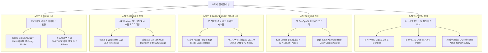

# 🏛️ 전략 5 — 노션 이력서 도메인별 계층 구조 (폴더 트리 모델) 설계서

---

## 1. 개요 및 배경

* **문서명**: 전략 5 — 노션 이력서 도메인별 계층 구조 (폴더 트리 모델) 설계서
* **작성자**: 김예건 ([@ibocon](https://github.com/ibocon) / `wlfka102@gmail.com`)
* **관리 위치**: `docs/portfolio/strategy/plan-strategy-05-notion-domain-hierarchy-architecture.md` (Local SoT)
* **목표 Notion 메인**: [📄 이력서 — 김예건](https://app.notion.com/p/3dd475218675811299b0e3d6b2baa43d)
* **대원칙 선언**:
  > **"최상위 폴더 자체를 '프로젝트 단위'로 구성하는 것은 완전 금지(Anti-Pattern)한다."**  
  > 채용 담당자(HR 리크루터, 테크 리드)에게 `Monolith`, `Argon`, `Peony`, `Lithium` 같은 사내/개인 프로젝트 이름은 사전 지식이 없어 생소하고 난해한 암호일 뿐입니다.  
  > 따라서 **최상위 폴더는 100% 채용 시장에서 통용되는 '기술 도메인 / 직무 전문성 / 엔지니어링 영역(Domain-First)'**으로만 구성하며, 프로젝트명은 하위 상세 페이지의 보조 식별자로만 사용합니다.

---

## 2. 핵심 설계 원칙 및 사용자 피드백 반영 이력

```text
[ 채용 담당자 관점의 핵심 설계 원칙 ]
1. 최상위 프로젝트명 배치 절대 금지 (Domain-First)
   - 최상위 폴더는 채용 공고(JD) 및 업계 표준 직무 명칭(백엔드, 인프라, 디자인시스템, DevEx 등)으로만 정의.
   - 프로젝트명(Monolith, Argon, Peony 등)은 하위 문서 제목의 괄호 병기로만 한정.
2. 하위 페이지 명명 규약 (Role-First Title Rule)
   - 하위 페이지 역시 프로젝트명 단독 표기(예: 'Monolith')를 금지.
   - 반드시 '[직무/기술 역할] — 핵심 성과 및 스택 (프로젝트명)' 형식으로 작성.
   - 예: '[전사 백엔드] 대규모 트랜잭션 및 전사 통합 모듈 모노레포 (.NET 9 / Monolith)'
3. Peony와 Garden 생태계의 도메인별 프로젝트 단위 분산
   - Peony는 단순 백엔드가 아니라 백엔드 마이크로서비스 9종, .NET MAUI 모바일 앱, K8s 인프라, 디자인 시스템, AI 하네스가 망라된 복합 생태계임.
   - Peony를 백엔드 단일 페이지로 축소하지 않고, 각 도메인 레이어에서 '독립 프로젝트 단위'로 분리 서술.
4. Garden.Razor & Penpot 디자인 시스템 정식 도메인 편입
   - 오픈소스 디자인 도구 Penpot과 C# Blazor/Razor 컴포넌트 라이브러리(Garden.Razor), 컴포넌트 갤러리를 연동한 디자인 시스템 구축 실적을 독립 도메인/프로젝트로 명시.
5. 비선호 기술(Flutter) 완전 제외
   - 모바일은 Lithium 중심의 무선 하드웨어 연동 및 BLE 패킷 최적화에 집중.
```

### 2.1 절대 금지 안티패턴(Anti-Pattern) 및 폐기 사유 기록 (재발 방지)

과거 검토 과정에서 제기되었으나 채용 공학적 관점에서 심각한 결함이 확인되어 **영구 폐기 및 금지된 안티패턴**을 기록합니다. 향후 어떠한 이력서 개편에서도 동일한 실수를 반복하지 않도록 합니다.

| 폐기된 안티패턴 모델 | 설계 내용 | 폐기 및 절대 금지 사유 |
| :--- | :--- | :--- |
| **⛔ 안티패턴 A**<br>`5대 프로젝트 단위 최상위 폴더 모델` | 최상위 폴더를 `[Monolith]`, `[Argon]`, `[Peony]` 등 사내 프로젝트 단위로 구성하고 하위에 도메인 기술 | **1. 채용 담당자의 인지 장벽 극대화**: 외부 리크루터나 테크 리드는 지원자의 사내 코드명에 대한 배경지식이 전무하여 암호처럼 느껴짐.<br>**2. 10초 스캔 실패**: 채용 담당자가 찾는 것은 "백엔드 개발자인가? 인프라 엔지니어인가?"이지 프로젝트명이 아님.<br>**3. JD 매칭 불가능**: 채용 공고의 자격 요건 키워드와 최상위 폴더가 매칭되지 않아 1차 서류 탈락 위험 초래. |
| **⛔ 안티패턴 B**<br>`회사 vs 자체 플랫폼 2대 축 분리형` | 최상위 폴더를 `01. 엔터프라이즈(MANGOSLAB)`와 `02. 자체 플랫폼(BotanicSoft)`으로 양분 | **1. 지원자 중심의 편의적 분류**: 공급 주체(회사/개인)를 가르는 것은 지원자 개인의 관점일 뿐, 채용 담당자의 관심사가 아님.<br>**2. 기술 전문성 파편화**: 동일한 백엔드/인프라 역량이 회사 폴더와 자체 플랫폼 폴더로 양분되어 역량의 총량이 분산되어 보임. |



---

## 3. 최상위 도메인 중심 노션 폴더 구조 및 최종 채택안

> **공식 채택 결정**:  
> 사람인, 점핏, 잡플래닛, 원티드 등 국내 주요 테크 채용 플랫폼의 실제 채용 공고(JD) 분석 결과([`recruitment-jd-benchmarking-references.md`](./recruitment-jd-benchmarking-references.md))를 바탕으로, 4대 핵심 직무(백엔드, 인프라, 데스크톱, 모바일)의 전문성을 유지하면서도 **`개발자 경험(DevEx) & 웹 디자인 시스템`을 독립 플랫폼 도메인(03)으로 격상**시킨 **[개선 조합 B: 5대 직무 전문성 분리형]을 최종 표준안으로 공식 채택**합니다.

---

### [최종 확정 채택안] 5대 직무 전문성 분리형 (DevEx & 디자인 시스템 플랫폼 격상) — ⭐ **최종 확정**
> **특징**: JD 분석에서 드러난 `모바일(BLE IoT)`과 `웹 디자인 시스템/DevEx`의 직무 성격 불일치를 해결하고, 테크 리드급 차별화 역량인 `Penpot/Garden.Razor` 디자인 시스템과 `Garden.Harness` AI 거버넌스를 독립된 상위 도메인으로 격상한 구조.

```text
├── 📁 01. .NET 백엔드 & 분산 아키텍처 (C#, Clean Architecture, CQRS)
│   ├── 📄 [전사 백엔드] .NET 9 모듈 모노레포 & 대규모 API GW (Monolith)
│   ├── 📄 [분산 메시징] RabbitMQ & Outbox 패턴 가계부 서비스 (Peony Backend)
│   └── 📄 [AI 파이프라인] 비동기 잡 큐 & OCR/요약 마이크로서비스 (NemonicStudy)
│
├── 📁 02. DevOps & 클라우드 인프라 (K8s, GitOps, On-Premise, Ceph)
│   ├── 📄 [K8s GitOps] 온프레미스 듀얼 사이트 K8s & Active-Standby DR (Argon)
│   └── 📄 [분산 스토리지] 하이브리드 K8s & 100TB Rook-Ceph 스토리지 (Garden.Cluster)
│
├── 📁 03. 개발자 경험(DevEx) & 웹 디자인 시스템 (Penpot, Harness, CI/CD)
│   ├── 📄 [디자인 시스템] Penpot 토큰 동기화 Razor 웹 컴포넌트 (Garden.Razor)
│   └── 📄 [엔지니어링 거버넌스] 전사 빌드 70% 단축 & AI 에이전트 하네스 (Garden.Harness)
│
├── 📁 04. Windows 데스크톱 & 시스템 프로그래밍 (WPF, Win32, 하드웨어 제어)
│   ├── 📄 [데스크톱 클라이언트] 글로벌 50만 대 제어 & .NET 9 현대화 (nemonic)
│   └── 📄 [디바이스 드라이버] 저수준 USB/Bluetooth 통신 프로토콜 SDK (Mango)
│
└── 📁 05. 모바일 & BLE 디바이스 연동 (Android, iOS, .NET MAUI, BLE)
    ├── 📄 [모바일 클라이언트] .NET MAUI Blazor Hybrid 가계부 앱 (Peony Mobile)
    └── 📄 [하드웨어 연동 앱] FINECUBE 컬러 라벨 앱 & BLE 스트리밍 (Lithium)
```

---

### [대안 A] JD 키워드 4대 직무 정밀 압축형 (4영역 슬림 모델)
> **특징**: 4개 대분류 틀을 유지하되 실제 JD의 핵심 필수/우대 키워드를 앞단 15자 이내로 전진 배치하고 말줄임을 방어한 모델.

```text
├── 📁 01. .NET 백엔드 & 분산 아키텍처 (.NET 9, Clean Arch, CQRS)
│   ├── 📄 [전사 백엔드] .NET 9 모듈 모노레포 & API GW (Monolith)
│   ├── 📄 [분산 메시징] RabbitMQ & Outbox CQRS 가계부 (Peony Backend)
│   └── 📄 [AI 파이프라인] 비동기 잡 큐 & OCR 마이크로서비스 (NemonicStudy)
│
├── 📁 02. DevOps & 클라우드 인프라 (K8s, GitOps, Ceph, DevEx)
│   ├── 📄 [K8s GitOps] 온프레미스 듀얼 사이트 DR 오케스트레이션 (Argon)
│   ├── 📄 [분산 스토리지] 100TB급 Rook-Ceph 고가용성 운영 (Garden.Cluster)
│   └── 📄 [DevEx 거버넌스] 전사 빌드 70% 단축 & 4대 AI 에이전트 하네스 (Garden.Harness)
│
├── 📁 03. Windows 데스크톱 & 시스템 제어 (C#, WPF, Win32, USB)
│   ├── 📄 [데스크톱 클라이언트] 50만 대 기기 제어 & .NET 9 현대화 (nemonic)
│   └── 📄 [디바이스 드라이버] OS 독립형 USB/Bluetooth 통신 SDK (Mango)
│
└── 📁 04. 모바일 & 웹 프론트엔드 (BLE IoT, MAUI, Penpot 디자인)
    ├── 📄 [모바일 클라이언트] .NET MAUI 가계부 앱 (Peony Mobile)
    ├── 📄 [하드웨어 연동 앱] BLE 무손실 스트리밍 라벨 앱 (Lithium)
    └── 📄 [웹 디자인 시스템] Penpot 토큰 동기화 Razor 컴포넌트 (Garden.Razor)
```

---

### [대안 C] 4대 시스템 토폴로지형 (서버사이드 2축 vs 엣지 디바이스 2축)
> **특징**: 백엔드와 인프라/플랫폼(서버사이드) 2개 폴더와 데스크톱/디바이스와 모바일(엔드포인트 엣지) 2개 폴더로 물리적 레이어를 2:2 대칭으로 맞춘 모델.

```text
├── 📁 01. 백엔드 서비스 & 분산 시스템 (Core Application Services)
│   ├── 📄 [전사 백엔드] 대규모 트랜잭션 처리 .NET 9 모듈 모노레포 (Monolith)
│   ├── 📄 [분산 메시징] 이벤트 주도 CQRS 가계부 마이크로서비스 (Peony Backend)
│   └── 📄 [AI 파이프라인] 비동기 OCR/요약 분산 처리 파이프라인 (NemonicStudy)
│
├── 📁 02. 클라우드 플랫폼 & 엔지니어링 거버넌스 (Infra, Storage, DevEx)
│   ├── 📄 [K8s GitOps] 온프레미스 듀얼 사이트 K8s & 100TB Ceph 스토리지 (Argon/Cluster)
│   ├── 📄 [엔지니어링 거버넌스] AI 코딩 에이전트 하네스 & 빌드 70% 가속 (Garden.Harness)
│   └── 📄 [웹 디자인 시스템] Penpot 토큰 동기화 Blazor 컴포넌트 라이브러리 (Garden.Razor)
│
├── 📁 03. 데스크톱 & 하드웨어 제어 시스템 (Desktop & Device Systems)
│   ├── 📄 [데스크톱 클라이언트] 50만 대 기기 제어 Windows 엔진 — 8년 수명주기 (nemonic)
│   └── 📄 [디바이스 드라이버] OS 독립형 USB/Bluetooth 통합 드라이버 SDK (Mango)
│
└── 📁 04. 모바일 & 무선 IoT 애플리케이션 (Mobile & Wireless IoT)
    ├── 📄 [모바일 클라이언트] .NET MAUI Blazor Hybrid 크로스플랫폼 앱 (Peony Mobile)
    └── 📄 [하드웨어 연동 앱] BLE 실시간 무손실 패킷 스트리밍 라벨 앱 (Lithium)
```

---

## 4. 도메인 허브 페이지(상위 폴더) 표준 템플릿 명세

각 도메인 상위 페이지는 채용 담당자에게 **전문 분야의 스케일과 비즈니스 가치**를 30초 내에 전달할 수 있도록 아래 표준 템플릿으로 구성합니다.

### 4.1 허브 페이지 레이아웃
1. **Header Block**: 도메인 명칭 및 영문 표기, 핵심 역할 요약
2. **Executive Summary Table**:
   - `[주요 기술 스택]`, `[해결한 핵심 엔지니어링 난제]`, `[대표 비즈니스 정량 지표]`, `[포괄 프로젝트 수]`
3. **Architecture Philosophy (철학)**:
   - 해당 도메인 개발 시 준수하는 원칙 (예: 백엔드의 경우 Clean Architecture & Event-Driven, 인프라의 경우 GitOps & Zero-Downtime, 디자인 시스템의 경우 Single Token SoT)
4. **Project Gallery Grid (하위 프로젝트 링크 카드)**:
   - 각 하위 상세 페이지로 연결되는 링크 카드 (배경 이미지, 프로젝트 명, 핵심 기술, 기간 포함)

---

## 5. 41개 Git 저장소 + Garden/Peony 생태계 종합 수렴 매핑표 (5대 직무 전문성 분리형 기준)

| 도메인 계층 | 포괄 저장소 / 프로젝트 목록 | 대표 상세 페이지 (TO-BE) |
| :--- | :--- | :--- |
| **01. .NET 백엔드 & 분산 아키텍처** | `Monolith`, `Oxygen.Hub`, `Oxygen.Teams`, `Oxygen.Slack`, `Oxygen.Zapier`, `Oxygen.Web`, `Oxygen.Amplitude`, `Oxygen.Jira`, `Oxygen.Nemonic.Pro.SettingsApp`, `Radium`, `Mangoslab`, `Peony Backend`, `Mangoslab.Infrastructure`, `Zinc.NemonicStudy`, `Zinc.NemonicStudy.Bff.Api`, `Zinc.NemonicStudy.Service.Ocr`, `Zinc.NemonicStudy.Service.Summary`, `Zinc.NemonicAi` | 1. [전사 백엔드] .NET 9 모듈 모노레포 & 대규모 API GW (Monolith)<br>2. [분산 메시징] RabbitMQ & Outbox 패턴 가계부 서비스 (Peony Backend)<br>3. [AI 파이프라인] 비동기 잡 큐 & OCR/요약 마이크로서비스 (NemonicStudy) |
| **02. DevOps & 클라우드 인프라** | `argon`, `kc5`, `kc6`, `Mangoslab.IaC`, `History`, `Garden.Cluster`, `Rook-Ceph Cluster` | 1. [K8s GitOps] 온프레미스 듀얼 사이트 K8s & Active-Standby DR (Argon)<br>2. [분산 스토리지] 하이브리드 K8s & 100TB Rook-Ceph 스토리지 (Garden.Cluster) |
| **03. 개발자 경험(DevEx) & 웹 디자인 시스템** | `Garden.Razor`, `Garden.Razor.Gallery`, `Penpot Design System (Tokens)`, `Mangoslab.Pipeline`, `Garden.Harness`, `Garden.Share`, `Garden.Analyzers` | 1. [디자인 시스템] Penpot 토큰 동기화 Razor 웹 컴포넌트 (Garden.Razor)<br>2. [엔지니어링 거버넌스] 전사 빌드 70% 단축 & AI 에이전트 하네스 (Garden.Harness) |
| **04. Windows 데스크톱 & 시스템 프로그래밍** | `NemonicBasicWindows`, `NemonicLabelWindows`, `Nemonic.Ampv`, `MemoView`, `Mangoslab.Usb`, `Mangoslab.Nemonic`, `Mangoslab.Bluetooth`, `Firmware`, `Firmware.TestUtility`, `MIP-301-Centerm-FW-Test`, `Garden.Usb`, `Garden.Bluetooth` | 1. [데스크톱 클라이언트] 글로벌 50만 대 제어 & .NET 9 현대화 (nemonic)<br>2. [디바이스 드라이버] 저수준 USB/Bluetooth 통신 프로토콜 SDK (Mango) |
| **05. 모바일 & BLE 디바이스 연동** | `Peony Mobile (.NET MAUI)`, `Garden.Maui`, `Lithium`, `Sulfur`, `Mangoslab.Drawing`, `NemonicBasicAndroid`, `NemonicBasiciOS` | 1. [모바일 클라이언트] .NET MAUI Blazor Hybrid 가계부 앱 (Peony Mobile)<br>2. [하드웨어 연동 앱] FINECUBE 컬러 라벨 앱 & BLE 스트리밍 (Lithium) |

---

## 6. 기대 효과 및 채용 경쟁력

1. **채용 담당자 인지 장벽 완전 제거 및 사이드바 말줄임 방어**:
   - 노션 사이드바를 열었을 때 생소한 프로젝트 코드명 대신 **`01. .NET 백엔드`, `02. DevOps 인프라`, `03. DevEx & 디자인시스템`, `04. Windows 데스크톱`, `05. 모바일 & BLE`**로 직무 전문성이 즉각 전달되며, 하위 페이지 역시 앞 15자 이내에 핵심 역량이 배치되어 말줄임(`...`)이 발생해도 완벽히 식별됨.
2. **모바일(BLE IoT)과 웹 디자인 시스템/DevEx의 명확한 정체성 분리**:
   - 모바일 폴더는 순수하게 `.NET MAUI`와 `BLE 하드웨어 스트리밍(Lithium)`에 집중하고, `Garden.Razor & Penpot` 디자인 시스템은 `Garden.Harness`와 함께 독립된 **플랫폼/생산성 도메인(03)**으로 격상되어 시니어/테크 리드급 차별화 포인트를 극대화함.
3. **Peony 및 Garden 생태계의 온전한 가치 전달**:
   - Peony의 백엔드와 모바일 앱, Garden의 인프라·디자인시스템·DevEx가 각 도메인의 '독립 프로젝트 단위'로 분리되어, 복합적인 풀스택 플랫폼 구축 역량이 선명하게 드러남.
