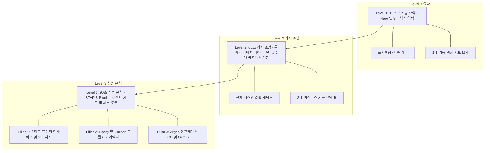
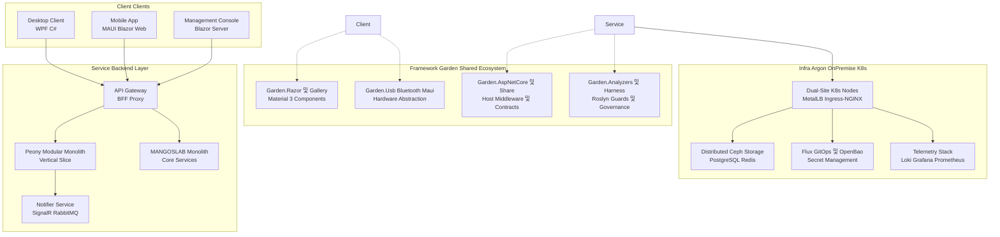

# 개발자 이력서 정보 아키텍처(IA) 및 프로젝트 기술 표준 명세

## 1. 개요 및 목적

본 명세서는 분산된 대규모 엔지니어링 프로젝트(모노레포, 10개 이상의 도메인 패키지, 온프레미스 K8s 인프라 등)를 보유한 소프트웨어 엔지니어가 **도메인 사전 지식이 없는 채용담당자(HR 및 기술 면접관)에게 3분 이내에 자신의 거시적 기술 역량과 미시적 엔지니어링 깊이를 직관적으로 증명할 수 있도록 설계된 표준 정보 아키텍처(Information Architecture, IA)**입니다.

---

## 2. 3단계 계층형 정보 아키텍처 (3-Tier IA)

이력서는 단일 페이지 완결성을 유지하되, 면접관의 스키밍 흐름에 맞춘 3단계 계층 구조를 갖춥니다.



---

## 3. 3대 비즈니스 기둥 (Business Pillars) 분류 체계

개별 저장소 15개를 동등한 위계로 나열하지 않고, 명확한 비즈니스 및 엔지니어링 가치를 기준으로 3대 기둥으로 통합합니다.

### Pillar 1: 스마트 프린터 디바이스 & 하드웨어 연동 플랫폼 (MANGOSLAB 생태계)
- **포괄 프로젝트**: `Monolith` (통합 백엔드), `Lithium` (FINECUBE 모바일 앱), `nemonic Desktop` (WPF Windows 인쇄 클라이언트)
- **비즈니스 정의**: 디바이스-모바일-PC-클라우드를 잇는 스마트 메모·라벨 프린터 하드웨어 연동 및 서비스 플랫폼
- **엔지니어링 핵심**:
  - Windows/iOS/Android 3대 OS 전반에 걸친 BLE/USB 프린팅 파이프라인 통합
  - 5개 분산 하위 시스템 및 12개 마이크로서비스의 단일 모노레포 통합
  - OS별 디바이스 드라이버 통신 추상화 및 렌더링 성능 최적화

### Pillar 2: 모듈러 모노리스 & 공용 도메인 생태계 (Peony & Garden)
- **포괄 프로젝트**: `Peony` (가계부 서비스 백엔드 & Blazor MAUI 앱), `Garden.*` 공용 패키지군 9종 및 `Garden.Harness` (에이전트 하네스)
  - *Garden 공용 패키지 9종: Garden.Usb, Garden.Bluetooth, Garden.Maui, Garden.Aspire, Garden.Razor, Garden.Razor.Gallery, Garden.AspNetCore, Garden.Analyzers, Garden.Share*
  - *AI 에이전트 하네스: Garden.Harness (별도 저장소)*
- **비즈니스 정의**: 개인 자산 관리와 금융 트랜잭션 흐름을 다루는 풀스택 모바일/웹 서비스 및 전사 도메인 공용 프레임워크
- **엔지니어링 핵심**:
  - Vertical Slice Architecture (VSA) 및 CQRS, Result 패턴 기반의 모듈 경계 수립
  - 10개의 독립 NuGet 라이브러리로 전사 재사용 컴포넌트 생태계 구축
  - Material 3 기반의 공용 디자인 시스템(Garden.Razor) 및 Roslyn 정적 분석기(Garden.Analyzers)를 통한 아키텍처 거버넌스 자동화

### Pillar 3: 온프레미스 인프라 엔지니어링 & GitOps (Argon & Garden.Cluster)
- **포괄 프로젝트**: `Argon` (Dual-site Kubernetes 클러스터), `Garden.Cluster` (GitOps 매니페스트), `OpenBao` 시크릿 제어면, 관측성 스택 (Loki/Grafana/Prometheus/Aspire)
- **비즈니스 정의**: 퍼블릭 클라우드 종속성 없이 온프레미스 자원만으로 구축된 고가용 분산 컨테이너 인프라
- **엔지니어링 핵심**:
  - 물리 서버 2개 사이트 간의 MetalLB L2 BGP 라우팅 및 Ceph 분산 스토리지 이중화
  - Flux 기반의 GitOps 선언적 배포 파이프라인과 OpenBao 암호화 시크릿 제어면 통합
  - 분산 추적(OTel) 및 로그 수집 파이프라인을 통한 모니터링 체계 내재화

---

## 4. 통합 시스템 아키텍처 다이어그램 명세

면접관이 5초 만에 전체 시스템의 연결 관계를 파악할 수 있도록 제공되는 상단 개념도입니다.



---

## 5. STAR 5-Block 프로젝트 카드 표준 서식

모든 프로젝트 카드는 아래 5대 블록 양식을 엄격히 준수하여 일관성을 확보합니다.

### 블록 구성 요소 및 작성 가이드

```markdown
### [프로젝트 타이틀] (진행 기간 / 팀 규모 및 본인 기여도)
> **한 줄 소개**: [누구를 위해 어떤 문제를 해결하는 프로덕트인가? 일상 언어로 1문장]

- **아키텍처 & 기술 스택**: 
  - 주요 언어/프레임워크, 데이터베이스, 통신 프로토콜, 배포 환경
- **핵심 당면 과제 (Problem)**:
  - 도메인 지식 없이도 공감할 수 있는 실제 기술 병목, 구조적 결합도, 성능 저하 문제 기술
- **엔지니어링 접근 (Action)**:
  - 단순 기능 구현이 아닌, 아키텍처 패턴 도입, 추상화 설계, 자동화 도구 개발 등 주도적 조치 2~3건
- **측정 가능한 성과 (Impact)**:
  - 정량적 수치 필수: 성능 개선 비율(%), 리소스 절감량, 개발/배포 리드타임 단축, 가용성 지표
- **관련 링크 및 상세 내역**:
  - GitHub 링크, 배포 URL, 기술 블로그/문서 링크
  - ▶ [토글 블록] 세부 기술 구현 및 코드 스니펫
```

---

## 6. 노션 화면 구현 및 인터랙션 규칙

1. **상단 고정 요약 (Top-Fold Focus)**
   - 페이지 진입 시 스크롤 없이 프로필, 핵심 포지셔닝(시스템 & 백엔드 엔지니어), 3대 기둥 요약 표가 한 화면에 보이도록 구성합니다.
2. **토글 블록을 통한 심층 정보 지연 노출 (Lazy Disclosure)**
   - 10개 `Garden.*` 라이브러리는 Pillar 2 내부의 토글(`▶ Garden 공용 패키지 세부 명세`) 안에 배치하여 기본 뷰의 길이를 압축합니다.
3. **외부 링크 명확화**
   - 비공개 사내 저장소는 `비공개 (사내 프로젝트)`로 명시하고, 공개 가능한 아키텍처 다이어그램이나 기술 명세서 링크를 대신 제공합니다.
