```mermaid
graph TD
    Root[이력서 김예건 메인]

    D1[01 백엔드 서비스 플랫폼]
    D2[02 클러스터 인프라 플랫폼]
    D3[03 디자인 시스템 및 프론트엔드]
    D4[04 개발자 경험 및 AI 거버넌스]
    D5[05 하드웨어 연동 데스크톱 제품]
    D6[06 모바일 및 BLE 디바이스 앱]

    Root --> D1
    Root --> D2
    Root --> D3
    Root --> D4
    Root --> D5
    Root --> D6

    subgraph 도메인 1 백엔드 상세
        D1 --> P1_1[Monolith 전사 통합 백엔드 플랫폼]
        D1 --> P1_2[Peony 이벤트 주도 CQRS 백엔드]
        D1 --> P1_3[NemonicStudy 마이크로서비스 백엔드]
    end

    subgraph 도메인 2 인프라 상세
        D2 --> P2_1[Argon 듀얼 사이트 K8s GitOps]
        D2 --> P2_2[Garden.Cluster 및 Ceph 분산 스토리지]
    end

    subgraph 도메인 3 디자인시스템 상세
        D3 --> P3_1[Garden.Razor 및 Penpot 웹 디자인 시스템]
        D3 --> P3_2[Blazor 반응형 컴포넌트 갤러리]
    end

    subgraph 도메인 4 DevEx 거버넌스 상세
        D4 --> P4_1[GitHub Actions 전사 빌드 70퍼센트 가속]
        D4 --> P4_2[Garden.Harness AI 에이전트 거버넌스]
    end

    subgraph 도메인 5 데스크톱 상세
        D5 --> P5_1[nemonic Desktop 윈도우 통합 클라이언트]
        D5 --> P5_2[Device SDK 저수준 USB BLE 프로토콜]
    end

    subgraph 도메인 6 모바일 상세
        D6 --> P6_1[Lithium 컬러 라벨 모바일 앱 및 BLE]
    end
```

# 🏛️ 전략 5 — 노션 이력서 도메인별 계층 구조 (폴더 트리 모델) 설계서

---

## 1. 개요 및 배경

* **문서명**: 전략 5 — 노션 이력서 도메인별 계층 구조 (폴더 트리 모델) 설계서
* **작성자**: 김예건 ([@ibocon](https://github.com/ibocon) / `wlfka102@gmail.com`)
* **관리 위치**: `resume/Plan_Strategy_05_Notion_Domain_Hierarchy_Architecture.md` (Local SoT)
* **목표 Notion 메인**: [📄 이력서 — 김예건](https://app.notion.com/p/3dd475218675811299b0e3d6b2baa43d)
* **배경 및 문제의식 (AS-IS)**:
  1. **사내 프로젝트 코드명 중심 나열의 인지 장벽**: `Monolith`, `Argon`, `Lithium` 등 외부 채용 담당자가 알 수 없는 프로젝트명이 최상위에 노출되어 직무 적합성 파악에 방해가 됨.
  2. **모바일 및 좌측 사이드바 말줄임(Truncation)**: 좌측 네비게이션에서 뒷부분 설명이 잘려 `Monolith — 회사 통합 .NET 모...`처럼 코드명만 남음.
  3. **Peony 및 Garden 생태계의 은폐 및 압축 문제**:
     - `Peony`(이벤트 주도 CQRS/RabbitMQ 가계부 백엔드)가 `NemonicStudy` 하위로 묶여 독립된 아키텍처 가치가 가려짐.
     - `Garden` 생태계(`Garden.Cluster`, `Garden.Harness`, `Garden.Razor` + `Penpot` 디자인 시스템)의 각 계층별 전문성이 단편적으로 축소됨.
  4. **디자인 시스템 실적 누락**: `Garden.Razor`와 `Penpot`을 연동한 디자인 토큰 및 컴포넌트 갤러리 구축 실적이 분류에 부재.
* **설계 목표 (TO-BE)**:
  1. **개발 영역(Domain) 기반 상위 허브 체계 수립**: 채용 담당자가 채용 포지션(백엔드, 인프라, 디자인시스템, DevEx, 클라이언트)에 맞춰 즉시 접근할 수 있도록 도메인 폴더로 계층화.
  2. **Peony와 Garden 생태계의 계층별 분산 표출**: 백엔드, 인프라, DevEx, 디자인 시스템 각 계층에 알맞게 배치.
  3. **Garden.Razor & Penpot 디자인 시스템 정식 도메인 편입**: 디자인 토큰 동기화 및 Razor 컴포넌트 라이브러리 역량 강조.
  4. **전략적 비선호 기술(Flutter) 완전 배제**: 모바일은 Lithium 중심의 BLE 하드웨어 연동에 집중.

---

## 2. 사용자 피드백 및 설계 방향 반영 이력

```text
[ 주요 피드백 반영 사항 ]
1. 언어 스타일: 한글을 중심으로 하되, SW 업계에서 통용되는 전문 용어(.NET, Clean Architecture, CQRS, DevOps, K8s, GitOps, DevEx, Penpot, Design System 등)는 자연스럽게 병기.
2. Peony의 독립적 분산 표출: Monolith(엔터프라이즈 모노레포)와 구별되는 순수 이벤트 주도 CQRS/Outbox 분산 백엔드로 독자적 페이지 부여.
3. Garden 생태계의 입체적 분산:
   - Garden.Cluster: 클러스터 인프라 플랫폼 산하로 배치
   - Garden.Harness: 개발자 경험 및 엔지니어링 거버넌스 산하로 배치
   - Garden.Razor & Penpot: 디자인 시스템 및 프론트엔드 영역 신설/배치
4. Flutter 완전 제외: 크로스플랫폼 모바일 중 Flutter 관련 기술은 제외하고, Lithium(C#/Kotlin/BLE) 중심의 무선 하드웨어 연동 앱으로 집중.
```



---

## 3. 노션 페이지 계층 구조 5대 고도화 베리에이션

### [베리에이션 1] 6대 풀스택 & 플랫폼 엔지니어링 완성형 (가장 완벽한 분산 표출 모델) — ⭐ **강력 추천**
> **특징**: `Peony`(이벤트 주도 CQRS)를 독자 백엔드로 독립시키고, `Garden.Cluster`(인프라), `Garden.Razor & Penpot`(디자인 시스템), `Garden.Harness`(DevEx)를 각 계층에 입체적으로 분산 표출한 최고 난이도 포트폴리오 구조.

```text
├── 📁 01. 백엔드 서비스 플랫폼 (.NET 9, Clean Architecture, CQRS)
│   ├── 📄 [Monolith] 전사 통합 .NET 9 백엔드 모노레포 & API Gateway (14개 레포 통합)
│   ├── 📄 [Peony] 이벤트 주도 CQRS 분산 백엔드 & Outbox 패턴 (RabbitMQ, VSA)
│   └── 📄 [NemonicStudy] 비동기 잡 큐 & AI 마이크로서비스 백엔드 (BFF, OCR, Summary)
│
├── 📁 02. 클러스터 인프라 & GitOps 플랫폼 (K8s, GitOps, On-Premise, Ceph)
│   ├── 📄 [Argon] 전사 On-Premise 듀얼 사이트 K8s 클러스터 & Active-Standby DR
│   └── 📄 [Garden.Cluster & Ceph] K8s GitOps 클러스터 & 100TB급 고가용성 분산 스토리지
│
├── 📁 03. 디자인 시스템 & 웹 프론트엔드 (Design System & Modern Web)
│   ├── 📄 [Garden.Razor & Penpot] Penpot 기반 토큰 동기화 웹 디자인 시스템
│   └── 📄 [Component Gallery] Blazor/Razor 기반 인터랙티브 UI 컴포넌트 갤러리
│
├── 📁 04. 개발자 경험 & AI 에이전트 거버넌스 (DevEx, CI/CD, Agent Harness)
│   ├── 📄 [CI/CD 가속] GitHub Actions 러너 최적화 (전사 빌드 70% 단축)
│   └── 📄 [Garden.Harness] AI 코딩 에이전트(Claude/Codex/OpenCode) 통합 하네스 & SoT 체계
│
├── 📁 05. 하드웨어 연동 데스크톱 제품 (Windows, WPF, Win32, 하드웨어 제어)
│   ├── 📄 [nemonic Desktop] Windows 스마트 메모 프린터 클라이언트 (8년 라이프사이클)
│   └── 📄 [Device SDK] 저수준 USB/Bluetooth 통합 프로토콜 드라이버 라이브러리
│
└── 📁 06. 모바일 & 무선 디바이스 앱 (Android, iOS, BLE)
    └── 📄 [Lithium] FINECUBE 컬러 라벨 모바일 앱 & BLE 실시간 스트리밍 최적화
```

---

### [베리에이션 2] 5대 플랫폼 축 (디자인 시스템을 DevEx/Frontend와 융합한 5영역 모델)
> **특징**: `Garden.Razor & Penpot` 디자인 시스템을 `개발자 경험(DevEx)` 영역과 결합하여 전사 엔지니어링 툴링/플랫폼 역량으로 포지셔닝하고, `Peony`는 백엔드의 독자 축으로 분리한 구조.

```text
├── 📁 01. 백엔드 서비스 플랫폼 (.NET 9, Clean Architecture, CQRS)
│   ├── 📄 [Monolith] 전사 14개 서비스를 통합한 .NET 9 백엔드 모노레포 & API Gateway
│   ├── 📄 [Peony] RabbitMQ 이벤트 기반 비동기 메시징 & Outbox 패턴 CQRS 가계부 백엔드
│   └── 📄 [NemonicStudy] 비동기 잡 큐 기반 AI/OCR 마이크로서비스 파이프라인
│
├── 📁 02. 클러스터 인프라 & 분산 스토리지 (K8s, GitOps, Ceph)
│   ├── 📄 [Argon & Garden.Cluster] 듀얼 사이트 베어메탈 K8s & 선언적 GitOps (Flux v2)
│   └── 📄 [Rook-Ceph] 100TB급 고가용성 분산 블록/파일 스토리지 운영
│
├── 📁 03. 개발자 경험 & 디자인 시스템 (DevEx, Penpot, Garden.Razor, Harness)
│   ├── 📄 [Garden.Razor & Penpot] 토큰 기반 크로스 플랫폼 디자인 시스템 & UI 갤러리
│   └── 📄 [Garden.Harness & CI/CD] AI 에이전트 하네스 & GitHub Actions 빌드 70% 가속
│
├── 📁 04. Windows 데스크톱 & 시스템 프로그래밍 (WPF, Win32, 하드웨어 제어)
│   ├── 📄 [nemonic Desktop] Windows 스마트 메모 프린터 클라이언트 (8년 라이프사이클)
│   └── 📄 [Device SDK] OS 독립형 USB/Bluetooth 통합 프로토콜 드라이버 라이브러리
│
└── 📁 05. 모바일 & BLE 디바이스 연동 (Android, iOS, BLE)
    └── 📄 [Lithium] FINECUBE 컬러 라벨 모바일 앱 & BLE 무손실 패킷 스트리밍
```

---

### [베리에이션 3] 4대 엔지니어링 코어 축 (백엔드 3개 분산 + 인프라 2개 + 디자인시스템/DevEx 2개 + 클라이언트 2개)
> **특징**: 4개 대분류 폴더 체계를 유지하면서, 백엔드에 `Monolith` / `Peony` / `NemonicStudy`를 모두 병렬 배치하고, 디자인 시스템과 DevEx를 단일 플랫폼 허브로 묶은 고밀도 모델.

```text
├── 📁 01. .NET 백엔드 & 분산 아키텍처 (C#, Clean Architecture, DDD, CQRS)
│   ├── 📄 [전사 백엔드 플랫폼] 대규모 트랜잭션 처리 및 모듈 모노레포 (Monolith)
│   ├── 📄 [이벤트 주도 CQRS] Outbox 패턴 & RabbitMQ 비동기 메시징 서비스 (Peony)
│   └── 📄 [AI 마이크로서비스] 비동기 잡 큐 & OCR/요약 파이프라인 (NemonicStudy)
│
├── 📁 02. DevOps & 클러스터 인프라 (K8s, GitOps, On-Premise, Ceph)
│   ├── 📄 [K8s GitOps & DR] 온프레미스 듀얼 사이트 K8s 체계 (Argon / Garden.Cluster)
│   └── 📄 [분산 스토리지] 100TB급 Ceph 블록/파일 스토리지 고가용성 운영
│
├── 📁 03. 디자인 시스템 & 엔지니어링 거버넌스 (Design System, DevEx, Harness)
│   ├── 📄 [Garden.Razor & Penpot] Penpot 디자인 토큰 기반 Blazor/Razor 디자인 시스템
│   └── 📄 [Garden.Harness & CI/CD] AI 코딩 에이전트 하네스 & 전사 빌드 70% 가속 파이프라인
│
└── 📁 04. 클라이언트 & 하드웨어 연동 제품 (Windows, Mobile, USB/BLE)
    ├── 📄 [데스크톱 클라이언트] Windows 스마트 메모 프린터 엔진 (nemonic Desktop / .NET 9)
    └── 📄 [모바일 & 디바이스 SDK] BLE 실시간 스트리밍 라벨 앱(Lithium) & USB/BLE SDK
```

---

### [베리에이션 4] 엔터프라이즈(회사) vs 자체 플랫폼(Garden/Peony) 이원화 기준 (5영역)
> **특징**: 회사의 상용 프로덕트 엔지니어링(`Monolith`, `Argon`, `nemonic`, `Lithium`)과 자체 오픈소스/아키텍처 플랫폼(`Peony`, `Garden.Cluster`, `Garden.Razor & Penpot`, `Garden.Harness`)의 혁신성을 극명하게 대비시킨 모델.

```text
├── 📁 01. 전사 비즈니스 백엔드 플랫폼 (MANGOSLAB Enterprise Backend)
│   ├── 📄 [Monolith] 전사 통합 .NET 9 백엔드 모노레포 & API Gateway
│   └── 📄 [NemonicStudy] AI 스터디 비동기 OCR/요약 마이크로서비스 파이프라인
│
├── 📁 02. 이벤트 주도 분산 아키텍처 플랫폼 (Peony Event-Driven Platform)
│   ├── 📄 [Peony Core] RabbitMQ 비동기 메시징 & Outbox 패턴 가계부 서비스
│   └── 📄 [Rich Domain Model] 불변식 보호 및 Clean Architecture / VSA 실증
│
├── 📁 03. 클라우드 네이티브 & 클러스터 플랫폼 (Argon & Garden.Cluster)
│   ├── 📄 [Argon K8s] 전사 온프레미스 듀얼 사이트 K8s & Active-Standby DR
│   └── 📄 [Garden.Cluster & Ceph] 선언적 GitOps 인프라 & 100TB급 분산 스토리지
│
├── 📁 04. 웹 디자인 시스템 & AI 에이전트 하네스 (Garden.Razor & Garden.Harness)
│   ├── 📄 [Garden.Razor & Penpot] Penpot 토큰 동기화 웹 디자인 시스템 구축
│   └── 📄 [Garden.Harness] AI 코딩 에이전트(Claude/Codex/OpenCode) 통합 거버넌스
│
└── 📁 05. 디바이스 엔드포인트 & 클라이언트 제품 (Desktop & Mobile)
    ├── 📄 [nemonic Desktop] Windows 스마트 프린터 엔진 (8년 수명주기 & .NET 9)
    └── 📄 [Lithium & Device SDK] FINECUBE 모바일 앱 & USB/BLE 드라이버
```

---

### [베리에이션 5] 기술 계층(Layer) 기준 철저한 풀스택 분산형 (6영역 / 2-2-2-2-2-2 완벽 대칭)
> **특징**: 모든 도메인을 정확히 2개씩 매핑하여 노션 사이드바와 갤러리 뷰에서 한 치의 오차도 없는 완벽한 시각적 균형미를 제공하는 정밀 레이아웃 모델.

```text
├── 📁 01. 엔터프라이즈 코어 백엔드 (.NET 9, Monorepo, SaaS Integration)
│   ├── 📄 [Monolith] 전사 통합 백엔드 플랫폼 & API Gateway (14개 레포 통합)
│   └── 📄 [NemonicStudy] 비동기 OCR / AI 요약 잡 큐 마이크로서비스
│
├── 📁 02. 이벤트 주도 분산 아키텍처 (CQRS, Event-Driven, Messaging)
│   ├── 📄 [Peony Backend] RabbitMQ 기반 이벤트 버스 & Outbox 정합성 보장
│   └── 📄 [Domain Modeling] Rich Domain Model 불변식 보호 및 VSA 구조
│
├── 📁 03. 클러스터 인프라 & 스토리지 (K8s, GitOps, Ceph)
│   ├── 📄 [Argon & Garden.Cluster] 베어메탈 K8s 듀얼 사이트 & Flux v2 GitOps
│   └── 📄 [Rook-Ceph] 100TB급 분산 블록/파일 스토리지 고가용성 운영
│
├── 📁 04. UI 디자인 시스템 & 웹 프론트엔드 (Design System, Razor, Penpot)
│   ├── 📄 [Garden.Razor & Penpot] Penpot 토큰 기반 재사용 컴포넌트 라이브러리
│   └── 📄 [Interactive Gallery] Blazor/Razor 기반 디자인 시스템 컴포넌트 갤러리
│
├── 📁 05. 개발자 경험 & 엔지니어링 거버넌스 (DevEx, CI/CD, Harness)
│   ├── 📄 [CI/CD 가속] GitHub Actions 러너 최적화 (전사 빌드 70% 단축)
│   └── 📄 [Garden.Harness] AI 코딩 에이전트 거버넌스 & SoT 문서 체계
│
└── 📁 06. 하드웨어 연동 디바이스 & 엣지 앱 (Windows, Mobile, USB/BLE)
    ├── 📄 [nemonic Desktop] 50만 대 누적 기기 제어 & .NET 9 윈도우 엔진
    └── 📄 [Lithium & Device SDK] BLE 라벨 프린터 모바일 앱 & 통신 프로토콜
```

---

## 4. 도메인 허브 페이지(상위 폴더) 표준 템플릿 명세

각 도메인 상위 페이지는 하위 프로젝트로 이동하기 전 채용 담당자에게 **전문 분야의 스케일과 비즈니스 가치**를 30초 내에 전달할 수 있도록 아래 표준 템플릿으로 구성합니다.

### 4.1 허브 페이지 레이아웃
1. **Header Block**: 도메인 명칭 및 영문 표기, 핵심 역할 요약
2. **Executive Summary Table**:
   - `[주요 기술 스택]`, `[해결한 핵심 엔지니어링 난제]`, `[대표 비즈니스 정량 지표]`, `[포괄 프로젝트 수]`
3. **Architecture Philosophy (철학)**:
   - 해당 도메인 개발 시 준수하는 원칙 (예: 백엔드의 경우 Clean Architecture & Event-Driven, 인프라의 경우 GitOps & Zero-Downtime, 디자인 시스템의 경우 Single Token SoT)
4. **Project Gallery Grid (하위 프로젝트 링크 카드)**:
   - 각 하위 상세 페이지로 연결되는 링크 카드 (배경 이미지, 프로젝트 명, 핵심 기술, 기간 포함)

---

## 5. 41개 Git 저장소 + Garden/Peony 생태계 종합 매핑표

| 도메인 계층 | 포괄 저장소 / 프로젝트 목록 | 대표 상세 페이지 (TO-BE) |
| :--- | :--- | :--- |
| **01. 백엔드 서비스 플랫폼** | `Monolith`, `Oxygen.Hub`, `Oxygen.Teams`, `Oxygen.Slack`, `Oxygen.Zapier`, `Oxygen.Web`, `Oxygen.Amplitude`, `Oxygen.Jira`, `Oxygen.Nemonic.Pro.SettingsApp`, `Radium`, `Mangoslab`, `Zinc.NemonicStudy`, `Zinc.NemonicStudy.Bff.Api`, `Zinc.NemonicStudy.Service.Ocr`, `Zinc.NemonicStudy.Service.Summary`, `Zinc.NemonicAi` | 1. 전사 통합 백엔드 플랫폼 (Monolith)<br>2. 비동기 잡 큐 & AI 마이크로서비스 (NemonicStudy) |
| **02. 이벤트 주도 CQRS 플랫폼** | `Peony`, `Mangoslab.Infrastructure` (도메인 이벤트/코어 프레임워크 원류) | 1. 이벤트 주도 CQRS 분산 백엔드 (Peony)<br>2. Rich Domain Model & Outbox 패턴 실증 |
| **03. 클러스터 인프라 플랫폼** | `argon`, `kc5`, `kc6`, `Mangoslab.IaC`, `History`, `Garden.Cluster`, `Rook-Ceph Cluster` | 1. 듀얼 사이트 K8s GitOps (Argon)<br>2. Garden.Cluster & Rook-Ceph 분산 스토리지 |
| **04. 디자인 시스템 & 프론트엔드** | `Garden.Razor`, `Garden.Razor.Gallery`, `Penpot Design System (Tokens)` | 1. Garden.Razor & Penpot 웹 디자인 시스템<br>2. Blazor 인터랙티브 UI 컴포넌트 갤러리 |
| **05. 개발자 경험 & 거버넌스** | `Mangoslab.Pipeline`, `Garden.Harness` | 1. GitHub Actions 러너 최적화 (빌드 70% 가속)<br>2. AI 코딩 에이전트 하네스 & SoT 체계 |
| **06. 데스크톱 & 모바일 하드웨어 제품** | `NemonicBasicWindows`, `NemonicLabelWindows`, `Nemonic.Ampv`, `MemoView`, `Mangoslab.Usb`, `Mangoslab.Nemonic`, `Mangoslab.Bluetooth`, `Firmware`, `Firmware.TestUtility`, `MIP-301-Centerm-FW-Test`, `Lithium`, `Sulfur`, `Mangoslab.Drawing` | 1. nemonic Desktop 통합 클라이언트<br>2. Device SDK 및 저수준 통신 프로토콜<br>3. FINECUBE 컬러 라벨 모바일 앱 (Lithium) |

---

## 6. 기대 효과 및 채용 경쟁력

1. **Peony의 독자적 아키텍처 위상 확보**:
   - 상용 모노리스 업무에 묻히지 않고, RabbitMQ 비동기 메시징·Outbox 패턴·Clean Architecture를 엄격하게 적용한 순수 분산 백엔드 설계 역량이 선명하게 부각됨.
2. **Garden 생태계의 입체적 전문성 증명**:
   - `Garden.Cluster`(K8s/Ceph 인프라), `Garden.Harness`(AI 에이전트 DevEx), `Garden.Razor & Penpot`(디자인 시스템)으로 분산 표출되어, 단순 개발자를 넘어 **"조직의 인프라·도구·디자인 시스템 전반을 구축하는 테크 리드"**로서의 진면목을 입증.
3. **디자인 시스템 구축 역량 신규 부각**:
   - Penpot 오픈소스 디자인 도구와 C# Blazor/Razor를 연결한 디자인 토큰 동기화 파이프라인을 보여줌으로써, 프론트엔드/디자인 협업 생산성 개선 역량까지 추가 어필.
