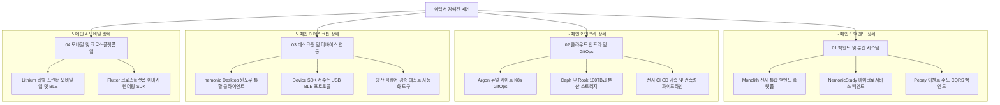

# 🏛️ 전략 5 — 노션 이력서 도메인별 계층 구조 (폴더 트리 모델) 설계서

---

## 1. 개요 및 배경

* **문서명**: 전략 5 — 노션 이력서 도메인별 계층 구조 (폴더 트리 모델) 설계서
* **작성자**: 김예건 ([@ibocon](https://github.com/ibocon) / `wlfka102@gmail.com`)
* **관리 위치**: `resume/Plan_Strategy_05_Notion_Domain_Hierarchy_Architecture.md` (Local SoT)
* **목표 Notion 메인**: [📄 이력서 — 김예건](https://app.notion.com/p/3dd475218675811299b0e3d6b2baa43d)
* **배경 및 문제의식 (AS-IS)**:
  1. **고유 프로젝트 코드명 중심의 1단계 나열**: `Monolith`, `Argon`, `Lithium` 등 외부 채용 담당자가 알 수 없는 사내 코드명이 최상위에 노출되어 직무 적합성 파악에 인지적 장벽 형성.
  2. **모바일 및 좌측 사이드바 말줄임(Truncation)**: 좌측 네비게이션에서 `Monolith — 회사 통합 .NET 모...` 형태로 뒷부분의 핵심 기술 설명이 잘려 프로젝트명만 노출됨.
  3. **41개 저장소 포괄의 구조적 한계**: 9년간 41개 Git 저장소의 방대한 엔지니어링 실적이 5개 플랫 프로젝트 페이지에 무리하게 압축되어 특정 도메인(백엔드, 인프라, 클라이언트)별 전문성 부각이 제한됨.
* **설계 목표 (TO-BE)**:
  1. **개발 영역(Domain) 기반 상위 허브 체계 수립**: 채용 담당자가 채용 포지션(백엔드, 인프라/DevOps, 클라이언트, 모바일)에 맞춰 즉시 접근할 수 있도록 4대 도메인 폴더로 계층화.
  2. **허브 앤 스포크(Hub & Spoke) 구조 도입**: 각 도메인 허브 페이지에서 해당 영역의 핵심 기술 철학, 해결한 문제, 정량 성과를 총괄하고, 하위 페이지에서 단위 프로젝트 상세를 심층 기술.

---

## 2. 핵심 설계 원칙 (Design Principles)

```text
[ 채용 담당자 중심 3대 정보 설계 원칙 ]
1. Role-First Visibility  : 사내 코드명 대신 직무 도메인(백엔드, K8s 인프라 등)을 1차 인덱스로 제시
2. Hub & Spoke Navigation : 상위 도메인 허브(총괄 요약) -> 하위 프로젝트(심층 기술서) 2단계 계층화
3. 41-Repo Traceability   : 41개 전 Git 저장소의 커밋/PR 이력을 4대 도메인 산하에 1:1 누락 없이 배치
```



---

## 3. 노션 페이지 계층 구조 (폴더 트리 모델 상세 정의)

```text
📄 이력서 — 김예건 (Master Root Hub)
│  ├─ 1. Core Profile & Contact (포지션: .NET 백엔드 & 분산 시스템 엔지니어)
│  ├─ 2. Key Contributions Summary (10,000+ Contributions, 연간 개발 밀도)
│  ├─ 3. Career Timeline (망고슬래브 9년 총괄 타임라인 & 역할 진화)
│  └─ 4. Domain Navigation Hub (아래 4대 도메인 영역 허브 링크)
│
├── 📁 01. 백엔드 & 분산 시스템 (.NET Core & Distributed Systems)
│   │   ├─ [Hub Overview] Clean Architecture, CQRS, 이벤트 기반 비동기 메시징, 전사 API Gateway
│   │   ├─ [Key Metrics] 초당 트랜잭션 처리, API 응답 속도 최적화, SaaS 연동 안정성 99.9%
│   │   └─ [Tech Stack] C#, .NET 9, ASP.NET Core, PostgreSQL, Redis, RabbitMQ, EF Core
│   │
│   ├── 📄 [Monolith] 전사 통합 백엔드 플랫폼 (.NET 9 모노레포)
│   │     ├─ 포괄: Monolith, Oxygen.Hub, Teams, Slack, Zapier, Web, Amplitude, Radium (14개 레포)
│   │     └─ 내용: VSA 기반 모듈 모노레포 구축, SaaS 양방향 웹훅 파이프라인, 전사 공통 SDK
│   ├── 📄 [NemonicStudy] AI 스터디 서비스 마이크로서비스 백엔드
│   │     ├─ 포괄: NemonicStudy, BFF API, OCR Service, AI Summary Service, NemonicAi (6개 레포)
│   │     └─ 내용: 비동기 OCR/요약 잡 큐, LLM 기반 문제 분석 파이프라인, BFF 최적화
│   └── 📄 [Peony] 이벤트 주도 가계부 CQRS 분산 백엔드 (개인 프로젝트)
│         ├─ 포괄: Peony, Garden.Cluster, Mangoslab.Infrastructure (공용 기반)
│         └─ 내용: RabbitMQ 비동기 이벤트 버스, Outbox 패턴, Rich Domain Model 불변식 보호
│
├── 📁 02. 클라우드 인프라 & GitOps (Cloud Infrastructure & DevOps)
│   │   ├─ [Hub Overview] On-Premise 베어메탈 K8s, Dual-Site 재해복구(DR), Ceph 스토리지, Flux GitOps
│   │   ├─ [Key Metrics] 온프레미스 인프라 비용 연 4,000만원 절감, DR 복구 RTO 5분 이내
│   │   └─ [Tech Stack] Kubernetes, Flux CD, Rook-Ceph, Keycloak, GitHub Actions, Docker
│   │
│   ├── 📄 [Argon] On-Premise 듀얼 사이트 K8s 클러스터 구축 & DR GitOps
│   │     ├─ 포괄: argon, kc5, kc6, Mangoslab.IaC (4개 레포)
│   │     └─ 내용: Active/Fenced Standby 구조, BGP Anycast 기반 트래픽 페일오버, Flux v2 GitOps
│   ├── 📄 [Ceph & Rook] 100TB급 분산 블록/파일 스토리지 고가용성 운영
│   │     ├─ 포괄: Rook-Ceph Cluster, CSI Block/CephFS, NVMe 분산 풀
│   │     └─ 내용: 스토리지 노드 장애 자동 복구, OSD 리밸런싱 무중단 튜닝, 백업 자동화
│   └── 📄 [CI/CD & Observability] 전사 빌드 가속 & 관측성 파이프라인
│         ├─ 포괄: Mangoslab.Pipeline, GitHub Actions Self-Hosted Runners, Seq, Prometheus
│         └─ 내용: 빌드 소요 시간 70% 단축(캐시 최적화), 분산 트레이싱 및 중앙 로그 수집
│
├── 📁 03. 데스크톱 & 하드웨어 디바이스 연동 (Desktop & Hardware Control)
│   │   ├─ [Hub Overview] Windows C# 데스크톱 엔진, GDI+ 그래픽 가속, USB/BLE 통신 프로토콜, 펌웨어 제어
│   │   ├─ [Key Metrics] 8년간 글로벌 50만 대 누적 기기 제어, GDI 핸들 누수 0건 달성
│   │   └─ [Tech Stack] C#, .NET 9, WPF, WinForms, GDI+, P/Invoke, WinUSB, Bluetooth LE
│   │
│   ├── 📄 [nemonic Desktop] Windows 스마트 메모 프린터 통합 클라이언트
│   │     ├─ 포괄: NemonicBasicWindows, NemonicLabelWindows, Nemonic.Ampv, MemoView (4개 레포)
│   │     └─ 내용: 8년 롱텀 수명주기 관리, 비동기 인쇄 렌더링 큐, 레거시 .NET 9 현대화
│   ├── 📄 [Device SDK & Protocols] USB/Bluetooth 통합 드라이버 라이브러리
│   │     ├─ 포괄: Mangoslab.Usb, Mangoslab.Bluetooth, Mangoslab.Nemonic (3개 레포)
│   │     └─ 내용: OS 독립형 패킷 프로토콜 추상화, 저수준 버퍼 제어, 기기 상태머신 가상화
│   └── 📄 [Manufacturing & QA] 펌웨어 검증 및 양산 라인 테스트 자동화 유틸리티
│         ├─ 포괄: Firmware, Firmware.TestUtility, MIP-301-Centerm-FW-Test (3개 레포)
│         └─ 내용: 제조 공장 양산 지그(Jig) 연동 펌웨어 플래싱, 센서/모터 자동화 품질 검증
│
└── 📁 04. 모바일 & 크로스플랫폼 앱 (Mobile & Cross-Platform Apps)
    │   ├─ [Hub Overview] BLE 실시간 데이터 스트리밍, Flutter/Xamarin 크로스플랫폼, 모바일 하드웨어 연동
    │   ├─ [Key Metrics] BLE 전송 패킷 유실률 0.01% 미만, 크로스플랫폼 렌더링 엔진 통일
    │   └─ [Tech Stack] Dart, Flutter, Android (Kotlin/Java), iOS (Swift), CoreBluetooth, BLE GATT
    │
    ├── 📄 [Lithium] FINECUBE 컬러 라벨 모바일 앱 마이그레이션 & BLE 최적화
    │     ├─ 포괄: Lithium, Sulfur, Mangoslab.Drawing (3개 레포)
    │     └─ 내용: 실시간 캔버스 드로잉 엔진, Android TargetSdk 34 마이그레이션, BLE 동기화 경합 해소
    └── 📄 [Flutter & SDK] 스마트 프린터 크로스플랫폼 이미지 렌더링 SDK
          ├─ 포괄: Nemonic.Sdk.Image.Flutter, 1세대 모바일 드라이버 (NemonicBasicAndroid/iOS)
          └─ 내용: Flutter 네이티브 브릿지, 2색/3색 디더링(Floyd-Steinberg) 모바일 고속 변환
```

---

## 4. 도메인 허브 페이지(상위 폴더) 표준 템플릿 명세

각 도메인 상위 페이지는 하위 프로젝트로 이동하기 전 채용 담당자에게 **전문 분야의 스케일과 비즈니스 가치**를 30초 내에 전달할 수 있도록 아래 표준 템플릿으로 구성합니다.

### 4.1 허브 페이지 레이아웃
1. **Header Block**: 도메인 명칭 및 영문 표기, 핵심 역할 요약
2. **Executive Summary Table**:
   - `[주요 기술 스택]`, `[해결한 핵심 엔지니어링 난제]`, `[대표 비즈니스 정량 지표]`, `[포괄 프로젝트 수]`
3. **Architecture Philosophy (철학)**:
   - 해당 도메인 개발 시 준수하는 원칙 (예: 백엔드의 경우 Clean Architecture & Event-Driven, 인프라의 경우 GitOps & Zero-Downtime)
4. **Project Gallery Grid (하위 프로젝트 링크 카드)**:
   - 각 하위 상세 페이지로 연결되는 링크 카드 (배경 이미지, 프로젝트 명, 핵심 기술, 기간 포함)

---

## 5. 41개 Git 저장소의 4대 도메인 1:1 수렴 매핑표

| 도메인 계층 | 포괄 저장소 목록 (총 41개) | 대표 상위 프로젝트 (TO-BE) |
| :--- | :--- | :--- |
| **01. 백엔드 & 분산 시스템** (17개) | `Monolith`, `Oxygen.Hub`, `Oxygen.Teams`, `Oxygen.Slack`, `Oxygen.Zapier`, `Oxygen.Web`, `Oxygen.Amplitude`, `Oxygen.Jira`, `Oxygen.Nemonic.Pro.SettingsApp`, `Radium`, `Mangoslab`, `Zinc.NemonicStudy`, `Zinc.NemonicStudy.Bff.Api`, `Zinc.NemonicStudy.Service.Ocr`, `Zinc.NemonicStudy.Service.Summary`, `Zinc.NemonicAi`, `Peony` | 1. 전사 통합 백엔드 플랫폼 (Monolith)<br>2. AI 스터디 마이크로서비스 (NemonicStudy)<br>3. 이벤트 주도 CQRS 백엔드 (Peony) |
| **02. 클라우드 인프라 & GitOps** (7개) | `argon`, `kc5`, `kc6`, `Mangoslab.IaC`, `Mangoslab.Pipeline`, `History`, `Garden.Cluster` | 1. 듀얼 사이트 K8s GitOps (Argon)<br>2. Rook-Ceph 분산 고가용 스토리지<br>3. 전사 CI/CD 및 관측성 파이프라인 |
| **03. 데스크톱 & 디바이스 연동** (11개) | `NemonicBasicWindows`, `NemonicLabelWindows`, `Nemonic.Ampv`, `MemoView`, `Mangoslab.Usb`, `Mangoslab.Nemonic`, `Mangoslab.Bluetooth`, `Firmware`, `Firmware.TestUtility`, `MIP-301-Centerm-FW-Test`, `Mangoslab.Infrastructure` | 1. nemonic Desktop 통합 클라이언트<br>2. Device SDK 및 저수준 통신 프로토콜<br>3. 양산 펌웨어 검증 테스트 자동화 도구 |
| **04. 모바일 & 크로스플랫폼 앱** (6개) | `Lithium`, `Sulfur`, `Mangoslab.Drawing`, `Nemonic.Sdk.Image.Flutter`, `NemonicBasicAndroid`, `NemonicBasiciOS` | 1. FINECUBE 컬러 라벨 모바일 앱 (Lithium)<br>2. 크로스플랫폼 이미지 렌더링 SDK (Flutter) |

---

## 6. 기대 효과 및 채용 경쟁력

1. **채용 담당자 스캔 경험 혁신**:
   - 노션 사이드바를 열었을 때 복잡한 코드명 대신 **`01. 백엔드`, `02. 인프라`, `03. 데스크톱`, `04. 모바일`**로 정돈되어, 지원자의 전문 역량이 한눈에 들어옴.
2. **풀스택 & 플랫폼 아키텍트로서의 입체감 부여**:
   - 백엔드 지원 시에는 `01. 백엔드`와 `02. 인프라`의 연계를 통해 "인프라까지 이해하는 백엔드 리드"로 포지셔닝 가능.
   - 플랫폼/인프라 지원 시에는 `02. 인프라`와 `03. 데스크톱/디바이스`를 통해 "하드웨어부터 분산 클라우드까지 연결하는 아키텍트"로 소구력 확보.
3. **SoT 문서 거버넌스 유지**:
   - 본 설계서를 로컬 Git(`resume/`)에 버전 관리하고, 향후 노션 페이지 레이아웃 개편 시 단방향 배포 기준으로 활용.
