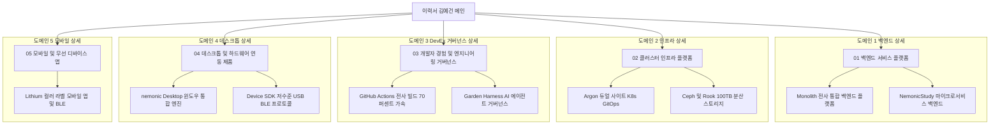

# 🏛️ 전략 5 — 노션 이력서 도메인별 계층 구조 (폴더 트리 모델) 설계서

---

## 1. 개요 및 배경

* **문서명**: 전략 5 — 노션 이력서 도메인별 계층 구조 (폴더 트리 모델) 설계서
* **작성자**: 김예건 ([@ibocon](https://github.com/ibocon) / `wlfka102@gmail.com`)
* **관리 위치**: `resume/Plan_Strategy_05_Notion_Domain_Hierarchy_Architecture.md` (Local SoT)
* **목표 Notion 메인**: [📄 이력서 — 김예건](https://app.notion.com/p/3dd475218675811299b0e3d6b2baa43d)
* **배경 및 문제의식 (AS-IS)**:
  1. **사내 프로젝트 코드명 중심 나열의 인지 장벽**: `Monolith`, `Argon`, `Lithium` 등 외부 채용 담당자가 알 수 없는 프로젝트명이 최상위에 노출되어 직무 적합성 파악에 방해가 됨.
  2. **모바일 및 좌측 사이드바 말줄임(Truncation)**: 좌측 네비게이션에서 뒷부분 설명이 잘려 `Monolith — 회사 통합 .NET 모...`처럼 코드명만 남음.
  3. **41개 저장소 포괄의 구조적 한계**: 9년간 41개 Git 저장소의 방대한 실적이 5개 플랫 프로젝트 페이지에 무리하게 압축되어 특정 도메인별 전문성 부각이 제한됨.
* **설계 목표 (TO-BE)**:
  1. **개발 영역(Domain) 기반 상위 허브 체계 수립**: 채용 담당자가 채용 포지션(백엔드, 인프라/DevOps, 클라이언트, 모바일)에 맞춰 즉시 접근할 수 있도록 도메인 폴더로 계층화.
  2. **허브 앤 스포크(Hub & Spoke) 구조 도입**: 각 도메인 허브 페이지에서 해당 영역의 핵심 기술 철학, 해결한 문제, 정량 성과를 총괄하고, 하위 페이지에서 단위 프로젝트 상세를 심층 기술.

---

## 2. 사용자 피드백 및 설계 방향 반영 이력

```text
[ 주요 피드백 반영 사항 ]
1. 언어 스타일: 한글을 중심으로 하되, SW 업계에서 통용되는 전문 용어(.NET, Clean Architecture, CQRS, DevOps, K8s, GitOps, DevEx 등)는 자연스럽게 병기.
2. 영역 분리 선호:
   - '개발자 경험 & 엔지니어링 거버넌스(DevEx & Harness)'의 독립적 가치 인정.
   - 채용 공고(JD)의 4대 핵심 직무(백엔드, DevOps, Windows 데스크톱, 모바일) 직결성 중시.
3. 기술 범위 조정: Flutter 관련 내용은 전략적으로 완전 제외하고, 모바일 영역은 Lithium 중심의 BLE 하드웨어 연동 및 통신 최적화에 집중.
4. 청킹(Chunking) 원칙: 한 영역당 1~2개의 핵심 프로젝트로 압축하여 채용 담당자의 인지 부하 최소화 및 시각적 대칭감 확보.
```



---

## 3. 노션 페이지 계층 구조 3대 고도화 베리에이션

### [베리에이션 1] 5대 플랫폼 & 프로덕트 축 (DevEx & AI 에이전트 하네스 독립형)
> **특징**: `개발자 경험 & 엔지니어링 거버넌스(DevEx & Harness)`를 당당히 독립 영역으로 격상하여 테크 리드/아키텍트급 역량을 부각하고, 모바일은 Flutter를 배제하고 Lithium의 BLE 하드웨어 연동으로 집중한 완성형 모델.

```text
├── 📁 01. 백엔드 서비스 플랫폼 (.NET 9, Clean Architecture, CQRS)
│   ├── 📄 [Monolith] 전사 통합 .NET 9 백엔드 모노레포 & API Gateway
│   └── 📄 [NemonicStudy/Peony] 비동기 잡 큐 & 이벤트 주도 CQRS 분산 백엔드
│
├── 📁 02. 클러스터 인프라 플랫폼 (K8s, GitOps, On-Premise, Ceph)
│   ├── 📄 [Argon] 베어메탈 K8s 클러스터 구축 & Dual-Site 재해복구(DR) GitOps
│   └── 📄 [Ceph & Rook] 100TB급 고가용성 분산 블록/오브젝트 스토리지
│
├── 📁 03. 개발자 경험 & 엔지니어링 거버넌스 (DevEx, CI/CD, Agent Harness)
│   ├── 📄 [CI/CD 가속] GitHub Actions 러너 최적화 (전사 빌드 70% 단축)
│   └── 📄 [Garden.Harness] AI 코딩 에이전트 거버넌스 & Single Source of Truth 체계
│
├── 📁 04. 하드웨어 연동 데스크톱 제품 (Windows, WPF, Win32, 하드웨어 제어)
│   ├── 📄 [nemonic Desktop] Windows 스마트 메모 프린터 클라이언트 (8년 라이프사이클)
│   └── 📄 [Device SDK] 저수준 USB/Bluetooth 통합 프로토콜 드라이버 라이브러리
│
└── 📁 05. 모바일 & 무선 디바이스 앱 (Android, iOS, BLE)
    └── 📄 [Lithium] FINECUBE 컬러 라벨 모바일 앱 & BLE 실시간 스트리밍
```

---

### [베리에이션 2] 4대 채용 직무(JD) 1:1 직결형 (2-2-2-1 클래식 직무 모델)
> **특징**: 국내외 테크 기업의 4대 채용 공고 포지션(백엔드, DevOps/인프라, Windows 데스크톱, 모바일)에 1:1로 정확하게 일치시켜 리크루터와 헤드헌터의 검색 최적화에 맞춘 모델.

```text
├── 📁 01. .NET 백엔드 & 분산 아키텍처 (C#, Clean Architecture, DDD, CQRS)
│   ├── 📄 [전사 백엔드] 대규모 트랜잭션 처리 및 전사 통합 모듈 모노레포 (.NET 9)
│   └── 📄 [분산 메시징] RabbitMQ & Outbox 패턴 기반 이벤트 주도 마이크로서비스
│
├── 📁 02. DevOps & 클라우드 인프라 (K8s, GitOps, On-Premise, Ceph)
│   ├── 📄 [K8s GitOps] 온프레미스 듀얼 사이트 K8s 구축 & 재해복구(DR) 체계 (Argon)
│   └── 📄 [인프라 & CI/CD] 100TB급 Ceph 분산 스토리지 & 전사 빌드 가속화(70% 단축)
│
├── 📁 03. Windows 데스크톱 & 시스템 프로그래밍 (WPF, Win32, 하드웨어 제어)
│   ├── 📄 [데스크톱 클라이언트] 50만 대 누적 기기 제어 및 레거시 .NET 9 현대화
│   └── 📄 [디바이스 드라이버] OS 독립형 USB / Bluetooth LE 통신 프로토콜 설계
│
└── 📁 04. 모바일 & BLE 디바이스 연동 (Android, iOS, BLE)
    └── 📄 [하드웨어 연동 모바일 앱] FINECUBE 컬러 라벨 앱 & BLE 무손실 패킷 스트리밍 (Lithium)
```

---

### [베리에이션 3] 4대 플랫폼 & 프로덕트 축 (DevEx 독립 + 클라이언트/디바이스 단일화 / 2-2-2-2 완벽 대칭)
> **특징**: 데스크톱과 모바일을 `클라이언트 & 하드웨어 연동 제품`으로 묶어, `DevEx & 거버넌스`를 독립 영역으로 유지하면서도 4개 폴더 구조의 완벽한 2-2-2-2 균형을 달성한 구조.

```text
├── 📁 01. 백엔드 서비스 플랫폼 (.NET 9, Clean Architecture, CQRS)
│   ├── 📄 [전사 백엔드] 전사 통합 .NET 9 백엔드 모노레포 & API Gateway (Monolith)
│   └── 📄 [분산 메시징] 비동기 잡 큐 & 이벤트 주도 CQRS 분산 백엔드 (NemonicStudy/Peony)
│
├── 📁 02. 클러스터 인프라 플랫폼 (K8s, GitOps, On-Premise, Ceph)
│   ├── 📄 [K8s GitOps] 베어메탈 K8s 듀얼 사이트 구축 & 재해복구(DR) (Argon)
│   └── 📄 [분산 스토리지] 100TB급 고가용성 Ceph 스토리지 & 무중단 리밸런싱
│
├── 📁 03. 개발자 경험 & 엔지니어링 거버넌스 (DevEx, CI/CD, Agent Harness)
│   ├── 📄 [CI/CD 가속] GitHub Actions 러너 최적화 (전사 빌드 70% 단축)
│   └── 📄 [Garden.Harness] AI 코딩 에이전트 거버넌스 & Single Source of Truth 체계
│
└── 📁 04. 클라이언트 & 하드웨어 연동 제품 (Windows, Mobile, USB/BLE)
    ├── 📄 [데스크톱 클라이언트] Windows 스마트 메모 프린터 엔진 (nemonic Desktop / .NET 9)
    └── 📄 [디바이스 연동 앱] 저수준 USB/Bluetooth 통합 SDK & 컬러 라벨 모바일 앱 (Lithium)
```

---

## 4. 도메인 허브 페이지(상위 폴더) 표준 템플릿 명세

각 도메인 상위 페이지는 하위 프로젝트로 이동하기 전 채용 담당자에게 **전문 분야의 스케일과 비즈니스 가치**를 30초 내에 전달할 수 있도록 아래 표준 템플릿으로 구성합니다.

### 4.1 허브 페이지 레이아웃
1. **Header Block**: 도메인 명칭 및 영문 표기, 핵심 역할 요약
2. **Executive Summary Table**:
   - `[주요 기술 스택]`, `[해결한 핵심 엔지니어링 난제]`, `[대표 비즈니스 정량 지표]`, `[포괄 프로젝트 수]`
3. **Architecture Philosophy (철학)**:
   - 해당 도메인 개발 시 준수하는 원칙 (예: 백엔드의 경우 Clean Architecture & Event-Driven, 인프라의 경우 GitOps & Zero-Downtime)
4. **Project Gallery Grid (하위 프로젝트 링크 카드)**:
   - 각 하위 상세 페이지로 연결되는 링크 카드 (배경 이미지, 프로젝트 명, 핵심 기술, 기간 포함)

---

## 5. 41개 Git 저장소의 4대/5대 도메인 1:1 수렴 매핑표

| 도메인 계층 | 포괄 저장소 목록 (총 41개) | 대표 상위 프로젝트 (TO-BE) |
| :--- | :--- | :--- |
| **01. 백엔드 서비스 플랫폼** (17개) | `Monolith`, `Oxygen.Hub`, `Oxygen.Teams`, `Oxygen.Slack`, `Oxygen.Zapier`, `Oxygen.Web`, `Oxygen.Amplitude`, `Oxygen.Jira`, `Oxygen.Nemonic.Pro.SettingsApp`, `Radium`, `Mangoslab`, `Zinc.NemonicStudy`, `Zinc.NemonicStudy.Bff.Api`, `Zinc.NemonicStudy.Service.Ocr`, `Zinc.NemonicStudy.Service.Summary`, `Zinc.NemonicAi`, `Peony` | 1. 전사 통합 백엔드 플랫폼 (Monolith)<br>2. 비동기 잡 큐 & 이벤트 주도 CQRS 분산 백엔드 (NemonicStudy/Peony) |
| **02. 클러스터 인프라 플랫폼** (6개) | `argon`, `kc5`, `kc6`, `Mangoslab.IaC`, `History`, `Garden.Cluster` | 1. 듀얼 사이트 K8s GitOps (Argon)<br>2. Rook-Ceph 분산 고가용 스토리지 |
| **03. 개발자 경험 & 거버넌스** (2개) | `Mangoslab.Pipeline`, `Garden.Harness` | 1. GitHub Actions 러너 최적화 (빌드 70% 가속)<br>2. AI 코딩 에이전트 하네스 & SoT 체계 |
| **04. 데스크톱 & 디바이스 연동** (12개) | `NemonicBasicWindows`, `NemonicLabelWindows`, `Nemonic.Ampv`, `MemoView`, `Mangoslab.Usb`, `Mangoslab.Nemonic`, `Mangoslab.Bluetooth`, `Firmware`, `Firmware.TestUtility`, `MIP-301-Centerm-FW-Test`, `Mangoslab.Infrastructure`, `Nemonic.Sdk.Image.Flutter` (공용 이미지 코어) | 1. nemonic Desktop 통합 클라이언트<br>2. Device SDK 및 저수준 통신 프로토콜 라이브러리 |
| **05. 모바일 & 무선 디바이스 앱** (4개) | `Lithium`, `Sulfur`, `Mangoslab.Drawing`, `NemonicBasicAndroid`, `NemonicBasiciOS` (1세대 모바일 이력) | 1. FINECUBE 컬러 라벨 모바일 앱 & BLE 실시간 스트리밍 (Lithium) |

---

## 6. 기대 효과 및 채용 경쟁력

1. **채용 담당자 스캔 경험 혁신**:
   - 노션 사이드바를 열었을 때 복잡한 코드명 대신 **`01. 백엔드`, `02. 인프라`, `03. DevEx`, `04. 데스크톱`, `05. 모바일`**로 정돈되어, 지원자의 전문 역량이 한눈에 들어옴.
2. **시니어 & 테크 리드급 차별화**:
   - 단순 구현에 머무르지 않고 전사 빌드 70% 단축 및 AI 코딩 에이전트 하네스를 구축한 `DevEx & 엔지니어링 거버넌스`가 독립 영역으로 조명받아 리드급 엔지니어의 면모 부각.
3. **SoT 문서 거버넌스 유지**:
   - 본 설계서를 로컬 Git(`resume/`)에 영구 버전 관리하고, 향후 노션 페이지 레이아웃 개편 시 단방향 배포 기준으로 활용.
